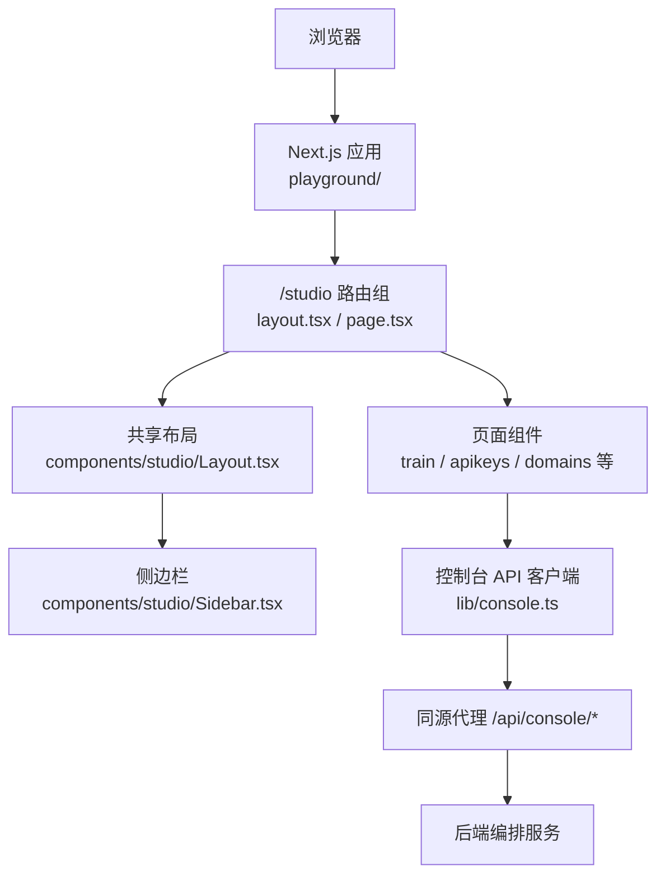
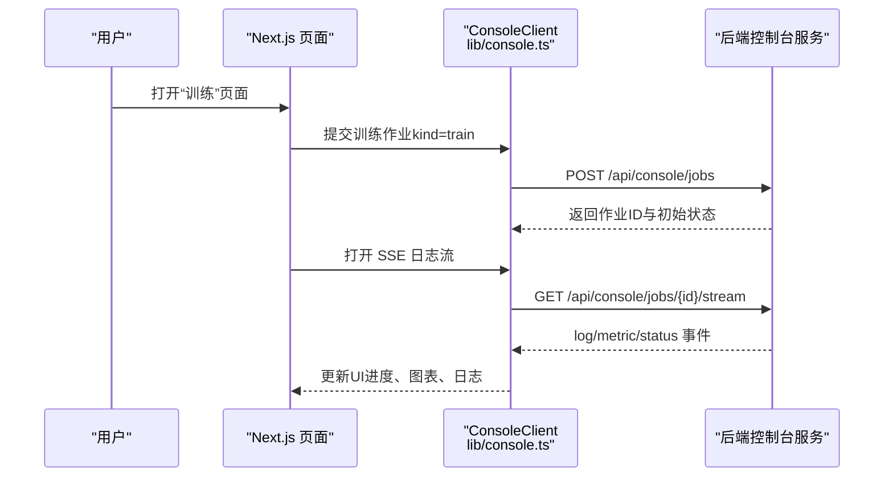
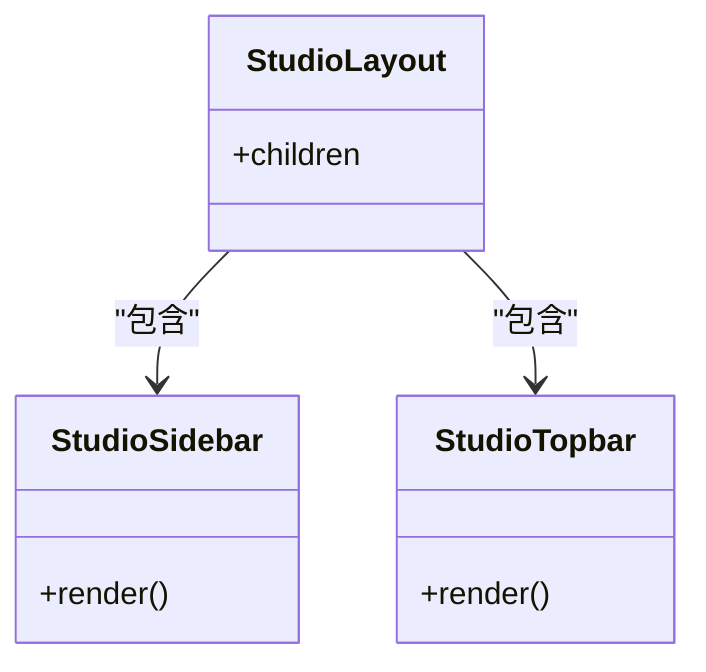
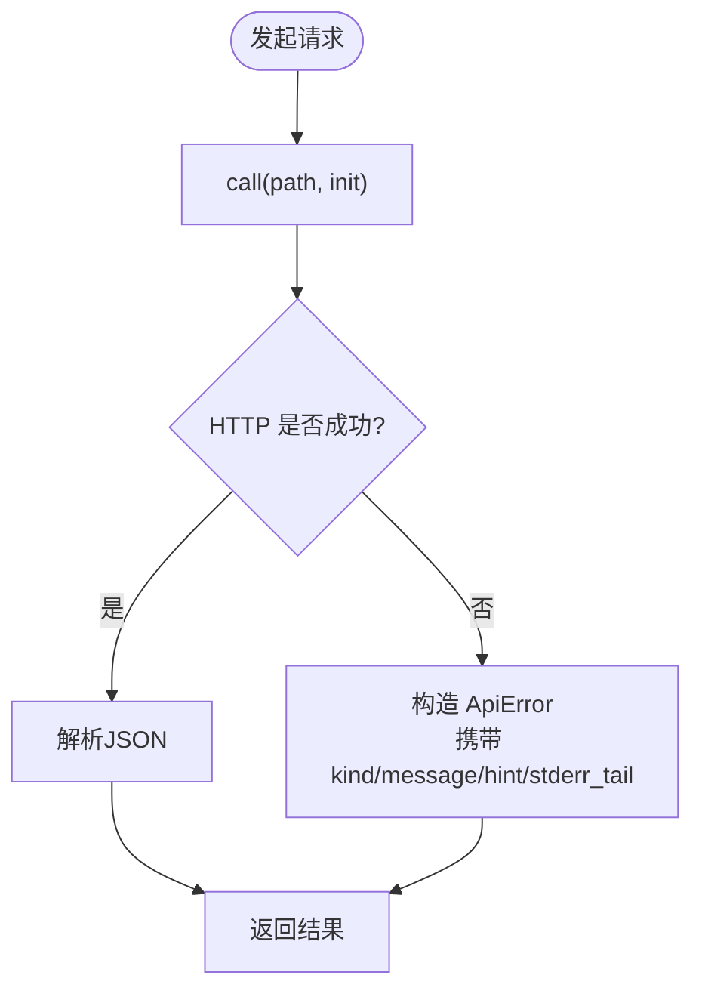
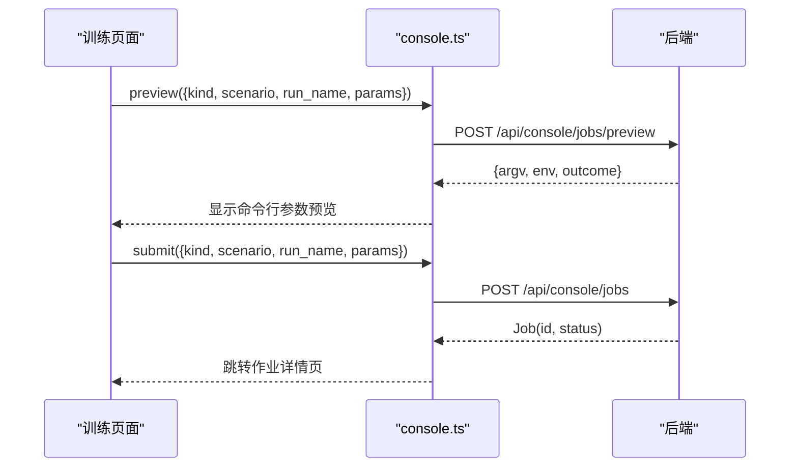
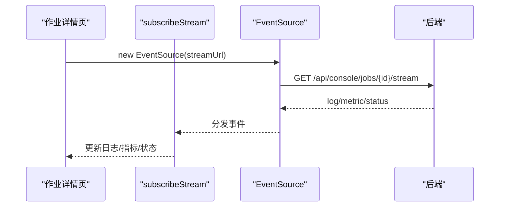
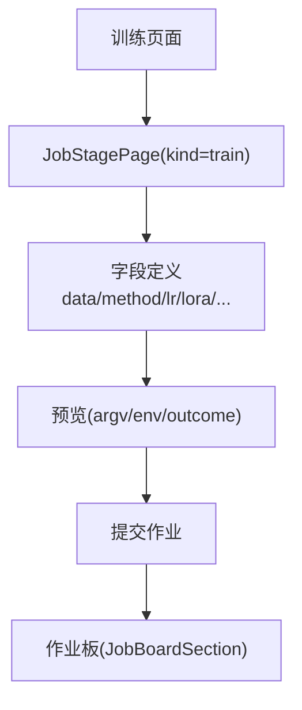
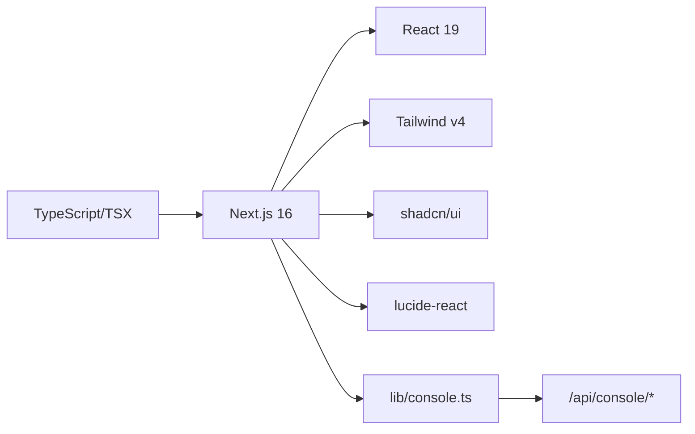

# Studio界面开发

<cite>
**本文引用的文件**   
- [README.md](file://README.md)
- [2026-10-09-studio-rollout-plan.md](file://docs/superpowers/plans/2026-10-09-studio-rollout-plan.md)
- [2026-10-09-studio-data-design.md](file://docs/superpowers/specs/2026-10-09-studio-data-design.md)
- [2026-10-09-studio-management-design.md](file://docs/superpowers/specs/2026-10-09-studio-management-design.md)
- [package.json](file://playground/package.json)
- [console.ts](file://playground/src/lib/console.ts)
- [studio布局页](file://playground/src/app/studio/layout.tsx)
- [studio首页](file://playground/src/app/studio/page.tsx)
- [侧边栏组件](file://playground/src/components/studio/Sidebar.tsx)
- [Studio外壳布局](file://playground/src/components/studio/Layout.tsx)
- [控制台概览页](file://playground/src/app/console/page.tsx)
- [折叠面板组件](file://playground/src/components/console/Fold.tsx)
- [命令行参数预览组件](file://playground/src/components/console/ArgvPreview.tsx)
- [训练页面](file://playground/src/app/studio/train/page.tsx)
- [API Key管理页](file://playground/src/app/studio/apikeys/page.tsx)
- [领域管理页](file://playground/src/app/studio/domains/page.tsx)
</cite>

## 目录
1. [引言](#引言)
2. [项目结构](#项目结构)
3. [核心组件](#核心组件)
4. [架构总览](#架构总览)
5. [详细组件分析](#详细组件分析)
6. [依赖关系分析](#依赖关系分析)
7. [性能与可维护性](#性能与可维护性)
8. [故障排查指南](#故障排查指南)
9. [结论](#结论)

## 引言
本文面向“Studio 控制台”的前端界面开发与集成，聚焦 Next.js Playground 中的 `/studio` 模块、共享 UI 组件、控制台 API 客户端以及后端编排契约。文档基于仓库中已有的 Studio 实施计划、数据与管理面设计说明，以及当前已落地的前端路由、布局与组件进行梳理，帮助读者快速理解：
- Studio 的入口、导航与页面组织
- 前端如何调用控制台 API
- 作业提交、预览、SSE 日志流等关键交互流程
- 现有组件的职责边界与扩展点

## 项目结构
Studio 界面位于 `playground` 子项目中，采用 Next.js App Router 组织页面，使用 React 19、Tailwind v4 与 shadcn/ui 基础组件；控制台 API 通过同源代理 `/api/console/*` 访问后端服务。

**图示来源**  
- [studio布局页:1-7](file://playground/src/app/studio/layout.tsx#L1-L7)  
- [Studio外壳布局:1-18](file://playground/src/components/studio/Layout.tsx#L1-L18)  
- [侧边栏组件:1-114](file://playground/src/components/studio/Sidebar.tsx#L1-L114)  
- [console.ts:105-128](file://playground/src/lib/console.ts#L105-L128)

**章节来源**  
- [README.md:261-276](file://README.md#L261-L276)  
- [2026-10-09-studio-rollout-plan.md:86-120](file://docs/superpowers/plans/2026-10-09-studio-rollout-plan.md#L86-L120)

## 核心组件
- **Studio 外壳布局**：提供顶部栏、左侧导航与主内容区，所有 `/studio` 页面复用该布局。
- **侧边栏**：按“数据 / 生命周期 / 系统 / 管理”分组展示导航项，支持高亮与“即将上线”标记。
- **控制台 API 客户端**：封装所有 `/api/console/*` 请求，统一错误处理、类型定义、SSE 订阅。
- **作业表单与预览**：通用 Stage 表单（由 console 模块复用）+ 命令行参数预览，保证可审计与可复现。
- **概览与监控**：作业列表、KPI、闸门状态、最近作业等。

**章节来源**  
- [Studio外壳布局:1-18](file://playground/src/components/studio/Layout.tsx#L1-L18)  
- [侧边栏组件:1-114](file://playground/src/components/studio/Sidebar.tsx#L1-L114)  
- [console.ts:1-128](file://playground/src/lib/console.ts#L1-L128)  
- [命令行参数预览组件:1-38](file://playground/src/components/console/ArgvPreview.tsx#L1-L38)

## 架构总览
Studio 前端通过 Next.js 路由渲染页面，页面内调用 `lib/console.ts` 提供的 API 客户端，经同源代理转发到后端控制台服务。后端负责作业编排、事件流、产物管理与闸门校验。

**图示来源**  
- [console.ts:151-160](file://playground/src/lib/console.ts#L151-L160)  
- [console.ts:361-392](file://playground/src/lib/console.ts#L361-L392)

**章节来源**  
- [2026-10-09-studio-rollout-plan.md:1072-1140](file://docs/superpowers/plans/2026-10-09-studio-rollout-plan.md#L1072-L1140)

## 详细组件分析

### Studio 外壳与导航
- 布局壳 `layout.tsx` 仅包裹 `StudioLayout`，将侧边栏与主区域组合。
- `Sidebar.tsx` 定义四组导航：数据、生命周期、系统、管理，部分功能带“soon”标记。
- `Layout.tsx` 渲染顶栏 + 侧边栏 + 主内容区，保持深色主题风格。

**图示来源**  
- [studio布局页:1-7](file://playground/src/app/studio/layout.tsx#L1-L7)  
- [Studio外壳布局:1-18](file://playground/src/components/studio/Layout.tsx#L1-L18)  
- [侧边栏组件:1-114](file://playground/src/components/studio/Sidebar.tsx#L1-L114)

**章节来源**  
- [studio布局页:1-7](file://playground/src/app/studio/layout.tsx#L1-L7)  
- [Studio外壳布局:1-18](file://playground/src/components/studio/Layout.tsx#L1-L18)  
- [侧边栏组件:1-114](file://playground/src/components/studio/Sidebar.tsx#L1-L114)

### 控制台 API 客户端
- 统一封装 fetch 调用，自动设置 JSON 头与缓存策略。
- 对空响应、非 2xx 响应进行结构化错误包装，便于前端分派提示或闸门面板。
- 提供作业、产物、闸门、API Key、用量、蒸馏 Provider、场景域与场景、项目管理、成员、配额、Webhook、发票等接口。
- 提供 SSE 订阅工具，断线重连时保留 Last-Event-ID，避免全量重放。

**图示来源**  
- [console.ts:105-128](file://playground/src/lib/console.ts#L105-L128)  
- [console.ts:354-392](file://playground/src/lib/console.ts#L354-L392)

**章节来源**  
- [console.ts:1-128](file://playground/src/lib/console.ts#L1-L128)  
- [console.ts:354-392](file://playground/src/lib/console.ts#L354-L392)

### 作业提交与预览
- 页面通过 `api.preview` 获取将要执行的 argv 与环境变量，供用户确认。
- 提交后通过 `api.submit` 创建作业，并拉取作业详情与 SSE 日志流。
- ArgvPreview 组件在输入变化时防抖调用预览接口，显示最终命令与预期输出。

**图示来源**  
- [console.ts:151-159](file://playground/src/lib/console.ts#L151-L159)  
- [命令行参数预览组件:1-38](file://playground/src/components/console/ArgvPreview.tsx#L1-L38)

**章节来源**  
- [console.ts:151-159](file://playground/src/lib/console.ts#L151-L159)  
- [命令行参数预览组件:1-38](file://playground/src/components/console/ArgvPreview.tsx#L1-L38)

### 作业监控与日志流
- 作业详情页通过 `streamJob` 打开 SSE 流，使用 `subscribeStream` 分别绑定 log/metric/status 事件。
- 状态变更时关闭连接，避免重复推送。
- 旧版 console 页面也使用轮询与闸门面板展示作业与门禁状态。

**图示来源**  
- [console.ts:361-392](file://playground/src/lib/console.ts#L361-L392)

**章节来源**  
- [console.ts:361-392](file://playground/src/lib/console.ts#L361-L392)  
- [控制台概览页:1-32](file://playground/src/app/console/page.tsx#L1-L32)

### 训练页面与字段定义
- 训练页使用通用 `JobStagePage` 组件，声明字段网格、高级选项与闸门阶段。
- 提供方法选择、学习率、LoRA、检查点策略等常用字段，以及大量高级训练参数。
- 底部展示“训练 · jobs”作业板，点击跳转到作业详情。

**图示来源**  
- [训练页面:1-84](file://playground/src/app/studio/train/page.tsx#L1-L84)

**章节来源**  
- [训练页面:1-84](file://playground/src/app/studio/train/page.tsx#L1-L84)

### API Key 管理
- 管理页直接挂载 `ApiKeysManager` 组件，复用控制台 API 客户端的 key 增删改查与用量统计接口。
- 后端契约包括分页、全部列表、创建、撤销、重新启用等。

**章节来源**  
- [API Key管理页:1-8](file://playground/src/app/studio/apikeys/page.tsx#L1-L8)  
- [2026-10-09-studio-management-design.md:1-133](file://docs/superpowers/specs/2026-10-09-studio-management-design.md#L1-L133)

### 领域与场景管理
- 领域管理页挂载 `DomainsManager`，用于维护场景域与场景的双语标签、排序与规范路径。
- 相关能力由 `scenario-domains` 与 `scenarios` 系列接口支撑。

**章节来源**  
- [领域管理页:1-16](file://playground/src/app/studio/domains/page.tsx#L1-L16)  
- [console.ts:214-242](file://playground/src/lib/console.ts#L214-L242)

## 依赖关系分析
- 前端依赖 Next.js 16、React 19、Tailwind v4、shadcn/ui 与 lucide-react 图标库。
- 控制台 API 客户端集中定义类型与请求逻辑，被各页面与组件复用。
- 布局与侧边栏为全局 UI 骨架，页面组件按需引入。

**图示来源**  
- [package.json:1-44](file://playground/package.json#L1-L44)  
- [console.ts:1-128](file://playground/src/lib/console.ts#L1-L128)

**章节来源**  
- [package.json:1-44](file://playground/package.json#L1-L44)

## 性能与可维护性
- 前端构建与类型检查：遵循 README 中的开发命令，确保 lint 与 tsc 通过。
- SSE 日志流：断线重连使用 Last-Event-ID，避免全量重放，降低带宽与渲染压力。
- 预览接口防抖：减少频繁打字时的后端压力。
- 组件职责清晰：布局、侧边栏、页面、API 客户端分离，便于扩展与维护。

[本节为通用指导，不直接分析具体文件]

## 故障排查指南
- 若 Playground 能加载但按钮无效，优先使用 `localhost:3001`，Next.js 开发主机名校验可能拦截其他 host。
- 若上游返回空 body，客户端会抛出可读错误；检查代理是否正确透传请求方法与响应体。
- 若 SSE 不断重放历史事件，确认未把 lastEventId 拼入 URL，应依赖浏览器自动携带 Last-Event-ID。
- 若数据集加载报错，参考 README 中的 legacy-datasets 建议。

**章节来源**  
- [README.md:486-493](file://README.md#L486-L493)  
- [console.ts:105-128](file://playground/src/lib/console.ts#L105-L128)  
- [console.ts:354-392](file://playground/src/lib/console.ts#L354-L392)

## 结论
Studio 界面以 Next.js 为宿主，通过统一的控制台 API 客户端与共享布局/侧边栏，构建了数据、训练、评估、部署、发布与管理系统的一体化工作台。当前实现已覆盖作业提交、预览、SSE 日志流、闸门提示与基本管理页面；后续可按实施计划逐步补齐更多管理面与业务页，同时保持前后端契约稳定与组件职责清晰。