# 知识库结构

<cite>
**本文引用的文件**   
- [README.md](file://README.md)
- [DESIGN.md](file://DESIGN.md)
- [docs/knowledge/README.md](file://docs/knowledge/README.md)
- [docs/knowledge/01-model-architecture.md](file://docs/knowledge/01-model-architecture.md)
- [docs/knowledge/02-training-framework.md](file://docs/knowledge/02-training-framework.md)
- [docs/knowledge/03-inference-serving.md](file://docs/knowledge/03-inference-serving.md)
- [docs/knowledge/04-evaluation-system.md](file://docs/knowledge/04-evaluation-system.md)
</cite>

## 目录
1. [引言](#引言)
2. [项目结构总览](#项目结构总览)
3. [知识库定位与目标](#知识库定位与目标)
4. [知识主线：模型架构](#知识主线模型架构)
5. [知识主线：训练框架](#知识主线训练框架)
6. [知识主线：推理服务](#知识主线推理服务)
7. [知识主线：评估系统](#知识主线评估系统)
8. [知识库内部依赖关系](#知识库内部依赖关系)
9. [使用建议与学习路径](#使用建议与学习路径)
10. [扩展阅读与外部入口](#扩展阅读与外部入口)
11. [结论](#结论)

## 引言
本仓库中的 `docs/knowledge` 是一个面向“想读懂 Kev 这个仓库”的结构化知识库。它不重复 README 的安装说明，而是把 Kev 的核心设计拆成四条主线：**模型架构、训练框架、推理服务、评估系统**。每条主线都强调真实代码锚点、可视化图表和可运行的 smoke 命令，目标是让读者从直觉到源码都能建立一致的心智模型。

Kev 的本质不是聊天模型，而是一族决策模型：给定一段状态文本和若干问题，直接输出每个问题的校准概率。理解 Kev 的关键不在深度有多深，而在于它如何把共享 state、隔离分支、指针打分、温度校准、冻结评测套件等设计组合在一起。

**章节来源**
- [README.md:8-28](file://README.md#L8-L28)
- [docs/knowledge/README.md:1-11](file://docs/knowledge/README.md#L1-L11)

## 项目结构总览
从仓库视角看，`docs/knowledge` 是文档层；真正实现这些概念的是 `kev/` 下的 Python 模块、`evals/` 下的冻结评测套件、`experiments/` 下的实验计划，以及 `deploy/`、`playground/` 等运行环境。知识库的作用是把这四者串起来。

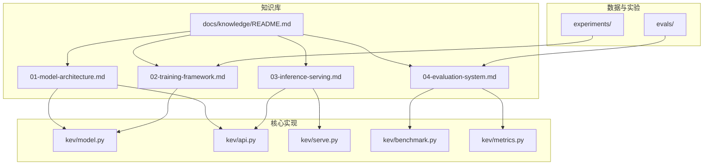

**图示来源**
- [docs/knowledge/README.md:1-20](file://docs/knowledge/README.md#L1-L20)
- [docs/knowledge/01-model-architecture.md:1-10](file://docs/knowledge/01-model-architecture.md#L1-L10)
- [docs/knowledge/02-training-framework.md:1-6](file://docs/knowledge/02-training-framework.md#L1-L6)
- [docs/knowledge/03-inference-serving.md:1-6](file://docs/knowledge/03-inference-serving.md#L1-L6)
- [docs/knowledge/04-evaluation-system.md:1-6](file://docs/knowledge/04-evaluation-system.md#L1-L6)

**章节来源**
- [docs/knowledge/README.md:1-20](file://docs/knowledge/README.md#L1-L20)

## 知识库定位与目标
知识库的顶层说明明确了四个学习目标：

| 编号 | 文档 | 你会搞懂 | 前置 |
|---|---|---|---|
| 00 | 交互式数据流转动画 | state → questions → probabilities 一次请求如何在模型里流动 | 无 |
| 01 | 模型架构基础 | causal LM、hybrid backbone、block-causal mask、pointer readout | Transformer 基础 |
| 02 | 训练框架 | LoRA vs 全量、损失设计、数据管线、分布式/resume/snapshot | 01 |
| 03 | 推理服务 | TypeSafe 契约、`/v1/systemone`、prefix cache、Docker/Modal/MLX 部署 | 01 |
| 04 | 评估系统 | 校准指标（ECE/Brier/NLL/AURC）、冻结套件、rounds 科研流程 | 01 |

这套文档解决的核心问题是：Kev 不是又一个会聊天的 LLM，而是一个只吐概率的决策模型。它的难点在于一整套不寻常的设计决策被缝在了一起。

**章节来源**
- [docs/knowledge/README.md:1-20](file://docs/knowledge/README.md#L1-L20)

## 知识主线：模型架构
模型架构文档的目标是回答一个根本问题：预训练的聊天大模型是怎么被改造成只吐概率、不做生成的决策模型的？

### 核心原语
Kev 的模型契约可以抽象为：

```text
state  →  questions[]  →  probabilities[]
```

它没有生成文字，也没有解码循环，只有 prefill 和 readout。

### 两大机制
1. **block-causal mask**：多个问题共享同一段 state，但问题之间不能互相偷看。
2. **pointer readout**：不对词表做下一个 token 预测，而是用 `<decide>` 的隐向量对每个选项边界 `</opt>` 的隐向量打分，得到选项 logits。

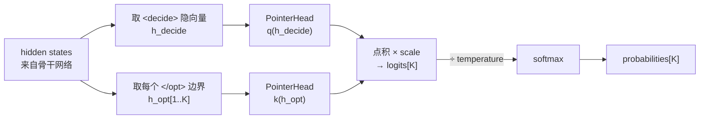

**图示来源**
- [docs/knowledge/01-model-architecture.md:100-147](file://docs/knowledge/01-model-architecture.md#L100-L147)

### hybrid backbone 的退化路径
Qwen3.5 是混合架构，包含 Gated DeltaNet 线性注意力层。这类层是递归的，无法支持任意 4D block-causal 掩码。因此 Kev 在 hybrid 上走 row form：每个问题一行，state 重复计算，从而引出服务端的 prefix cache。

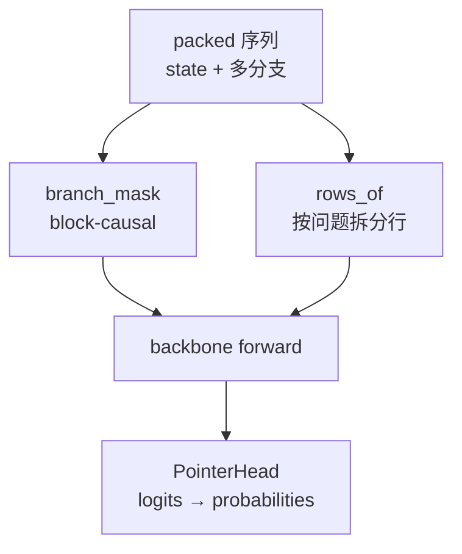

**图示来源**
- [docs/knowledge/01-model-architecture.md:56-99](file://docs/knowledge/01-model-architecture.md#L56-L99)
- [docs/knowledge/01-model-architecture.md:151-181](file://docs/knowledge/01-model-architecture.md#L151-L181)

### 一次完整推理
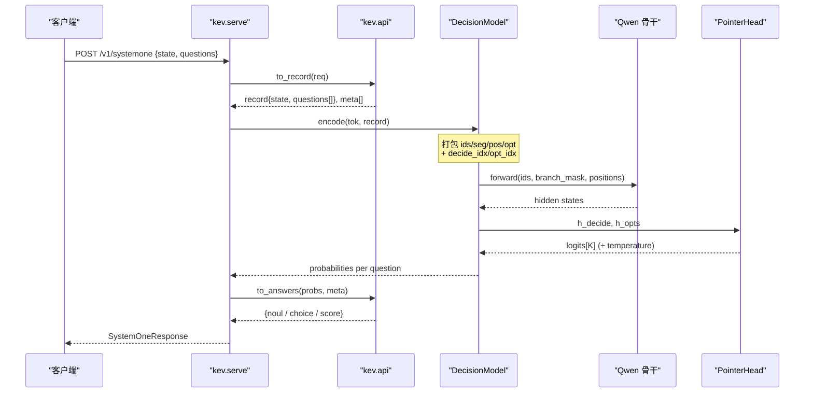

**图示来源**
- [docs/knowledge/01-model-architecture.md:195-222](file://docs/knowledge/01-model-architecture.md#L195-L222)

**章节来源**
- [docs/knowledge/01-model-architecture.md:1-245](file://docs/knowledge/01-model-architecture.md#L1-L245)

## 知识主线：训练框架
训练框架文档的目标是回答：一个冻结的 Qwen 基座，怎么被喂进 block-causal 决策格式，最终训出会打概率的 Kev？

### 训练优化目标
一句话概括：用带标注的 record（state + questions + label），训练 pointer head 和基座（LoRA 或全量），让每个问题的 logits 过 softmax 后命中 label。

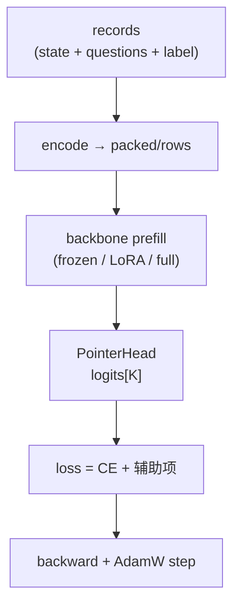

**图示来源**
- [docs/knowledge/02-training-framework.md:7-22](file://docs/knowledge/02-training-framework.md#L7-L22)

### LoRA 与全量微调
| 维度 | LoRA（0.8B/4B/9B） | full_ft（27B） |
|---|---|---|
| 基座 | 冻结，只训小 adapter + head | 整个 text backbone + head 都训 |
| 精度 | 视配置 | bf16 权重 + fp32 master |
| 分布式 | 单 GPU 常见 | torchrun + FSDP2 |
| 产物 | adapter + head | ~51 GB 全量权重 |

### 损失设计
主损失是交叉熵，同时提供若干可选辅助约束，共同目标是校准：不只让 top-1 对，还要让概率值本身可信。

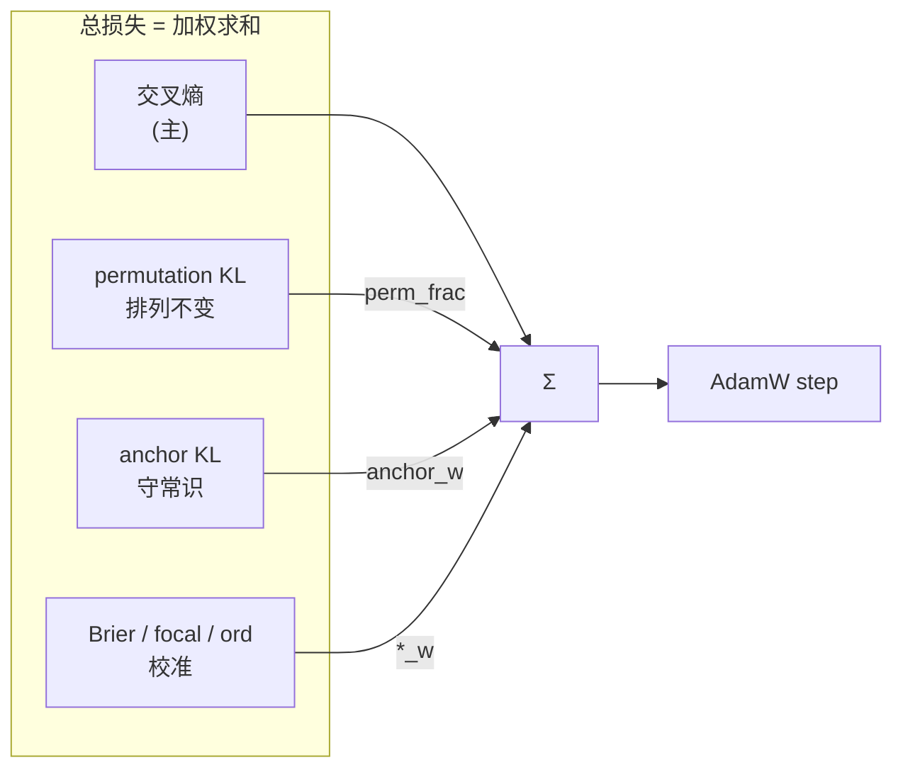

**图示来源**
- [docs/knowledge/02-training-framework.md:63-121](file://docs/knowledge/02-training-framework.md#L63-L121)

### 数据来源与增强
训练数据有三类入口：冻结套件、自有 JSONL、现场构建公开源。增强开关包括 none-pair、distractor、public_frac、train_sources、holdout 等，用于训练 abstain、抗噪和分布泛化。

**章节来源**
- [docs/knowledge/02-training-framework.md:1-188](file://docs/knowledge/02-training-framework.md#L1-L188)

## 知识主线：推理服务
推理服务文档的目标是回答：一个训好的 Kev checkpoint，怎么变成一个兼容 TypeSafe SDK、能处理长文档、可 scale-to-zero 的 HTTP 端点？

### 服务心智模型
服务端只做一件事：HTTP 封装一次 prefill-only 决策。

```text
POST /v1/systemone {state, questions}  →  一次前向  →  {answers: 概率}
```

### TypeSafe System One 契约
Kev 是 hosted 产品 Jev 的本地替代，所以 API 形状必须兼容 TypeSafe SDK。三种问题类型分别是 noul、choice、score。

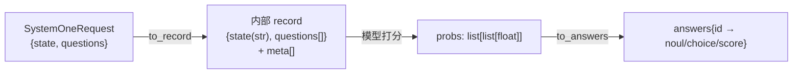

**图示来源**
- [docs/knowledge/03-inference-serving.md:16-45](file://docs/knowledge/03-inference-serving.md#L16-L45)

### Prefix Cache 与长文档
hybrid backbone 走 row form，state 会被重复计算。PrefixCache 把 state 前缀跨请求复用，是多问题场景的性能核心。服务侧还有上下文准入：state 超过限制返回 422，或者开启截断模式。

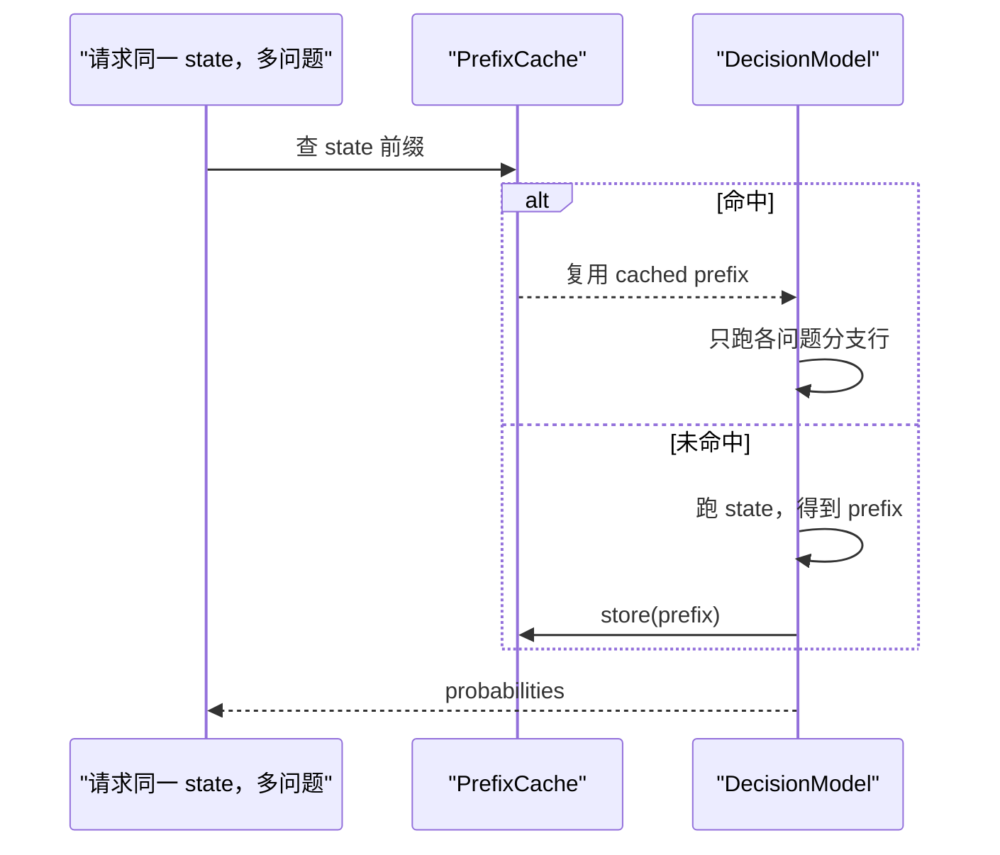

**图示来源**
- [docs/knowledge/03-inference-serving.md:74-107](file://docs/knowledge/03-inference-serving.md#L74-L107)

### 部署形态
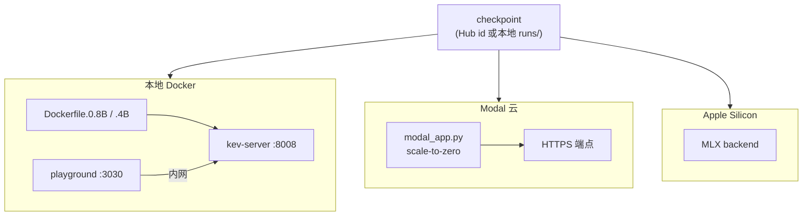

**图示来源**
- [docs/knowledge/03-inference-serving.md:122-144](file://docs/knowledge/03-inference-serving.md#L122-L144)

**章节来源**
- [docs/knowledge/03-inference-serving.md:1-197](file://docs/knowledge/03-inference-serving.md#L1-L197)

## 知识主线：评估系统
评估系统文档的目标是回答：怎么证明一个决策模型不只是猜对了，而是它给出的概率值得信任？

### 为什么评估是重头戏
普通 LLM 评测看“回答得像不像样”。Kev 输出的是概率，所以真正的问题是：模型说置信度 0.9 的那些判断，是不是真的有约 90% 对？这叫校准。

### 评分流水线
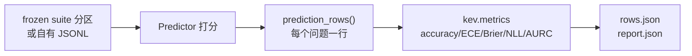

**图示来源**
- [docs/knowledge/04-evaluation-system.md:15-36](file://docs/knowledge/04-evaluation-system.md#L15-L36)

### 指标族
| 指标 | 定义 | 越低越好? |
|---|---|---|
| accuracy | argmax(p) == label 的比例 | 越高越好 |
| ECE | 按置信度分桶，准确率与置信度的偏差加权 | ✅ |
| Brier | 全分布平方误差，不只 top-1 | ✅ |
| NLL | 真实标签概率的负对数 | ✅ |

### 温度校准
PointerHead 推理时把 logits 除以 temperature。temperature 需要在训练之外的开发/留出数据上拟合，不能泄漏进训练集。

### 冻结套件与 rounds
评测数据通过 manifest 锁定 dataset、base revision 和各分区 sha256。rounds 把单次 benchmark 升级为科研流程：spec 校验、trial 启动、watch/readout、confirm verdict。

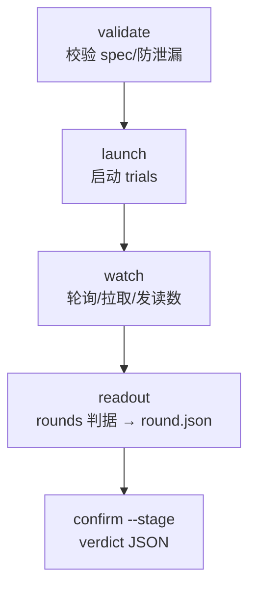

**图示来源**
- [docs/knowledge/04-evaluation-system.md:123-142](file://docs/knowledge/04-evaluation-system.md#L123-L142)

**章节来源**
- [docs/knowledge/04-evaluation-system.md:1-184](file://docs/knowledge/04-evaluation-system.md#L1-L184)

## 知识库内部依赖关系
知识库四篇文档不是并列关系，而是递进关系：

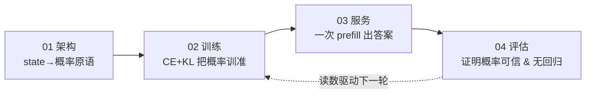

**图示来源**
- [docs/knowledge/04-evaluation-system.md:170-180](file://docs/knowledge/04-evaluation-system.md#L170-L180)

**章节来源**
- [docs/knowledge/README.md:12-20](file://docs/knowledge/README.md#L12-L20)
- [docs/knowledge/04-evaluation-system.md:170-180](file://docs/knowledge/04-evaluation-system.md#L170-L180)

## 使用建议与学习路径
知识库建议的学习顺序是：

1. 先在浏览器打开交互式数据流转动画，建立 state → questions → probabilities 的直觉。
2. 再读模型架构，把动画节点对应到真实函数。
3. 按兴趣深入训练、服务、评估三条线。
4. 动手验证：用一条 smoke 命令把阅读和运行对齐。

最小可运行路径是安装依赖、跑一次 smoke 训练、对一个冻结评测套件打分。

**章节来源**
- [docs/knowledge/README.md:22-43](file://docs/knowledge/README.md#L22-L43)

## 扩展阅读与外部入口
知识库之外，仓库还提供更高层的项目说明和设计参考：

- [README.md](file://README.md)：Kev 的整体介绍、模型规格、快速开始、API、训练、部署、性能、局限性和开发说明。
- [DESIGN.md](file://DESIGN.md)：与 Kev 代码无关的设计语言分析，描述一种受 Vercel 启发的视觉系统，适合前端或产品设计参考。

如果你只想了解 Kev 是什么、怎么用、有哪些模型和性能数字，先看 README；如果你想理解仓库里的知识组织方式，再看 docs/knowledge。

**章节来源**
- [README.md:8-28](file://README.md#L8-L28)
- [DESIGN.md:1-10](file://DESIGN.md#L1-L10)

## 结论
`docs/knowledge` 把 Kev 从一个“能跑的仓库”变成了一个“可学习的系统”。它用四条主线串联起模型、训练、服务和评估，并用真实代码锚点和流程图降低理解门槛。对于初学者，它是进入 Kev 的最佳入口；对于维护者，它是统一术语、对齐实现和避免误读的重要参考。