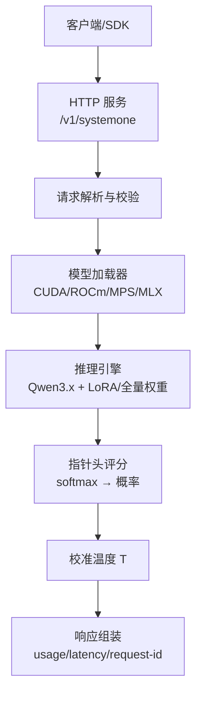
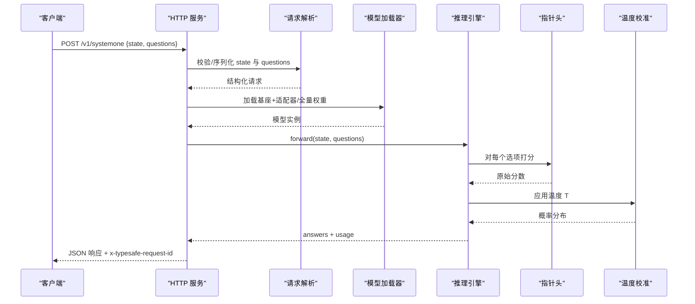
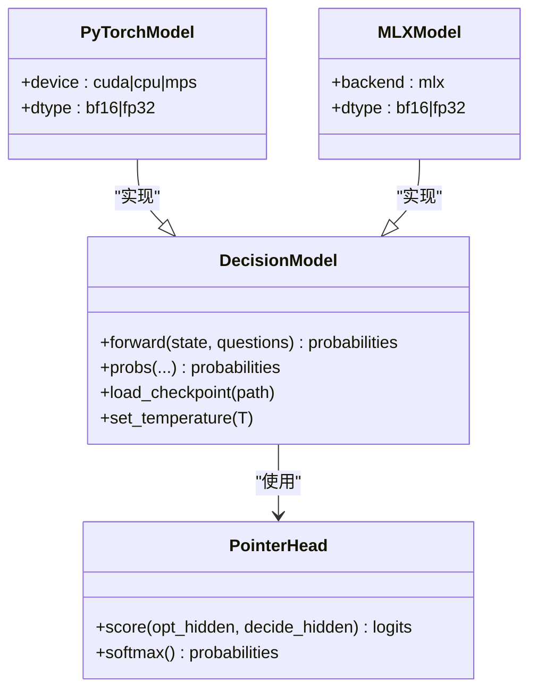
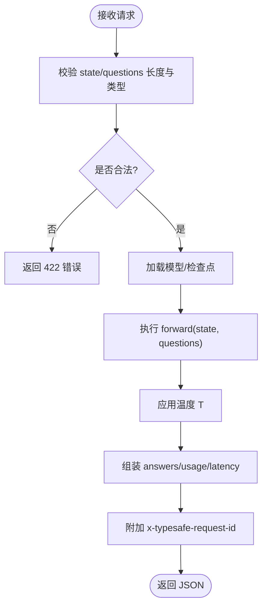
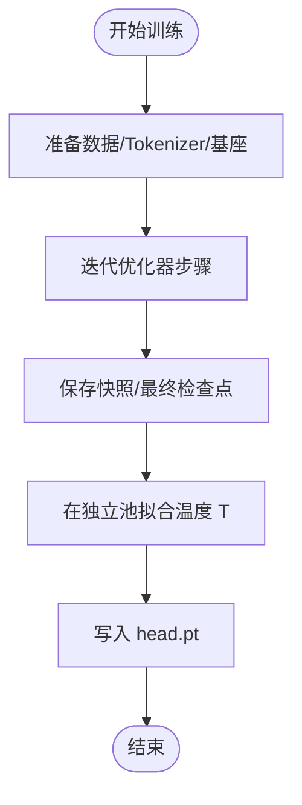
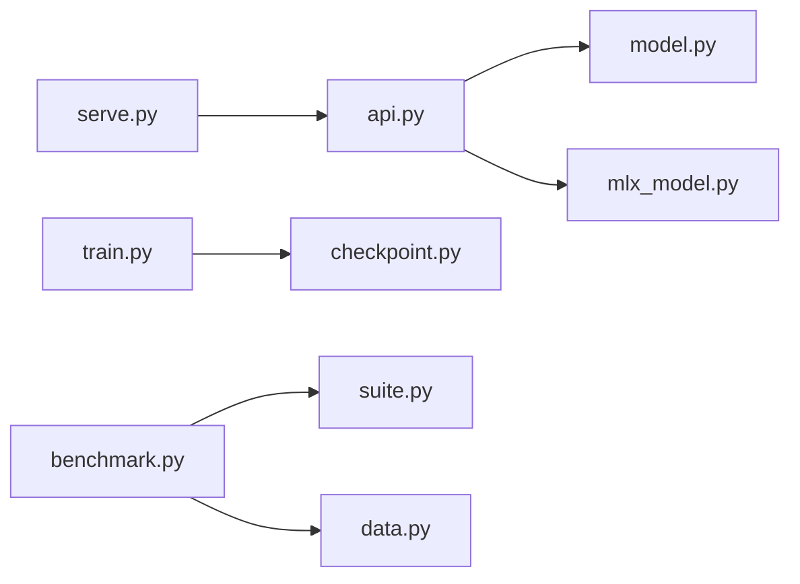

# 设计系统规范

<cite>
**本文引用的文件**   
- [README.md](file://README.md)
- [DESIGN.md](file://DESIGN.md)
- [PLAN.md](file://PLAN.md)
- [api.py](file://kev/api.py)
- [serve.py](file://kev/serve.py)
- [model.py](file://kev/model.py)
- [mlx_model.py](file://kev/mlx_model.py)
- [train.py](file://kev/train.py)
- [benchmark.py](file://kev/benchmark.py)
</cite>

## 目录
1. [引言](#引言)
2. [项目结构](#项目结构)
3. [核心组件](#核心组件)
4. [架构总览](#架构总览)
5. [详细组件分析](#详细组件分析)
6. [依赖关系分析](#依赖关系分析)
7. [性能与容量规划](#性能与容量规划)
8. [故障排查指南](#故障排查指南)
9. [结论](#结论)
10. [附录](#附录)

## 引言
本文件为 Kev 项目的“设计系统规范”，聚焦于可训练、可部署的小型决策模型家族（Kev-0.8B / 4B / 9B / 27B）的体系结构、数据流、服务接口、训练流程与运行约束。Kev 基于 Qwen3.5/Qwen3.8，提供与 TypeSafe System One 兼容的 API，支持在 CUDA 或 Apple Silicon（MLX）上推理，并提供从本地到云端的一键部署路径。

## 项目结构
仓库采用“功能域 + 工具脚本”的组织方式：
- kev/: 核心 Python 包，包含推理、训练、评估、基准测试、服务化等模块
- playground/: Next.js 前端 Playground，用于交互式调试与演示
- evals/, experiments/, runs/: 评估套件、实验配置与运行产物
- deploy/: Docker/Modal 部署脚本与 Compose 编排
- docs/, skills/, scripts/: 文档、技能与辅助脚本

图表来源
- [serve.py:1-200](file://kev/serve.py#L1-L200)
- [api.py:1-200](file://kev/api.py#L1-L200)
- [model.py:1-200](file://kev/model.py#L1-L200)
- [mlx_model.py:1-200](file://kev/mlx_model.py#L1-L200)

章节来源
- [README.md:72-143](file://README.md#L72-L143)
- [README.md:277-313](file://README.md#L277-L313)

## 核心组件
- 推理与模型
  - 统一模型接口：支持注意力-only 与混合注意力/DeltaNet 的 Qwen3.x 基座；LoRA 适配器或全量权重均可加载
  - 指针头：对每个选项的 </opt> 隐藏状态与问题 <decide> 隐藏状态进行打分并 softmax 得到概率
  - 后端：CUDA/ROCm（PyTorch）、MPS（PyTorch）、MLX（Apple Silicon）
- 服务层
  - REST API：POST /v1/systemone，返回 choice/noul/score 三类问题的概率与置信度
  - 批处理：按 token 预算分片，避免内存随问题数增长
  - 鉴权：可选 Bearer Token
- 训练与校准
  - 训练：交叉熵损失，LoRA 或全量微调；支持长上下文与 soft targets
  - 校准：每检查点携带温度 T，可在独立池上拟合
- 评估与基准
  - 多套冻结数据集：decision-v7、transfer-v4/v9、breadth-v1 等
  - 指标：准确率、Brier、ECE、自动化比例、选项顺序敏感性、问题隔离性

章节来源
- [README.md:323-343](file://README.md#L323-L343)
- [README.md:345-364](file://README.md#L345-L364)
- [README.md:387-408](file://README.md#L387-L408)
- [README.md:418-448](file://README.md#L418-L448)

## 架构总览
Kev 的服务端将“共享状态文本”与“多个问题”编码为一次或多次前向计算，复用状态缓存，逐问题输出概率。对于含 DeltaNet 的模型，每个问题作为独立行，但状态仍只计算一次。

图表来源
- [serve.py:1-200](file://kev/serve.py#L1-L200)
- [api.py:1-200](file://kev/api.py#L1-L200)
- [model.py:1-200](file://kev/model.py#L1-L200)
- [mlx_model.py:1-200](file://kev/mlx_model.py#L1-L200)

## 详细组件分析

### 推理与模型（model.py / mlx_model.py）
- 输入构造：将 state 与每个 question 拼接成 token 序列；注意力掩码仅允许当前问题读取自身与共享状态
- 位置编码：每个问题在状态之后重置位置 ID，保证状态只计算一次
- 指针头：对 </opt> 与 <decide> 的隐藏状态做相似度打分，softmax 得到概率
- 后端选择：CUDA/ROCm/MPS（PyTorch）或 MLX（Apple Silicon），默认 bf16，可切换 fp32

图表来源
- [model.py:1-200](file://kev/model.py#L1-L200)
- [mlx_model.py:1-200](file://kev/mlx_model.py#L1-L200)

章节来源
- [README.md:323-343](file://README.md#L323-L343)

### 服务接口（api.py / serve.py）
- 路由
  - GET /v1/models：返回模型卡与已加载检查点详情
  - POST /v1/systemone：主推理接口
  - POST /v1/systemone/permute：单 Choice 问题不同选项顺序对比
  - POST /v1/systemone/separate：逐个问题独立前向
- 请求体
  - state：字符串/对象/数组，最大 65,536 tokens
  - model：模型名（如 kev-latest）
  - questions：字典，每项包含 type/instructions/criteria
- 响应体
  - answers：按问题 id 返回 choice/noul/score 及其概率/置信度
  - usage：input_tokens/output_tokens
  - latency_ms：模型时间
  - 响应头：x-typesafe-request-id
- 鉴权与环境变量
  - KEV_API_KEY：Bearer Token 校验
  - KEV_TEMPERATURE=1：返回未校准概率
  - KEV_DTYPE=fp32：强制 fp32 路径
  - KEV_TRUNCATE_STATES=1：超长 state 截断而非拒绝

图表来源
- [api.py:1-200](file://kev/api.py#L1-L200)
- [serve.py:1-200](file://kev/serve.py#L1-L200)

章节来源
- [README.md:277-313](file://README.md#L277-L313)

### 训练与校准（train.py / calibrate.py）
- 训练目标：交叉熵；LoRA 或全量微调；支持 soft targets
- 数据格式：与 API 一致，每条记录附带 label
- 温度校准：在独立池（不在规则面板中）上拟合 T，写入 head.pt
- 设备探测：子进程探测 CUDA/MPS 可用性，失败则中止或回退

图表来源
- [train.py:1-200](file://kev/train.py#L1-L200)
- [README.md:345-364](file://README.md#L345-L364)
- [README.md:406-408](file://README.md#L406-L408)

章节来源
- [README.md:345-364](file://README.md#L345-L364)
- [README.md:406-408](file://README.md#L406-L408)

### 评估与基准（benchmark.py）
- 套件：decision-v7（训练源）、transfer-v4/v9（新源）、breadth-v1（综合指数）
- 指标：准确率、Brier、ECE、自动化比例、选项顺序变化、问题隔离
- 远程评测：可对任意 System One 端点（包括 Jev）进行评测

章节来源
- [README.md:387-408](file://README.md#L387-L408)

## 依赖关系分析
- 外部依赖
  - PyTorch（CUDA/ROCm/MPS）或 MLX（Apple Silicon）
  - flash-linear-attention（Qwen3.5 加速）
  - Modal（云端部署）
- 内部模块耦合
  - serve.py 依赖 api.py 的路由与校验
  - model.py/mlx_model.py 提供统一推理接口
  - train.py 依赖 checkpoint.py/metrics.py 等工具
  - benchmark.py 复用 suite.py/data.py 的数据加载与指标计算

图表来源
- [serve.py:1-200](file://kev/serve.py#L1-L200)
- [api.py:1-200](file://kev/api.py#L1-L200)
- [model.py:1-200](file://kev/model.py#L1-L200)
- [mlx_model.py:1-200](file://kev/mlx_model.py#L1-L200)
- [train.py:1-200](file://kev/train.py#L1-L200)
- [benchmark.py:1-200](file://kev/benchmark.py#L1-L200)

## 性能与容量规划
- GPU 选型建议
  - Kev-0.8B：L4 足够，成本较低
  - Kev-4B：L40S/H100 更优
  - Kev-9B：约需 17 GB 显存
  - Kev-27B：需要 51 GB 权重，运行时约 66 GB（含缓冲）
- 延迟与吞吐
  - 短文本：H100 上 Kev-4B 约 18 ms/请求
  - 长文本：相同文本重复请求可利用缓存显著降低时延
  - 并发：64 客户端下，H100 上 Kev-4B 可达 ~100 req/s
- Apple Silicon
  - MLX 自动启用；长文档以 1,024 tokens 块读取，峰值内存接近权重大小
- 精度
  - 默认 bf16；fp32 路径用于严格对齐评估结果

章节来源
- [README.md:418-448](file://README.md#L418-L448)

## 故障排查指南
- MPS 训练显存不足
  - 确保单次只运行一个任务；避免 output_hidden_states 或 trainable_token_indices
- Playground 按钮不可用
  - 使用 localhost:3001；Next.js 开发主机名校验
- 数据集加载报错
  - 使用 legacy-datasets/banking77（仓库已适配）
- 设备探测超时
  - KEV_DEVICE_PROBE_TIMEOUT 控制探测超时；显式指定 --device 会直接失败而非回退

章节来源
- [README.md:487-493](file://README.md#L487-L493)

## 结论
Kev 通过统一的模型接口、稳定的 HTTP API、灵活的训练与校准机制，以及跨 CUDA/MLX 的后端支持，提供了从笔记本到数据中心的全链路决策模型解决方案。其设计强调可解释的概率输出、严格的评估与发布流程，以及与 TypeSafe System One 的无缝对接。

## 附录

### 设计语言与品牌规范（参考）
本项目还包含一份受 Vercel 启发的设计语言说明，涵盖色彩、排版、间距、组件与阴影层级等，可作为 UI 扩展时的参考。

章节来源
- [DESIGN.md:1-737](file://DESIGN.md#L1-L737)