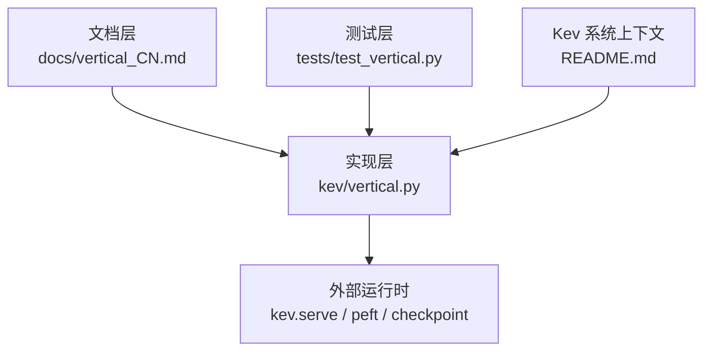
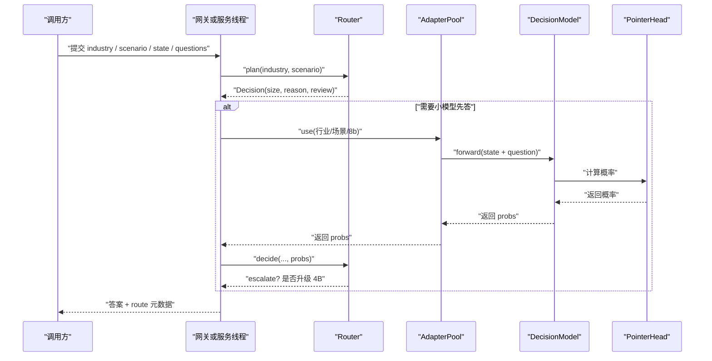
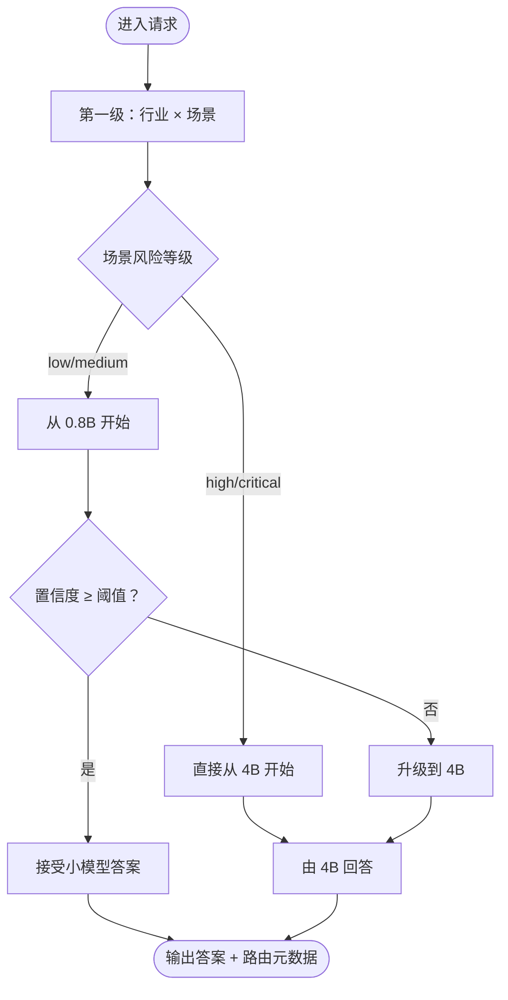
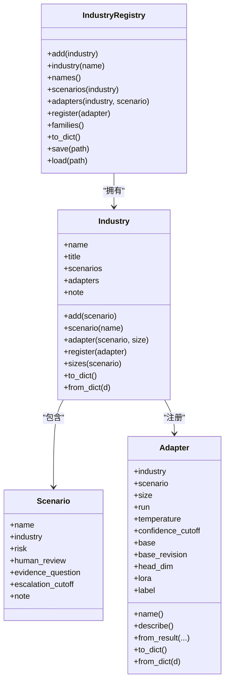
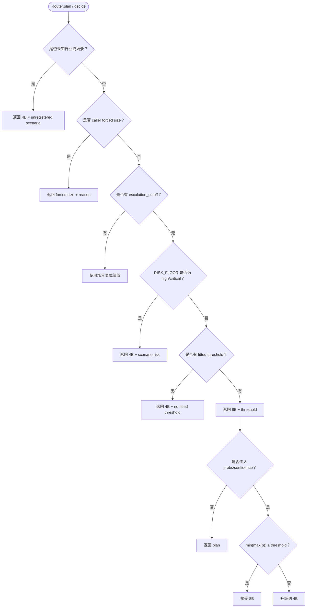
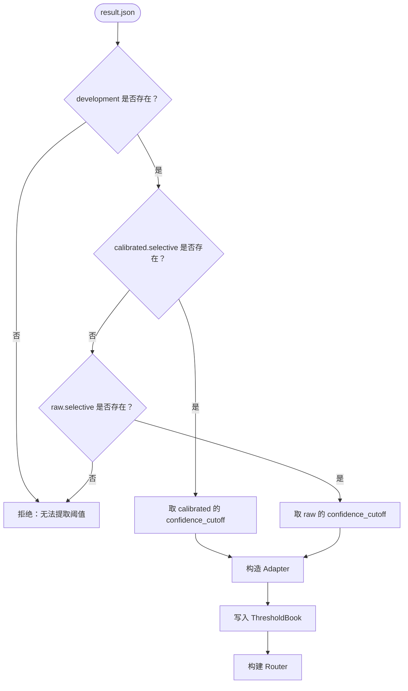
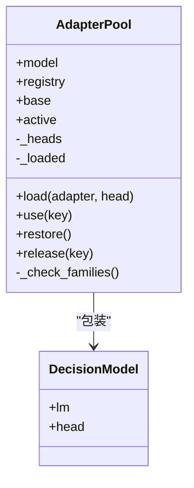
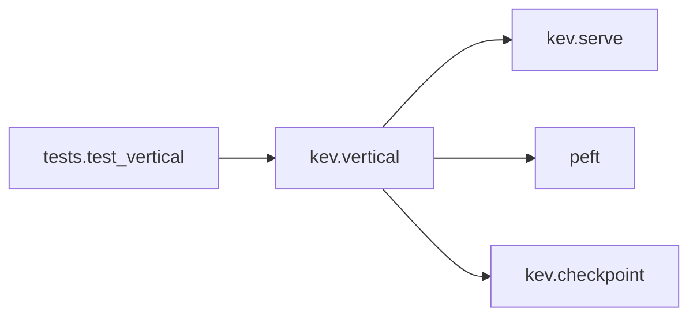

# 场景管理系统（两级层次结构）

<cite>
**本文引用的文件**   
- [README.md](file://README.md)
- [vertical_CN.md](file://docs/vertical_CN.md)
- [vertical.py](file://kev/vertical.py)
- [test_vertical.py](file://tests/test_vertical.py)
</cite>

## 目录
1. [引言](#引言)
2. [项目结构](#项目结构)
3. [核心组件](#核心组件)
4. [架构总览](#架构总览)
5. [详细组件分析](#详细组件分析)
6. [依赖关系分析](#依赖关系分析)
7. [性能与部署考量](#性能与部署考量)
8. [故障排查指南](#故障排查指南)
9. [结论](#结论)
10. [附录](#附录)

## 引言
本文件聚焦“场景管理系统”的两级层次结构：上层是“行业 × 场景”的分类与风险分层，下层是“小模型（0.8B）→ 大模型（4B）”的置信度升级路由。该系统的目标是在保证安全与可审计的前提下，让低风险、高置信的问题优先由低成本的小模型回答；当证据不足或置信度不够时，自动升级到更可靠的大模型，并保留完整决策依据供人工复核。

该系统不是一个新的独立模型，而是对已有 Kev 推理服务的一层控制平面：它不持有权重，也不直接启动 Web 服务，而是通过注册表、路由规则、阈值书和适配器池，决定“哪个尺寸”的模型回答一条记录，以及是否需要人工复核。

**章节来源**
- [README.md:18-29](file://README.md#L18-L29)
- [vertical_CN.md:1-15](file://docs/vertical_CN.md#L1-L15)

## 项目结构
围绕“场景管理系统”，仓库中与实现直接相关的代码主要分布在以下位置：

| 层级 | 路径 | 职责 |
|---|---|---|
| 设计说明 | `docs/vertical_CN.md` | 描述两层结构、契约、风险分层、部署形态与验收标准 |
| 实现代码 | `kev/vertical.py` | 注册表、场景、行业、路由器、阈值书、适配器池 |
| 测试代码 | `tests/test_vertical.py` | 验证路由规则、阈值来源、适配器池行为与边界条件 |
| 系统上下文 | `README.md` | Kev 整体能力、API、训练与部署背景，为垂直路由提供运行环境 |

**图表来源**
- [vertical_CN.md:57-70](file://docs/vertical_CN.md#L57-L70)
- [vertical.py:1-40](file://kev/vertical.py#L1-L40)
- [test_vertical.py:1-15](file://tests/test_vertical.py#L1-L15)
- [README.md:18-29](file://README.md#L18-L29)

**章节来源**
- [vertical_CN.md:57-70](file://docs/vertical_CN.md#L57-L70)
- [vertical.py:1-40](file://kev/vertical.py#L1-L40)
- [test_vertical.py:1-15](file://tests/test_vertical.py#L1-L15)
- [README.md:18-29](file://README.md#L18-L29)

## 核心组件
场景管理系统的核心由五类对象组成：

| 组件 | 作用 | 关键不变量 |
|---|---|---|
| `Adapter` | 一个行业在某个尺寸上的 LoRA delta、温度与置信度阈值 | 阈值不可手工填写，必须来自训练结果 |
| `Scenario` | 一个决策任务及其风险等级、是否需人工复核 | 风险等级只能从低到高，不能随意放宽 |
| `Industry` | 一个行业的场景集合与已训练适配器集合 | 名称唯一，适配器必须挂在已声明场景上 |
| `IndustryRegistry` | 全量行业、场景、适配器的注册表 | JSON 可读写，作为部署真相来源 |
| `Router` | 根据场景风险与小模型置信度决定“谁回答” | 不读取 state 内容做路由 |
| `ThresholdBook` | 从训练结果中抽取校准阈值，构建无常量路由器 | 阈值必须可追溯到 development 切片 |
| `AdapterPool` | 共享基座 + 多行业 adapter 切换 | 不重写骨架权重，不引入 per-request 舍入 |

这些组件共同构成“先分类、再路由”的两级结构：第一级确定行业与场景，第二级确定使用 0.8B 还是 4B。

**章节来源**
- [vertical.py:88-150](file://kev/vertical.py#L88-L150)
- [vertical.py:171-260](file://kev/vertical.py#L171-L260)
- [vertical.py:267-350](file://kev/vertical.py#L267-L350)
- [vertical.py:455-510](file://kev/vertical.py#L455-L510)
- [vertical.py:744-793](file://kev/vertical.py#L744-L793)
- [vertical.py:614-720](file://kev/vertical.py#L614-L720)

## 架构总览
场景管理系统采用“控制平面 + 推理服务”的分层设计：

**图表来源**
- [vertical.py:501-610](file://kev/vertical.py#L501-L610)
- [vertical.py:614-720](file://kev/vertical.py#L614-L720)
- [vertical_CN.md:377-414](file://docs/vertical_CN.md#L377-L414)

**章节来源**
- [vertical_CN.md:57-70](file://docs/vertical_CN.md#L57-L70)
- [vertical.py:501-610](file://kev/vertical.py#L501-L610)
- [vertical.py:614-720](file://kev/vertical.py#L614-L720)

## 详细组件分析

### 两级层次结构
系统的第一级是“行业 × 场景”的组织方式，第二级是“小模型 → 大模型”的升级路径。

**图表来源**
- [vertical.py:50-71](file://kev/vertical.py#L50-L71)
- [vertical.py:537-604](file://kev/vertical.py#L537-L604)
- [vertical_CN.md:132-180](file://docs/vertical_CN.md#L132-L180)

**章节来源**
- [vertical.py:50-71](file://kev/vertical.py#L50-L71)
- [vertical.py:537-604](file://kev/vertical.py#L537-L604)
- [vertical_CN.md:132-180](file://docs/vertical_CN.md#L132-L180)

### 注册表与行业场景
`IndustryRegistry` 是部署的真相来源，包含多个 `Industry`，每个 `Industry` 包含多个 `Scenario` 和若干 `Adapter`。注册表支持 JSON 序列化、加载、保存，并校验命名空间、风险等级、阈值范围等约束。

**图表来源**
- [vertical.py:88-150](file://kev/vertical.py#L88-L150)
- [vertical.py:171-260](file://kev/vertical.py#L171-L260)
- [vertical.py:267-350](file://kev/vertical.py#L267-L350)

**章节来源**
- [vertical.py:88-150](file://kev/vertical.py#L88-L150)
- [vertical.py:171-260](file://kev/vertical.py#L171-L260)
- [vertical.py:267-350](file://kev/vertical.py#L267-L350)
- [test_vertical.py:259-320](file://tests/test_vertical.py#L259-L320)

### 路由器与决策语义
`Router` 负责两条输入、一个输出：

1. 场景表中的风险等级：这是可审计、可签字的下限。
2. 小模型自身的置信度：这是升级信号。

路由器按顺序应用五条规则：未知场景直送大模型、强制尺寸优先、场景显式阈值覆盖、风险等级下限、小模型起步并按阈值升级。

**图表来源**
- [vertical.py:501-610](file://kev/vertical.py#L501-L610)
- [vertical_CN.md:162-180](file://docs/vertical_CN.md#L162-L180)

**章节来源**
- [vertical.py:501-610](file://kev/vertical.py#L501-L610)
- [test_vertical.py:78-178](file://tests/test_vertical.py#L78-L178)
- [vertical_CN.md:162-180](file://docs/vertical_CN.md#L162-L180)

### 阈值书与测量来源
`ThresholdBook` 是从训练结果到路由器的桥。它不引入硬编码阈值，而是从每个尺寸的 development 行中提取 `temperature` 和 `confidence_cutoff`。若缺少 selective 块，则拒绝构造，因为 0.0 表示全部升级、1.0 表示从不升级，两者都不是测量值。

**图表来源**
- [vertical.py:126-168](file://kev/vertical.py#L126-L168)
- [vertical.py:744-793](file://kev/vertical.py#L744-L793)
- [test_vertical.py:18-24](file://tests/test_vertical.py#L18-L24)

**章节来源**
- [vertical.py:126-168](file://kev/vertical.py#L126-L168)
- [vertical.py:744-793](file://kev/vertical.py#L744-L793)
- [test_vertical.py:189-218](file://tests/test_vertical.py#L189-L218)

### 适配器池与共享基座
`AdapterPool` 的核心目标是“一个基座，多个行业”。它通过 peft 的未合并 adapter 机制切换行业，而不是每次 forward 都重写骨架权重。这样既避免 per-request 的 bf16 舍入，也避免重复拷贝权重。

**图表来源**
- [vertical.py:614-720](file://kev/vertical.py#L614-L720)

**章节来源**
- [vertical.py:614-720](file://kev/vertical.py#L614-L720)
- [test_vertical.py:381-447](file://tests/test_vertical.py#L381-L447)
- [vertical_CN.md:101-129](file://docs/vertical_CN.md#L101-L129)

### 升级报告与审计指标
`escalation_report` 将“被允许由小模型回答的记录”和“被升级到大模型的记录”分开统计，重点看两个数：

- `answered.accuracy`：小模型被允许回答的那组准确率。
- `recall_of_errors_caught`：升级规则抓出了多少错误。

这两个指标共同判断路由是否只是“把简单题留给小模型”，而把错题漏掉。

**章节来源**
- [vertical.py:799-841](file://kev/vertical.py#L799-L841)
- [vertical_CN.md:245-270](file://docs/vertical_CN.md#L245-L270)
- [test_vertical.py:231-254](file://tests/test_vertical.py#L231-L254)

## 依赖关系分析
场景管理系统对外部环境的依赖可以概括为三层：

| 依赖 | 角色 | 耦合方式 |
|---|---|---|
| `kev.serve` | 实际推理服务 | 路由器不启动服务，只返回 Decision；服务线程或网关调用 `AdapterPool.use` |
| `peft` | 多 adapter 切换 | 通过 `set_adapter` 切换行业 delta，不重写 backbone |
| `checkpoint` | 权重与 meta 读取 | 用于读取 head、base 信息、resolve_run |
| `tests` | 规则正确性保障 | 在无 GPU、无权重的情况下验证路由逻辑 |

**图表来源**
- [vertical.py:48-49](file://kev/vertical.py#L48-L49)
- [vertical.py:614-720](file://kev/vertical.py#L614-L720)
- [test_vertical.py:1-15](file://tests/test_vertical.py#L1-L15)

**章节来源**
- [vertical.py:48-49](file://kev/vertical.py#L48-L49)
- [vertical.py:614-720](file://kev/vertical.py#L614-L720)
- [test_vertical.py:1-15](file://tests/test_vertical.py#L1-L15)

## 性能与部署考量
从系统设计角度，两级层次结构带来的性能收益主要来自两点：

1. **成本分层**：低风险、高置信问题走 0.8B，减少昂贵 4B 调用。
2. **共享基座**：多个行业共享同一个 frozen backbone，只切换 LoRA delta 和 pointer head。

部署形态上，spec 描述了两种路径：

- 复用现有 `/v1/systemone`，通过请求头携带 `x-kev-industry` 与 `x-kev-scenario`。
- 新增 `/v1/vertical`，用于批量路由、升级清单与路由元数据。

云端部署示例中，Modal 网关可同时持有 0.8B 与 4B 两个 `kev.serve.Server`，并通过 `AdapterPool.use` 切换行业，而不重启容器或重写骨架权重。

**章节来源**
- [vertical_CN.md:375-461](file://docs/vertical_CN.md#L375-L461)
- [vertical.py:614-720](file://kev/vertical.py#L614-L720)
- [README.md:221-247](file://README.md#L221-L247)

## 故障排查指南
以下是场景管理系统中最常见的异常与处理原则：

| 现象 | 可能原因 | 系统行为 | 建议处理 |
|---|---|---|---|
| 未知行业或场景 | registry 中没有对应条目 | 返回 4B，reason 为 `unregistered scenario` | 检查请求头中的 industry/scenario，补充 registry |
| 没有 fitted threshold | result.json 缺少 selective 块 | 返回 4B，reason 为 `no fitted threshold` | 重新读取 development 切片，不要手工填阈值 |
| 小模型置信度过低 | min(max(p)) < threshold | escalate=True，escalate_to=4B | 网关应重发同一条记录给 4B |
| 混合不同 base 的 adapter | 0.8B 与 4B 混在一个 pool | 抛出 `AdapterConflict` | 按 family 拆分 pool，每个 backbone 一个池 |
| 使用了未加载的 adapter key | 调用了 `pool.use` 但未 `load` | 抛出 `UnknownScenario` | 确保先 load，再 use |
| 同时传入 probs 和 confidence | `decide` 参数冲突 | 抛出 `ValueError` | 只传 probs 或 confidence 之一 |

**章节来源**
- [vertical.py:73-84](file://kev/vertical.py#L73-L84)
- [vertical.py:126-168](file://kev/vertical.py#L126-L168)
- [vertical.py:537-604](file://kev/vertical.py#L537-L604)
- [vertical.py:648-717](file://kev/vertical.py#L648-L717)
- [test_vertical.py:180-184](file://tests/test_vertical.py#L180-L184)
- [test_vertical.py:429-458](file://tests/test_vertical.py#L429-L458)

## 结论
场景管理系统的两级层次结构，本质上是在“业务可解释性”和“推理成本”之间建立一道可审计的护栏：

- 第一级用“行业 × 场景 × 风险等级”表达业务含义，让临床、合规或风控人员能阅读、比对并签字。
- 第二级用“小模型置信度 vs 测量阈值”决定是否升级，避免把不确定性当作“不需要人工”的证据。
- 整个系统不读 state 内容做路由，因此审计依据始终是“表决定了什么”，而不是另一个黑盒分类器。
- 通过 `ThresholdBook` 和 `AdapterPool`，系统把阈值来源和模型切换路径都落到可追溯、可测试的实现上。

这套设计适合那些“部分问题可由低成本模型稳定回答，但高风险或不确定问题必须由更强模型复核”的真实业务。

[本节不直接分析具体代码文件]

## 附录

### 关键 API 与字段约定
- 请求头：`x-kev-industry`、`x-kev-scenario`、可选 `x-kev-forced-size`。
- 响应体：除 TypeSafe 答案外，增加 `route` 元数据，包含 industry、scenario、size、reason、escalate、escalate_to、threshold、observed、base、adapter。
- 决策字段：`industry`、`scenario`、`size`、`reason`、`review`、`escalate`、`escalate_to`、`threshold`、`observed`、`base`、`adapter`、`note`。

**章节来源**
- [vertical_CN.md:377-414](file://docs/vertical_CN.md#L377-L414)
- [vertical.py:455-498](file://kev/vertical.py#L455-L498)