# 控制台数据库持久化系统

<cite>
**本文引用的文件**   
- [kev/console/db.py](file://kev/console/db.py)
- [kev/console/app.py](file://kev/console/app.py)
- [kev/console/__main__.py](file://kev/console/__main__.py)
- [scripts/gen_console_schema.py](file://scripts/gen_console_schema.py)
- [tests/test_console_backend_switch.py](file://tests/test_console_backend_switch.py)
- [playground/src/lib/console.ts](file://playground/src/lib/console.ts)
</cite>

## 更新摘要
**变更内容**   
- 新增多租户项目管理系统，包含 projects、project_members、project_quota、webhooks、invoices 五个核心表
- 实现完整的 CRUD 操作：项目成员管理、配额限制、Webhook 配置、发票账单
- 添加手动级联删除逻辑，确保项目删除时关联数据的一致性
- 扩展 Store 类以支持新的多租户功能
- 新增 HTTP 路由端点用于多租户资源管理

## 目录
1. [引言](#引言)
2. [项目结构](#项目结构)
3. [核心组件](#核心组件)
4. [架构总览](#架构总览)
5. [详细组件分析](#详细组件分析)
6. [依赖关系分析](#依赖关系分析)
7. [性能与一致性](#性能与一致性)
8. [故障排查指南](#故障排查指南)
9. [结论](#结论)

## 引言
本文件聚焦于 Kev 控制台的数据库持久化子系统，围绕作业编排、产物与血缘、事件流、场景配置、API Key 与用量统计、蒸馏 Provider 用量等能力进行系统化说明。**最新更新**增加了完整的多租户项目管理系统，支持项目成员管理、配额限制、Webhook 集成和发票账单功能。该子系统以 SQLAlchemy Core 为核心，通过环境变量在 SQLite 与 PostgreSQL 之间切换；日志文件作为真相源，events 表提供可分页的 UI 尾部与 SSE 续传；状态机集中校验，避免非法转移。

## 项目结构
控制台持久化相关代码主要分布在以下位置：
- 数据访问层：`kev/console/db.py`（Store、DDL、迁移、事务代理、作业/产物/事件/API Key/用量/Provider/场景/**多租户项目**等）
- HTTP 路由层：`kev/console/app.py`（FastAPI 路由、SSE、产物读取、闸门、密钥管理、用量查询、内部端点、进程装配、**多租户 API**）
- 命令行入口：`kev/console/__main__.py`（serve/initdb、端口保护、SQL 初始化）
- 初始数据生成脚本：`scripts/gen_console_schema.py`（种子 SQL 生成）
- 后端切换测试：`tests/test_console_backend_switch.py`（SQLite/PostgreSQL 环境验证）
- 前端客户端：`playground/src/lib/console.ts`（多租户项目 API 调用）

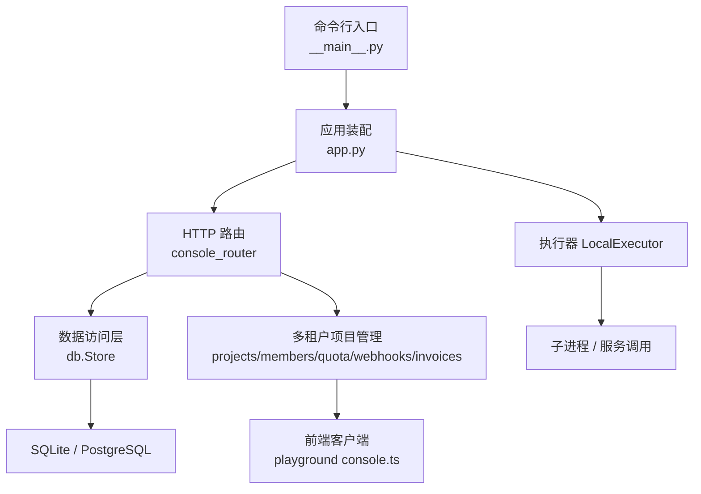

**图表来源**
- [kev/console/__main__.py:74-89](file://kev/console/__main__.py#L74-L89)
- [kev/console/app.py:1331-1366](file://kev/console/app.py#L1331-L1366)
- [kev/console/db.py:352-373](file://kev/console/db.py#L352-L373)
- [playground/src/lib/console.ts:274-311](file://playground/src/lib/console.ts#L274-L311)

**章节来源**
- [kev/console/__main__.py:1-97](file://kev/console/__main__.py#L1-L97)
- [kev/console/app.py:1-15](file://kev/console/app.py#L1-L15)
- [kev/console/db.py:1-11](file://kev/console/db.py#L1-L11)

## 核心组件
- Store：统一的数据访问对象，封装连接、事务、DDL、迁移、作业状态机、产物与血缘、事件追加与读取、API Key 生命周期与用量、蒸馏 Provider 与用量、场景域与场景 CRUD、spec 配置与历史版本、**多租户项目管理系统**。
- FastAPI 路由：暴露控制台 API，包括配置、场景、数据集、作业提交/取消/重试、事件流、产物内容、闸门检查、API Key 管理、用量统计、内部端点、**多租户项目管理端点**等。
- 命令行工具：支持 serve 启动服务与 initdb 初始化数据库（优先使用预置 SQL，缺失时回退到 Store 建库+播种）。

**章节来源**
- [kev/console/db.py:352-373](file://kev/console/db.py#L352-L373)
- [kev/console/app.py:360-361](file://kev/console/app.py#L360-L361)
- [kev/console/__main__.py:74-89](file://kev/console/__main__.py#L74-L89)

## 架构总览
控制台持久化采用"HTTP 路由 + Store 数据访问"的分层设计。Store 通过 SQLAlchemy Engine/Connection 管理连接与事务，不依赖 ORM，SQL 文本由项目掌控。后端通过环境变量 KEV_CONSOLE_DB_BACKEND 选择 SQLite 或 PostgreSQL。**新增的多租户项目管理系统**提供了完整的项目隔离、成员权限、配额控制和计费功能。

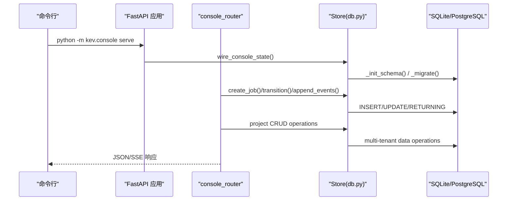

**图表来源**
- [kev/console/__main__.py:74-89](file://kev/console/__main__.py#L74-L89)
- [kev/console/app.py:1331-1366](file://kev/console/app.py#L1331-L1366)
- [kev/console/db.py:437-488](file://kev/console/db.py#L437-L488)

## 详细组件分析

### Store 数据访问层
Store 是持久化的核心，负责：
- 后端 URL 解析与环境变量映射（KEV_CONSOLE_DB_BACKEND、HOST/PORT/USER/PASSWORD/NAME/SCHEMA、路径）
- 连接与事务代理（_Conn），补齐 SQLAlchemy 2.0 自动提交语义，处理 idle-in-transaction 与 InternalError 恢复
- DDL 与 schema_version 管理，跨方言建表与索引
- 幂等迁移（补列、回填 spec_json、新增 daemon_id 列）
- 作业状态机（ALLOWED/SOURCES 定义合法转移，transition 原子校验+写入）
- 产物登记与血缘记录（artifacts、lineage）
- 事件追加与读取（append_events 逐行 RETURNING id，read_events/tail_text）
- API Key 生命周期与用量统计（create/list/revoke/reactivate/record_usage/usage_summary/usage_timeseries）
- 蒸馏 Provider 与用量（create/list/get/update/deactivate/upsert/distill_usage_*）
- 场景域与场景 CRUD、spec 配置与历史版本（seed_scenarios/_backfill_specs/read/write/history/prune）
- **多租户项目管理**（projects/members/quota/webhooks/invoices CRUD 操作）

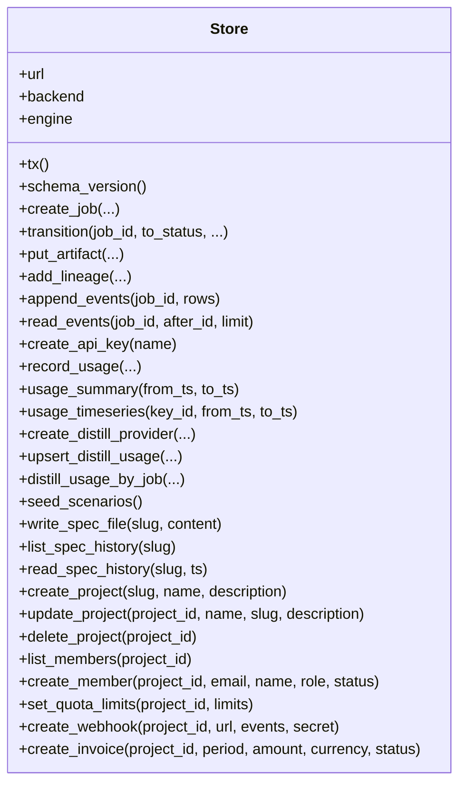

**图表来源**
- [kev/console/db.py:352-373](file://kev/console/db.py#L352-L373)
- [kev/console/db.py:492-518](file://kev/console/db.py#L492-L518)
- [kev/console/db.py:534-582](file://kev/console/db.py#L534-L582)
- [kev/console/db.py:607-658](file://kev/console/db.py#L607-L658)
- [kev/console/db.py:662-711](file://kev/console/db.py#L662-L711)
- [kev/console/db.py:715-786](file://kev/console/db.py#L715-L786)
- [kev/console/db.py:805-842](file://kev/console/db.py#L805-L842)
- [kev/console/db.py:846-961](file://kev/console/db.py#L846-L961)
- [kev/console/db.py:965-1005](file://kev/console/db.py#L965-L1005)
- [kev/console/db.py:1207-1266](file://kev/console/db.py#L1207-L1266)
- [kev/console/db.py:1370-1600](file://kev/console/db.py#L1370-L1600)

**章节来源**
- [kev/console/db.py:48-74](file://kev/console/db.py#L48-L74)
- [kev/console/db.py:277-340](file://kev/console/db.py#L277-L340)
- [kev/console/db.py:437-488](file://kev/console/db.py#L437-L488)
- [kev/console/db.py:492-518](file://kev/console/db.py#L492-L518)
- [kev/console/db.py:534-582](file://kev/console/db.py#L534-L582)
- [kev/console/db.py:607-658](file://kev/console/db.py#L607-L658)
- [kev/console/db.py:662-711](file://kev/console/db.py#L662-L711)
- [kev/console/db.py:715-786](file://kev/console/db.py#L715-L786)
- [kev/console/db.py:805-842](file://kev/console/db.py#L805-L842)
- [kev/console/db.py:846-961](file://kev/console/db.py#L846-L961)
- [kev/console/db.py:965-1005](file://kev/console/db.py#L965-L1005)
- [kev/console/db.py:1026-1056](file://kev/console/db.py#L1026-L1056)
- [kev/console/db.py:1145-1189](file://kev/console/db.py#L1145-L1189)
- [kev/console/db.py:1193-1266](file://kev/console/db.py#L1193-L1266)
- [kev/console/db.py:1370-1600](file://kev/console/db.py#L1370-L1600)

### HTTP 路由与 SSE 事件流
FastAPI 路由提供控制台 API，关键职责：
- 配置与场景树（scenarios、scenario-domains）
- 数据集与产物（datasets/artifacts/content）
- 作业提交/预览/取消/重试/事件/日志（jobs preview/submit/cancel/retry/events/stream/log）
- 闸门检查（gates/{stage}）
- API Key 管理与用量（apikeys、usage）
- 蒸馏 Provider 与用量（distill-providers、distill-usage）
- 内部端点（_internal/distill-event、_internal/distill-cancel）
- SSE 流式事件（stream_job），基于 events 表游标轮询，Last-Event-ID 续传
- **多租户项目管理**（projects/members/quota/webhooks/invoices CRUD 端点）

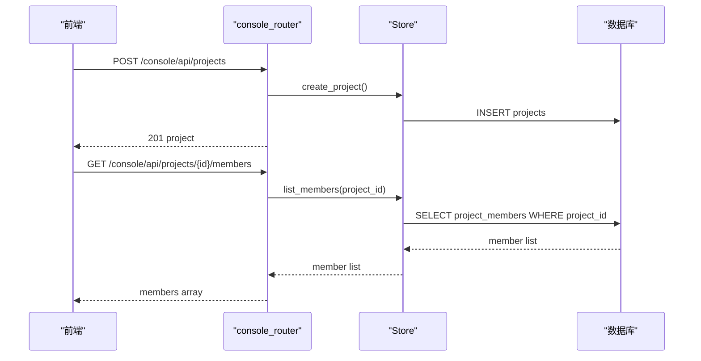

**图表来源**
- [kev/console/app.py:629-677](file://kev/console/app.py#L629-L677)
- [kev/console/app.py:742-778](file://kev/console/app.py#L742-L778)
- [kev/console/db.py:662-711](file://kev/console/db.py#L662-L711)
- [kev/console/app.py:901-1115](file://kev/console/app.py#L901-L1115)

**章节来源**
- [kev/console/app.py:364-596](file://kev/console/app.py#L364-L596)
- [kev/console/app.py:599-800](file://kev/console/app.py#L599-L800)
- [kev/console/app.py:803-896](file://kev/console/app.py#L803-L896)
- [kev/console/app.py:1119-1155](file://kev/console/app.py#L1119-L1155)
- [kev/console/app.py:1158-1234](file://kev/console/app.py#L1158-L1234)
- [kev/console/app.py:1238-1313](file://kev/console/app.py#L1238-L1313)
- [kev/console/app.py:901-1115](file://kev/console/app.py#L901-L1115)

### 多租户项目管理系统

#### 项目表结构
多租户项目管理系统包含五个核心表：

- **projects**：项目基本信息（id、slug、name、description、created_at、updated_at）
- **project_members**：项目成员（id、project_id、email、name、role、status、created_at）
- **project_quota**：项目配额（training_hours_limit/used、gpu_limit、api_calls_limit/used、storage_gb_limit/used）
- **webhooks**：Webhook 配置（id、project_id、url、events、secret、active、last_status、last_delivered_at）
- **invoices**：发票账单（id、project_id、period、amount、currency、status、due_at、issued_at、line_items）

```mermaid
erDiagram
projects ||--o{ project_members : has
projects ||--o| project_quota : has
projects ||--o{ webhooks : has
projects ||--o{ invoices : has
projects {
TEXT id PK
TEXT slug UK
TEXT name
TEXT description
TEXT created_at
TEXT updated_at
}
project_members {
TEXT id PK
TEXT project_id FK
TEXT email
TEXT name
TEXT role
TEXT status
TEXT created_at
}
project_quota {
TEXT project_id PK FK
REAL training_hours_limit
REAL training_hours_used
INTEGER gpu_limit
INTEGER api_calls_limit
INTEGER api_calls_used
REAL storage_gb_limit
REAL storage_gb_used
TEXT updated_at
}
webhooks {
TEXT id PK
TEXT project_id FK
TEXT url
TEXT events
TEXT secret
INTEGER active
INTEGER last_status
TEXT last_delivered_at
TEXT created_at
}
invoices {
TEXT id PK
TEXT project_id FK
TEXT period
REAL amount
TEXT currency
TEXT status
TEXT due_at
TEXT issued_at
TEXT line_items
}
```

**图表来源**
- [kev/console/db.py:254-312](file://kev/console/db.py#L254-L312)

#### 项目 CRUD 操作
Store 类实现了完整的项目管理功能：

- **create_project**：创建新项目，自动生成 UUID 并设置时间戳
- **update_project**：更新项目信息（名称、slug、描述）
- **delete_project**：删除项目，包含手动级联删除逻辑
- **get_project**：获取项目详情

**章节来源**
- [kev/console/db.py:1370-1408](file://kev/console/db.py#L1370-L1408)

#### 成员管理
项目成员管理支持多种角色和状态：

- **角色类型**：owner、admin、member、viewer
- **状态类型**：invited、active
- **CRUD 操作**：邀请成员、更新成员信息、移除成员

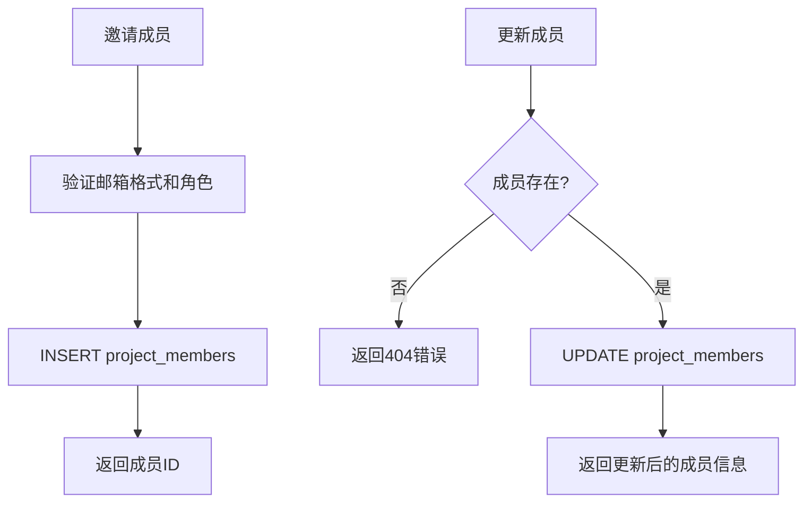

**图表来源**
- [kev/console/db.py:1411-1455](file://kev/console/db.py#L1411-L1455)
- [kev/console/app.py:948-995](file://kev/console/app.py#L948-L995)

**章节来源**
- [kev/console/db.py:1411-1455](file://kev/console/db.py#L1411-L1455)
- [kev/console/app.py:948-995](file://kev/console/app.py#L948-L995)

#### 配额管理
项目配额系统支持多种资源限制：

- **训练时长**：training_hours_limit/training_hours_used
- **GPU 限制**：gpu_limit
- **API 调用**：api_calls_limit/api_calls_used  
- **存储空间**：storage_gb_limit/storage_gb_used

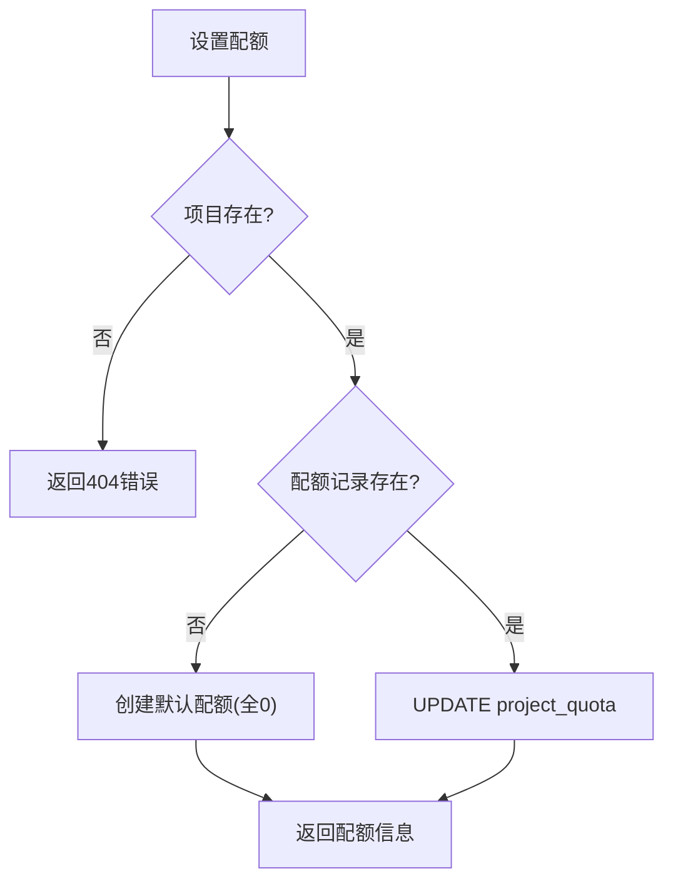

**图表来源**
- [kev/console/db.py:1459-1503](file://kev/console/db.py#L1459-L1503)
- [kev/console/app.py:1000-1017](file://kev/console/app.py#L1000-L1017)

**章节来源**
- [kev/console/db.py:1459-1503](file://kev/console/db.py#L1459-L1503)
- [kev/console/app.py:1000-1017](file://kev/console/app.py#L1000-L1017)

#### Webhook 管理
Webhook 系统支持事件通知机制：

- **事件类型**：自定义事件数组
- **安全机制**：可选的 secret 密钥
- **状态跟踪**：last_status、last_delivered_at
- **活动控制**：active 标志位

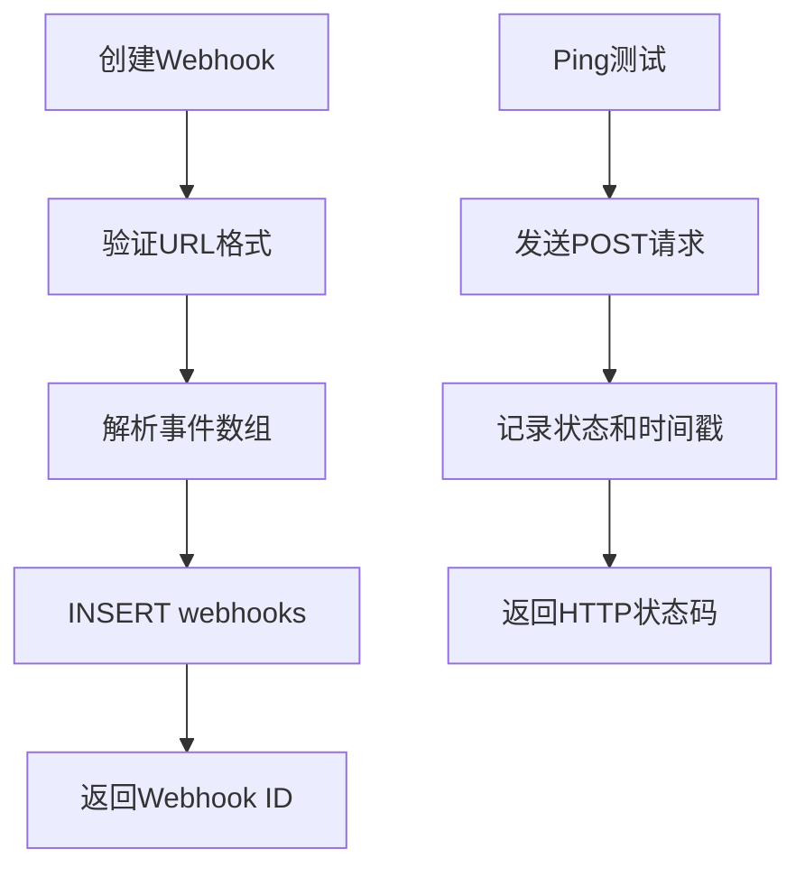

**图表来源**
- [kev/console/db.py:1507-1565](file://kev/console/db.py#L1507-L1565)
- [kev/console/app.py:1022-1084](file://kev/console/app.py#L1022-L1084)

**章节来源**
- [kev/console/db.py:1507-1565](file://kev/console/db.py#L1507-L1565)
- [kev/console/app.py:1022-1084](file://kev/console/app.py#L1022-L1084)

#### 发票账单
发票系统支持项目计费管理：

- **计费周期**：period 字段（如 "2026-10"）
- **金额管理**：amount 和 currency
- **状态跟踪**：open、paid、overdue 等状态
- **明细记录**：line_items JSON 数组

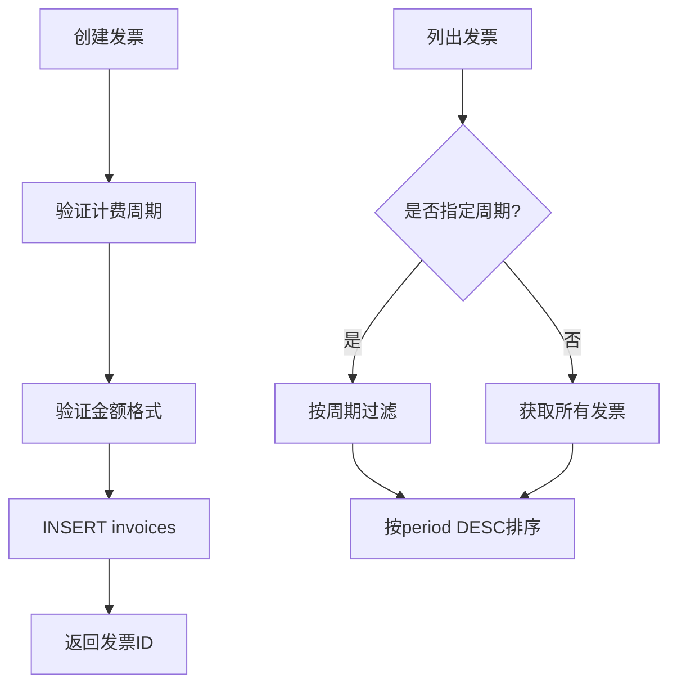

**图表来源**
- [kev/console/db.py:1569-1600](file://kev/console/db.py#L1569-L1600)
- [kev/console/app.py:1089-1114](file://kev/console/app.py#L1089-L1114)

**章节来源**
- [kev/console/db.py:1569-1600](file://kev/console/db.py#L1569-L1600)
- [kev/console/app.py:1089-1114](file://kev/console/app.py#L1089-L1114)

### 作业状态机与事务
Store.transition 将状态校验与写入合并为一条语句，结合 BEGIN IMMEDIATE 拿写锁，避免并发下「已取消的作业最终被标记成功」的问题。SOURCES 由 ALLOWED 反推，确保「能到达目标状态的来源集合」正确且稳定。

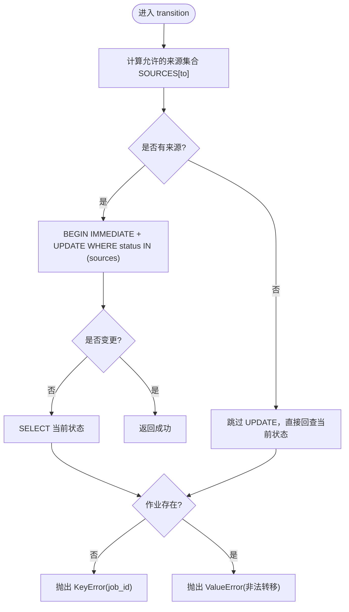

**图表来源**
- [kev/console/db.py:77-97](file://kev/console/db.py#L77-L97)
- [kev/console/db.py:534-582](file://kev/console/db.py#L534-L582)

**章节来源**
- [kev/console/db.py:77-97](file://kev/console/db.py#L77-L97)
- [kev/console/db.py:534-582](file://kev/console/db.py#L534-L582)

### 事件追加与游标
append_events 逐行 INSERT ... RETURNING id，避免 executemany 不支持 RETURNING 的问题；空批次返回 0，表示无新增，不会把游标顶到末尾。read_events 按 job_id 和 after_id 分页，tail_text 用于错误体 stderr_tail。

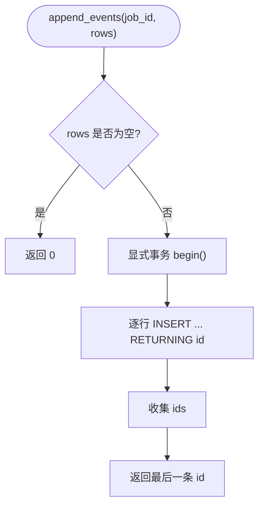

**图表来源**
- [kev/console/db.py:662-696](file://kev/console/db.py#L662-L696)

**章节来源**
- [kev/console/db.py:662-711](file://kev/console/db.py#L662-L711)

### API Key 与用量统计
- 创建 Key：generate raw key -> sha256 hash -> store prefix + active flag -> return key_id
- 使用记录：record_usage 记录 endpoint/method/status/tokens/latency/ts
- 汇总与时间序列：usage_summary 聚合 calls/tokens/last_used/avg/p99；usage_timeseries 按日聚合

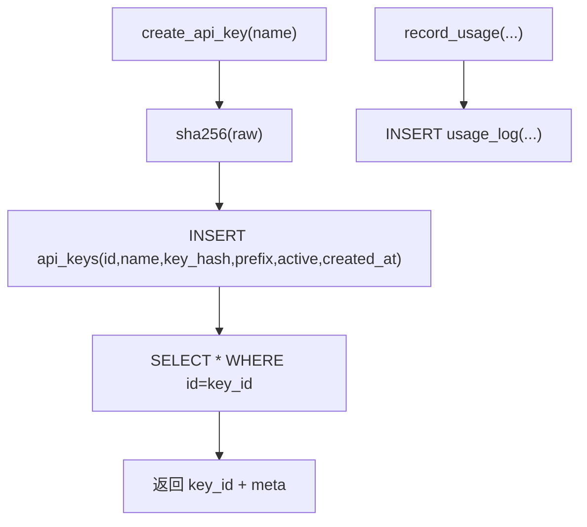

**图表来源**
- [kev/console/db.py:715-786](file://kev/console/db.py#L715-L786)
- [kev/console/db.py:805-842](file://kev/console/db.py#L805-L842)

**章节来源**
- [kev/console/db.py:715-786](file://kev/console/db.py#L715-L786)
- [kev/console/db.py:805-842](file://kev/console/db.py#L805-L842)

### 蒸馏 Provider 与用量
- Provider 管理：create/list/get/update/deactivate
- 用量采集：upsert_distill_usage（ON CONFLICT DO UPDATE），按 provider/key_hint/model/day 聚合
- 用量查询：by_provider/by_job/totals

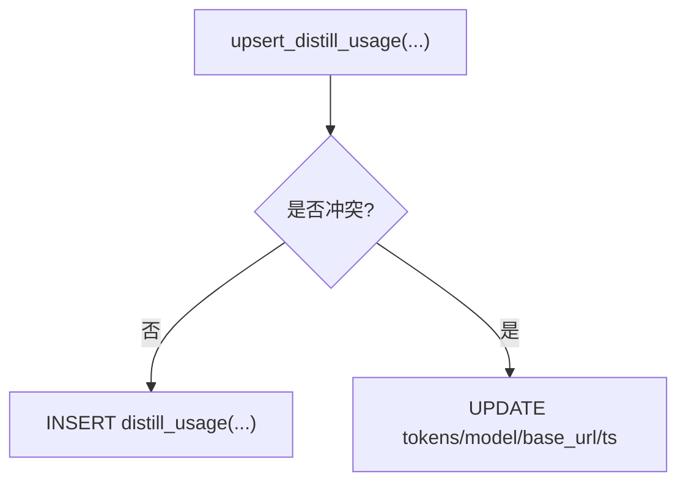

**图表来源**
- [kev/console/db.py:846-961](file://kev/console/db.py#L846-L961)

**章节来源**
- [kev/console/db.py:846-961](file://kev/console/db.py#L846-L961)

### 场景配置与历史版本
- seed_scenarios：幂等播种医疗场景（domain + scenarios）
- _backfill_specs：从本地 specs 回填 spec_json（仅填空行）
- write_spec_file：校验 JSON 与必要字段，归档上一版历史，保留最近 N 版
- list_spec_history/read_spec_history：按 ts 取历史版本

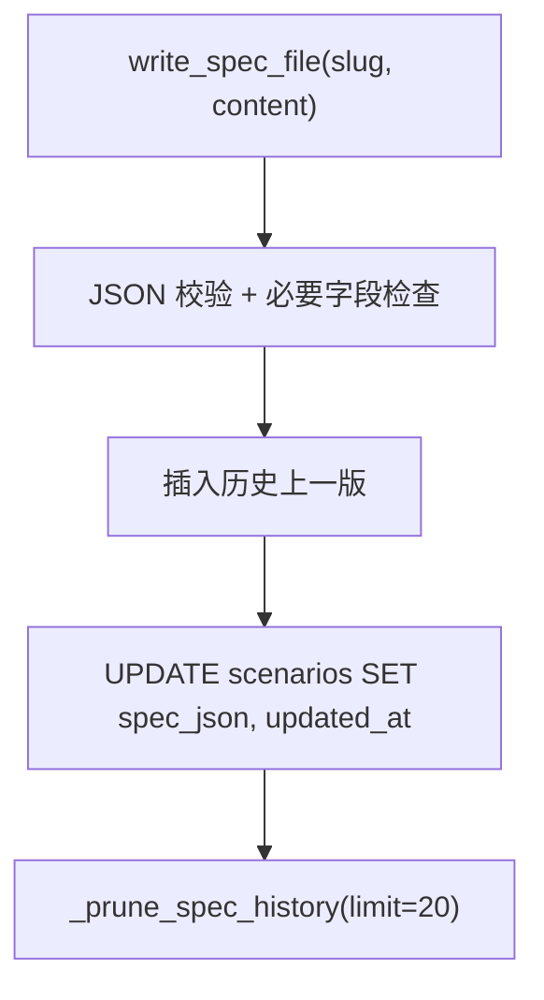

**图表来源**
- [kev/console/db.py:965-1005](file://kev/console/db.py#L965-L1005)
- [kev/console/db.py:1207-1266](file://kev/console/db.py#L1207-L1266)

**章节来源**
- [kev/console/db.py:965-1005](file://kev/console/db.py#L965-L1005)
- [kev/console/db.py:1007-1005](file://kev/console/db.py#L1007-L1005)
- [kev/console/db.py:1207-1266](file://kev/console/db.py#L1207-L1266)

## 依赖关系分析
- Store 依赖 SQLAlchemy Engine/Connection，通过 backend_url 根据环境变量构造 URL
- app.py 通过 wire_console_state 注入 Store 与 LocalExecutor，并注册 console_router
- __main__.py 提供 serve/initdb 命令，initdb 优先使用预置 SQL（gen_console_schema.py 生成），缺失则回退 Store 建库+播种
- tests/test_console_backend_switch.py 验证后端切换与往返
- **前端客户端**：playground/src/lib/console.ts 提供多租户项目的 TypeScript API 客户端

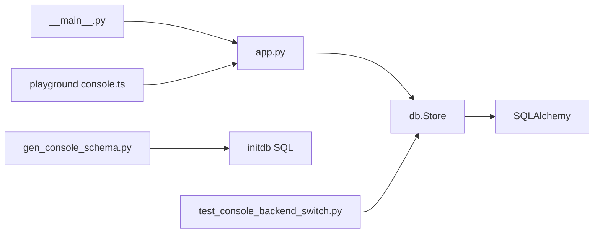

**图表来源**
- [kev/console/__main__.py:51-71](file://kev/console/__main__.py#L51-L71)
- [scripts/gen_console_schema.py:39-52](file://scripts/gen_console_schema.py#L39-L52)
- [tests/test_console_backend_switch.py:14-42](file://tests/test_console_backend_switch.py#L14-L42)
- [playground/src/lib/console.ts:274-311](file://playground/src/lib/console.ts#L274-L311)

**章节来源**
- [kev/console/__main__.py:51-71](file://kev/console/__main__.py#L51-L71)
- [scripts/gen_console_schema.py:39-52](file://scripts/gen_console_schema.py#L39-L52)
- [tests/test_console_backend_switch.py:14-42](file://tests/test_console_backend_switch.py#L14-L42)
- [playground/src/lib/console.ts:274-311](file://playground/src/lib/console.ts#L274-L311)

## 性能与一致性
- 连接与事务：每线程一个连接，WAL 模式提升读并发；_Conn 代理补齐自动提交语义，处理 idle-in-transaction 与 InternalError 后重连
- 状态机：transition 使用 BEGIN IMMEDIATE 与 SOURCES 集合，保证校验与写入原子性
- 事件追加：逐行 INSERT RETURNING id，避免 executemany 不支持 RETURNING 的问题；空批次返回 0，防止游标误判
- 用量统计：按 key_id 与时间范围聚合，p99 延迟计算
- 后端切换：SQLite 默认，PostgreSQL 通过环境变量配置；测试覆盖 URL 构建与往返
- **多租户一致性**：手动级联删除确保项目删除时关联数据的完整性，避免孤儿记录

**章节来源**
- [kev/console/db.py:277-340](file://kev/console/db.py#L277-L340)
- [kev/console/db.py:534-582](file://kev/console/db.py#L534-L582)
- [kev/console/db.py:662-696](file://kev/console/db.py#L662-L696)
- [kev/console/db.py:805-842](file://kev/console/db.py#L805-L842)
- [tests/test_console_backend_switch.py:14-42](file://tests/test_console_backend_switch.py#L14-L42)
- [kev/console/db.py:1399-1407](file://kev/console/db.py#L1399-L1407)

## 故障排查指南
- 状态非法转移：transition 抛出 ValueError，检查 ALLOWED/SOURCES 与当前状态
- 作业不存在：transition 抛出 KeyError，确认 job_id 是否存在
- 事件游标异常：append_events 空批次返回 0，前端需正确处理 after_id 不变的情况
- 后端连接问题：InternalError 触发回滚与新连接重试；PostgreSQL idle-in-transaction 超时会回滚
- 产物缺失：register_finished 失败会记 system 事件并重抛，检查 artifacts.register 与日志
- 端口冲突：独立运行控制台禁止绑定 8008（推理端点），使用默认 8790 或设置 KEV_CONSOLE_ALLOW_SERVE_PORT=1
- **多租户项目故障**：
  - 项目删除失败：检查手动级联删除逻辑是否正确执行
  - 成员权限错误：验证角色枚举值（owner/admin/member/viewer）
  - 配额设置无效：确认配额记录是否存在，必要时创建默认配额
  - Webhook 投递失败：检查 last_status 字段和网络连通性

**章节来源**
- [kev/console/db.py:534-582](file://kev/console/db.py#L534-L582)
- [kev/console/db.py:662-696](file://kev/console/db.py#L662-L696)
- [kev/console/db.py:277-340](file://kev/console/db.py#L277-L340)
- [kev/console/app.py:158-180](file://kev/console/app.py#L158-L180)
- [kev/console/__main__.py:35-48](file://kev/console/__main__.py#L35-L48)
- [kev/console/db.py:1399-1407](file://kev/console/db.py#L1399-L1407)

## 结论
控制台数据库持久化系统以 Store 为核心，结合 FastAPI 路由与 SQLAlchemy Core，提供了健壮的作业编排、产物血缘、事件流、场景配置与用量统计能力。**最新的多租户项目管理系统**进一步增强了系统的企业级功能，支持项目隔离、成员权限管理、配额控制和计费功能。通过环境变量灵活切换 SQLite/PostgreSQL，配合严格的作业状态机与事务代理，确保一致性与可靠性。SSE 事件流与 Last-Event-ID 续传机制使 UI 体验流畅，而产物与日志文件的真相源定位保障了可观测性与可审计性。多租户项目管理系统的手动级联删除逻辑确保了数据完整性，避免了孤儿记录的产生。