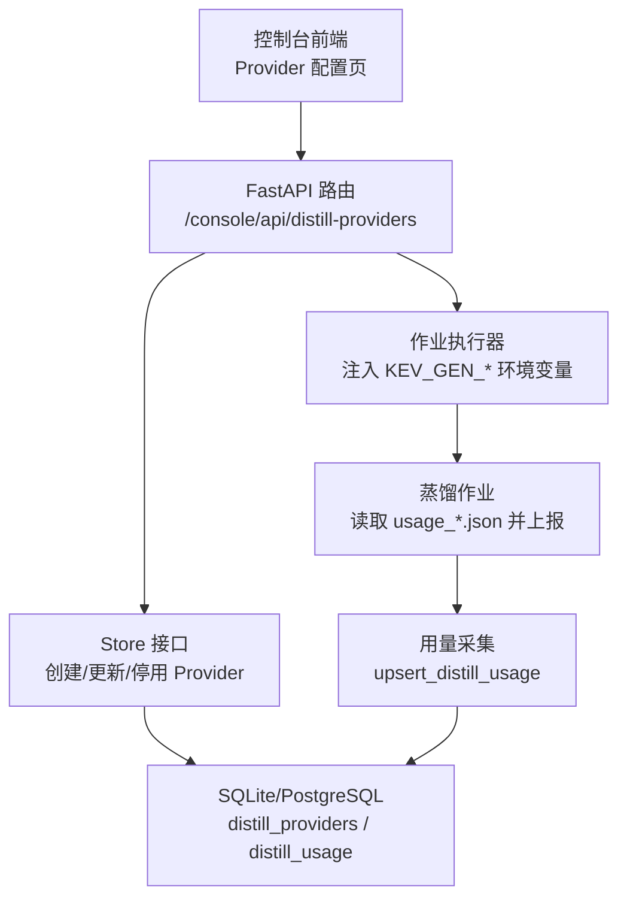
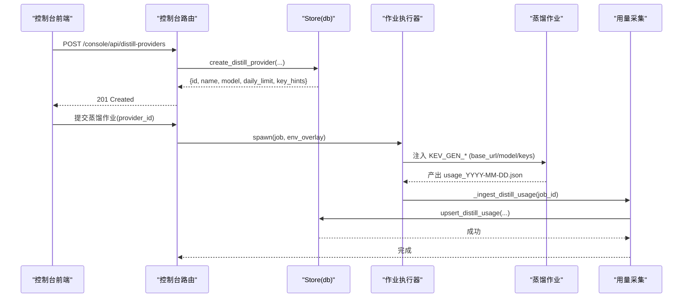
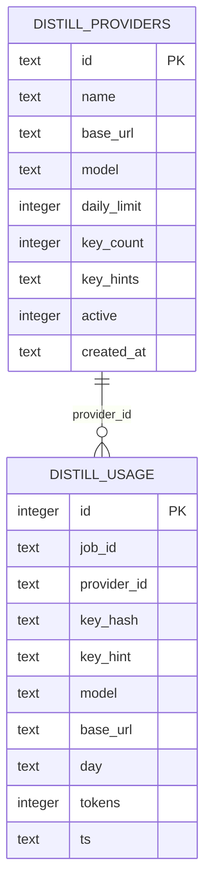
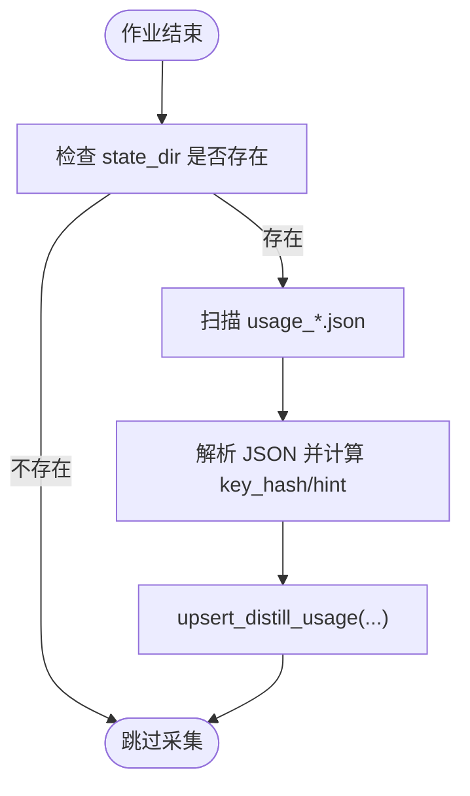
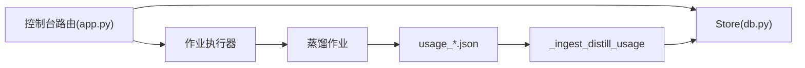

# 蒸馏提供者管理框架

<cite>
**本文引用的文件**   
- [README.md](file://README.md)
- [app.py](file://kev/console/app.py)
- [db.py](file://kev/console/db.py)
- [model.py](file://kev/model.py)
- [2026-10-09-studio-management-design.md](file://docs/superpowers/specs/2026-10-09-studio-management-design.md)
</cite>

## 目录
1. [引言](#引言)
2. [项目结构](#项目结构)
3. [核心组件](#核心组件)
4. [架构总览](#架构总览)
5. [详细组件分析](#详细组件分析)
6. [依赖关系分析](#依赖关系分析)
7. [性能与容量特性](#性能与容量特性)
8. [故障排查指南](#故障排查指南)
9. [结论](#结论)
10. [附录](#附录)

## 引言
本文件聚焦“蒸馏提供者管理框架”，即控制台侧对第三方大模型提供者的统一管理能力：包括提供者注册、密钥池与每日限额、作业执行时注入密钥、用量采集与统计，以及前端配置页面的后端契约。该能力位于 `kev.console` 编排服务中，通过数据库持久化，并与蒸馏作业流水线（数据生成、蒸馏训练等）协同工作。

## 项目结构
蒸馏提供者管理相关代码主要分布在以下位置：
- 控制台 HTTP 路由与作业编排：`kev/console/app.py`
- 数据库存储与查询接口：`kev/console/db.py`
- 设计契约与前端约定：`docs/superpowers/specs/2026-10-09-studio-management-design.md`
- 推理模型上下文（用于理解“状态长度”“分支预算”等概念在蒸馏数据中的影响）：`kev/model.py`
- 项目整体说明与运行方式（帮助理解蒸馏在 Kev 体系中的定位）：`README.md`

图示来源
- [app.py:300-324](file://kev/console/app.py#L300-L324)
- [db.py:846-944](file://kev/console/db.py#L846-L944)
- [2026-10-09-studio-management-design.md:45-77](file://docs/superpowers/specs/2026-10-09-studio-management-design.md#L45-L77)

章节来源
- [README.md:18-29](file://README.md#L18-L29)
- [app.py:1-15](file://kev/console/app.py#L1-L15)
- [db.py:203-218](file://kev/console/db.py#L203-L218)
- [2026-10-09-studio-management-design.md:45-77](file://docs/superpowers/specs/2026-10-09-studio-management-design.md#L45-L77)

## 核心组件
- 提供者元数据表 `distill_providers`：保存 provider 标识、base_url、模型名、每日限额、密钥提示、活跃状态等。
- 用量表 `distill_usage`：按 provider、key_hash、day 聚合 token 用量，支持按 provider/job/day 维度查询。
- Store 方法族：`create_distill_provider`、`list_distill_providers`、`get_distill_provider`、`deactivate_distill_provider`、`update_distill_provider`、`upsert_distill_usage`、`distill_usage_by_provider`、`distill_usage_totals`、`distill_usage_by_job`。
- 控制台路由：对外暴露 `/console/api/distill-providers` 的 CRUD 接口，以及 `/console/api/distill/{job_id}/usage` 用量查询。
- 用量采集：作业完成后从 `state_dir` 下 `usage_*.json` 解析并按 provider/key_hash/day 写入 `distill_usage`。

章节来源
- [db.py:203-218](file://kev/console/db.py#L203-L218)
- [db.py:846-944](file://kev/console/db.py#L846-L944)
- [2026-10-09-studio-management-design.md:45-77](file://docs/superpowers/specs/2026-10-09-studio-management-design.md#L45-L77)

## 架构总览
蒸馏提供者管理框架由“配置面 + 执行面 + 存储面”三部分构成：
- 配置面：控制台前端通过 `/console/api/distill-providers` 维护 provider 池；敏感密钥不进入浏览器，仅服务端保存。
- 执行面：蒸馏作业启动时，根据 `provider_id` 解析出 base_url、model、keys，并以 `KEV_GEN_*` 形式注入到作业环境。
- 存储面：SQLite/PostgreSQL 双方言持久化；用量以天为单位聚合，支持按 provider/job 汇总。

图示来源
- [app.py:300-324](file://kev/console/app.py#L300-L324)
- [db.py:846-944](file://kev/console/db.py#L846-L944)
- [2026-10-09-studio-management-design.md:45-77](file://docs/superpowers/specs/2026-10-09-studio-management-design.md#L45-L77)

## 详细组件分析

### 数据库层：提供者与用量
- `distill_providers` 表字段包含 id、name、base_url、model、daily_limit、key_count、key_hints、active、created_at。
- `distill_usage` 表字段包含 job_id、provider_id、key_hash、key_hint、model、base_url、day、tokens、ts，并提供唯一索引 `(provider_id, key_hash, day)`。
- Store 提供完整的 CRUD 与聚合查询，支持部分更新（空 keys 表示保留原密钥），并在返回结果中对密钥进行脱敏（仅 hints）。

图示来源
- [db.py:203-218](file://kev/console/db.py#L203-L218)
- [db.py:846-944](file://kev/console/db.py#L846-L944)

章节来源
- [db.py:203-218](file://kev/console/db.py#L203-L218)
- [db.py:846-944](file://kev/console/db.py#L846-L944)

### 控制面：HTTP 路由与校验
- 设计文档定义了四个端点：创建、列表、更新、停用。
- 前端布局为单页表格 + 新建抽屉；keys 多行文本框，仅显示 hint；编辑时留空表示保留原 keys。
- 用量展示：当日/当周/当月进度条，超阈值标黄/红，并提示次日不再轮询。

章节来源
- [2026-10-09-studio-management-design.md:45-77](file://docs/superpowers/specs/2026-10-09-studio-management-design.md#L45-L77)

### 执行面：作业注入与用量采集
- `_ingest_distill_usage` 在作业结束后扫描 `state_dir` 下的 `usage_*.json`，按 key 哈希与日期聚合写入 `distill_usage`。
- 若作业未显式传 `state_dir`，则回退到默认路径 `paths.DEFAULT_DISTILL_STATE_DIR`，保证端到端可通。
- 用量聚合使用 `ON CONFLICT ... DO UPDATE`，避免重复写入导致的数据不一致。

图示来源
- [app.py:300-324](file://kev/console/app.py#L300-L324)
- [db.py:906-917](file://kev/console/db.py#L906-L917)

章节来源
- [app.py:300-324](file://kev/console/app.py#L300-L324)
- [db.py:906-917](file://kev/console/db.py#L906-L917)

### 模型上下文对蒸馏数据的影响
- 模型编码时对 state 和 question branch 有严格长度限制；超长会被拒绝或截断，这直接影响蒸馏数据的构造与过滤。
- 训练上下文与服务上下文不同：训练更短，服务允许更长 state（最高 65,536 tokens），但每个 question branch 也有预算。
- 蒸馏数据应遵循这些约束，以避免运行时被拒绝或精度下降。

章节来源
- [model.py:11-28](file://kev/model.py#L11-L28)
- [model.py:87-127](file://kev/model.py#L87-L127)
- [model.py:130-151](file://kev/model.py#L130-L151)

## 依赖关系分析
- 控制台路由依赖 Store 接口，Store 直接操作数据库。
- 作业执行器依赖 Store 获取 provider 信息，并将密钥注入作业环境变量。
- 用量采集依赖作业产出的 usage 文件，并通过 Store 写入用量表。
- 前端依赖设计文档约定的后端契约，不直接访问密钥明文。

图示来源
- [app.py:300-324](file://kev/console/app.py#L300-L324)
- [db.py:846-944](file://kev/console/db.py#L846-L944)

章节来源
- [app.py:300-324](file://kev/console/app.py#L300-L324)
- [db.py:846-944](file://kev/console/db.py#L846-L944)

## 性能与容量特性
- 用量聚合使用数据库级聚合与去重，避免应用层重复计算。
- 用量写入采用 ON CONFLICT 合并，减少锁竞争与重复 IO。
- 密钥仅在创建时上传一次，后续仅传输 hint，降低网络与存储风险。
- 对于长文档蒸馏，建议遵循模型上下文限制，避免运行时被拒绝或精度下降。

[本节为通用指导，不直接分析具体文件]

## 故障排查指南
- 用量为空：检查作业是否产出 `usage_*.json`，确认 `state_dir` 是否正确，且文件名符合 `usage_YYYY-MM-DD.json` 格式。
- 用量未按 provider 聚合：确认作业请求携带了正确的 `provider_id`，且 provider 处于 active 状态。
- 密钥泄露风险：确保前端不接收明文 keys；后端只返回 key_hints。
- 用量上限告警：当某 key 达到 daily_limit 后，次日将不再轮询；需调整限额或轮换密钥。

章节来源
- [app.py:300-324](file://kev/console/app.py#L300-L324)
- [db.py:846-944](file://kev/console/db.py#L846-L944)
- [2026-10-09-studio-management-design.md:45-77](file://docs/superpowers/specs/2026-10-09-studio-management-design.md#L45-L77)

## 结论
蒸馏提供者管理框架通过统一的提供者注册、密钥池管理、作业注入与用量采集，实现了第三方大模型在蒸馏链路中的可控、可观测、可审计。其设计兼顾安全性（密钥不落地浏览器）、可运维性（用量可视化与阈值告警）与可扩展性（多 provider、多 key 轮换）。在实际使用中，应严格遵循模型上下文限制，确保蒸馏数据质量与稳定性。

[本节为总结性内容，不直接分析具体文件]

## 附录
- 快速上手：参考项目 README 了解 Kev 的整体运行方式与蒸馏在其中的角色。
- 前端实现：参考设计文档了解 Provider 配置页的字段语义与交互约定。

章节来源
- [README.md:18-29](file://README.md#L18-L29)
- [2026-10-09-studio-management-design.md:45-77](file://docs/superpowers/specs/2026-10-09-studio-management-design.md#L45-L77)