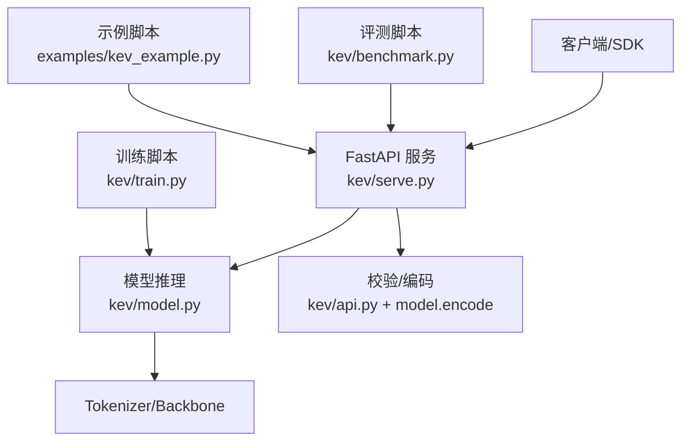
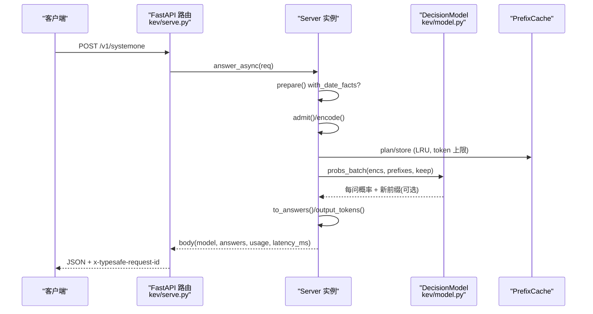
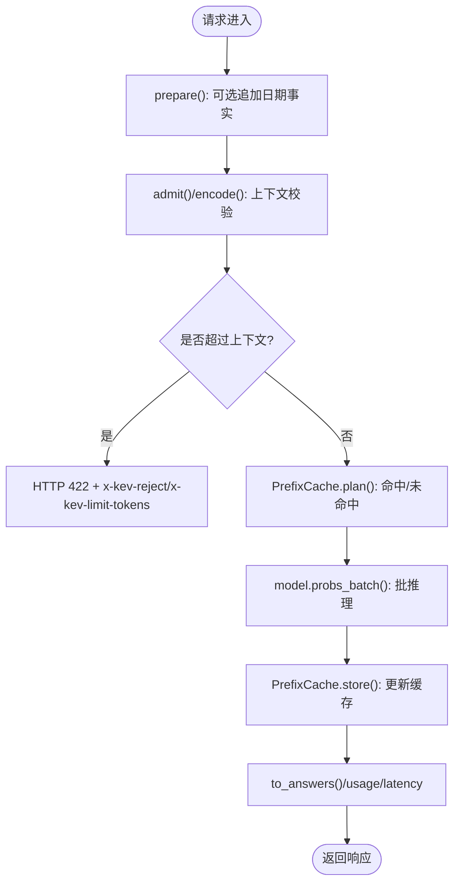
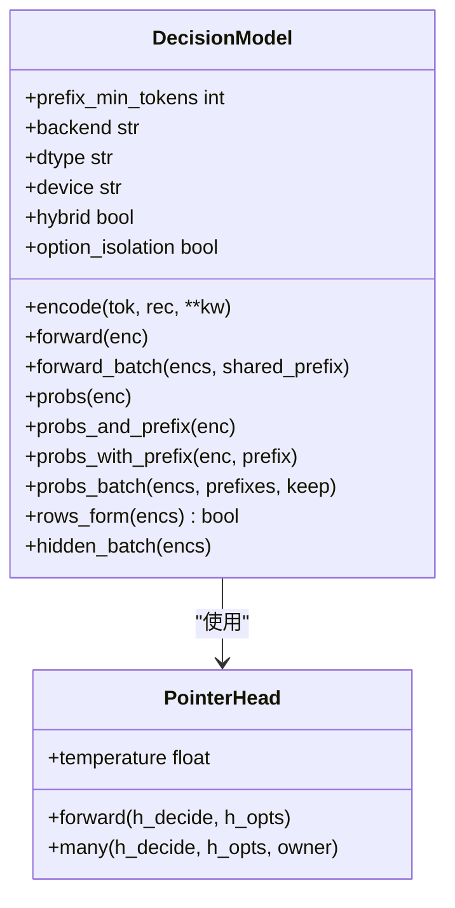
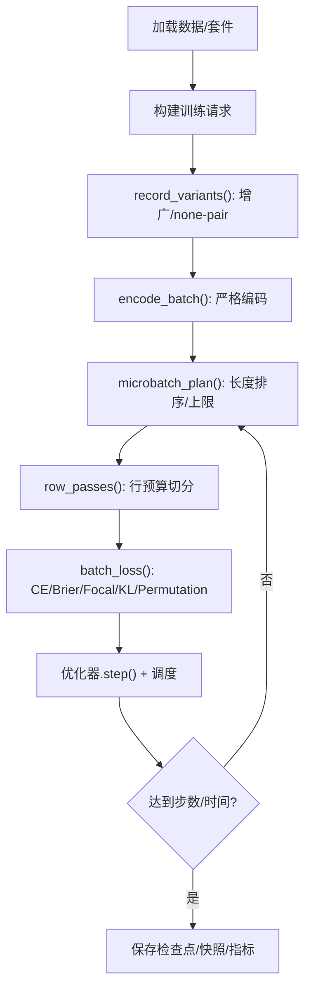
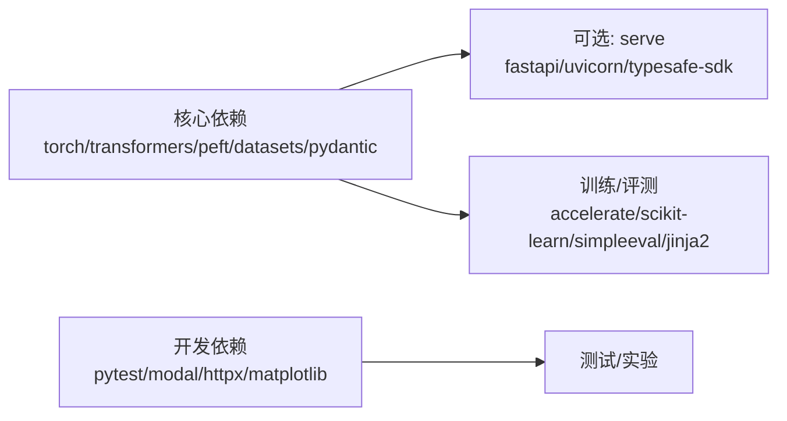

# Kev 基础教程

<cite>
**本文引用的文件**   
- [README.md](file://README.md)
- [README_CN.md](file://README_CN.md)
- [pyproject.toml](file://pyproject.toml)
- [examples/kev_example.py](file://examples/kev_example.py)
- [kev/serve.py](file://kev/serve.py)
- [kev/model.py](file://kev/model.py)
- [kev/train.py](file://kev/train.py)
- [kev/benchmark.py](file://kev/benchmark.py)
</cite>

## 目录
1. [简介](#简介)
2. [项目结构](#项目结构)
3. [核心组件](#核心组件)
4. [架构总览](#架构总览)
5. [详细组件分析](#详细组件分析)
6. [依赖关系分析](#依赖关系分析)
7. [性能与部署要点](#性能与部署要点)
8. [故障排查指南](#故障排查指南)
9. [结论](#结论)
10. [附录：快速上手命令](#附录快速上手命令)

## 简介
Kev 是一组小型决策模型，基于 Qwen3.5/Qwen3.8，提供 TypeSafe System One 兼容的 /v1/systemone API。它支持在一次请求中同时提出是/否（noul）、多选（choice）和评分（score）问题，并默认输出校准后的概率。你可以使用预训练权重，也可以在自己的数据上微调；既可在本地 GPU/Mac 运行，也可通过 Modal 或 Docker 部署 HTTPS 端点。

本教程面向初学者，从“是什么、怎么用、怎么训、怎么测、怎么部署”五个维度，带你快速上手 Kev。

## 项目结构
仓库以 Python 包 kev 为核心，包含推理服务、模型实现、训练脚本、基准评测以及控制台与示例代码。关键目录与文件如下：
- kev/serve.py：FastAPI 服务入口，暴露 /v1/systemone 等接口，管理状态前缀缓存、批处理与设备选择。
- kev/model.py：决策模型封装，负责编码、掩码、指针头打分、行/块因果两种推理路径及 KV 前缀复用。
- kev/train.py：LoRA/全量微调训练器，含数据构建、损失项、微批次计划、FSDP2 全量训练与检查点保存。
- kev/benchmark.py：对冻结套件或自定义 JSONL 进行评测，输出指标与报告。
- examples/kev_example.py：对接本地服务的示例脚本，演示三种问题类型与响应字段。
- pyproject.toml：项目元信息、依赖与可选依赖（serve/mlx/dev）。
- README.md/README_CN.md：完整用户文档（模型、API、训练、部署、性能、限制等）。

图示来源
- [kev/serve.py:242-348](file://kev/serve.py#L242-L348)
- [kev/model.py:243-509](file://kev/model.py#L243-L509)
- [examples/kev_example.py:24-120](file://examples/kev_example.py#L24-L120)

章节来源
- [README.md:18-29](file://README.md#L18-L29)
- [README_CN.md:18-29](file://README_CN.md#L18-L29)
- [pyproject.toml:1-67](file://pyproject.toml#L1-L67)

## 核心组件
- 推理服务（FastAPI）
  - 暴露 /v1/systemone、/v1/models、/v1/systemone/permute、/v1/systemone/separate。
  - 维护状态前缀缓存（PrefixCache），按 LRU 与 token 上限控制内存。
  - 单模型线程批量执行 forward pass，支持 CUDA Graphs 与融合内核（NVIDIA）。
  - 支持 BEARER 鉴权、x-typesafe-request-id、server-timing 等 TypeSafe 兼容特性。
- 决策模型（DecisionModel）
  - 将 state 与多个 question 打包为一条序列，采用分块因果掩码或行式推理。
  - 指针头（PointerHead）对每个选项的 </opt> 隐藏状态与 <decide> 打分，softmax 得到概率。
  - 支持 LoRA 适配器与全量微调；混合基座（Qwen3.5/3.8）走行式路径，纯注意力基座可走块因果路径。
  - 提供 probs/probs_and_prefix/probs_with_prefix/probs_batch 等统一接口。
- 训练器（train）
  - 支持 LoRA 与全量（FSDP2）训练，多种损失项（CE/Brier/Focal/有序概率/KL 锚定/置换 KL）。
  - 长度排序与行预算切分，避免长记录导致显存爆炸。
  - 断点续训、快照、梯度裁剪、学习率调度、指标统计。
- 评测器（benchmark）
  - 支持本地 checkpoint 与远程 System One 端点。
  - 输出 per-question 行级结果、覆盖率、延迟、校准误差、置信错误率等。
  - 支持旋转平均（RotationAveraged）与日期事实增强（with_date_facts）。

章节来源
- [kev/serve.py:47-234](file://kev/serve.py#L47-L234)
- [kev/model.py:205-509](file://kev/model.py#L205-L509)
- [kev/train.py:47-153](file://kev/train.py#L47-L153)
- [kev/benchmark.py:49-176](file://kev/benchmark.py#L49-L176)

## 架构总览
下图展示一次 /v1/systemone 请求的生命周期：客户端发送结构化 state 与 questions，服务端校验并编码，模型计算概率，最终返回答案与用量。

图示来源
- [kev/serve.py:214-234](file://kev/serve.py#L214-L234)
- [kev/serve.py:282-285](file://kev/serve.py#L282-L285)
- [kev/model.py:464-492](file://kev/model.py#L464-L492)

## 详细组件分析

### 推理服务（kev/serve.py）
- 关键职责
  - 启动 FastAPI 应用，挂载 /console/api（若可用）。
  - 中间件：Bearer 鉴权、x-typesafe-request-id、server-timing。
  - 路由：systemone、permute、separate、models。
  - 资源：Server 持有 Checkpoint、Tokenizer、Model、Device、PrefixCache。
- 状态前缀缓存（PrefixCache）
  - 键：(state token ids, option_isolation)。
  - 策略：LRU，限制最大状态数与总 token 数；OOM 时清空并重试。
- 批处理与线程
  - 单模型线程消费队列，批量执行 _run；捕获 CUDA Graphs。
  - 提交失败/停止时返回明确错误（503/422）。
- 环境变量
  - KEV_PREFIX_CACHE / MIN_TOKENS / MAX_TOKENS / DATE_FACTS / TRUNCATE_STATES / API_KEY / TEMPERATURE / BACKEND / DTYPE / CUDA_GRAPHS / FUSED。

图示来源
- [kev/serve.py:141-205](file://kev/serve.py#L141-L205)
- [kev/serve.py:237-239](file://kev/serve.py#L237-L239)
- [kev/model.py:130-143](file://kev/model.py#L130-L143)

章节来源
- [kev/serve.py:242-348](file://kev/serve.py#L242-L348)
- [kev/serve.py:375-410](file://kev/serve.py#L375-L410)

### 决策模型（kev/model.py）
- 编码与掩码
  - encode() 将 state 与多 question 打包，生成 ids/seg/pos/opt 等。
  - branch_mask_batch() 构造分块因果掩码，支持 option_isolation。
- 指针头（PointerHead）
  - 对每个选项的 </opt> 隐藏状态与 <decide> 打分，推理时可按 temperature 缩放 logits。
- 推理路径
  - rows_form(): 混合基座或超长序列走行式；纯注意力基座可走块因果。
  - probs/probs_and_prefix/probs_with_prefix/probs_batch: 统一接口，支持前缀复用。
- 上下文限制
  - SERVE_MAX_STATE=65536，SERVE_MAX_BRANCH=SERVE_MAX_STATE+8192，ROW_PASS_TOKENS=16384。

图示来源
- [kev/model.py:205-224](file://kev/model.py#L205-L224)
- [kev/model.py:243-509](file://kev/model.py#L243-L509)

章节来源
- [kev/model.py:87-128](file://kev/model.py#L87-L128)
- [kev/model.py:154-186](file://kev/model.py#L154-L186)
- [kev/model.py:243-509](file://kev/model.py#L243-L509)

### 训练器（kev/train.py）
- 数据与变体
  - training_requests(): 从套件/自建 JSONL/合成数据构建训练集。
  - record_variants(): 增广（none 选项/干扰项/置换顺序），none-pair 兄弟样本。
- 损失函数
  - question_loss(): CE/Brier/Focal/有序概率约束。
  - anchor_loss(): 对齐冻结基座的零样本分布（KL）。
  - permutation_kl(): 选项顺序对称 KL。
- 微批次计划
  - microbatch_plan(): 长度排序、pass_tokens_max 上限、balanced_runs。
  - row_passes(): 按行预算拆分，避免长记录 OOM。
- 训练流程
  - 优化器：AdamW 或 MasterAdamW（全量训练）。
  - 调度：OneCycleLR。
  - 检查点：head.pt + tokenizer；全量训练支持快照与断点续训。

图示来源
- [kev/train.py:106-153](file://kev/train.py#L106-L153)
- [kev/train.py:201-291](file://kev/train.py#L201-L291)
- [kev/train.py:339-385](file://kev/train.py#L339-L385)
- [kev/train.py:636-719](file://kev/train.py#L636-L719)

章节来源
- [kev/train.py:47-153](file://kev/train.py#L47-L153)
- [kev/train.py:201-291](file://kev/train.py#L201-L291)
- [kev/train.py:339-385](file://kev/train.py#L339-L385)
- [kev/train.py:390-505](file://kev/train.py#L390-L505)
- [kev/train.py:549-719](file://kev/train.py#L549-L719)

### 评测器（kev/benchmark.py）
- 输入：冻结套件分区或自定义 JSONL。
- 预测器：LocalPredictor（本地 checkpoint）或 RemotePredictor（远程 System One）。
- 输出：predictions.jsonl、rows.json、report.json，含准确率、Brier、校准、置信错误率、覆盖率和延迟。
- 可选：date_facts 预处理、rotations 旋转平均。

章节来源
- [kev/benchmark.py:49-176](file://kev/benchmark.py#L49-L176)
- [kev/benchmark.py:197-262](file://kev/benchmark.py#L197-L262)

### 示例脚本（examples/kev_example.py）
- 健康检查 GET /v1/models。
- 构造结构化 state 与三类问题（choice/noul/score）。
- POST /v1/systemone，打印答案、概率、置信度与用量。

章节来源
- [examples/kev_example.py:24-120](file://examples/kev_example.py#L24-L120)

## 依赖关系分析
- 运行时依赖
  - torch、transformers、accelerate、peft、datasets、pydantic、scikit-learn、simpleeval、jinja2。
- 可选依赖
  - serve：fastapi、uvicorn、typesafe-sdk、sqlalchemy、psycopg、requests、mlx-lm（Apple Silicon）。
  - dev：pytest、modal、httpx、matplotlib。

图示来源
- [pyproject.toml:21-51](file://pyproject.toml#L21-L51)

章节来源
- [pyproject.toml:1-67](file://pyproject.toml#L1-L67)

## 性能与部署要点
- 设备与后端
  - CUDA/ROCm：bf16 默认，可选 CUDA Graphs 与融合内核（flash-linear-attention）。
  - Apple Silicon：MLX 自动启用（混合基座），否则回退到 torch MPS/CPU。
- 上下文与缓存
  - 状态最长 65,536 tokens，每问分支最多额外 8,192 tokens。
  - PrefixCache 控制状态前缀缓存大小与 token 上限，OOM 自动清理并重试。
- 部署方式
  - 本地：python -m kev.serve --run <checkpoint_or_hub_id> --port 8008。
  - Modal：一键部署 HTTPS 端点，空闲缩容到零。
  - Docker：deploy/ 脚本拉起服务与 Playground。
- 性能参考
  - 不同模型/GPU 的延迟与吞吐见 README 中的表格；短文本与重复文本差异明显（缓存命中）。

章节来源
- [README.md:418-448](file://README.md#L418-L448)
- [README_CN.md:398-428](file://README_CN.md#L398-L428)
- [kev/serve.py:361-410](file://kev/serve.py#L361-L410)

## 故障排查指南
- 端口冲突
  - 启动时会探测端口是否已被占用；若被其他进程占用会直接退出，避免路由被劫持。
- 上下文超限
  - 状态过长或分支过长会返回 422，附带拒绝原因（state_over_max/branch_over_max/not_encodable）与限制 token 数；可开启 KEV_TRUNCATE_STATES=1 截断读取。
- Mac 训练内存不足
  - 确保只跑一个任务；不要启用 output_hidden_states 或使用 trainable_token_indices。
- Playground 按钮不可用
  - 使用 localhost:3001；Next.js 开发主机名校验，其他域名需配置 allowedDevOrigins。
- 数据集脚本不支持
  - 使用 legacy-datasets/banking77（仓库已适配）。

章节来源
- [kev/serve.py:351-392](file://kev/serve.py#L351-L392)
- [README.md:487-492](file://README.md#L487-L492)
- [README_CN.md:466-472](file://README_CN.md#L466-L472)

## 结论
Kev 提供了轻量、可自托管的决策模型方案，覆盖从训练、评测到部署的全链路。其 TypeSafe 兼容 API 让迁移成本极低；默认校准的概率便于在业务侧设置阈值与自动化分流。对于需要领域适配的场景，LoRA 微调即可显著提升效果；如需极致精度，可选择 Kev-27B 全量微调版本。

## 附录：快速上手命令
- 本地运行
  - uv sync --extra serve
  - uv run --extra serve python -m kev.serve --run jaredpalmer/kev-4b --port 8009
- 调用 API（curl）
  - curl -s localhost:8009/v1/systemone -H 'content-type: application/json' -d '{...}'
- Python SDK（TypeSafe）
  - 使用 typesafe_sdk.TypeSafeClient 指向本地服务地址
- 微调（示例）
  - uv run python -m kev.train --data train.jsonl --base Qwen/Qwen3.5-4B-Base --init_from jaredpalmer/kev-4b --epochs 2 --lr 2e-5 --batch 1 --accum 8 --dtype bf16 --checkpointing 1 --device cuda --out runs/mine
- 评测（示例）
  - uv run python -m kev.benchmark --run runs/mine --data heldout.jsonl --out runs/mine-eval

章节来源
- [README.md:72-143](file://README.md#L72-L143)
- [README_CN.md:72-156](file://README_CN.md#L72-L156)
- [README.md:176-219](file://README.md#L176-L219)
- [README_CN.md:158-199](file://README_CN.md#L158-L199)