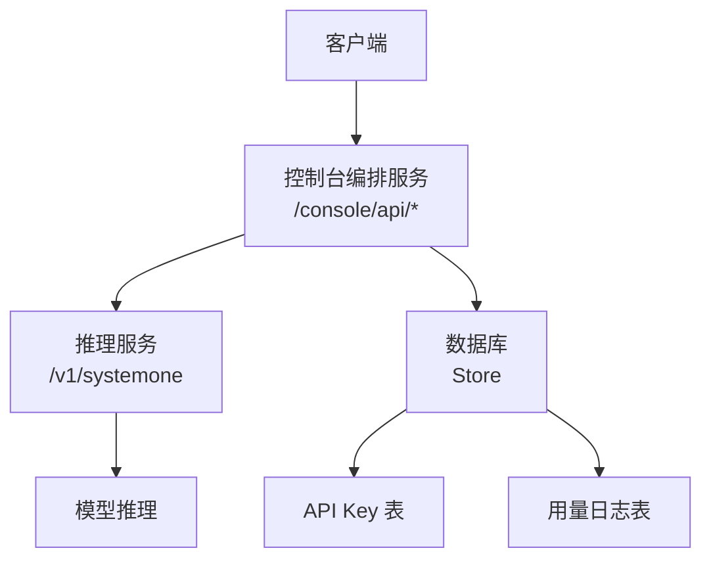
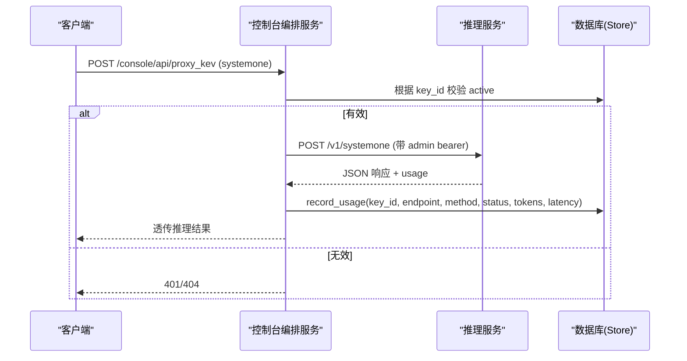
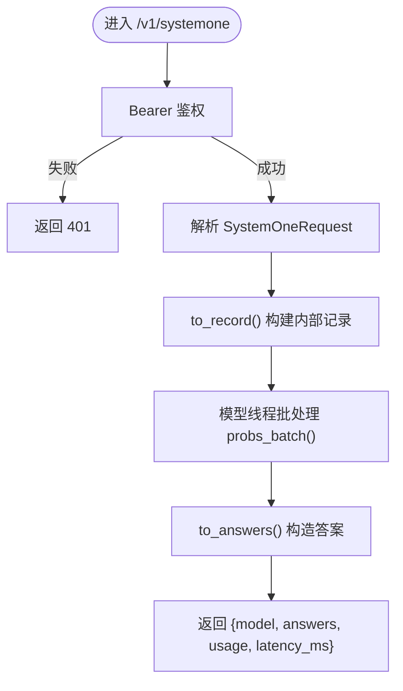
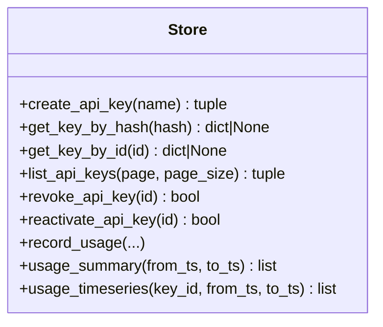
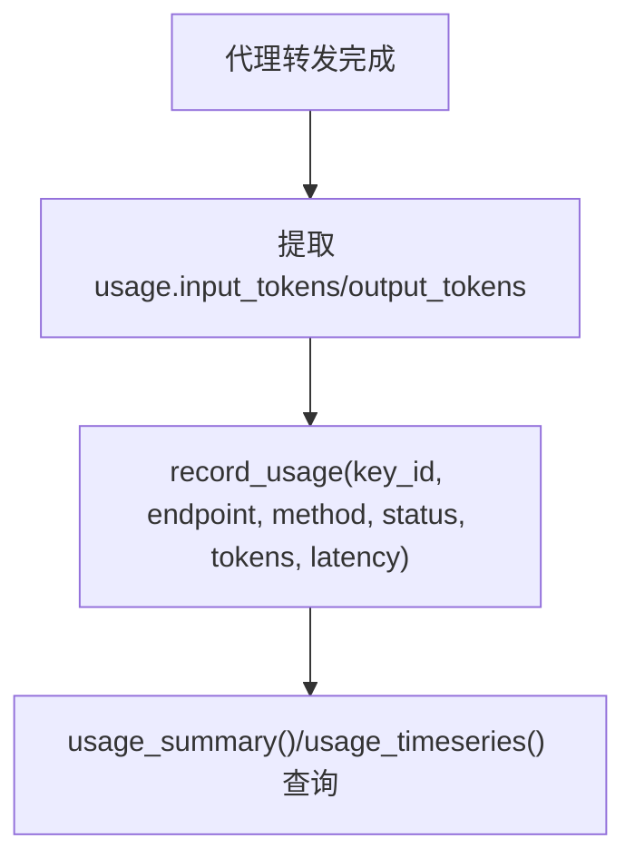
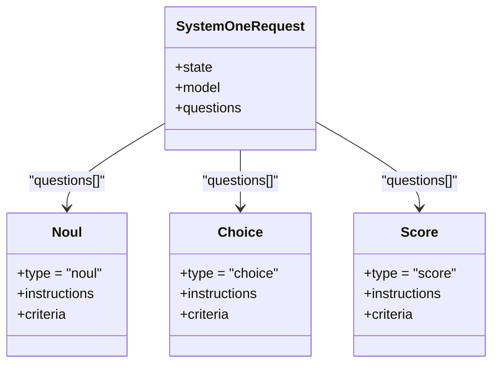
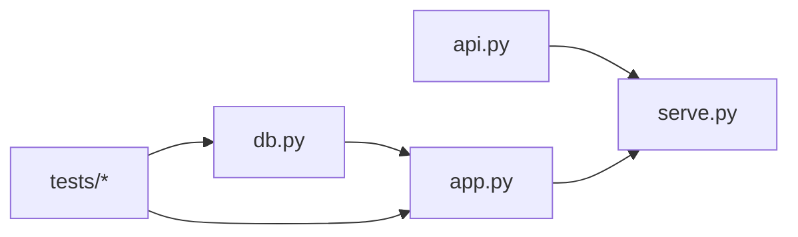

# API密钥管理与使用追踪系统

<cite>
**本文引用的文件**   
- [README.md](file://README.md)
- [api.py](file://kev/api.py)
- [serve.py](file://kev/serve.py)
- [app.py](file://kev/console/app.py)
- [db.py](file://kev/console/db.py)
- [test_console_apikeys.py](file://tests/test_console_apikeys.py)
- [test_console_apikey_routes.py](file://tests/test_console_apikey_routes.py)
</cite>

## 目录
1. [引言](#引言)
2. [项目结构](#项目结构)
3. [核心组件](#核心组件)
4. [架构总览](#架构总览)
5. [详细组件分析](#详细组件分析)
6. [依赖关系分析](#依赖关系分析)
7. [性能与容量特性](#性能与容量特性)
8. [故障排查指南](#故障排查指南)
9. [结论](#结论)
10. [附录](#附录)

## 引言
本文件聚焦 Kev 仓库中与“API 密钥管理”和“使用追踪”相关的实现，覆盖以下目标：
- 解释服务端 Bearer 认证与控制台侧 API Key 管理的职责边界。
- 梳理从客户端请求到推理服务、再到用量落库的完整链路。
- 给出关键数据模型、接口契约、错误处理与可观测性要点。
- 提供架构图、时序图与流程图，帮助非专业读者快速理解。

## 项目结构
围绕 API 密钥与用量追踪，主要涉及以下模块：
- 推理服务入口与鉴权中间件：`kev/serve.py`
- TypeSafe 兼容的请求/响应建模与答案构造：`kev/api.py`
- 控制台编排与代理路由（含用量记录）：`kev/console/app.py`
- 持久化存储（API Key、用量日志等）：`kev/console/db.py`
- 端到端行为验证用例：`tests/test_console_apikeys.py`、`tests/test_console_apikey_routes.py`
- 项目级使用说明与环境变量说明：`README.md`

**图示来源**
- [serve.py:258-278](file://kev/serve.py#L258-L278)
- [app.py:327-354](file://kev/console/app.py#L327-L354)
- [db.py:715-842](file://kev/console/db.py#L715-L842)

**章节来源**
- [README.md:277-321](file://README.md#L277-L321)
- [serve.py:258-278](file://kev/serve.py#L258-L278)
- [app.py:327-354](file://kev/console/app.py#L327-L354)
- [db.py:715-842](file://kev/console/db.py#L715-L842)

## 核心组件
- 推理服务鉴权中间件：在 `/v1/*` 路径上校验 `Authorization: Bearer <KEV_API_KEY>`，未设置环境变量时默认开放；为每个响应附加 `x-typesafe-request-id`。
- 控制台 API Key 管理：创建、撤销、重新启用、分页列表；仅返回元数据，不暴露明文或哈希。
- 用量追踪：通过控制台代理转发推理请求后，将 endpoint、method、status、input_tokens、output_tokens、latency_ms 写入用量日志表，并支持汇总与时序查询。
- 类型化请求/响应：`SystemOneRequest`、`Noul`、`Choice`、`Score` 等 Pydantic 模型，以及置信度计算与输出 token 统计。

**章节来源**
- [serve.py:258-278](file://kev/serve.py#L258-L278)
- [db.py:715-842](file://kev/console/db.py#L715-L842)
- [api.py:17-46](file://kev/api.py#L17-L46)
- [api.py:120-165](file://kev/api.py#L120-L165)

## 架构总览
下图展示一次典型调用链：客户端经控制台代理访问推理服务，控制台负责鉴权、转发、用量落库；推理服务负责解析请求、执行预填充推理、返回结构化答案。

**图示来源**
- [app.py:327-354](file://kev/console/app.py#L327-L354)
- [db.py:737-786](file://kev/console/db.py#L737-L786)
- [serve.py:275-278](file://kev/serve.py#L275-L278)

## 详细组件分析

### 推理服务鉴权与请求处理
- 中间件对 `/v1/*` 进行 Bearer 校验，缺失或错误返回 401，并携带 `www-authenticate: Bearer`。
- 所有响应统一注入 `x-typesafe-request-id`，便于客户端关联请求。
- `/v1/systemone` 接收 `SystemOneRequest`，内部转换为内部记录，交由模型线程批处理，最终组装为 TypeSafe 兼容响应体。

**图示来源**
- [serve.py:258-278](file://kev/serve.py#L258-L278)
- [serve.py:207-227](file://kev/serve.py#L207-L227)
- [api.py:43-46](file://kev/api.py#L43-L46)
- [api.py:102-117](file://kev/api.py#L102-L117)
- [api.py:149-165](file://kev/api.py#L149-L165)

**章节来源**
- [serve.py:258-278](file://kev/serve.py#L258-L278)
- [serve.py:207-227](file://kev/serve.py#L207-L227)
- [api.py:43-46](file://kev/api.py#L43-L46)
- [api.py:102-117](file://kev/api.py#L102-L117)
- [api.py:149-165](file://kev/api.py#L149-L165)

### 控制台 API Key 管理
- 创建 Key：生成原始凭据（前缀 `kev_`），计算 SHA-256 哈希入库，同时返回 key 的 id 作为前端使用的凭据。
- 列表：分页返回，仅包含 id、name、prefix、active、created_at 等元数据，不包含明文或哈希。
- 撤销/重新启用：通过更新 active 字段控制可用性。
- 按 id 查询：仅返回 active 的记录。

**图示来源**
- [db.py:715-842](file://kev/console/db.py#L715-L842)

**章节来源**
- [db.py:715-842](file://kev/console/db.py#L715-L842)
- [test_console_apikeys.py:17-47](file://tests/test_console_apikeys.py#L17-L47)
- [test_console_apikey_routes.py:18-33](file://tests/test_console_apikey_routes.py#L18-L33)

### 用量追踪与聚合
- 记录：每次代理转发推理请求后，将 endpoint、method、status、input_tokens、output_tokens、latency_ms 写入 `usage_log`。
- 汇总：按 key 聚合调用次数、输入/输出 token 总量、最近使用时间、平均延迟与 P99 延迟。
- 时序：按天聚合调用次数、token 量与平均延迟。

**图示来源**
- [app.py:327-354](file://kev/console/app.py#L327-L354)
- [db.py:777-842](file://kev/console/db.py#L777-L842)

**章节来源**
- [app.py:327-354](file://kev/console/app.py#L327-L354)
- [db.py:777-842](file://kev/console/db.py#L777-L842)

### 请求/响应与置信度
- 问题类型：`noul`（是/否）、`choice`（多选一）、`score`（有序等级）。
- 置信度公式：Choice 与 Score 的置信度与 TypeSafe 参考适配器一致。
- 输出 token：基于序列化后的答案字符串估算，用于计费风格统计。

**图示来源**
- [api.py:17-46](file://kev/api.py#L17-L46)

**章节来源**
- [api.py:17-46](file://kev/api.py#L17-L46)
- [api.py:120-165](file://kev/api.py#L120-L165)

## 依赖关系分析
- 推理服务 (`serve.py`) 依赖类型定义 (`api.py`) 与模型加载/设备选择逻辑。
- 控制台编排 (`app.py`) 依赖 Store (`db.py`) 进行 Key 与用量管理，并通过 HTTP 代理调用推理服务。
- 测试用例验证 Key 生命周期与用量落库语义。

**图示来源**
- [serve.py:25-32](file://kev/serve.py#L25-L32)
- [app.py:34-40](file://kev/console/app.py#L34-L40)
- [db.py:715-842](file://kev/console/db.py#L715-L842)

**章节来源**
- [serve.py:25-32](file://kev/serve.py#L25-L32)
- [app.py:34-40](file://kev/console/app.py#L34-L40)
- [db.py:715-842](file://kev/console/db.py#L715-L842)

## 性能与容量特性
- 推理服务默认 bf16 加速，可选 fp32 精确路径；支持 CUDA Graphs 与融合内核（NVIDIA）。
- 状态前缀缓存可减少重复文档的前向开销；长文档分块读取以降低峰值内存。
- 批量处理：模型线程以队列方式合并请求，减少调度开销。
- 用量统计为轻量写入，不影响主推理路径。

[本节为通用指导，不直接分析具体文件]

## 故障排查指南
- 401 未授权：检查是否设置了 `KEV_API_KEY`，且客户端发送了正确的 `Authorization: Bearer <key>`。
- 422 上下文溢出：当 state 超过限制时，可选择开启 `KEV_TRUNCATE_STATES=1` 截断或使用更短文档。
- Key 不可用：确认 Key 未被撤销（active=0），或通过 id 查询是否存在。
- 用量无数据：确认控制台代理已正确转发并调用 `record_usage`，且后端 Store 正常写入。

**章节来源**
- [serve.py:258-278](file://kev/serve.py#L258-L278)
- [serve.py:145-152](file://kev/serve.py#L145-L152)
- [db.py:763-786](file://kev/console/db.py#L763-L786)

## 结论
Kev 的 API 密钥管理与使用追踪由两条线组成：
- 推理服务侧提供轻量 Bearer 认证与标准化响应头，确保 TypeSafe 兼容。
- 控制台侧提供完整的 API Key 生命周期管理与用量采集、聚合能力，支撑运营与审计。
两者通过代理与 Store 解耦，既保证推理性能，又满足安全与可观测性需求。

[本节为总结性内容，不直接分析具体文件]

## 附录
- 环境变量与部署提示：`KEV_API_KEY`、`KEV_TEMPERATURE`、`KEV_DTYPE`、`KEV_DATE_FACTS`、`KEV_TRUNCATE_STATES` 等。
- 示例与边界情况：中文请求/响应示例、超长 state 的 422 处理、不同等级数的 score 等。

**章节来源**
- [README.md:277-321](file://README.md#L277-L321)