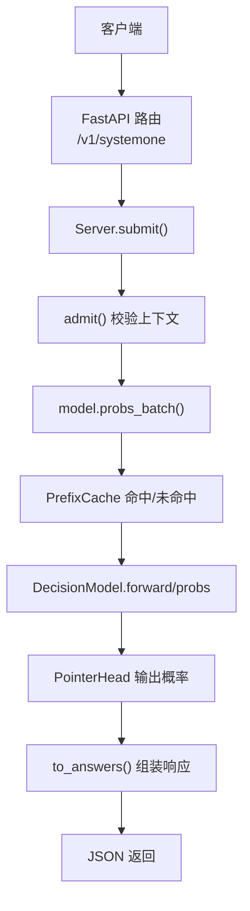
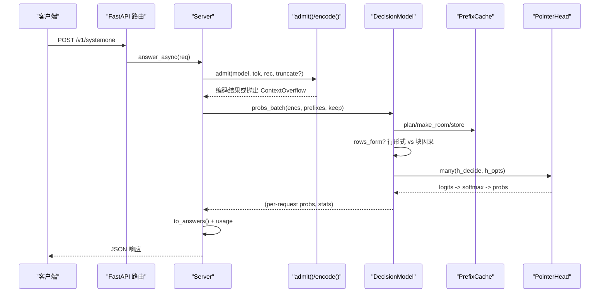
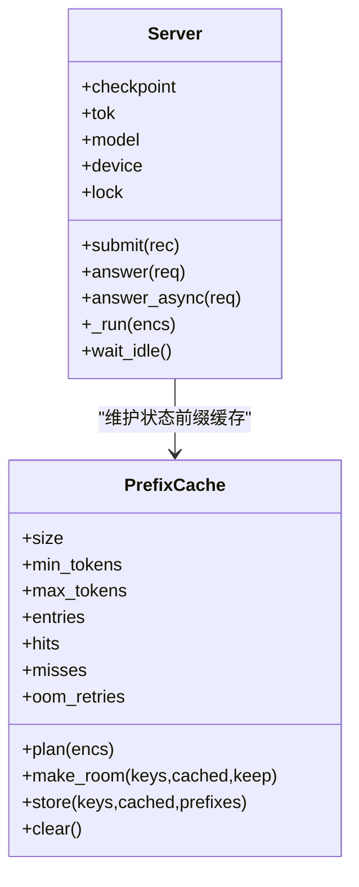
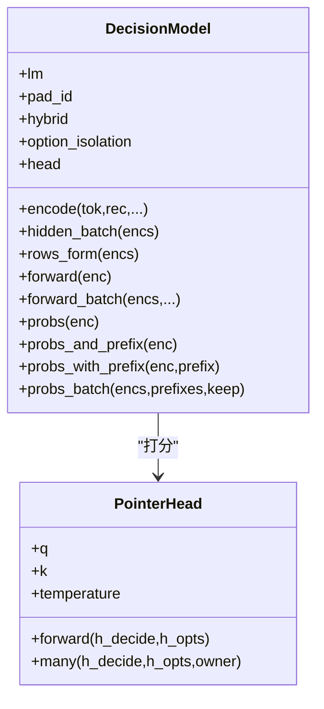
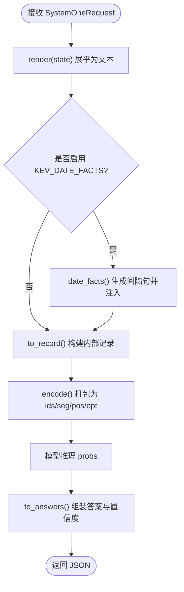
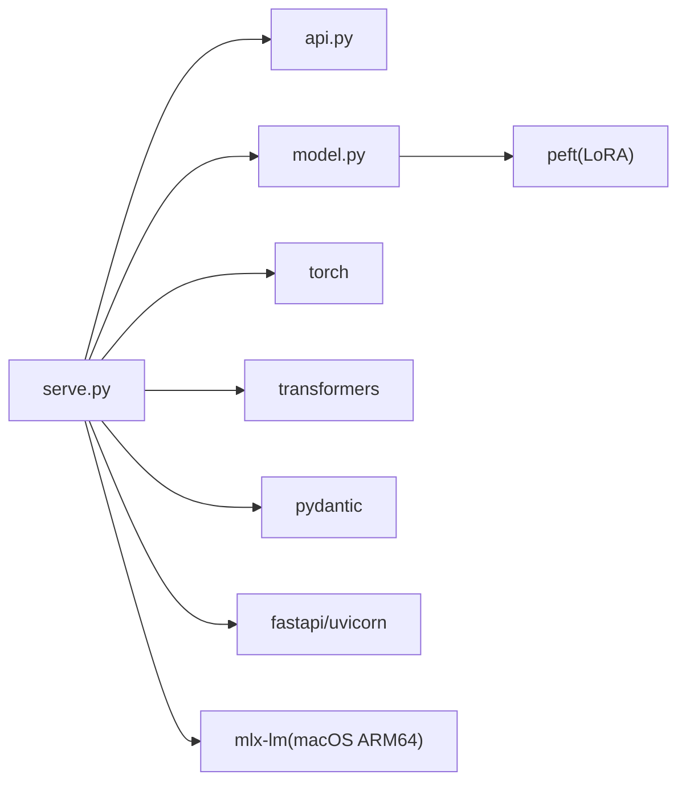

# 解剖学开发工具

<cite>
**本文引用的文件**   
- [README.md](file://README.md)
- [DESIGN.md](file://DESIGN.md)
- [pyproject.toml](file://pyproject.toml)
- [serve.py](file://kev/serve.py)
- [model.py](file://kev/model.py)
- [api.py](file://kev/api.py)
</cite>

## 目录
1. [简介](#简介)
2. [项目结构](#项目结构)
3. [核心组件](#核心组件)
4. [架构总览](#架构总览)
5. [详细组件分析](#详细组件分析)
6. [依赖关系分析](#依赖关系分析)
7. [性能与容量特性](#性能与容量特性)
8. [故障排查指南](#故障排查指南)
9. [结论](#结论)
10. [附录](#附录)

## 简介
本项目提供一套“小型决策模型”工具链，目标是在本地训练、评估并部署一个与 TypeSafe System One API 兼容的服务端。它基于 Qwen3.5/Qwen3.8 基座，采用 LoRA 适配器与指针头（pointer head）进行判别式推理；支持 CUDA 与 Apple Silicon（MLX），并提供浏览器 Playground、命令行训练/评测、以及可伸缩的 HTTPS 部署能力。

该仓库同时包含大量实验、评测套件与部署脚本，但本技术文档聚焦于“服务—模型—API”的核心实现路径，帮助读者快速理解请求如何被编码、缓存、批处理并返回校准概率。

## 项目结构
- 顶层 README 给出模型规格、快速开始、API 说明、训练与部署流程、基准与性能数据。
- DESIGN.md 为设计系统规范，不直接参与推理链路，但与前端 Playground 等界面相关。
- pyproject.toml 定义 Python 包、依赖与可选依赖（serve、mlx）。
- kev/serve.py 是 FastAPI 服务端入口：加载检查点、暴露 /v1/systemone 等接口、维护状态前缀缓存与批处理线程。
- kev/model.py 实现决策模型：编码器、块因果掩码、行形式推理、指针头、前缀缓存接口。
- kev/api.py 定义 TypeSafe 兼容的请求/响应结构与置信度计算。

**图示来源**
- [serve.py:282-319](file://kev/serve.py#L282-L319)
- [serve.py:141-205](file://kev/serve.py#L141-L205)
- [model.py:396-492](file://kev/model.py#L396-L492)
- [api.py:102-160](file://kev/api.py#L102-L160)

**章节来源**
- [README.md:72-143](file://README.md#L72-L143)
- [pyproject.toml:1-67](file://pyproject.toml#L1-L67)

## 核心组件
- 服务端 Server：管理检查点、Tokenizer、模型实例、请求队列、CUDA Graphs、状态前缀缓存与批处理线程。
- 模型 DecisionModel：封装 Transformer 基座、LoRA、指针头；提供 encode、forward、probs、probs_and_prefix、probs_with_prefix、probs_batch 等统一接口。
- API 适配层：将 TypeSafe 的 noul/choice/score 问题映射到内部记录，再转回结构化答案与置信度。

关键职责边界：
- serve.py 负责 HTTP、鉴权、限流/配额、缓存策略与批调度。
- model.py 负责序列编码、注意力掩码、行/块两种推理路径、KV 缓存与指针头打分。
- api.py 负责请求/响应建模、日期事实注入、置信度公式与序列化。

**章节来源**
- [serve.py:47-234](file://kev/serve.py#L47-L234)
- [model.py:205-492](file://kev/model.py#L205-L492)
- [api.py:17-160](file://kev/api.py#L17-L160)

## 架构总览
下图展示一次 /v1/systemone 请求从进入 FastAPI 到返回答案的完整调用链，包括上下文校验、前缀缓存、批处理与指针头概率输出。

**图示来源**
- [serve.py:282-319](file://kev/serve.py#L282-L319)
- [serve.py:141-205](file://kev/serve.py#L141-L205)
- [model.py:329-492](file://kev/model.py#L329-L492)
- [api.py:102-160](file://kev/api.py#L102-L160)

## 详细组件分析

### 服务端 Server 与 PrefixCache
- Server 持有 Checkpoint、Tokenizer、模型、设备、锁、统计量，并在启动时创建单例模型线程。
- 请求通过 Future 提交至队列；模型线程批量消费，使用 CUDA Graphs（如启用）减少内核启动开销。
- PrefixCache 按 LRU 维护状态前缀（KV 与 DeltaNet 状态），支持 min/max tokens 阈值与 OOM 重试清理。
- 环境变量控制行为：KEV_PREFIX_CACHE、KEV_PREFIX_MIN_TOKENS、KEV_PREFIX_MAX_TOKENS、KEV_DATE_FACTS、KEV_TRUNCATE_STATES、KEV_API_KEY、KEV_TEMPERATURE、KEV_DTYPE、KEV_BACKEND 等。

**图示来源**
- [serve.py:47-234](file://kev/serve.py#L47-L234)

**章节来源**
- [serve.py:36-100](file://kev/serve.py#L36-L100)
- [serve.py:102-234](file://kev/serve.py#L102-L234)

### 决策模型 DecisionModel
- 支持两类基座：纯注意力（Qwen3）与混合（Qwen3.5，含 Gated DeltaNet）。混合基座必须走“行形式”推理，因为循环层无法遵守块因果掩码。
- 指针头 PointerHead 对每个问题的 <decide> 隐藏向量与各选项 </opt> 隐藏向量做内积打分，推理时可除以温度以校准概率。
- 前缀复用：probs_and_prefix 在一次前向中返回 KV 缓存与状态隐藏；probs_with_prefix 仅运行分支 token，避免重复计算状态。
- 批处理：probs_batch 根据 CUDA Graphs 与 eager 路径组合执行，保证内存上限与吞吐。

**图示来源**
- [model.py:205-224](file://kev/model.py#L205-L224)
- [model.py:243-492](file://kev/model.py#L243-L492)

**章节来源**
- [model.py:69-73](file://kev/model.py#L69-L73)
- [model.py:154-185](file://kev/model.py#L154-L185)
- [model.py:329-492](file://kev/model.py#L329-L492)

### API 适配层
- 将 TypeSafe 的三类问题映射为内部记录：noul（二选一）、choice（多选项）、score（有序等级）。
- 支持可选的日期事实注入：当 state 中出现绝对日期时，自动追加“两两日期间隔”的事实文本，辅助模型进行日期算术。
- 置信度计算遵循 TypeSafe 参考适配器：choice 使用 (p_max - 1/K)/(1 - 1/K)，score 使用分布集中度的期望偏差度量。

**图示来源**
- [api.py:49-91](file://kev/api.py#L49-L91)
- [api.py:102-160](file://kev/api.py#L102-L160)
- [serve.py:237-239](file://kev/serve.py#L237-L239)

**章节来源**
- [api.py:17-160](file://kev/api.py#L17-L160)

## 依赖关系分析
- FastAPI/Uvicorn：HTTP 服务与 ASGI 服务器。
- Pydantic：请求/响应类型校验。
- Transformers/Torch：基座模型加载与推理。
- PEFT：LoRA 适配。
- MLX（Apple Silicon）：在 macOS ARM64 上作为后端加载混合检查点。
- SQLAlchemy/psycopg：控制台数据库（与本推理链路解耦）。

**图示来源**
- [pyproject.toml:21-51](file://pyproject.toml#L21-L51)
- [serve.py:23-34](file://kev/serve.py#L23-L34)
- [model.py:1-8](file://kev/model.py#L1-L8)

**章节来源**
- [pyproject.toml:1-67](file://pyproject.toml#L1-L67)

## 性能与容量特性
- 上下文限制：
  - 训练上下文：MAX_STATE=384、MAX_BRANCH=1024、MAX_PACKED=2048。
  - 服务上下文：SERVE_MAX_STATE=65536、SERVE_MAX_BRANCH=73728、ROW_PASS_TOKENS=16384。
- 行形式 vs 块因果：
  - 混合基座（Qwen3.5）始终行形式；纯注意力基座在 packed 长度超过 ROW_PASS_TOKENS 时切换行形式。
- 前缀缓存：
  - 默认缓存 4 个状态前缀，最小 384 个 token（纯注意力基座），混合基座总是缓存。
  - 最大缓存总 token 数 65536；超出则按 LRU 淘汰。
- 批处理与 CUDA Graphs：
  - 默认开启 CUDA Graphs（NVIDIA），显著降低 warmup 延迟；FLA 融合核可进一步加速 Qwen3.5。
- 精度：
  - 默认 bf16 服务；fp32 用于精确评估；两者答案差异极小（通常 top-1 一致）。

**章节来源**
- [model.py:11-28](file://kev/model.py#L11-L28)
- [model.py:329-333](file://kev/model.py#L329-L333)
- [serve.py:36-43](file://kev/serve.py#L36-L43)
- [serve.py:394-405](file://kev/serve.py#L394-L405)

## 故障排查指南
- 端口冲突：
  - 启动时会探测端口是否已有进程监听；若冲突会拒绝启动，常见原因是 console 占用了同一端口。
- 上下文超限：
  - 超长 state 会被拒绝（422），或在启用 KEV_TRUNCATE_STATES=1 后截断并返回 truncated 标记。
  - 分支过长也会拒绝（branch_over_max）。
- MPS/CPU 内存不足：
  - 在 Mac 上建议只运行一个训练任务；避免开启 output_hidden_states 或不必要的 trainable_token_indices。
- 日期算术不可靠：
  - 可通过 KEV_DATE_FACTS=1 注入日期间隔事实提升表现。
- 选项顺序敏感性：
  - 同一 choice 问题改变选项顺序可能影响答案；可使用 /permute 接口评估稳定性。

**章节来源**
- [serve.py:351-392](file://kev/serve.py#L351-L392)
- [serve.py:147-156](file://kev/serve.py#L147-L156)
- [README.md:486-493](file://README.md#L486-L493)
- [README.md:450-458](file://README.md#L450-L458)

## 结论
本仓库围绕“轻量决策模型”的目标，提供了从训练、评测到服务的全链路工具。其核心在于：
- 统一的 TypeSafe 兼容 API；
- 针对长文档的前缀缓存与行形式推理；
- 指针头与温度校准的概率输出；
- 跨平台后端（CUDA/ROCm、Apple MLX）与灵活的部署方式（本地、Modal、Docker）。

对于使用者而言，优先选择 Kev-4B 作为起点，根据硬件与精度需求升级到 Kev-9B 或 Kev-27B；如需领域适配，使用提供的微调流程与技能自动化闭环。

## 附录
- 设计系统与设计语言参考见 DESIGN.md，主要用于前端与品牌一致性，不影响推理核心。
- 更多模型卡、评测报告与发布说明位于 docs/ 与 experiments/ 目录。