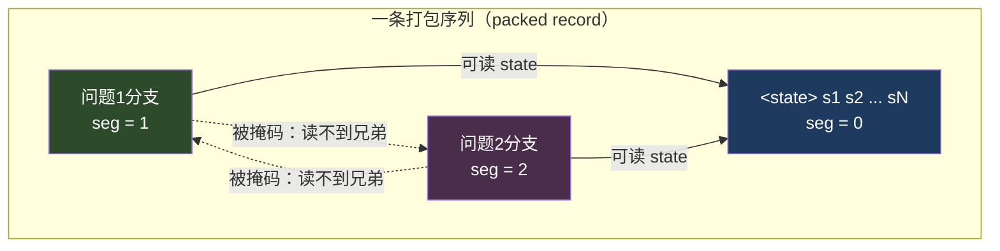
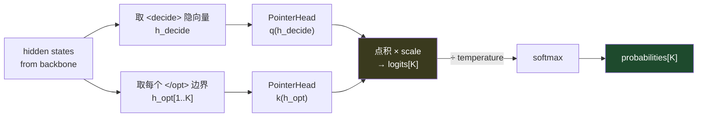
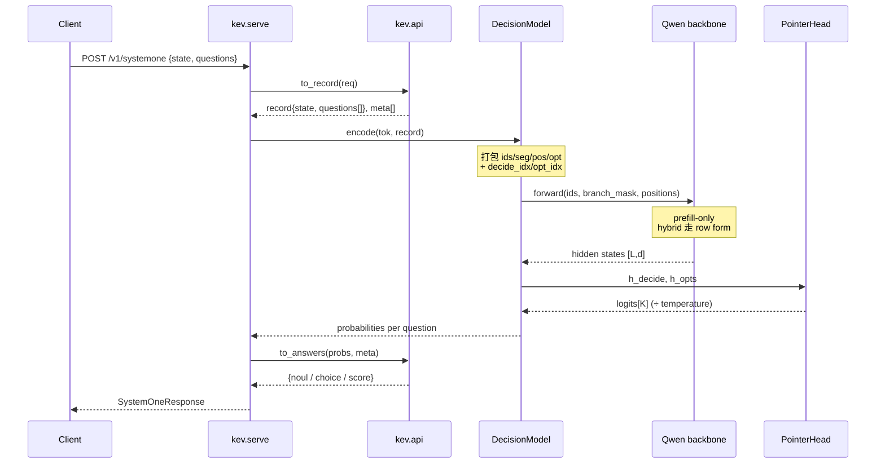

# 01 · 模型架构基础

> 目标：读完后你能回答——"一个预训练好的聊天大模型，是怎么被改造成一个只吐概率、不做生成的决策模型的？"

## 1. 先补三块地基

如果你完全没有 Transformer 基础，先把这三块补齐，再回来读 Kev 的改动。

### 1.1 因果语言模型（causal LM）

一个 GPT/Qwen 式的模型做一件事：**给定前缀，预测下一个 token 的概率分布**。

```
输入:  "今天 天气 很"
模型每一步都对"下一个 token"输出一个覆盖整个词表的分布
```

关键机制：
- **self-attention**：每个 token 可以"看"序列里的其它 token；**causal（因果）mask** 规定它只能看自己和左边，看不到右边（否则会偷看答案）。
- **KV cache**：生成时把已经算过的 key/value 缓存起来，逐 token 复用。
- **prefill vs decode**：处理整段 prompt 叫 prefill（一次算完、可并行）；逐 token 往外蹦叫 decode。

> **Kev 的第一性改造：只 prefill，不 decode。** 它压根不要生成文字，只要"读完这段 state 和问题之后，每个问题的答案分布"。这一刀砍掉了词表输出头（LM head）、采样、解码循环——整个仓库的简单与怪异都源于此。

### 1.2 Hugging Face Transformers

- `AutoModelForCausalLM.from_pretrained(...)` 加载一个完整模型；`.model` 拿到 **去掉 LM head 的骨干（backbone）**。
- `AutoTokenizer` 把文本切成 token id。
- 4D attention mask：`forward` 可以接受一个自定义的 `[B,1,L,L]` 加性掩码，用来覆盖默认的因果掩码。

Kev 用的正是 `.model`（backbone only）。看 [`kev/model.py:DecisionModel.__init__()`](../../kev/model.py)：

```python
# backbone only (no vocab head): we never generate text.
self.lm = AutoModel.from_pretrained(weights, **load) \
        if weights else AutoModelForCausalLM.from_pretrained(name, ...).model
```

`.model` 结尾就是"把 LM head 丢掉"。

### 1.3 LoRA（参数高效微调）

冻结原始权重 `W`，只训练两个小矩阵 `A·B`（秩 `r` 远小于隐藏维度），推理时等效于 `W + B·A`。
Kev-0.8B/4B/9B 就是"冻结 Qwen 基座 + 小 LoRA adapter"；Kev-27B 是全量微调。详见 [02 训练框架](./02-training-framework.md)。

---

## 2. Kev 的两大独创机制

地基打完，进入 Kev 真正的设计核心。整个模型契约是一个原语：

```
state  →  questions[]  →  probabilities[]
```

### 2.1 block-causal mask：共享 state、隔离分支

一个请求里，多个问题共享同一段 state，但 **问题之间不能互相偷看**。这就是 block-causal（块因果）掩码。

看 [`kev/model.py:encode()`](../../kev/model.py) 的打包格式：

```
[<state> ...state tokens...]                    ← 段号 seg=0，所有问题共享
[<q> instr <opt> o1 </opt> <opt> o2 </opt> <decide>]   ← 段号 seg=1（问题1分支）
[<q> instr <opt> o1 </opt> ... <decide>]              ← 段号 seg=2（问题2分支）
...
```

规则在 [`kev/model.py:branch_mask()`](../../kev/model.py)：

```python
def branch_mask(seg, device, dtype=torch.float32):
    """attend(i,j) iff j<=i and (seg[j]==0 or seg[j]==seg[i])."""
```

翻译成大白话：位置 `i` 能关注位置 `j`，当且仅当
1. `j <= i`（因果，不偷看未来），**并且**
2. `j` 属于 state（`seg[j]==0`，共享前缀人人可读）**或者** `j` 和 `i` 属于同一个问题分支（`seg[j]==seg[i]`）。



> 为什么这么设计？因为一次业务请求会同时问"这份合同有违约责任吗（noul）？属于哪一类（choice）？风险几分（score）？"——它们共享同一份合同，但每个问题的判断必须独立，不能被别的问题的措辞污染。block-causal 让它们在 **一次前向** 里并行算完，又互不串味。

批量版 [`branch_mask_batch()`](../../kev/model.py) 还处理 right-padding（填充位不被人看到、对角线自留避免整行被掩空）和 option isolation（见 §4）。

### 2.2 pointer readout：不生成 token，而是给候选项打分

普通 LM 到 `<decide>` 位置会去预测下一个词的 15 万维分布。Kev 不这么做。它用一个 **指针头（PointerHead）** 直接对每个候选项打分：

- 取 `<decide>` 位置的隐向量 `h_decide`（"我现在要做决定了"）；
- 取每个选项结束标记 `</opt>` 位置的隐向量 `h_opt[k]`（"第 k 个选项是这个样子"）；
- 做注意力点积：`logit[k] = (k(h_opt[k]) · q(h_decide)) / sqrt(dp)`。

看 [`kev/model.py:PointerHead.forward()`](../../kev/model.py)：

```python
class PointerHead(nn.Module):
    def __init__(self, d, dp=256):
        self.q, self.k = nn.Linear(d, dp), nn.Linear(d, dp)
        self.scale = 1 / math.sqrt(dp)
        self.temperature = 1.0   # 推理时把 logits 除以它（校准），argmax 不变

    def forward(self, h_decide, h_opts):   # [d], [K,d] -> logits [K]
        z = (self.k(h_opts) @ self.q(h_decide)) * self.scale
        return z if self.training or self.temperature == 1.0 else z / self.temperature
```

`logits` 过 softmax 就是选项概率分布。K 个选项，输出 K 维——**与词表无关，与生成就无关**。



**三种问题类型如何统一到一个指针头**（见 [`kev/api.py`](../../kev/api.py)）：

| 类型 | 候选项怎么来 | 最终答案怎么读 |
|---|---|---|
| `noul`（是/否） | 固定 2 项 `[false, true]` | `answer = p(true)` |
| `choice`（多选） | criteria 的每个 key 一个选项 | `argmax` + 概率分布 + confidence |
| `score`（评分） | 有序等级描述各一项 | `Σ i·p[i]`（期望等级）+ legend |

置信度公式在 [`kev/api.py:choice_confidence()`](../../kev/api.py) 与 `score_confidence()`：
`choice_confidence = (p_max − 1/K) / (1 − 1/K)`，均匀分布时 0、确定时 1。

---

## 3. hybrid backbone：DeltaNet 带来的一个"退化路径"

Qwen3.5 是 **混合架构**：传统 attention 层与 **Gated DeltaNet（线性注意力）** 层交替。DeltaNet 是递归的（有 recurrent state / conv state），**它无法实现任意 4D block-causal 掩码**。

[`kev/model.py:is_hybrid()`](../../kev/model.py)：

```python
def is_hybrid(config):
    """Whether a backbone has Gated DeltaNet layers (Qwen3.5). Such backbones cannot honour the
    block-causal mask and run the row form."""
    return "linear_attention" in set(getattr(config, "layer_types", None) or [])
```

解决办法：**row form（行形式）**。既然分支只能读 state + 自己，那就干脆把"state + 单个分支"拆成一条独立的因果行，逐问题跑。[`rows_of()`](../../kev/model.py) 做这个拆分：

```python
def rows_of(enc):
    """Split a packed encoding into its state and per-question branch rows...
    Feeding state + rows[k] as one causal row is equivalent to the packed block-causal form
    for that question, on any architecture."""
```

两条路径 **在 fp32 噪声内数值一致**（`tests/test_model.py::test_rows_match_packed` 保证）。`DecisionModel.__init__` 里据此选路：

```python
self.hybrid = is_hybrid(self.lm.config)
if self.hybrid and option_isolation:
    raise ValueError("option_isolation needs the packed mask; not available on hybrid backbones")
```

> 这条"退化路径"是仓库里大量复杂度（shared prefix、fused kernels、长文档 flash kernel）的根源：hybrid 上每问一行会把 state 重复算，于是有了 [prefix cache（03）](./03-inference-serving.md) 和 [`kev/shared_prefix.py`](../../kev/shared_prefix.py)。

---

## 4. 进阶：option isolation（排列不变性）

默认 packing 下，一个分支里选项是顺序排开的：选项 2 能"看到"选项 1。这对二分类没影响，但对"选项顺序不该影响判断"的严谨场景不够。

[`encode(option_isolation=True)`](../../kev/model.py) 把 **每个选项 span 变成独立子分支**：它只能读 state + 指令 + 自己；所有选项共享同一组位置 id；`<decide>` 放在最长 span 之后的固定位置。这样逐选项表示与 `<decide>` 对它们的注意力 **天然排列不变**。掩码逻辑在 [`branch_mask_batch(opts=...)`](../../kev/model.py)。

仅在 attention-only（非 hybrid）骨干可用（因为要 packed 掩码）。

---

## 5. 一次完整推理（把上面串起来）



对照动画：[`architecture-flow.html`](./architecture-flow.html) 里把这条链路做成了粒子沿管道流动的动画。

---

## 6. 关键常量速查（[`kev/model.py`](../../kev/model.py)）

| 常量 | 含义 | 值 |
|---|---|---|
| `SPECIAL` | 复用 Qwen 已有的特殊 token 作分隔符（不新增词表行） | `<\|state\|>` 等 5 个 |
| `MAX_STATE / MAX_BRANCH / MAX_PACKED` | 训练上下文预算（token） | 384 / 1024 / 2048 |
| `SERVE_MAX_STATE` | 服务侧最长 state | 65,536 |
| `ROW_PASS_TOKENS` | 一次推理 pass 容纳的行 token 预算 | 16,384 |

注意分隔符的选择很讲究：复用 **已存在的** 特殊 token，这样 LoRA 只需"重新解释"它们的含义，无需训练新 embedding 行。
而 [`user_tokens()`](../../kev/model.py) 会把用户文本里的 `<|...|>` 改写掉，**保证候选项边界不可被调用方伪造**。

---

## 7. 跑一遍 / 看一遍

- 打开 [`kev/model.py`](../../kev/model.py)，按顺序读：`encode` → `branch_mask_batch` → `rows_of` → `PointerHead` → `DecisionModel.__init__`。
- 做实验：`option_isolation` 打开/关闭，跑 `uv run pytest tests/test_model.py -k rows_match_packed`，验证 packed 与 row 两条路径等价。
- 下一步：带着"state 共享 / 分支隔离 / 指针打分"这三件套去读 [02 训练框架](./02-training-framework.md)，看它是怎么被训出来的。
