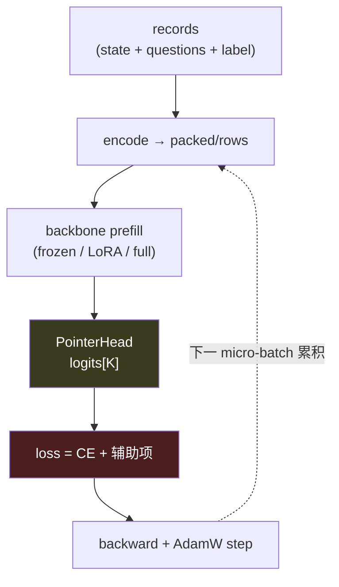
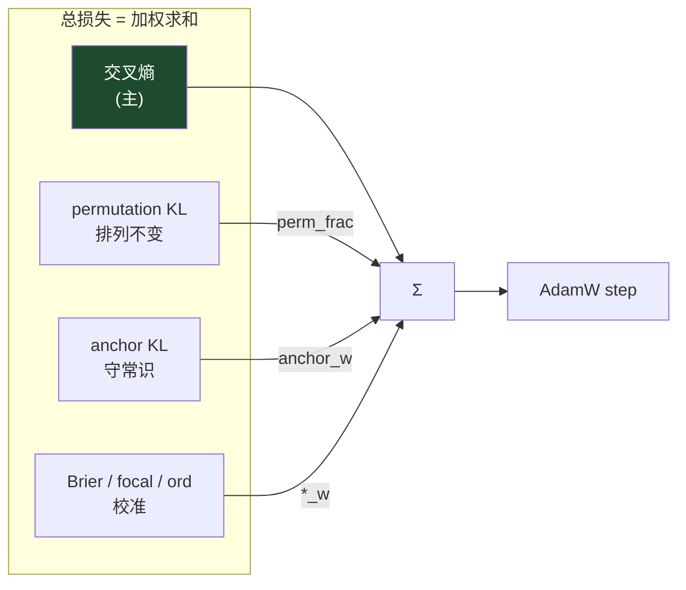
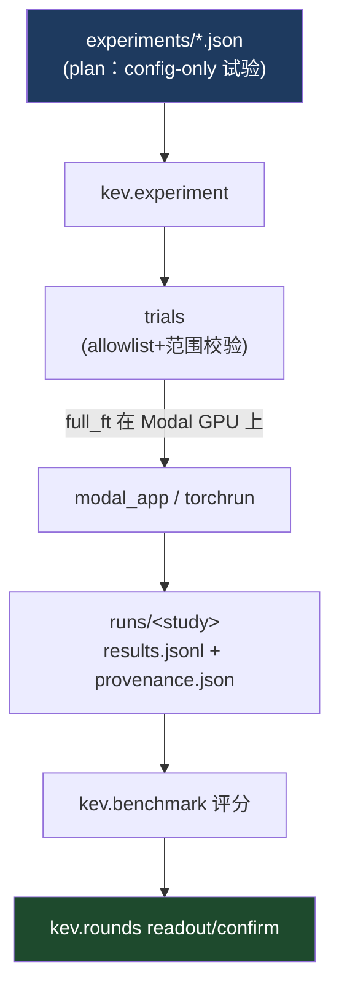

# 02 · 训练框架

> 目标：读完后你能回答——"一个冻结的 Qwen 基座，怎么被喂进 block-causal 决策格式，训出会打概率的 Kev？"

主线文件：[`kev/train.py`](../../kev/train.py)（725 行）、[`kev/full_ft.py`](../../kev/full_ft.py)、[`kev/suite.py`](../../kev/suite.py)、[`kev/data.py`](../../kev/data.py)。

## 1. 训练在优化什么

一句话：**用带标注的 `record`（state + questions + 每个问题的 label），训练 pointer head（从零）+ 基座（LoRA 或全量），
让每个问题的 logits 过 softmax 后命中 label。** 没有生成、没有 seq2seq、没有 decoder——纯粹是"多分类交叉熵 + 若干辅助约束"。



## 2. LoRA vs 全量微调：两条训练路径

看 [`kev/train.py` 顶部 docstring](../../kev/train.py)：

```
LoRA fine-tune of the decision model ... with the pointer head trained from scratch.
`--full_ft 1` trains the whole backbone instead (bf16 weights, fp32 masters;
several GPUs through torchrun + FSDP2).
```

| | LoRA（0.8B/4B/9B） | full_ft（27B） |
|---|---|---|
| 基座 | 冻结，只训小 adapter + head | 整个 text backbone + head 都训 |
| 精度 | 视配置 | bf16 权重 + fp32 master（`MasterAdamW`） |
| 分布式 | 单 GPU 常见 | torchrun + FSDP2 分片 |
| 产物 | adapter（`head.pt` + LoRA） | ~51 GB 全量权重 |
| 不加载 | —— | vision tower / LM head / MTP（永远不加载） |

`--lora_targets` 决定 adapter 贴在哪些投影上（[`DecisionModel.__init__`](../../kev/model.py)）：
`all / dense / attn / qv`。在 hybrid 基座上，`all`/`attn` 会自动追加 DeltaNet 投影
（`in_proj_qkv/z/a/b`、`out_proj`），`dense` 则冻结它们（retention ablation）。

```bash
# LoRA（发布的 4B/9B 配方）
uv run python -m kev.train --suite evals/v7/decision-v7 --base Qwen/Qwen3.5-4B-Base \
  --epochs 2 --lr 5e-5 --batch 4 --accum 2 --dtype bf16 --device cuda --out runs/kev-4b

# 全量（torchrun，8 卡）
torchrun --standalone --nproc_per_node 8 -m kev.train --full_ft 1 \
  --weights_dtype bf16 --dtype bf16 --checkpointing 1 ...
```

## 3. batch 与梯度累积

`train.py` docstring：*"Batch size is small (variable-length records with custom masks) and gradients are accumulated
over `--accum` micro-batches. 一个 step 看到 `accum × batch × world_size` 条 records。"*

为什么要累积：record 变长 + 自定义 4D 掩码 → 大 batch 显存爆炸。用小 micro-batch 攒梯度是这类"非规则张量形状"训练的通用解法。

## 4. 损失设计（Kev 的灵魂）

核心损失在 [`kev/train.py:question_loss()`](../../kev/train.py)：

```python
def question_loss(z, q, dev, ord_w, label_smoothing=0.0, brier_w=0.0, focal_gamma=0.0):
    """Cross-entropy (or against a soft target), optionally plus the normalized
    ranked probability score for ordered levels."""
    loss = F.cross_entropy(z[None], y, label_smoothing=label_smoothing)
    if brier_w:      # 加 Brier：全分布的平方误差，不只 top-1
        loss = loss + brier_w * (F.softmax(z, -1) - target).square().sum()
    if focal_gamma:  # focal：下采样"已经答对"的简单样本
        loss = (1 - torch.exp(-loss)).pow(focal_gamma) * loss
    if q["qtype"] == "score" and ord_w > 0:   # 有序等级：ranked probability score
        loss = loss + ord_w * (p.cumsum(-1)[:-1] - observed_cdf).square().mean()
    return loss
```

主 CE 之外，四个可调辅助约束（默认全 0，都不在发布配方里）：`--label_smoothing` / `--brier_w` / `--focal_gamma` / `--ord_w`。
它们的共同目标是 **校准**——不只让 top-1 对，还要让概率值本身可信。

### 4.1 permutation KL：对抗"选项顺序偏置"

[`kev/train.py`](../../kev/train.py) 的 `--perm_kl / --perm_frac`：把同一 record 的选项随机打乱再跑一遍，
用对称 KL 约束"打乱前后的分布应一致"（`permuted_copy()` + 对称 `kl_div`）：

```python
return 0.5 * (F.kl_div(lp2, lp1, log_target=True) + F.kl_div(lp1, lp2, log_target=True))
```

默认 `--perm_frac 0.3`：30% 的 record 走这第二条打乱前向。这让模型学到"内容决定判断，而非位置"。

### 4.2 anchor KL：向冻结基座的 zero-shot 靠拢

[`kev/train.py:anchor_loss()`](../../kev/train.py)：

```python
"""KL(teacher || student) for one question,
teacher = frozen base zero-shot distribution keyed by option key."""
```

`--anchor / --anchor_w / --anchor_sources`：在某些数据源上，把 **冻结基座的 zero-shot 答案** 当 teacher，
用 KL 把学生往它拉，防止小数据微调把基座原本正确的常识训坏（来源：[`kev/anchors.py`](../../kev/anchors.py)）。



## 5. 数据从哪来：三种入口

[`kev/train.py`](../../kev/train.py) docstring 给出三条路径：

| 入口 | 命令 | 说明 |
|---|---|---|
| 冻结套件 | `--suite evals/v7/decision-v7` | 读套件的 **训练分区**（发布配方走这条） |
| 自有 JSONL | `--data mine.jsonl` | 你自己的标注行，可叠 `--suite --replay N` |
| 现场构建 | `--n_per_source 40` | 从公开源现搭（smoke 路径） |

数据构造、增强、none-pair 逻辑在 [`kev/data.py`](../../kev/data.py)（`build / augment / none_pair / materialize`）。

### 5.1 增强开关（`AGENTS.md` 里那一大段的代码版）

| 开关 | 作用 |
|---|---|
| `--p_none` / `--p_none_distract` / `--p_distract` | 注入"无答案/干扰项"，训练 abstain 与抗噪 |
| `--p_none_pair` | 生成 none 配对样本（同 state 两条） |
| `--none_pair_max_state N` | 只对 state ≤ N token 的 record 造 none-pair，防止长 state 把一次 pass 撑爆显存 |
| `--synthetic_repeat` | 合成 policy/rule 记录重复 |
| `--public_frac / --train_sources / --holdout` | 公开源配比与留出 |

### 5.2 token 预算与 plan（长上下文训练的坑）

`--length_sort 1`：把一步的 record 按长度近邻分成 micro-batch，避免某 rank 等另一个的长尾。
`--pass_tokens_max N` / `--row_budget N`：按 **精确 token 形状**（不是字符数）裁剪每步的最大 pass。
round 21 就因为用字符计划、被一个 token 密集的 PII state 撑爆显存（详见 AGENTS.md），这块是长上下文训练的精髓，入门阶段先知道"存在这组开关、解决的是显存可预测性"即可。

## 6. 训练产物、断点与快照

- **checkpoint**：`<out>/checkpoint`（LoRA 权重 + `head.pt` + tokenizer），`head.pt["temperature"]` 携带校准温度。
- **resume point**：`--save_every_minutes/-steps` 写 `<out>/resume`（fp32 master + 动量 + scheduler + RNG + 数据位置），`--resume 1` 逐 bit 续训。
- **snapshot**：`--snapshot_fractions 0.25,0.5,0.75` 在优化步分数处写可加载 bf16 checkpoint（`kev.full_ft.SnapshotWriter`，最多 `MAX_SNAPSHOTS=8`）。
- **指标**：`training_metrics.json` 记录每 epoch 梯度范数（clip 前后）、full_ft 的保存/快照耗时。

## 7. 从训练到研究流水线

单次训练很少手动跑；绝大多数通过 **study/round** 编排：



详见 [04 评估系统](./04-evaluation-system.md) 的 rounds 流程。

## 8. 跑一遍

```bash
# 1 分钟 smoke：不加载真权重，验证整条 encode→loss→step 链路
uv run python -m kev.train --n_per_source 40 --accum 4 --out runs/smoke

# 看损失项如何被 flag 点亮（对照 §4）
uv run python -m kev.train --help | grep -E "perm_kl|anchor|brier|focal|ord_w"
```

- 读源码顺序：`question_loss` → `anchor_loss` → perm 的对称 KL → step 循环里 `terms` 的累加。
- 下一步：模型训出来了，怎么上线服务？去 [03 推理服务](./03-inference-serving.md)。
