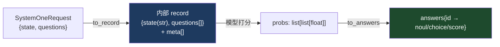
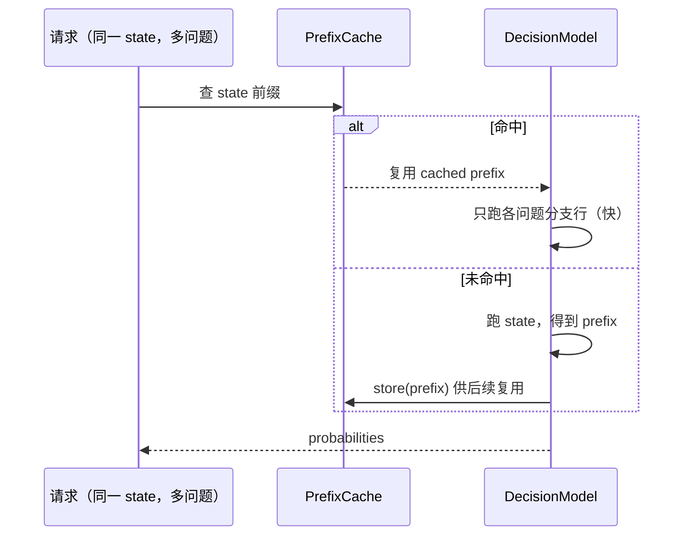
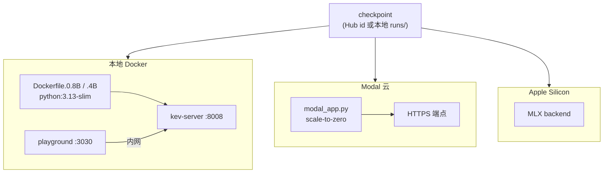
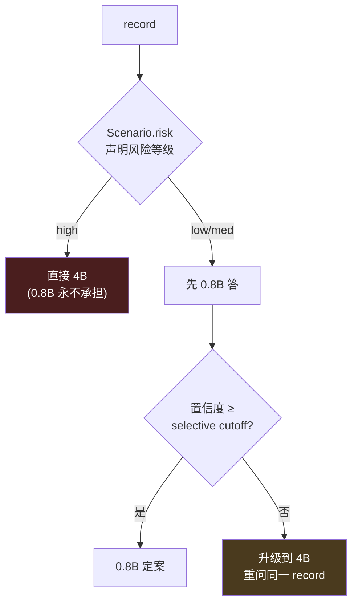

# 03 · 推理服务

> 目标：读完后你能回答——"一个训好的 Kev checkpoint，怎么变成一个兼容 TypeSafe SDK、能处理 64k 长文档、可 scale-to-zero 的 HTTP 端点？"

主线文件：[`kev/api.py`](../../kev/api.py)（契约）、[`kev/serve.py`](../../kev/serve.py)（FastAPI 服务）、[`kev/checkpoint.py`](../../kev/checkpoint.py)（加载）、[`kev/vertical.py`](../../kev/vertical.py)（行业路由）。

## 1. 服务的心智模型：一次 prefill，不生成

[`kev/serve.py`](../../kev/serve.py) 顶部一句话点题：*"loads one checkpoint, exposes **prefill-only decisions**"*。
服务端做的全部事情就是 [01 文档](./01-model-architecture.md) 里那条链路的 HTTP 封装：

```
POST /v1/systemone {state, questions}  →  一次前向  →  {answers: 概率}
```

## 2. 契约层：TypeSafe System One 兼容（[`kev/api.py`](../../kev/api.py)）

Kev 是 hosted 产品 [Jev](https://docs.typesafe.ai/api) 的 **drop-in 本地替代**，所以 API 形状必须一模一样。
Pydantic 模型定义了三种问题：

```python
class Noul(BaseModel):    type: Literal["noul"];    criteria: dict | None    # 是/否
class Choice(BaseModel):  type: Literal["choice"];  criteria: dict[str, ...] # 多选（1..255 项）
class Score(BaseModel):   type: Literal["score"];   criteria: list[...]      # 有序等级
class SystemOneRequest(BaseModel):
    state: JSONContent                              # str | dict | list | ...
    model: str = "kev-latest"
    questions: dict[str, Question]                  # 至少一个
```

请求进来后两步翻译（[`to_record`](../../kev/api.py) / [`to_answers`](../../kev/api.py)）：



- [`render()`](../../kev/api.py) 把结构化 state（str/对象/数组）拍平成模型看到的文本，保留字段名当标签。
- [`to_record()`](../../kev/api.py) 把每种问题映射成候选项列表：noul → `[no, yes]`；choice → criteria 各项；score → 等级描述。
- [`to_answers()`](../../kev/api.py) 把概率回写成 TypeSafe 兼容答案：noul 给 `p(true)`，choice 给 `argmax + probabilities + confidence`，score 给期望等级 `Σ i·p[i] + legend`。
- 置信度公式镜像 TypeSafe 参考适配器（`choice_confidence` / `score_confidence`）。

### 2.1 一个可选的预处理：date_facts

模型自己不擅长日期减法（issue #8）。[`api.py:date_facts()`](../../kev/api.py) 把 state 里出现的所有绝对日期两两配对，
算好天数差，作为一句事实塞进 state（`"August 3, 2026 is 12 days after July 22, 2026."`）。
**opt-in**：服务侧 `KEV_DATE_FACTS=1`，评分侧 `--date_facts`。

## 3. 服务层（[`kev/serve.py`](../../kev/serve.py)）

### 3.1 路由面

| 路由 | 用途 |
|---|---|
| `POST /v1/systemone` | 主推理端点：一次前向出全部答案 |
| `POST /v1/systemone/permute` | 把一个 Choice 在多种选项顺序下重跑（测排列稳健性） |
| `POST /v1/systemone/separate` | 每个问题各跑一遍（packed vs separate 对比） |
| `GET /v1/models` | 模型列表（Docker HEALTHCHECK 打这个） |
| `/console/api/*` | 编排控制台挂载在 **同一 8008 端口** |

```python
@app.post("/v1/systemone")
async def systemone(req: SystemOneRequest):
    """TypeSafe-compatible endpoint: typed questions in, typed answers out, one prefill pass."""
```

`MODEL_NAMES = ("kev-latest", "jev-latest")`：**同一个 checkpoint 用两个名字服务**，`jev-latest` 是 TypeSafe SDK 的默认模型名，
未配置的客户端也能直接跑通。Bearer 鉴权：`KEV_API_KEY` 未设 = 开放本地服务，设了就要求 `Authorization: Bearer <key>`。

### 3.2 prefix cache：长文档 + 多问题的性能核心

hybrid 骨干（Qwen3.5）走 row form，每个问题一行、每行都带 state → **state 会被重复计算**。
[`kev/serve.py:PrefixCache`](../../kev/serve.py) 把 state 前缀（KV + DeltaNet states）缓存起来跨请求复用：

```python
@dataclass
class PrefixCache:
    """State prefixes kept across requests, least recently used first:
    (state token ids, option_isolation) -> prefix."""
    size: int          # 缓存几个 state（KEV_PREFIX_CACHE，默认 4）
    min_tokens: int    # 短于此不缓存（hybrid=0，attention-only=384）
    max_tokens: int    # 总共持有的 state token 上限（默认 65536）
```

规模感（`model.py` 注释）：Kev-4B on MLX，一个 4.8k token 的 state + 64 个问题，
一次性 24.7 GB；一行一行跑降到 8.9 GB（成本就是 64 份 state cache）。`prefix_min_tokens` 的解释在
[`kev/model.py:DecisionModel.prefix_min_tokens`](../../kev/model.py)。



### 3.3 上下文准入与长文档

[`kev/model.py:admit()`](../../kev/model.py) 是服务侧准入：state 超过 `SERVE_MAX_STATE=65536` token → **422**；
`KEV_TRUNCATE_STATES=1` 则只读前 65536 token 并在响应里标注 truncated。超过 `ROW_PASS_TOKENS=16384` 的长行走
"long-row 规则"（state 只跑一遍、fused kernel）。

### 3.4 后端与精度（[`kev/checkpoint.py`](../../kev/checkpoint.py) LoadOptions）

- CUDA → torch `sdpa`；MPS/CPU → torch `eager`（兼容自定义 4D 掩码）。
- Apple Silicon 上 hybrid checkpoint 默认走 **MLX 后端**（[`kev/mlx_model.py`](../../kev/mlx_model.py)，实现同一 `SCORING_INTERFACE`）。
- bf16 是大骨干的 serving 选项；`KEV_TEMPERATURE` / `--temperature` 可覆盖 checkpoint 自带温度。
- `--run` 既接本地目录也接 HF Hub id（`jaredpalmer/kev-4b@v1.0`）。

## 4. 部署形态



- **Docker Compose**：`deploy/docker-compose.yml` 起 `kev-server`(8008) + `playground`(3030)；
  checkpoint **不入镜像**，运行时 `KEV_RUN` 指定。一键脚本：Windows `deploy/deploy-windows.ps1`、Linux `deploy/deploy-linux.sh`。
- **Modal**：`modal_app.py` 提供 scale-to-zero 的 HTTPS 端点（`kev-serve`）。
- 环境变量驱动：`KEV_RUN / KEV_DTYPE / KEV_PREFIX_CACHE / KEV_CUDA_GRAPHS / KEV_FUSED / KEV_DATE_FACTS / KEV_API_KEY / HF_ENDPOINT ...`

启动一条服务：

```bash
uv run --extra serve python -m kev.serve --run jaredpalmer/kev-4b --port 8009
```

## 5. 垂直部署与风险路由（[`kev/vertical.py`](../../kev/vertical.py)）

"垂直行业 Kev" 不是新模型，而是：**发布 checkpoint + 行业 LoRA delta + 行业 head + 行业校准温度**。
五个行业共享同一冻结骨干，切换 = peft `set_adapter`（0.8B 每行业 46 MB，4B 131 MB），不复制权重。

真正有趣的决策是 **哪个尺寸来答**，路由有两个可审计输入：



两条设计红线（docstring 明示）：
1. **失败安全**：无法分类的场景 → 走大模型；0.8B 无记录 cutoff → 升级而非硬判。
2. **路由不看 state 内容**：绝不用文本内容选尺寸——否则就在校准模型前面又插了个未校准的分类器。
   临床审阅者能靠读表格核对的，只有"是这张（声明式风险）表做的决定"。

`vertical.py` 是 `kev.serve.Server` 之上的纯决策层，不含权重/CUDA/FastAPI，
因此路由规则可 **无 GPU 测试**。

## 6. 跑一遍

```bash
# 起本地服务
uv run --extra serve python -m kev.serve --run runs/smoke/checkpoint --port 8009

# 打一发 noul + choice 混合请求
curl -s localhost:8009/v1/systemone -H 'content-type: application/json' -d '{
  "state": "合同第7条：任一方违约需赔偿对方全部直接损失。",
  "questions": {
    "has_penalty": {"type": "noul"},
    "risk": {"type": "choice", "criteria": {"low": "轻微", "high": "严重"}}
  }
}'
```

对照 [00 动画](./architecture-flow.html) 里"请求 → encode → prefill → readout → 响应"的粒子流。
下一步：怎么证明这个模型概率可信？去 [04 评估系统](./04-evaluation-system.md)。
