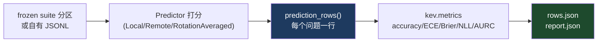
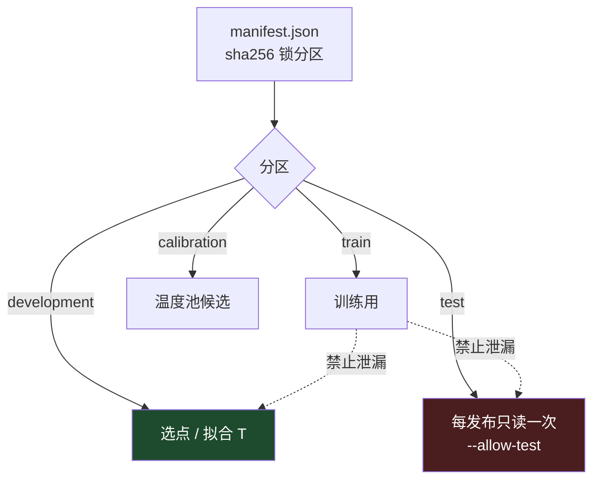
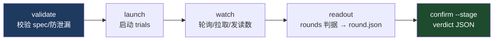
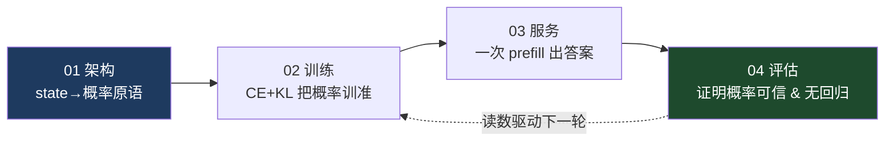

# 04 · 评估系统

> 目标：读完后你能回答——"怎么证明一个决策模型不只是'猜对了'，而是它给出的概率 **值得信任**？"

主线文件：[`kev/benchmark.py`](../../kev/benchmark.py)（评分入口）、[`kev/metrics.py`](../../kev/metrics.py)（纯 numpy 指标）、[`kev/calibrate.py`](../../kev/calibrate.py)、[`kev/compare.py`](../../kev/compare.py)、[`kev/suite.py`](../../kev/suite.py)、[`kev/rounds.py`](../../kev/rounds.py)。

## 1. 为什么评估是 Kev 的重头戏

普通 LLM 评测看"回答得像不像样"。Kev 输出的是 **概率**，所以真正的问题是：

> 模型说"置信度 0.9"的那些判断，是不是 **真的有约 90% 对**？

这叫 **校准（calibration）**，是 Kev 整个评估体系的核心，也是它和"跑个 accuracy 就交付"的模型最本质的区别。

## 2. 评分流水线（[`kev/benchmark.py`](../../kev/benchmark.py)）



```bash
uv run python -m kev.benchmark --run runs/<name>/checkpoint --suite evals/v4/transfer-v4 --out runs/<bench>
uv run python -m kev.benchmark --remote http://127.0.0.1:8008 --suite ... --out ...   # 打任意 System One 端点
```

产物：
- **`rows.json`**：逐题记录，含 `p`（概率）、`label`、`logits`、`task/source/variant`……（外部套件的 rows.json 会入库，供事后重算）。
- **`report.json`**：accuracy、ECE/Brier/NLL、选择性覆盖与 AURC、排列稳健性、隔离度，外加 `environment`（logits 依赖的 kernel 集：包版本、GPU、dtype、attention 实现、DeltaNet forward 等——**逐 bit 配对两次读数前必须先对 environment**）。

[`validate_distribution()`](../../kev/benchmark.py) 是最基本的守门：概率必须在 [0,1]、有限、且 sum≈1，否则报错。

## 3. 指标族（[`kev/metrics.py`](../../kev/metrics.py)：纯 numpy，可离线跑在 rows.json 上）

### 3.1 正确性

- **accuracy**：`argmax(p) == label` 的比例（[`_row_scores`](../../kev/metrics.py) 里的 `acc`）。

### 3.2 校准三件套

| 指标 | 定义 | 越低越好? | 看代码 |
|---|---|---|---|
| **ECE**（期望校准误差） | 按置信度分 10 桶，每桶 `\|平均准确率 − 平均置信度\|` 的加权 | ✅ 低好 | [`ece()`](../../kev/metrics.py) |
| **Brier** | 全分布的平方误差 `Σ(p − onehot)²`，不只 top-1 | ✅ 低好 | [`_row_scores`](../../kev/metrics.py) |
| **NLL** | 真实标签概率的负对数（可从 logits 精确算） | ✅ 低好 | [`nll_at_temperature()`](../../kev/metrics.py) |

```python
def ece(conf, correct, bins=10):
    edges = np.linspace(0, 1, bins + 1); e = 0.0
    for lo, hi in zip(edges[:-1], edges[1:]):
        m = (conf >= lo) & (conf < hi) ...
        e += m.mean() * abs(correct[m].mean() - conf[m].mean())   # 桶内 准确率 vs 置信度 的差
    return float(e)
```

ECE 的直觉：如果模型"过度自信"（说 0.9 却只对 0.7），ECE 就会把它揪出来。

### 3.3 选择性预测（模型知道自己不知道什么）

决策场景里，**允许模型"不确定就弃权"** 往往比强答更重要：

- **coverage at error budget**（[`coverage_at_error()`](../../kev/metrics.py)）：在给定错误率预算下，模型最多能"敢答"多大比例的题。
- **risk-coverage 曲线 / AURC**（[`risk_coverage_curve()`](../../kev/metrics.py)）：覆盖率越高、风险（错误率）通常越高；曲线下面积 AURC 越小说明"该答的答得准、该弃的弃得掉"。

### 3.4 按长度分桶的校准（长文档关键）

[`calibration_by_length()`](../../kev/metrics.py) 输出 `under_8k / 8k_16k / ... / 64k_plus` 各桶的 acc/ECE/Brier/confident-errors——
用于回答"文档变长后，概率还准不准"。`report.json` 的 `by_length` 面板就来自这里。

## 4. 温度校准：给 checkpoint 配一个可信度旋钮

PointerHead 在推理时把 logits 除以 `temperature`（[见 01](./01-model-architecture.md)）。怎么定这个 T？

- [`fit_temperature(rows)`](../../kev/metrics.py)：在一批 rows 上找出让 NLL 最小的 T。
- [`kev.calibrate`](../../kev/calibrate.py)：`kev.calibrate --rows <rows.json>` 报告"用这批行拟合一个温度会怎样"——raw / shipped / workload 内样本 / 组间无泄漏 OOF + 配对 bootstrap 对比 shipped。它是 **report-only**，不改动模型。
- 每个发布的 checkpoint 都自带一个在 **其开发行** 上拟合的 T（README 的表格：0.8B=2.35 / 4B=2.41 / 9B=2.19 / 27B=1.32）。

> **纪律**：温度只能拟合在 **训练语料之外** 的开发/留出数据上。AGENTS.md 记录 round 19 曾因在训练源的 development 行上拟合温度导致 ECE 虚低——这正是 `kev.rounds.pool_conflicts` 会拒绝的泄漏。

## 5. 配对比较：两个 checkpoint 谁更好（[`kev/compare.py`](../../kev/compare.py)）

```bash
uv run python -m kev.compare --candidate <dir> --reference <dir>
```

[`metrics.py`](../../kev/metrics.py) 的 `paired`（`kev.rounds.paired` 用：2000 次重采样、seed 0）做的是 **record-clustered bootstrap**：
同一 record 的多个问题必须整体一起重采样（否则高估显著性），给出配对指标区间。
这保证"Kev-9B 比 Kev-4B 在新源上高 3 个点"这种话有置信区间支撑，而不是点估计。

## 6. 冻结套件（[`kev/suite.py`](../../kev/suite.py) + `evals/`）

评测数据的可信来自"冻死、可复现、绝不泄漏进训练"：

```
evals/<version>/<suite>/
  manifest.json      ← 钉死 dataset + base revision + 每个分区的 sha256
  *.jsonl            ← 分区：train / calibration / development / test
```

- **选点纪律**：只在 development 上选 checkpoint/温度，**test 每个发布模型只读一次**（`--allow-test` 是唯一能读锁定 test 的通道）。
- **准入规则**：套件用 `SERVING_CONTEXT` 记录它的上下文预算；超长的行按 long-row 规则评。
- **eval-only 面板**（永远不能进训练语料）：`breadth-v1`（14 个 held-out 数据集，README 的"index"就来自它）、`transfer-v4/v9`（MMLU-Pro、埋状态、不可知）、`longdoc-v1`、`hard-v1`、`devtools-v1`、`documents-v1/v2` 等。
- **被移除的套件**：`kev.suite.REMOVED_SUITES` 会带原因拒绝读取（如 wanli/typesafe/scienthoon 因标注不健全被下线）。



## 7. rounds：把评估升级成科研流程（[`kev/rounds.py`](../../kev/rounds.py)）

单点 benchmark 只是"读一次数"。真正的研究问题（这个改动是不是净进步？）由 **round spec** 编排：

```
experiments/rounds/r<N>.json   ← 每轮一份 spec，训练/读数前先 commit
```

一份 spec 注册：studies（plan/GPU/timeout/budget）、arms（trial + parent）、parents（每次读数在哪）、
read tags → suites、rule（读数面板、bootstrap 指标、配对界判据、rank）、confirmation stages。



```bash
uv run python -m kev.rounds {validate,launch,watch,launch-reads,readout,confirm} <spec>
```

关键护栏（`AGENTS.md`）：
- **`POOL_REQUIRED_FROM`（round 21 起）**：任何受温度影响的判据（除 accuracy 外）没有注册 `temperature` 池 → `validate`/`launch` 直接拒绝这一轮。
- **`pool_conflicts`**：拒绝温度池与任何 arm 的训练数据共用。
- 每个 arm 的读数记录 `temperature_source`（是池还是它自己的开发行），表格在 arm 被训练语料的行服务时告警 `!!!`。
- **可复现**：`tests/test_rounds.py` 逐 bit 重现 rounds 5–18 的读数与 8/10/11/12/15 的 verdict。

## 8. 跑一遍

```bash
# 评分
uv run python -m kev.benchmark --run runs/smoke/checkpoint --suite evals/smoke-v1 --out runs/smoke-bench

# 对已存 rows.json 报告"拟合一个温度会怎样"（report-only）
uv run python -m kev.calibrate --rows runs/smoke-bench/rows.json

# 校验某个 round spec（不训练，只查泄漏/判据）
uv run python -m kev.rounds validate experiments/rounds/r5.json
```

- 读源码顺序：`benchmark.prediction_rows` → `metrics._row_scores` → `metrics.metrics` → `metrics.ece / fit_temperature`。
- 回看 [00 动画](./architecture-flow.html) 底部"评估与校准回路"一节：rows → 指标 → 温度 → 发布 checkpoint。

## 9. 四篇文档的收束



到这里，你已经具备读懂 Kev 全仓的概念地图。剩下的深度（长上下文 plan、FSDP2/resume/snapshot、
Modal lease、私有镜像套件）都建立在这四块地基之上。
