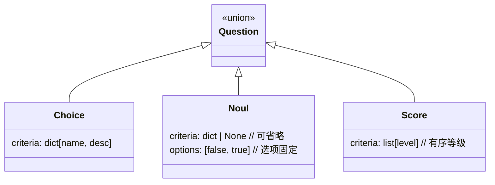
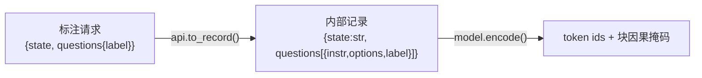
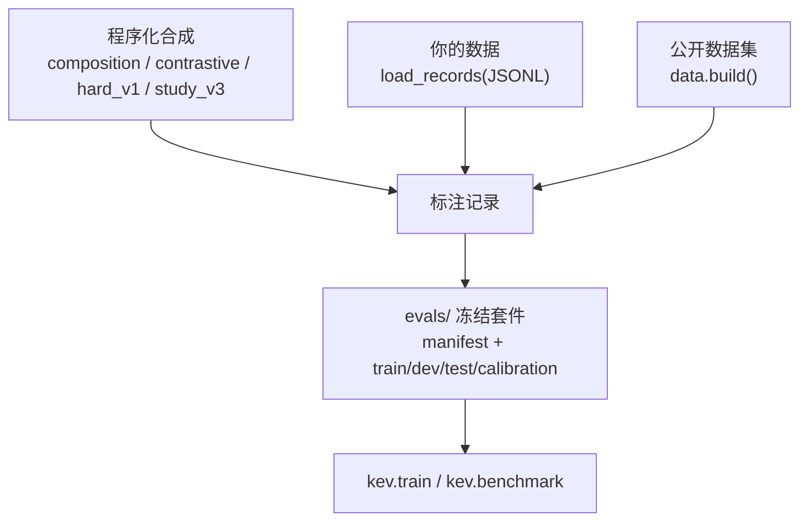
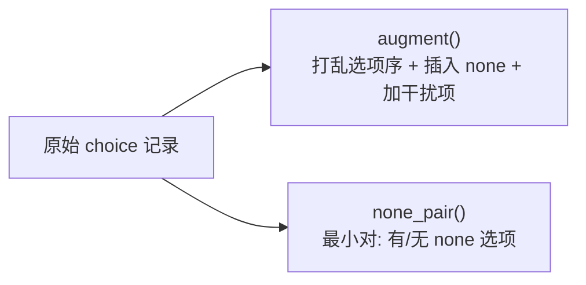
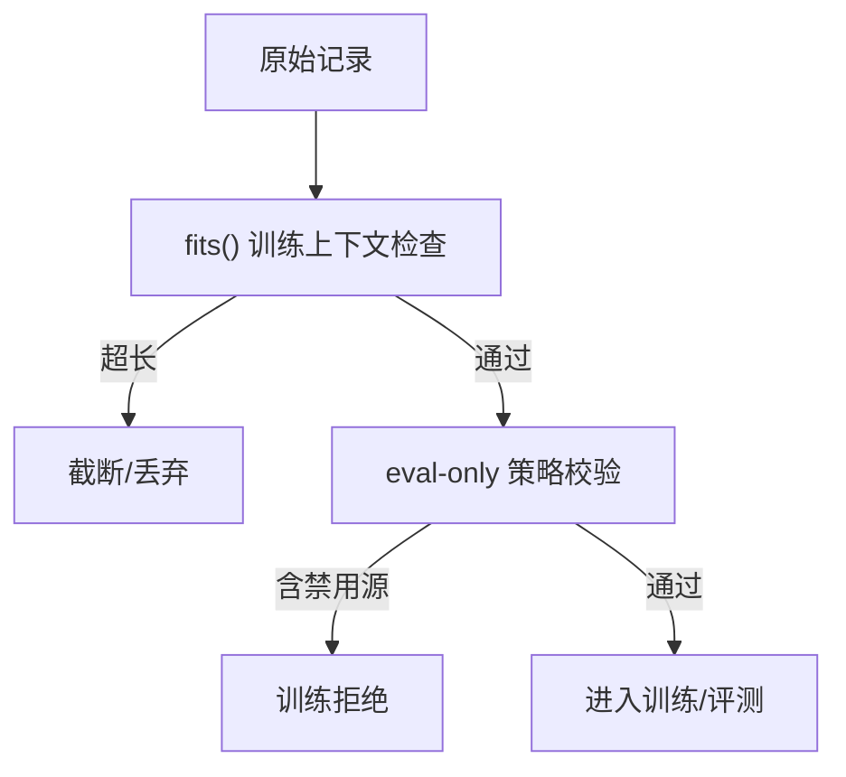

# 01 · 数据准备

> 核心结论：**KEV 的训练数据不是「问答对」，而是 `state + 多个结构化 questions` 的标注记录**。一个状态可以挂多个问题，每个问题输出一组选项的概率。数据准备的本质，就是把任何来源转化为统一格式，并保证「选项乱序不变 / 能识别 none-of-the-above / 跨源可溯源」。

---

## 1. 数据长什么样

### 1.1 对外协议：三类问题

`kev/api.py` 定义了 `SystemOneRequest`，任何进入模型的数据最终都映射成这三类：



| 类型 | 语义 | 模型输出 |
|---|---|---|
| `choice` | 多选项（如意图分类、多选一） | `argmax` + 各选项概率 + 置信度 |
| `noul` | 是非判断（Noul = null-or-unknown 的缩写，实为 true/false） | `p(true)` |
| `score` | 有序等级（如 1~5 星、风险档位） | 期望等级 + 概率分布 + 置信度 |

### 1.2 标注记录的两层表示



- **标注请求（labelled request）**：人/程序写的东西，带 `label`（答案）。
- **内部记录（internal record）**：`kev.data.materialize()` 通过 `api.to_record()` 把它变成模型真正吃的东西（`state` 被 `render()` 拍平成文本，`questions` 变成 `{instr, options, label}`）。`label` 在训练时被转成整数索引。
- **关键约束**：进入模型的文本**绝不含标签、criteria 之外的任何元数据**（`api_request()` 会剥离），保证训练与线上推理走同一条路径。

### 1.3 `evals/` 里一条样本（`.jsonl`）

```json
{"state": "顾客说：我想查一下上个月的账单。",
 "questions": {"intent": {"type":"choice",
   "instructions":"哪类银行意图最符合？",
   "criteria":{"billing":"账单查询","card":"银行卡","loan":"贷款"},
   "label":"billing", "src":"banking77"}},
 "_meta": {"id":"banking77/train/12","group_id":"...","variant":"clean",
           "text_sha256":"...","row_sha256":"...","source":"banking77",
           "repo":"legacy-datasets/banking77","revision":"...","split":"train"}}
```

`_meta` 携带**逐行/逐文本哈希、数据集 revision、split、`group_id`（用于分组计分）**，是「可溯源 + 可复现」的基石。

---

## 2. 数据从哪来（三类来源）



### 2.1 公开数据集（`kev/data.py`）

`build(n_per_source, ...)` 把 19 个 HuggingFace 公开数据集（统一登记在 `kev/data.py:ALL_REPOS` / `ALL_SOURCES`）转成 TypeSafe 形状。每个源有独立的 `_xxx()` 转换器，关键点：

| 数据集（源名） | HuggingFace 仓库 | 子集 / 说明 | 用途 |
|---|---|---|---|
| banking77 | `legacy-datasets/banking77` | 客服意图 77 类 | 训练 |
| boolq | `google/boolq` | 是非问答 | 训练 |
| agnews | `fancyzhx/ag_news` | 新闻 4 分类 | 训练 |
| mnli | `nyu-mll/multi_nli` | 取 `validation_matched` | 训练 |
| sst5 | `SetFit/sst5` | 影评 5 档情感 | 训练 |
| yelp | `Yelp/yelp_review_full` | 评论 5 星 | 训练 |
| trec | `CogComp/trec` | 问题类型 6 类 | 训练 |
| dbpedia14 | `fancyzhx/dbpedia_14` | 维基 14 类 | 训练 |
| amazon | `SetFit/amazon_reviews_multi_en` | 评论 5 星（多语言英） | 训练 |
| imdb | `stanfordnlp/imdb` | 影评二分类 | 训练 |
| arc | `allenai/ai2_arc` | 科学多选题 | 训练 |
| openbookqa | `allenai/openbookqa` | 科学常识 QA | 训练 |
| csqa | `tau/commonsense_qa` | 常识 QA | 训练 |
| mmlu | `cais/mmlu` | 取 `test` 分区 | 仅评测 |
| emotion | `dair-ai/emotion` | 情感 6 类 | 仅评测 |
| tweet_offensive | `cardiffnlp/tweet_eval` | 取 `offensive` config | 仅评测 |
| qnli | `nyu-mll/glue` | 取 `qnli` config | 仅评测 |
| paws | `google-research-datasets/paws` | 取 `labeled_final` config | 仅评测 |
| sciq | `allenai/sciq` | 科学 QA | 仅评测 |

> 来源：`kev/data.py:16-17`（`REPOS`）、`:278-281`（`ALL_REPOS`）、`:289-290`（`TRAINABLE` / `EVAL_ONLY`）。注意 `qnli`/`paws`/`mnli` 来自带 config 的父仓库，加载时按 `config` 或 `split`（如 `validation_matched`、`labeled_final`）选取。

**下载到本地 `./data/`**（可选）。`build()` 通过 `datasets.load_dataset(repo, …)` 读 Hub（`kev/data.py:43-46`），默认写进 `HF_HOME` 缓存（Windows：`%USERPROFILE%\.cache\huggingface`）。若想把数据集原文件放进仓库内的 `./data/<repo>/`（离线复用、直接翻 parquet），用 `hf` CLI（`huggingface_hub`，随 `uv sync` 的 `datasets` 一起装好）：

```powershell
# 参考命令：单个仓库 -> ./data/<repo>/
hf download --repo-type dataset google/boolq --local-dir ./data/google/boolq

# 2.1 表里的 19 个仓库
$repos = @(
  "legacy-datasets/banking77", "google/boolq", "fancyzhx/ag_news", "nyu-mll/multi_nli", "SetFit/sst5",
  "Yelp/yelp_review_full", "CogComp/trec", "fancyzhx/dbpedia_14", "SetFit/amazon_reviews_multi_en",
  "stanfordnlp/imdb", "allenai/ai2_arc", "allenai/openbookqa", "tau/commonsense_qa", "cais/mmlu",
  "dair-ai/emotion", "cardiffnlp/tweet_eval", "nyu-mll/glue", "google-research-datasets/paws", "allenai/sciq"
)
foreach ($r in $repos) {
  if ($r -eq "CogComp/trec") {
    # 该仓库 main 分支只有加载脚本 trec.py，取 Hub 自动转换的 parquet 分支
    hf download --repo-type dataset $r --revision refs/convert/parquet --local-dir "./data/$r"
  } else {
    hf download --repo-type dataset $r --local-dir "./data/$r"
  }
}
```

Linux / Modal 侧同理：`for r in "${repos[@]}"; do hf download --repo-type dataset "$r" --local-dir "./data/$r"; done`。

- **已下载的跳过**：`hf download` 幂等——`--local-dir` 内在 `.cache/huggingface/download/**.metadata` 记录 etag/size，文件没变就不重新传输（实测第二次跑显示 `Fetching 2 files … 0.00B`），所以整段可以反复重跑；只有强制重下才加 `--force-download`。
- **体积**：19 个仓库的 main 分支合计约 1.34 GB，大头是 yelp 308 MiB、mmlu 257 MiB（181 个科目文件）、multi_nli 214 MiB、glue 155 MiB、paws 123 MiB、dbpedia14 114 MiB。
- **只要 `build()` 真正读的那部分**：用 `--include` 精确到 config / split（行尾数字为该 pattern 命中的实际大小）：

```powershell
hf download --repo-type dataset nyu-mll/multi_nli --include "data/validation_matched-*.parquet" --local-dir ./data/nyu-mll/multi_nli   # 4.7 MiB
hf download --repo-type dataset nyu-mll/glue --include "qnli/*.parquet" --local-dir ./data/nyu-mll/glue                               # 18.3 MiB
hf download --repo-type dataset cardiffnlp/tweet_eval --include "offensive/*.parquet" --local-dir ./data/cardiffnlp/tweet_eval         # 1.2 MiB
hf download --repo-type dataset google-research-datasets/paws --include "labeled_final/*.parquet" --local-dir ./data/google-research-datasets/paws   # 10.4 MiB
hf download --repo-type dataset cais/mmlu --include "all/*.parquet" --local-dir ./data/cais/mmlu                                       # 49.1 MiB
```

- **不入库、也不被 `build()` 读取**：`./data/` 已加进 `.gitignore`；`--local-dir` 产出的是仓库文件树，`load_dataset` 认的是缓存布局。要让缓存本身落进仓库，设 `HF_HOME=./data`（或给 `hf download` 传 `--cache-dir`）；已经下到 `./data/` 的 parquet 也可以直接本地读，例如 `load_dataset("parquet", data_files={"test": "./data/CogComp/trec/default/test/*.parquet"})`。

- **`_wrap_state`**：同一文本随机裹成 `{document:...}` / `{ticket:...}` / `[{role,customer}]` / 纯文本 —— 让模型对「状态容器形式」不敏感。
- **`TRAINABLE` vs `EVAL_ONLY`**：硬性策略（见 `kev/data.py:289`）。可训练源（banking77…csqa）能进训练；eval-only 源（mmlu、qnli、paws…）**永远不参与训练、只做迁移度量**，训练代码会显式拒绝含 eval-only 源的数据（`kev/train.py:113-116`）。
- 选项顺序每题随机打乱（`augment` / `_mcq`），让「键名」本身不携带答案信息。

### 2.2 冻结评测套件（`evals/`）

- 目录命名：`decision-v7`、`transfer-v9`、`hard-v1`、`longdoc-v1`… 按「主题族-版本」或「代次 vN」或「roundN 专项」组织。
- 每个套件有 `manifest.json`：记录 `version`、`seed`、trainable/eval_only sources、`dataset_revisions`、`base_revisions`、`context` 上限。大文件从 Hub 镜像 `jaredpalmer/kev-suites` 按 sha256 下载。
- 数据按 `split` 分文件：`train`（只训练用）、`development`（调温/选模）、`test`（锁定的最终评测）、`calibration`（温度拟合）。

### 2.3 程序化合成（`kev/composition.py`、`contrastive.py` 与 `scripts/build_*.py`）

| 生成器 | 作用 | 标签来源 |
|---|---|---|
| `composition` | 组合式规则记录（atom/negation/and/or/unless/if） | 规则求解器给出 |
| `contrastive` | 同一 item 改一句翻转标签的对比对 | 代码级不变性校验 |
| `hard_v1_*` | 七个困难族（tradeoff / multi_hop / ambiguous / numeric / long_policy…） | 规则引擎求解 |
| `study_v3` | 程序化策略族 + 分组划分 | 分组随机 |
| `build_longdoc_v1` | 4k–64k 长文档退化探针 | 求解器 + 自带标签 |

### 2.4 你自己的数据（`kev/data.load_records`）

最简单的方式：准备一个 JSONL，每行一个 `SystemOneRequest` + `label`：

```json
{"state":"客户工单：无法登录。","questions":{
  "team":{"type":"choice","instructions":"归属哪个团队？",
          "criteria":{"billing":"账单","auth":"账号","tech":"技术"},"label":"auth"},
  "urgent":{"type":"noul","instructions":"是否紧急？","label":true}}}
```

`load_records()` 会补全 `_meta`、`src`，并校验每个问题都有 `label`。然后直接 `--data 你的.jsonl` 喂给 `kev.train`。

---

## 3. 防骗数据增强（训练侧）

光有原始数据不够，KEV 刻意做两类「抗捷径」增强：



- **`augment`**（`kev/data.py:320`）：每题必打乱选项顺序；按概率 `p_none` 把「none of the above」设为正确答案、或 `p_none_distract` 仅作干扰项、或 `p_distract` 加无关干扰项。→ 防止模型学「看到某措辞就选它」。
- **`none_pair`**（`kev/data.py:346`）：同一状态与问题渲染两次，一次保留真选项（none 是错的），一次删掉真选项（none 是对的），其余完全相同。→ 专门训练「证据是否匹配某选项」而非「背答案」。
- `NONE_OPTIONS` 用 12 种不同措辞轮换，避免模型把特定字符串当信号。

---

## 4. 入库前的合规检查



- `fits()` 用 `kev/model.py:encode` 严格编码，确保记录在训练上下文内（`MAX_STATE=384` 默认，可上调到 64k）。
- 训练时 `validate_training()` 拒绝任何 eval-only 源（`kev/train.py:training_requests`）。

---

## 5. 各步骤输入与输出（入参 → 产物）

| 入参 / 初始状态 | 步骤（章节） | 输出产品 | 说明 |
|---|---|---|---|
| 标注请求（人/程序写，带 `label`）+ `api.SystemOneRequest` 结构 | 1 数据格式 | 内部记录（内存）/ `.jsonl` 行 + `_meta` | `api.to_record()` 映射；`_meta` 带哈希/源 revision/split/`group_id` |
| 19 个 HF 数据集（见 2.1 表）+ `ALL_REPOS` | 2.1 公开数据集 `build` | 标注记录（汇入 `evals/` 套件） | 各源 `_xxx()` 转换器转 TypeSafe 形状 |
| 2.1 表里的 HF 仓库 id | 2.1 `hf download --repo-type dataset … --local-dir ./data/<repo>` | `./data/<repo>/**.parquet` | 幂等，已下载且未变化的文件跳过；整集约 1.34 GB，`--include` 可只取所需 config/split |
| 套件规范（主题族/代次/round 专项） | 2.2 冻结评测套件 | `evals/<suite>/manifest.json` + 各 split `.jsonl` | 冻结、分 split、可溯源 |
| 生成器参数 + 规则引擎 | 2.3 程序化合成 | 合成记录（落 `evals/`） | `composition`/`contrastive`/`hard_v1` 等，规则求解器给标签 |
| 你的 JSONL（每行 `SystemOneRequest` + `label`） | 2.4 你自己的数据 | 补全 `_meta` 的 `.jsonl` | `load_records()` 校验并补全 |
| 原始 choice 记录 + 增强概率（`p_none` 等） | 3 防骗增强 | 增强后的训练样本 | `augment` 打乱序+none；`none_pair` 最小对 |
| 训练上下文限制（`MAX_STATE` 等） | 4 合规检查 | 通过校验的记录集 | `fits()` + `validate_training()` 拒 eval-only 源 |

## 6. 本篇要点

1. 数据是 `state + 多 questions`，三类问题统一映射；标签只在训练时存在。
2. 公开数据集 + 程序化合成 + 你自己的 JSONL，三者都汇入同一内部记录格式。
3. `evals/` 是「冻结、可溯源、分 split」的评测资产；`trainable/eval_only` 是硬策略。
4. `augment` 与 `none_pair` 是抗捷径的关键，垂直领域训练务必保留。
5. 下一步 → [02-训练流程.md](./02-训练流程.md)
