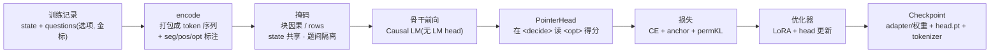
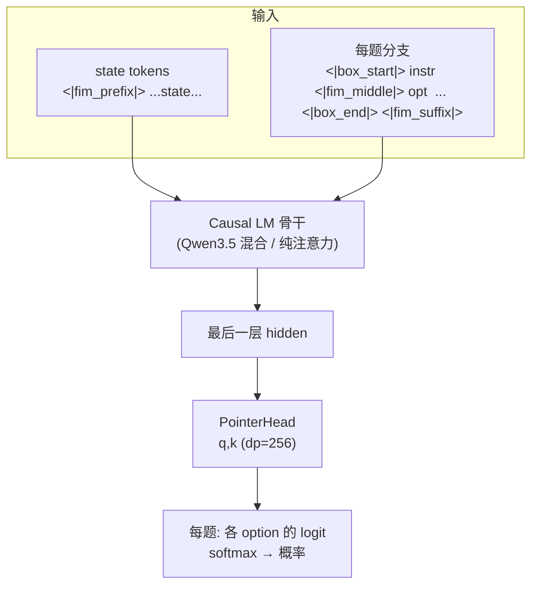
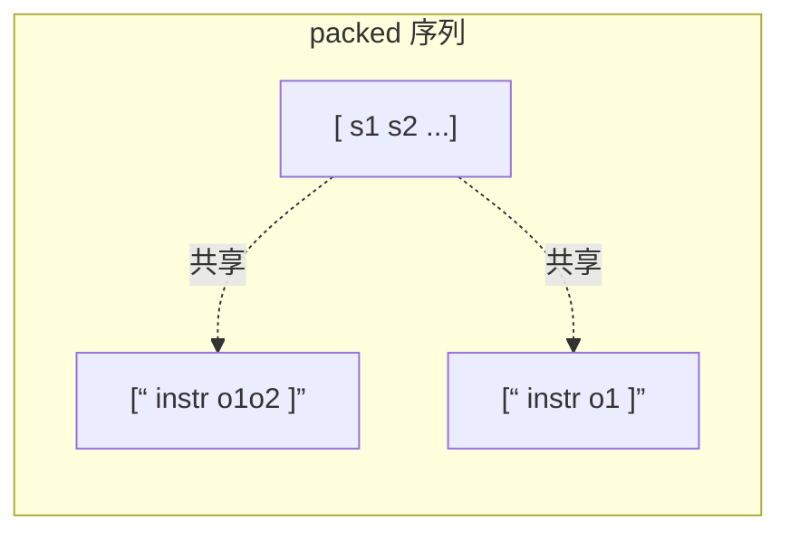
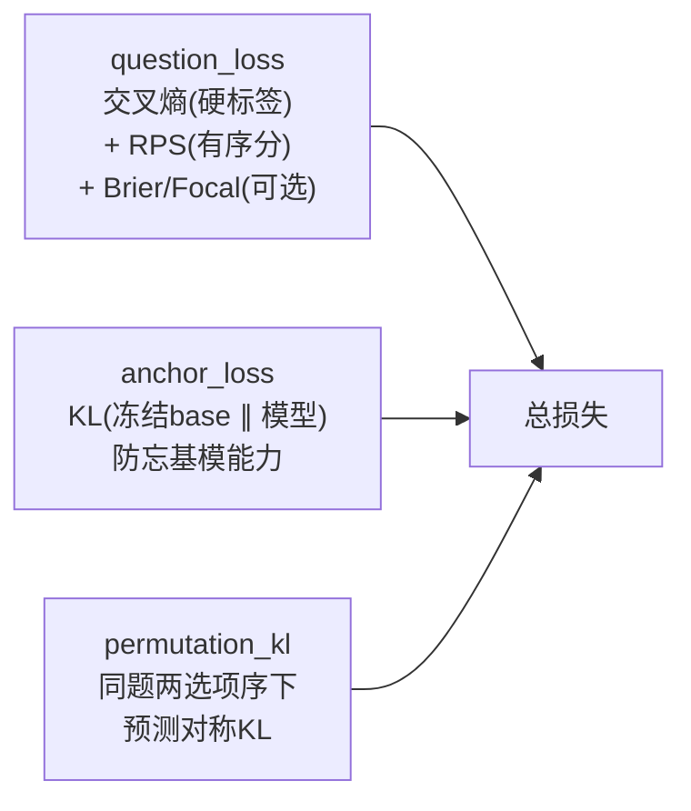
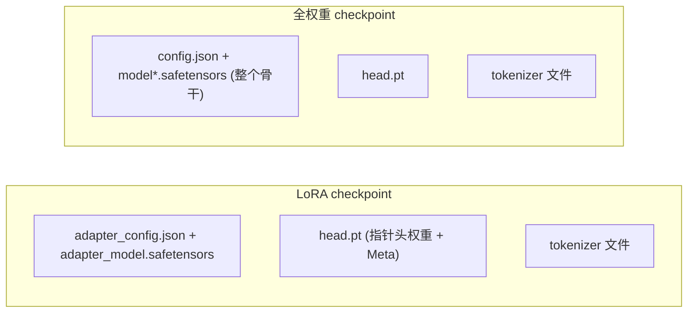
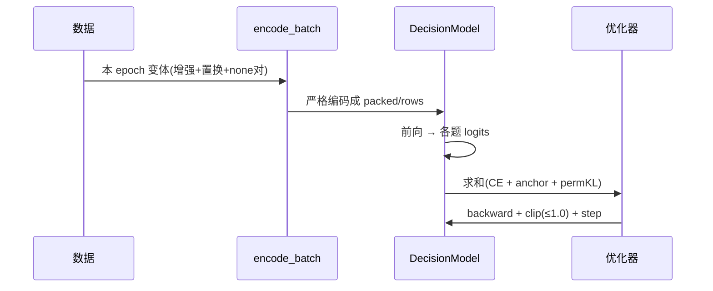

# 02 · 训练流程

> 核心结论：**KEV 的训练 = 在冻结的 Causal LM 底座上做 LoRA（默认），同时把一个「指针读出头」从零训练出来。模型永远不做文本生成，只做「在 `<decide>` 位置读出各选项的概率」这件事。** 理解 `model.py` 的编码与掩码，是理解整个项目的一半。

---

## 0. 核心概念导读（先建立直觉）

如果只读一节，读这节就够了。它用一句话抓住本质、一张图看清数据流、一张表速查名词，细节见后续各章。

> **本质**：KEV 不在「生成文本」，而在「读出概率」。训练目标 = 让一个**冻结的基座语言模型**，在给定 `state` 下，通过一个**轻量指针头**，对一组候选选项各算一个可 softmax 的概率。

### 0.1 训练数据流（一张图看懂）



### 0.2 名词速查表

| 概念 | 一句话解释 | 类比 / 为什么重要 |
|---|---|---|
| 基座 Causal LM | 冻结的预训练语言模型（Qwen3.5 等），负责「理解 state」 | 博学但不做决定的顾问 |
| 指针读出头 PointerHead | 极小的双线性打分器：在 `<decide>` 算各 `</opt>` 的得分 | 「指」向答案的指针，从零训练 |
| 编码 encode | 把 state + 多题/选项 打包成带标注的 token 序列 | 把自然语言题变成可算的矩阵 |
| 掩码 mask | 让 state 共享、各题分支互相不可见 | 保证「多问题互不干扰」且高效 |
| 块因果掩码 | 纯注意力骨架下的掩码实现 | 一次前向算完所有分支 |
| rows form | 混合骨架(含循环层)下的「state+分支」独立行实现 | 循环层无法用块掩码，改用行 |
| 选项隔离 | 使模型对「选项顺序」构造上鲁棒 | 打乱选项顺序，答案不变 |
| 主损失 CE | 选项分类交叉熵(+有序分) | 标准分类监督 |
| 锚点 anchor | 用冻结 base 零样本分布做 KL 目标 | 防灾难性遗忘（垂直领域关键） |
| 置换 KL | 强制选项乱序后预测一致 | 让模型真「懂」而非背位置 |
| LoRA | 低秩适配，只训少量参数 | 省显存、可叠加、易发布 |
| Delta 训练 | 从已发布 checkpoint 热启动继续训 | 继承通用能力再补垂直知识 |
| Checkpoint 布局 | 骨干(LoRA/全权重) + head.pt + tokenizer | 唯一还原 DecisionModel 的契约 |
| temperature | 校准温度，写回 head.pt | 推理时除它使概率可信 |

### 0.3 四个核心概念，一句话讲清

**编码（encode）**：把一条「state + 几个问题（每题带若干选项和金标）」的记录，序列化成 token，并用 `seg`/`pos`/`opt`/`decide_idx`/`opt_idx` 等张量标注每个 token 的归属。这是所有下游计算的「坐标系」（`kev/model.py:87`，见第 3 章）。

**掩码（mask）**：一条 state 要对应多个问题、且问题间必须互不干扰，所以不能用普通因果掩码。纯注意力骨架用「packed 块因果掩码」一次前向完成；混合骨架（含 Gated DeltaNet 循环）改用「rows form + shared_prefix」，让 state 只算一次、每题当独立行。两者数学逐位一致（第 3 章详述）。

**损失函数（loss）**：主项是选项分类交叉熵（score 题额外加有序概率得分）。两个关键「护栏」——锚点 KL 防止忘记基座知识、置换 KL 强制选项乱序后预测一致；校准项（标签平滑/Brier/Focal）同一题至多开一个（第 4 章详述）。

**Checkpoint 布局**：发布物不是「一个模型文件」，而是「骨干(LoRA 适配器 或 全权重) + head.pt(指针头 + Meta) + tokenizer」三件套。`kev/checkpoint.py` 是唯一知道如何把它们还原成 `DecisionModel` 的模块；校准得到的 `temperature` 也写在这里（第 6 章详述）。

---

## 1. 模型架构



- **骨干只取 `AutoModel`（无 LM head）**：因为不生成文本（`kev/model.py:257` 注释 "we never generate text"）。
- **分隔符复用 Qwen 的特殊 token**（`<|fim_prefix|>`、`<|box_start|>`、`<|box_end|>` 等），无需新增 embedding 行；LoRA 把它们的「分隔语义」适配出来（`kev/model.py:11`）。
- **PointerHead**（`kev/model.py:205`）：一个极小的双线性头 `z = k(h_opts) · q(h_decide) / √dp`。`h_decide` 是 `<decide>` 位置的隐藏，`h_opts` 是每个 `</opt>` 位置的隐藏。训练时 `temperature=1`，推理时可除以拟合温度做校准。

---

## 2. 编码与掩码（最关键的概念）

### 2.1 `encode()` 把一条记录打包成



`encode()`（`kev/model.py:87`）产出：`ids`、`seg`（0=state，k=第 k 题）、`pos`、`opt`（每 token 所属选项索引）、`decide_idx`、`opt_idx`。

### 2.2 两种前向形式

| 骨干类型 | 前向形式 | 原因 |
|---|---|---|
| **纯注意力**（如 Qwen3 老代） | **packed 块因果掩码**：一次前向，state 共享，各题分支互相不可见 | 掩码可直接表达 |
| **混合骨干**（Qwen3.5 含 Gated DeltaNet 循环层） | **rows form**：state 跑一次，每题作为「state+分支」的独立 causal 行；训练用 `shared_prefix` 让 state 只算一次 | 循环层无法遵守块因果掩码 |

> 两种形式在数学上**逐位一致**（`tests/test_model.py::test_rows_match_packed`），只是实现路径不同。这是 KEV 能把「同一状态多个问题」高效且隔离地回答的根本。

### 2.3 选项隔离（`option_isolation`）

开启后，每个选项 span 成为独立子分支、共享 position，使 `<decide>` 对各选项的注意力**构造上置换不变**——模型对「选项顺序」天然鲁棒，无需靠数据增强硬凑（但增强仍然保留）。

---

## 3. 损失函数



| 损失 | 参数 | 作用 |
|---|---|---|
| 主损失 `CE` | 默认 | 选项分类交叉熵；`score` 题额外加有序概率得分 `ord_w`（ranked probability score） |
| 标签平滑 / Brier / Focal | `--label_smoothing`/`--brier_w`/`--focal_gamma` | 校准相关，**同一题最多开一个**（已发布版本默认全 0） |
| 锚点 `anchor` | `--anchor` + `--anchor_w` | 用冻结 base 的零样本分布做 KL 目标，防止微调侵蚀基模知识（`kev/anchors.py` 计算） |
| 置换 KL | `--perm_kl`/`--perm_frac` | 强制「选项乱序后预测一致」 |

> 关键设计：**base 模型本身就有知识，KEV 只用指针头把它「导向」到决策任务**；`anchor` 损失保证不把这部分知识训没了（这是垂直领域 delta 训练时防止灾难性遗忘的核心杠杆）。

---

## 4. 训练入口与关键旋钮

```bash
# 标准 LoRA（release 配方）
uv run python -m kev.train --suite evals/v7/decision-v7 \
    --base Qwen/Qwen3.5-4B-Base --epochs 2 --lr 5e-5 \
    --batch 4 --accum 2 --dtype bf16 --out runs/kev-4b

# 冒烟（~1 分钟）
uv run python -m kev.train --n_per_source 40 --accum 4 --out runs/smoke

# delta 微调（垂直领域）
uv run python -m kev.train --data mine.jsonl --init_from jaredpalmer/kev-4b \
    --replay 2000 --suite evals/v7/decision-v7 --lr 2e-5 --out runs/mine
```

| 旋钮 | 默认 | 说明 |
|---|---|---|
| `--base` | Qwen3-0.6B-Base | 底座；release 用 Qwen3.5 0.8B/4B/9B 与 Kev-27B |
| `--lora` | 16 | LoRA rank；`--lora_targets all\|dense\|attn\|qv` |
| `--lr` / `--head_lr` | 2e-4 / 0 | 主学习率；指针头可单独设（`head_lr=0` 同主 lr） |
| `--epochs` / `--accum` / `--batch` | 1 / 8 / 1 | 可变长记录，靠 `--accum` 累积梯度 |
| `--dtype` | fp32 | CUDA 上可用 `bf16`（autocast，fp32 master） |
| `--full_ft` | 0 | 训练整个骨干（bf16 权重+fp32 master，`kev.full_ft.MasterAdamW`） |
| `--init_from` | "" | **delta 模式**：从已有 checkpoint 热启动，继承已发布能力 |
| `--anchor` / `--anchor_w` | "" / 0 | 锚点 KL 目标 |
| `--p_none` / `--p_distract` / `--p_none_pair` | 0.1/0.12/0 | 抗捷径数据增强 |
| `--shared_prefix` | full_ft 时开 | 混合骨干上 state 只算一次 |
| `--length_sort` / `--pass_tokens_max` | 0 / 0 | 长状态/大 batch 的内存与负载均衡 |
| `--max_state` | 384 | 训练样本 state 上限（可上调到 64k） |

---

## 5. Checkpoint 布局（必须懂，否则不会加载）

### 5.0 什么是 checkpoint

checkpoint（检查点）是**一次训练/发布留下的完整可还原产物**——既可以是本地 `runs/<name>` 目录，也可以是 HuggingFace Hub 仓库（`jaredpalmer/kev-4b`，用 `@tag` 固定版本）。它**不是「一个 .bin 模型文件」**，而是一组约定文件，由 `kev/checkpoint.py` 唯一负责「把目录还原成可推理的 `DecisionModel`」。

关键认知：KEV 把「基座语言模型」与「决策能力」拆开。基座是冻结公开的 Qwen（几 GB，不在 checkpoint 里重复存），决策能力由两部分携带：

- **指针头** `head.pt`：从零训练的小参数 + 元数据 `Meta`
- **LoRA 适配器**（轻量 delta）或 **全权重骨干**（完整拷贝）

于是 **checkpoint = 基座引用（`meta.base`）+ {指针头 + 适配器/全骨}**。这就是它「三件套」的本质。

### 5.1 两种布局的文件清单

| 形态 | 文件 | 说明 |
|---|---|---|
| **LoRA checkpoint**（默认发布） | `adapter_config.json` | LoRA 配置（rank、targets），加载规则的依据 |
| | `adapter_model.safetensors` | LoRA 增量权重（通常数十~数百 MB） |
| | `head.pt` | 指针头权重 + `Meta`（见 5.2） |
| | tokenizer 文件 | 与基座同源，目录自带副本 |
| **全权重 checkpoint**（`--full_ft`） | `config.json` + `model*.safetensors` | 整个骨干（`save_pretrained` 产物，`meta.weights=="full"`） |
| | `head.pt` | 同上 |
| | tokenizer 文件 | 同上 |

### 5.2 `head.pt` 里的 Meta 字段

`head.pt` 是 checkpoint 的「身份证 + 指针头权重」。除指针头张量 `head` 外，存一个 `Meta` 数据类（老 checkpoint 缺字段时给默认，读改写不丢信息）：

| 字段 | 含义 | 用途 |
|---|---|---|
| `base` / `base_revision` | 基座 HF 仓库与版本 | 加载时据此取基座 + tokenizer |
| `lora` / `head_dim` | LoRA rank / 指针头维度(dp) | 重建 head 与适配器结构 |
| `weights` | `"lora"` 或 `"full"` | 决定走适配器还是整骨加载 |
| `weights_dtype` | `fp32`/`bf16` | 全权重加载 dtype，须与 `config.json` 一致 |
| `option_isolation` / `special_embeddings` | 训练时的掩码/embedding 选项 | 重建时必须一致 |
| `temperature` | 校准温度（默认 1.0） | 推理时自动除以它做校准 |
| `holdout` / `extra` | 留出集 / 其余训练参数 | 溯源与读改写不丢信息 |

### 5.3 加载规则与一致性校验

加载入口 `Checkpoint(run).load(device, opts)`（`kev/checkpoint.py:233`）：

1. **判定形态**：有 `adapter_config.json` → LoRA；否则有 `config.json`+`model*.safetensors` → 全权重。
2. **一致性校验（防半加载）**：`head.pt.weights` 必须与目录实际文件一致，否则直接报错——挡住「写了 full 却只有适配器」这类静默错误。
3. **挂基座**：tokenizer 永远来自 `meta.base`；LoRA 用 `PeftModel.from_pretrained` 挂到基座，可 `merge_and_unload`（W += delta，fp32 一次舍入）；全权重 `load_full` 整骨加载，不合并。
4. **装指针头**：`meta.head` 装入 `model.head`，并把 `meta.temperature` 设为头校准温度（除非加载时显式覆盖）。
5. **后端选择**：`torch`（精确路径）/ `mlx`（Apple 芯片，仅混合骨架）/ `auto`（mps 且非 fp32 请求时自动 mlx）；CUDA 上 `kev.serve` 默认开 `fused` + `cuda_graphs` 提速。

> **Delta 训练（`--init_from`）**走 `warm_start`：加载前逐字段比对 `COMPAT_FIELDS`（base/lora/head_dim/option_isolation/weights…），不一致直接报错——防止架构不匹配导致「能训练、能报 loss、却半加载」的隐蔽 bug。

### 5.4 为什么这么设计

- **基座与决策解耦**：基座几 GB 只存引用，发布物只需传 LoRA（小）+ `head.pt`；换基座改 `meta.base` 即可。
- **`head.pt` 是单一真相源**：serve / benchmark / 训练 / 发布 / Space 全部经 `kev/checkpoint.py`，保证「存」与「读」同一套逻辑。
- **校准随 checkpoint 走**：`temperature` 写进 `head.pt`，推理自动校准，外部无需记忆。
- **强校验防错**：`weights` 一致性、`COMPAT_FIELDS` 比对、`weights_dtype` 与 config 对齐，把「看起来能跑其实错了」挡在加载期。



`kev/checkpoint.py` 是**唯一**知道布局的模块，`kev.serve`/`benchmark`/`train --init_from`/`publish`/Space 全走它：

- `Meta`（存于 `head.pt`）：`base`、`base_revision`、`lora`、`head_dim`、`weights_dtype`、`temperature`、`weights`("lora"|"full") 等 —— 决定如何把目录还原成 `DecisionModel`。
- **加载规则**：有 `adapter_config.json` → 在 `meta.base` 上挂 LoRA；否则有 `config.json`+权重 → 直接加载整个骨干。
- **`temperature`**：由 `scripts/calibrate_checkpoint.py` 在留出集上拟合后写回 `head.pt`，推理时自动除以它做校准（argmax 不变）。

### 断点续训与快照（仅全权重）

- `--save_every_steps/--save_every_minutes` 写 `<out>/resume`；`--resume 1` 逐位继续。
- `--snapshot_fractions 0.25,0.5,0.75` 在优化器步的特定比例写可加载快照到 `<snapshot_dir>/step-<N>/checkpoint`，**永不删除**（最多 8 个，`kev.budget.MAX_SNAPSHOTS`）。

---

## 6. 训练时发生了什么（一次 step）



- 每题损失**对问题数取平均**再按 `share` 加权，保证 `--row_budget` 拆分记录后梯度不变。
- 梯度范数全局裁剪到 `MAX_GRAD_NORM=1.0`。
- 学习率用 `OneCycleLR`（前 10% warmup）。

---

## 7. 各步骤输入与输出（入参 → 产物）

| 入参 / 初始状态 | 步骤（章节） | 输出产品 | 说明 |
|---|---|---|---|
| 内部记录（来自 `evals/` 或 `--data`）+ 超参（`lr`/`lora`/`epochs`…） | 2 编码与掩码 | `ids`/`seg`/`pos`/`opt`/`decide_idx`/`opt_idx` 张量 | `encode()` 打包；packed/rows 逐位一致 |
| 编码张量 + 基座（`--base`）+ LoRA 配置 | 4 训练入口 | `runs/<out>/`（checkpoint + 指标） | 一次训练 run 的根目录 |
| checkpoint 目录 / Hub id（`Checkpoint(run)`） | 4/5 Checkpoint | 可加载还原的 `DecisionModel` 三件套 | `head.pt` 含 `Meta`+`temperature` |
| 训练 run 中的权重 + 优化器状态 | 4 训练指标 | `runs/<out>/training_metrics.json` | 梯度范数、save/backbone 秒数、快照耗时 |
| `resume` 点文件（`--resume 1`） | 5 断点续训 | 续训后的新 checkpoint | fp32 masters+调度+RNG+数据位置 |
| 快照配置（`--snapshot_fractions`） | 5 快照 | `<snapshot_dir>/step-<N>/checkpoint` | 可加载 bf16 快照，永不删（≤8） |

## 8. 本篇要点

1. 骨干去 LM head，只训练 LoRA + 从零的 PointerHead；不生成文本。
2. 编码用复用特殊 token；纯注意力走 packed 掩码，混合骨干走 rows/shared_prefix，二者逐位一致。
3. 损失 = 交叉熵（+有序分）+ 可选锚点 KL + 置换 KL；锚点是垂直领域防遗忘的关键。
4. Checkpoint = 骨干(LoRA 或全权重) + `head.pt` + tokenizer；`temperature` 由校准脚本写回。
5. 下一步 → [03-编排调度.md](./03-编排调度.md)
