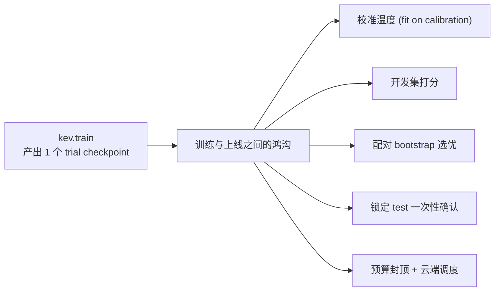
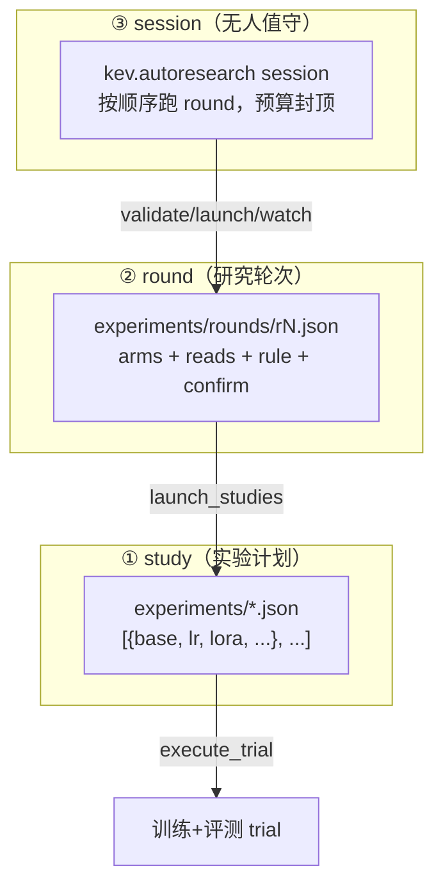
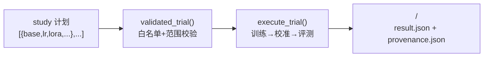
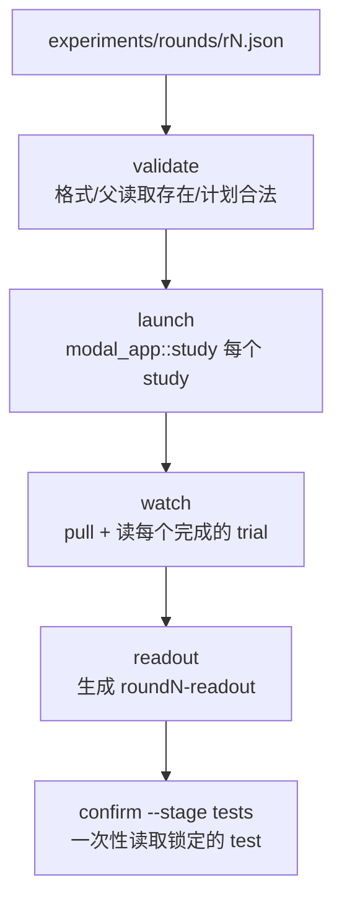
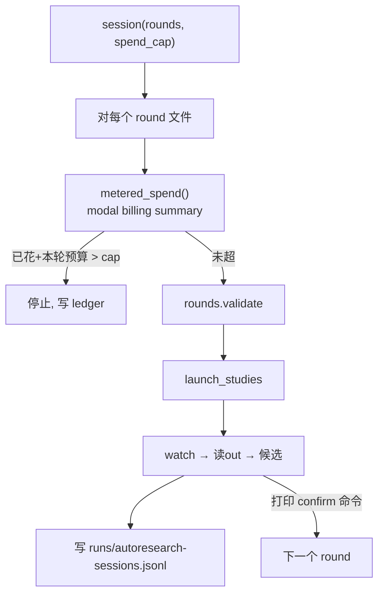
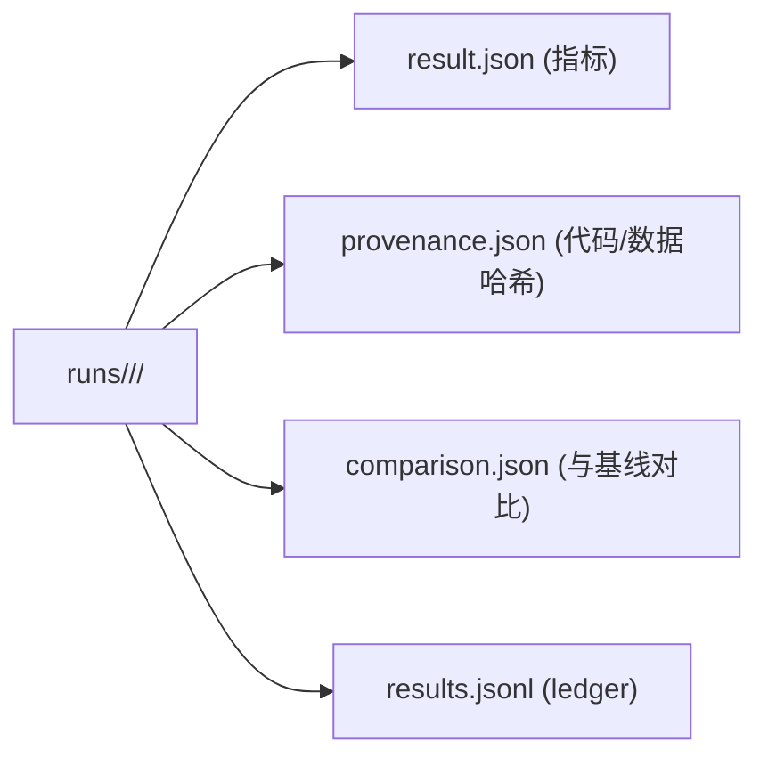

# 03 · 编排调度

> 核心结论：**KEV 把「做实验」也当成数据来管理。** 一次 study 是一个 JSON 计划（1~8 个 trial），每个 trial 只是「允许列表里的训练超参 + 一个底座」；轮次（round）把多个 study 的候选与一个父模型对比、用配对 bootstrap 选出胜者；`autoresearch` 还能在预算内**无人值守**地按顺序跑完注册的轮次。所有产物都带回源码/数据/配置的哈希，确保可复现。

---

## 0. 为什么训练之后还要编排调度

一句话：**训练只解决「怎么把一个候选模型训出来」，编排调度解决「训出来之后，怎么在统计意义上选、比、验证，并在预算内自动化地跑完整个研究」。** 一次 `kev.train` 产出的只是一个 trial checkpoint，它"好不好、比父模型强不强"训练本身并不回答。

六个绕不开的理由：

1. **训练只是「生产一个候选」**：单次训练只对应一组超参（base/lr/lora/…），它优于还是劣于基线，必须靠评测才知道。训练命令本身不做"该不该用这个 checkpoint"的决策。
2. **需要统计显著的对比，而非看单次准确率噪声**：研究是「多臂 vs 父模型」的比较问题。`kev.rounds` 用 `paired_bootstrap`（2000 次重采样）做胜/负/平裁决，配一条 `rule` 在多个套件上选出"通过门禁且分数最好"的候选——人工逐次跑训练得不到这种严谨性。
3. **需要防作弊与可复现**：round 的 spec（`studies/reads/arms/rule/confirm`）在训练前就提交冻结，像 PLAN 注册；锁定的 test 分区只读取**一次**，杜绝"看着测试调参"的过拟合。所有产物带回代码/数据/配置哈希（`provenance.json` + `kernel_environment`）。
4. **需要规模与成本管控**：全权重 27B 训练要 8×H200、单次上千美元。编排（`modal_app.py` + `budget.py`）负责把 trial 分发到云端容器、管理快照、超时续跑、预算封顶——人工无法管理这么多并行 GPU 任务。
5. **需要无人值守自动化**：`kev.autoresearch` 在预算内按顺序自动跑完注册的轮次（`validate → launch → watch → readout`），但**刻意不自动 confirm**（test 读取由人工执行一次），兼顾自动化与纪律。
6. **训练产物与「可用决策模型」之间有鸿沟**：checkpoint 只是"带指针头的文件"；真正上线前还要做：校准温度、开发集打分、与基线配对比较、选优、最终锁定 test 确认。编排把"从 trial 到发布候选"的整条流水线管起来。

> 所以编排调度不是训练的附属品，而是**把研究本身当作可管理的流水线**：study（配置 trial）→ round（跨套件选优）→ session（预算内无人值守）。后三章逐级展开。

### 0.1 编排会修改 / 重新训练已有的模型吗？

**会发起训练，但绝不修改已有模型文件。** 三件事要分清：

1. **编排会触发训练**：study 计划的每个 trial 都是一次完整训练（`experiment.execute_trial`：train→calibrate→evaluate），`modal_app.py::study` 把它跑在云端容器；`autoresearch` session 在预算内按注册顺序发起这些训练。所以编排**确实会"训练出新模型"**。
2. **编排不修改已有 checkpoint**：每次训练都写独立目录 `runs/<study>/<trial>/`，产出新的候选 checkpoint；round 把候选与 `parent`（已有 checkpoint）比较，只是「读 parent + 读 arm」做统计裁决，**绝不覆写 parent**。
3. **「基于已有模型再训练」= Delta 训练**：`--init_from <已有checkpoint>` 用 `warm_start` 从已有 checkpoint 热启动继续训，产出的仍是**新 checkpoint**（继承通用能力 + 微调垂直知识），原 checkpoint 原样保留。round 的 `arms` 也可以是已存在的 checkpoint（如插值产物 `runs/...`），这种情况**只读不训**。

> **纪律红线**：编排（尤其 `autoresearch`）严格**不改评估器、不冻结/篡改评测套件、不自动 `confirm`**。锁定的 test 分区与读取由人工执行 `kev.rounds confirm` **一次**，确保「晋级为新父模型」是刻意的、可追溯的决策，而非编排自动覆盖。

### 0.2 编排调度相当于「后训练」吗？

**不等价。** 后训练是编排调度的**原子操作**，编排调度是**管理后训练的元流程**。

- **后训练（post-training）**：指第 2 章详述的训练步骤——在冻结基座 LM 上做 LoRA/全权重微调并训练 PointerHead，产出**单个** checkpoint。它是一次「训练动作」。
- **编排调度（本篇）**：把「一次后训练」当作可复用的实验单元，组织成研究：
  - `study` 配置**多次**后训练（不同超参 / 不同 `--base` / `--init_from` Delta 热启动），每个 = 一个 trial；
  - `round` 在多个套件上读取并比较这些后训练产物，统计选优；
  - `session` 在预算内循环执行上述轮次。

> **边界**：编排调度**不一定每次都触发后训练**——`round` 的 `arms` 可以是已存在的 checkpoint（如插值产物 `runs/...`），此时只读不训；`round` 与 `session` 的「比较 / 裁决」阶段本身也不训练。只有 `study` 的 trial 才是后训练。

一句话类比：后训练是「厨师做一道菜」，编排调度是「排班 + 做多道菜 + 盲测选哪道端上桌」。

## 1. 三层调度概念

---

## 2. ① Study：`kev.experiment`

一个 study 计划 = **JSON 数组，每项是一组允许的超参**（`kev/experiment.py:DEFAULTS`）。每个 trial：

1. 在套件的 `train` 分区上训练
2. 在 `calibration` 分区拟合温度
3. 在 `development` 分区打分
4. 把 `result.json` / `provenance.json` / `comparison.json` 写入 `<study>/<trial>/`

**两种执行模式（同一代码路径）：**
- `local`：本机顺序跑（一次一个 GPU 任务），`--wait-pid` 可排队等别的任务。
- `modal`：`modal_app.py` 把 `execute_trial` 跑在容器里（每 trial 一容器），`--aggregate` 后期排名。

**重要约束（防错配）：**
- `validated_trial()` 只允许改白名单参数（见 `experiment.py:62` 的 `DEFAULTS/CHOICES/OPTIONAL_INTS`），且范围严格校验。
- 全权重 trial 必须 `weights_dtype=bf16`，并写快照；`base` 必须在套件 `base_revisions` 中钉死（或 trial 自带 40 位 commit sha）。
- `data` 必须是 `evals/` 下的 `.jsonl`；`init_from` 必须是 runs 卷路径或 Hub id。

---

## 3. ② Round：`kev.rounds`（研究轮次引擎）

一个 round 永远是同形状（`kev/rounds.py:1` 注释）：

> arms（配置 trial 或由其产出的 checkpoint）与 parent checkpoint 在多个套件上被读取；一条 rule 用**配对、按记录聚类的 bootstrap** 把每个 arm 与 parent 比较（primary 有下界、guard 有阈值、pooled panel）；通过的、分数最好的 arm 是该尺寸的候选；confirmation 阶段（test 分区、锁定读取）只读取一次。

**spec 关键字段**（提交前即冻结，像 PLAN 注册）：
- `studies`：每个 = 一次 `modal_app.py::study` 调用（含 plan/suite/gpu/timeout/budget）。
- `reads`：每个读取标签打分的套件与 flag（`--allow-test` 等）。
- `arms` / `parents`：要比较的 trial 与基线 checkpoint。
- `rule`：`{panels, criteria, rank}` —— 用 bootstrap 区间做「胜/负/平」裁决。
- `temperature`：每个 arm 在服务温度下读取（在自家 development 行拟合，或注册一个温度池）。
- `confirm`：最终确认阶段读取哪些分区。

**统计核心**：`kev.metrics.paired_bootstrap`（2000 次重采样，seed 0）——所有「arm vs parent」的 delta 都用它，保证比较有统计意义而非噪声。

---

## 4. ③ Session：`kev.autoresearch`（无人值守）

- **预算驱动**：每次轮次前读 `modal billing summary`，若「已花 + 本轮 study 预算」超过 `--spend-cap` 就停。
- **纪律**：只能跑 spec 注册的 trials/reads；**绝不改评估器、冻结套件或 gates；绝不 confirm**（test/锁定读取由人工 `kev.rounds confirm` 在 readout 命名候选后**刻意**执行一次）。
- 附带 `leaderboard`（汇总所有 trial 的 `result.json`）、`release-check`（每个 seed 必须过 gates）、`compare`（study 间对比）。

---

## 5. 云平台：`modal_app.py`

`modal_app.py`（85KB）是把 KEV 研究跑在 Modal 上的入口，**与本地共用 `kev.experiment.execute_trial`**，只是设备不同。20+ 命令：

| 命令 | 作用 |
|---|---|
| `study` | 按计划跑一轮 study（每 trial 一容器） |
| `resume` / `pull` | 补跑评估 / 拉回结果并排名 |
| `benchmarks` | 批量 `kev.benchmark` |
| `smoke` / `sft_probe` | 端到端冒烟 / 全权重探针（显存、步时） |
| `serving` / `gpu_tests` | GPU 服务基准 / 跑 pytest |
| `interpolate` / `merge_adapter` | WiSE-FT 插值 / LoRA 合并 |
| `mirror_snapshots` / `release_*` | 私有 Hub 镜像 / 发布三段 |

管理 `kev-hf-cache`、`kev-runs` 两个 volume 与 HF secret；记录 git commit、suite hash、shipped 源码 hash，保证远端与本地可比对。

---

## 6. 产物与可复现性

- `provenance.json` 记 `kernel_environment`（`kev.predictors.kernel_environment`：包版本、GPU、backbone dtype、注意力实现版本）—— 因为 kernel 版本微差就能让读取偏移（见 `runs/drift-v1/REPORT.md`），**两个读取逐位可比的前提是这些一致**。
- `config_digest` / `recipe`（`autoresearch.py`）用配置哈希标识「同一配方」，seed 除外。

---

## 7. 各步骤输入与输出（入参 → 产物）

| 入参 / 初始状态 | 步骤（章节） | 输出产品 | 说明 |
|---|---|---|---|
| study 计划 JSON（1~8 trial 超参）+ 套件 `base_revisions` | 2 Study | `<study>/<trial>/result.json`+`provenance.json`+`comparison.json` | 训练→校准→评测 |
| round spec（`studies`/`reads`/`arms`/`rule`/`confirm`，先冻结） | 3 Round | `runs/rN-readout/roundN.json` + 表格；`runs/rN-verdict/` | 配对 bootstrap 选优 + 锁定 test 裁决 |
| rounds 列表 + `--spend-cap` 预算 | 4 Session | `runs/autoresearch-sessions.jsonl` + `leaderboard.md` | 无人值守 ledger |
| `execute_trial` + Modal 卷/HF secret | 5 Modal | 云端 runs 卷产物 + 镜像 | 容器跑 trial，记录 git/suite/hash |
| 源码 + 数据 + 配置 | 6 可复现 | `provenance.json` + `config_digest`/`recipe` | 远端本地逐位可比 |

## 8. 本篇要点

1. study = JSON 计划（1~8 trial），trial 只改白名单超参；local 或 modal 两种执行。
2. round = 把候选与父模型在多个套件上用**配对 bootstrap** 对比选优；spec 先冻结后训练。
3. autoresearch session 在预算内无人值守跑轮次；不自动 confirm。
4. 所有产物带回哈希，远端结果与本地可逐位比对。
5. 下一步 → [04-评测体系.md](./04-评测体系.md)
