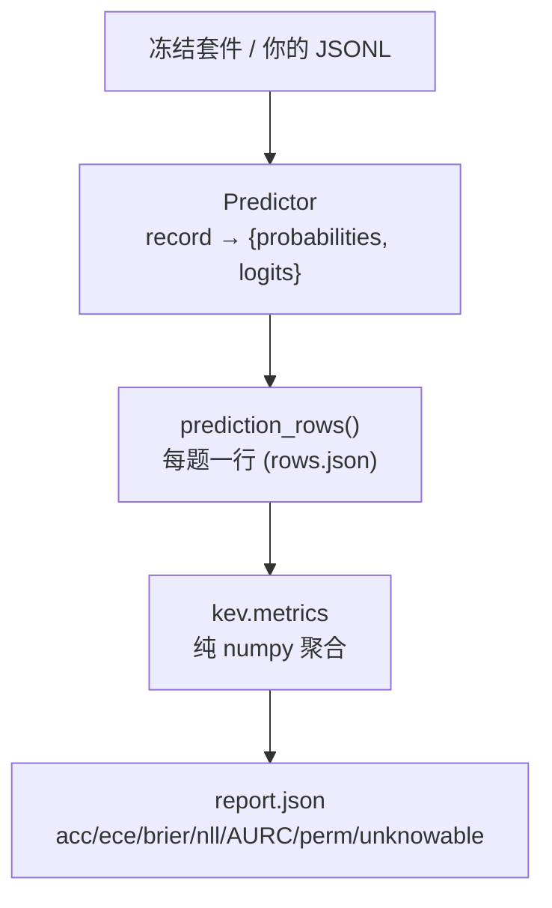
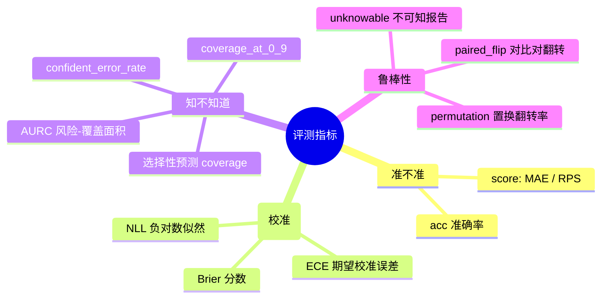
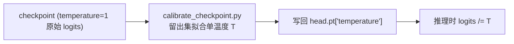

# 04 · 评测体系

> 核心结论：**KEV 的评测是「纯 numpy 打分 + 严格可复现」。** 任何预测器（本地 checkpoint / 任意 System One 端点 / Jev 基线）都产出同样结构的 `rows.json`，再由 `kev.metrics` 算出 `report.json`。指标覆盖「准不准、概不概、知不知道自己不知道、选项乱序变不变」四个维度——这正是决策模型区别于普通分类器的地方。

---

## 1. 评测数据流



入口：`kev.benchmark --run <ckpt> --suite <suite> --out <dir>`
- `--remote <url>`：打任何 System One 兼容端点
- `--data x.jsonl`：你自己的标注行
- `--date_facts`：可选的日期算术预处理（模型不擅长减日期）
- `--allow-test`：唯一读取锁定 test 分区的开关

---

## 2. 三种预测器（`kev/predictors.py`）

| 预测器 | 用途 | 并发 |
|---|---|---|
| `LocalPredictor` | 本进程加载 checkpoint 打分（GPU） | 1（串行） |
| `RemotePredictor` | 任意 `POST /v1/systemone` 端点 | `concurrency`>1（线程池） |
| `JevPredictor` | 经 AI Gateway 跑 Jev 基线（预算封顶） | 1 |

`LocalPredictor` 还会记录 `kernels` 字段（用了哪些注意力 kernel），用于事后诊断 kernel 版本漂移（`drift-v1`）。

---

## 3. 一行数据（row）长什么样

`prediction_rows()`（`kev/benchmark.py:48`）为每条记录的每个问题生成一行：

```json
{"id":"banking77/train/12","group":"...","question":"intent",
 "source":"banking77","task":"banking77","type":"choice",
 "keys":["billing","card","loan"],"label":0,
 "p":[0.82,0.11,0.07],
 "logits":[...],"inference_temperature":1.0,
 "raw_probability_sum":1.0,"zero_count":0}
```

`variant` 字段区分 `clean`（原题）/ `permuted`（选项乱序版）/ `none_*` 等，配对比较时用。

---

## 4. 四大维度指标（`kev/metrics.py`）



### 4.1 准确率与有序分
- `acc`：argmax 是否等于标签。
- `score` 题额外报 `MAE`（期望等级误差）与 `RPS`（ranked probability score）—— 有序预测用。

### 4.2 校准（概不概）
- `ECE`：分桶后 |准确率 − 置信度| 加权平均。
- `Brier`：概率与 one-hot 的平方误差和。
- `NLL`：有 logits 时精确计算，否则由概率反推（`_tempered_logits` 支持温度重放）。

### 4.3 选择性预测（知不知道自己不知道）
- `coverage_at_0_9`：置信度 ≥0.9 的问题占比。
- `confident_error_rate`：高置信但答错的比例。
- `AURC`：风险-覆盖曲线下面积（right-step 积分，`aurc=area_under_risk_coverage`）。
- 这些让「只回答有把握的」策略可被量化。

### 4.4 鲁棒性与诚实性
- `permutation`：选项乱序后 `argmax` 翻转率 + 最大概率差 —— 测「是否真置换不变」。
- `unknowable`：`unknowable_report` 单独处理「信息不足」记录（只评置信度，不算准确率）。
- `paired_flip`（`kev/contrastive.paired_flip`）：对比对里「改一句翻转标签」时模型是否跟着变。

---

## 5. 温度与校准



- 训练永远 `T=1`；`scripts/calibrate_checkpoint.py` 在留出数据集上拟合一个温度写回 `head.pt`，推理时自动应用（`PointerHead.forward` 检查 `self.temperature`）。argmax 不变，但概率校准到可解释。
- `kev.calibrate` 还能出「raw / shipped / workload / workload_oof」四臂对比报告。

---

## 6. 比较、排名与漂移

| 工具 | 作用 |
|---|---|
| `kev.compare` | 运行间对比（NLL 敏感性 + none 变体诊断） |
| `kev.metrics.paired_bootstrap` | 记录聚类的配对 bootstrap（round 选模用） |
| `kev.autoresearch leaderboard` | 汇总所有 trial 的 `result.json` 成 `runs/leaderboard.md` |
| `runs/drift-v1/` | kernel 版本漂移诊断（同代码同 checkpoint，仅 kernel 版本差导致 p 偏移） |
| `scripts/verify_claims.py` | CI 中校验 `docs/claims.json` 的每个对外数字都能追到仓库内已提交证据 |

---

## 7. 各步骤输入与输出（入参 → 产物）

| 入参 / 初始状态 | 步骤（章节） | 输出产品 | 说明 |
|---|---|---|---|
| 冻结套件 / 你的 JSONL + Predictor（`--run`/`--remote`） | 1 评测数据流 | `rows.json` + `report.json` | 每题一行；四维指标 |
| 运行时配置（`--concurrency` 等） | 2 三种预测器 | （运行时，无落盘） | Local/Remote/Jev 统一 `rows` 结构 |
| `rows.json` | 3 一行 row | 单行 `p`/`logits`/`variant` | 配对比较用 |
| 校准集 + checkpoint（`temperature=1` 原始 logits） | 5 温度校准 | 写回 `head.pt['temperature']` + `calibration.json` | 留出集拟合 T |
| 各 trial 的 `result.json` | 6 比较/排名 | `leaderboard.md` / `drift-v1` 报告 | 汇总 + kernel 漂移诊断 |
| `docs/claims.json` + 仓库已提交证据 | 6 声明校验 | 校验通过/失败（CI） | 每个对外数字可追 |

## 8. 本篇要点

1. 预测器统一产出 `rows.json`，`kev.metrics` 纯 numpy 算出 `report.json`。
2. 指标四维：准不准、概不概、知不知道、乱序变不变。
3. 温度在留出集拟合后写回 `head.pt`，推理自动应用。
4. 比较一律用配对 bootstrap，确保统计意义。
5. 下一步 → [05-模型服务.md](./05-模型服务.md)
