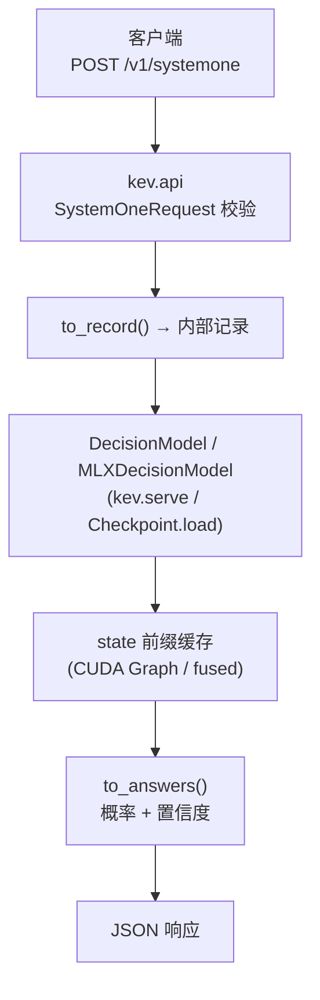
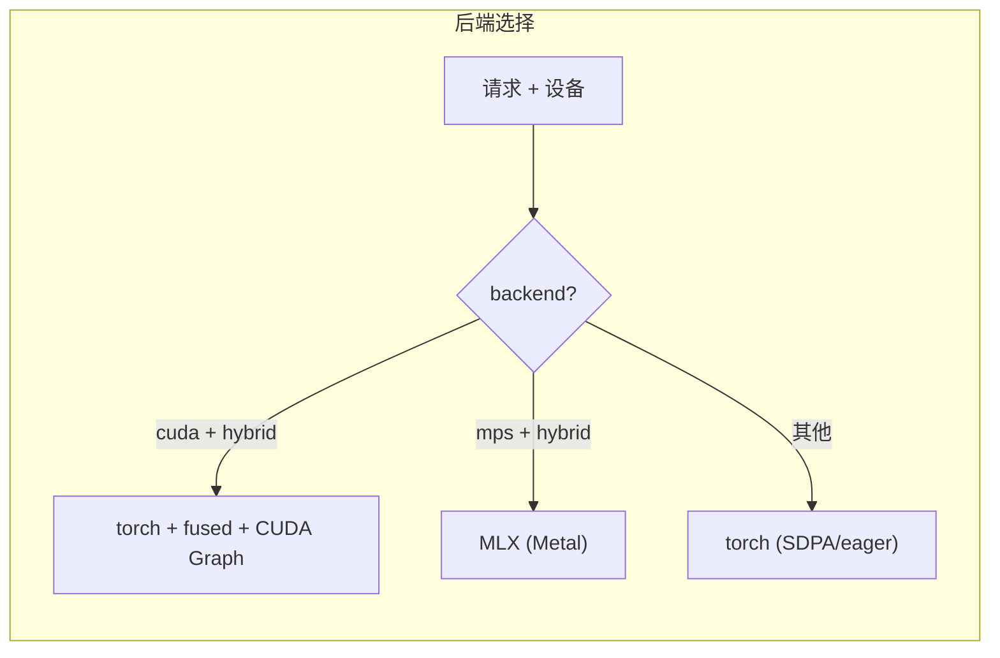

# 05 · 模型服务

> 核心结论：**KEV 的「推理」是一次 prefill-only 前向，没有任何自回归解码。** 服务层把 checkpoint 加载成 `DecisionModel`（或 Apple 芯片上的 `MLXDecisionModel`），暴露与 TypeSafe 兼容的 `POST /v1/systemone`。由于同一 state 下多个问题彼此隔离，服务可以做「state 前缀缓存」「CUDA Graph 批处理」「MLX 后端」等激进优化。

---

## 1. 服务架构



- 请求体就是 `kev/api.py` 的 `SystemOneRequest`（`state` + `questions`）。
- 响应：每个问题给出 `choice/noul/score` 答案、选项概率分布、置信度（`to_answers`，`kev/api.py:149`）。

---

## 2. 加载选项（`LoadOptions`）

`kev/checkpoint.py` 的 `LoadOptions` 是「把 checkpoint 变成模型」的所有旋钮，全部可由 `KEV_*` 环境变量注入（`from_env`）：

| 变量 | 作用 |
|---|---|
| `KEV_DTYPE` | fp32（精确路径）/ bf16 / fp16；serve 在 CUDA/MPS 默认 bf16（省半显存、延迟降 2–4.5×） |
| `KEV_MERGE` | LoRA 是否合并进底座（一次 fp32 取整，避免双舍入） |
| `KEV_BACKEND` | `torch` / `mlx` / `auto`（Mac 上 hybrid 底座自动走 MLX） |
| `KEV_TEMPERATURE` | 覆盖 `head.pt` 里拟合的温度；`1.0` = 原始 logits |
| `KEV_CUDA_GRAPHS` | hybrid 骨干在 CUDA 上把 serving pass 重放为 CUDA Graph，跨请求批处理 |
| `KEV_FUSED` | 用 `kev.fused_qwen35` 的 Triton 融合算子重写 Qwen3.5 解码层 |
| `KEV_LORA_SCALE` | WiSE-FT 式插值（base↔微调权重），仅推理 |

> **精确性纪律**：所有对外公布数字都跑在「fp32 + 不合并 + 不开 graph/fused」的精确路径；serve 默认开 bf16/cuda_graphs/fused 只为快，两者数值差在 ~0.01 内、argmax 一致。

---

## 3. 高效服务的关键技巧

### 3.1 状态前缀复用
同一 `state` 下多个问题，state 的 KV 只算一次，分支从缓存续算（`probs_and_prefix` / `probs_with_prefix`，`kev/model.py`）。**数学上精确**：分支彼此不可见、state 见不到分支（块因果掩码保证）。

### 3.2 CUDA Graph + 批处理
`kev.cuda_graphs.CudaGraphs` 把 hybrid 骨干的 state pass / row pass 固化为图，跨请求批处理（`DecisionModel.probs_batch`），长 state 用 eager 前缀兜底。`EAGER_STATES` 控制同时持有的长状态数。

### 3.3 MLX 后端（Apple Silicon）
`kev.mlx_model.MLXDecisionModel` 用 mlx-lm 的 Metal 实现 + 共享 encoder/head；始终合并 LoRA，加载全权重原样（不合并）。与 fp32 torch 路径权重级一致（`tests/test_mlx.py`）。



---

## 4. 置信度公式（与 TypeSafe 参考适配器一致）

- **choice**：`(p_max − 1/K) / (1 − 1/K)`，0=均匀，1=确定。
- **score**：`max(0, 1 − E|level−mode| / D)`，D=均匀分布的 MAD。
- 概率序列化保留 4 位小数（255 选项上限下仍满足 TypeSafe 的 `|Σ−1|<0.02`）。

---

## 5. 三种「前端/载体」

| 载体 | 位置 | 用途 |
|---|---|---|
| **playground** | `playground/`（Next.js 16 + React 19） | 交互演示：state 输入 + question JSON + 预设 Tab；`chess/page.tsx` 国际象棋 demo；`scripts/jev-evaluate.mjs` 批量跑 Jev 基线 |
| **space** | `space/`（Gradio + ZeroGPU） | Hugging Face Space：加载 checkpoint、选项顺序稳定性检测、`mcp_server=True` 暴露 MCP；`presets.py` 与 playground 同步 |
| **skills/kev-deploy** | `skills/kev-deploy/` | agent/人工自助部署技能：`modal deploy` → 验证 → 接入 → 下线 |

---

## 6. 起一个服务（最小可运行）

```bash
# FastAPI sidecar，暴露 /v1/systemone
uv run python -m kev.serve --run jaredpalmer/kev-4b --port 8008

# 请求示例
curl -s localhost:8008/v1/systemone -H 'content-type: application/json' -d '{
  "state": "客户：我的订单还没发货。",
  "questions": {
    "team": {"type":"choice",
      "instructions":"归属哪个团队？",
      "criteria":{"logistics":"物流","billing":"账单","tech":"技术"}}
  }
}'
```

`serve` 默认按设备自动选后端（CUDA→bf16+graph+fused；Mac→MLX）；`KEV_DTYPE=fp32` 切回精确路径。

---

## 7. 各步骤输入与输出（入参 → 产物）

| 入参 / 初始状态 | 步骤（章节） | 输出产品 | 说明 |
|---|---|---|---|
| checkpoint（Hub id/路径）+ 请求 `SystemOneRequest` | 1 服务架构 | 运行中的 `POST /v1/systemone` 端点响应 | prefill-only 前向 |
| checkpoint + `KEV_*` 环境变量 | 2 LoadOptions | 配置化的 `DecisionModel`/`MLXDecisionModel` | dtype/merge/backend/graph/fused |
| 同一 `state` 下多问题请求 | 3 高效技巧 | 前缀缓存 / CUDA Graph / MLX 加速结果 | 精确且极快 |
| checkpoint（各载体） | 5 载体 | `playground/` / `space/` / `kev-deploy` 端点 | 演示/Space/MCP/Modal |
| 部署命令 / Modal 配置 | 6 起服务 | 本地或云端可调用端点 | `kev.serve` 或 Modal/Space |

## 8. 本篇要点

1. 服务 = 一次 prefill-only 前向；协议是 TypeSafe 兼容的 `/v1/systemone`。
2. `LoadOptions` 用 `KEV_*` 环境变量控制 dtype/merge/backend/graph/fused。
3. state 前缀缓存 + CUDA Graph + MLX 让同一 state 多问题极快且精确。
4. 置信度有确定公式；playground / Space / kev-deploy 三种载体。
5. 下一步 → [06-垂直领域实战.md](./06-垂直领域实战.md)
