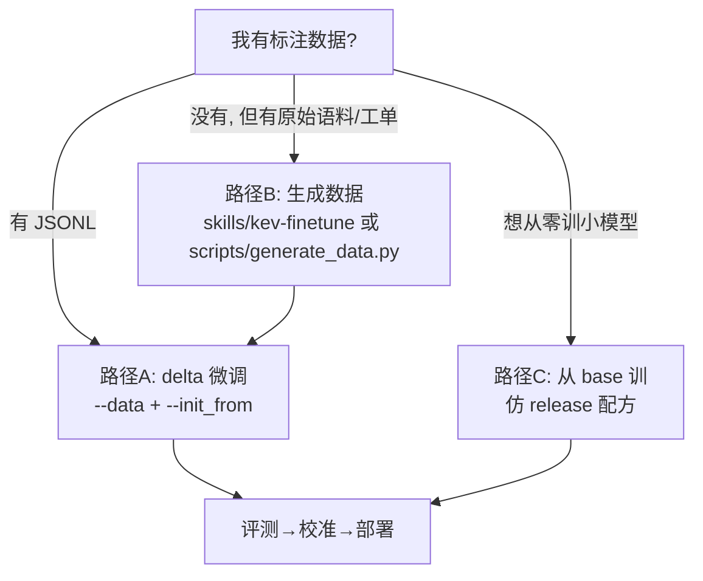
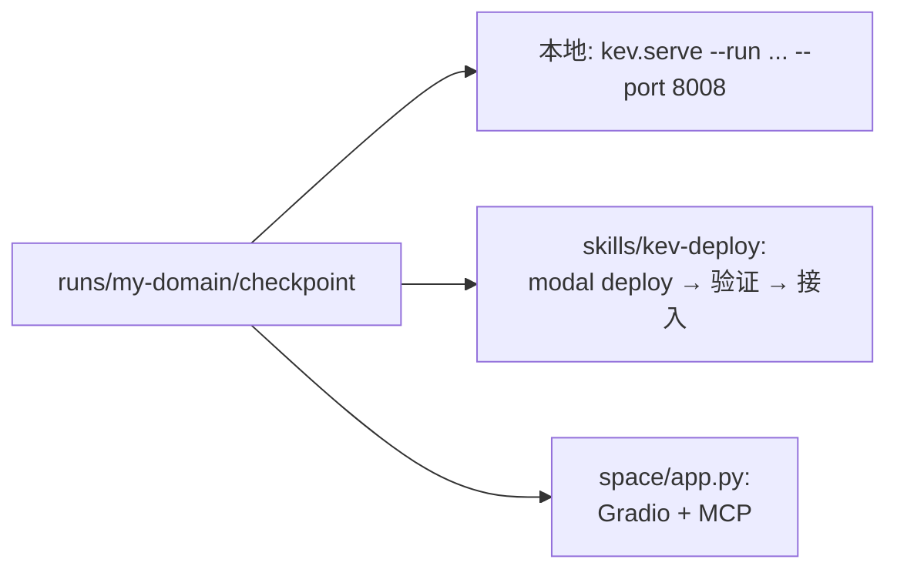
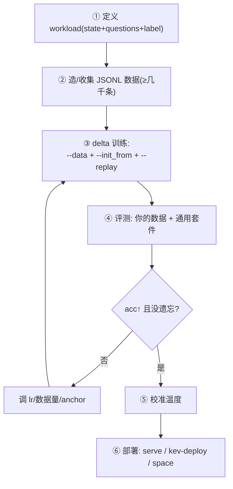

# 06 · 垂直领域实战指南

> 目标：看完本篇，你能在**不读源码**的前提下，从 0 训出一个属于你自己领域的 KEV 模型，并完成评测、校准、部署。
> 最短路径 = **delta 微调**：拿已发布的 `kev-4b` 当底座，用你的数据 `+ --init_from + --replay`，继承通用能力、只学你的领域。

---

## 0. 决策树：你该走哪条路



---

## 1. 第一步：定义你的 workload（数据格式）

先想清楚三件事：
1. **state 是什么**？一段文本 / 一个 JSON 对象（工单、合同、对话记录、监控告警…）。
2. **要回答哪些问题**？每个问题归到三类之一：`choice`（多选一）、`noul`（是否）、`score`（有序档位）。
3. **答案从哪来**？已有标签直接写；没有就用 LLM 标注或人工。

最小可用数据（每行一个 `SystemOneRequest` + `label`），详见 [01-数据准备.md §1.3](./01-数据准备.md)：

```json
{"state":"工单：用户无法登录App。","questions":{
  "category":{"type":"choice","instructions":"属于哪类问题？",
    "criteria":{"login":"登录","pay":"支付","refund":"退款","other":null},"label":"login"},
  "urgent":{"type":"noul","instructions":"是否需紧急处理？","label":false}}}
```

> 规则：选项**顺序随意**（训练会打乱）；务必保留若干 `other`/`None of the above` 类选项与干扰项（见 [01 §3](./01-数据准备.md)），否则模型会学捷径。

---

## 2. 第二步：造数据（没有现成标签时）

两种现成工具：

| 工具 | 位置 | 用途 |
|---|---|---|
| `skills/kev-finetune` | agent 技能 | 5 阶段流程（访谈→造数→训练→读数→部署），含 `scripts/convert_data.py`、`generate_data.py`、`plan_size.py`、`split_data.py` |
| `scripts/generate_data.py` | 仓库脚本 | 用任意 OpenAI 兼容模型按 spec **生成平衡标注记录**（可断点续写） |
| `scripts/convert_data.py` | kev-finetune/scripts | CSV/JSONL 已有标签 → KEV 训练记录 |

**数据量估算**：`plan_size.py` 能告诉你「要多少条记录才能让 +5 点提升显著」；也可事后用 `result.json` 做事后功效分析。**经验起点**：垂直领域几千到上万条有效记录通常够看到一个明显提升。

---

## 3. 第三步：delta 微调（最核心命令）

```bash
uv run python -m kev.train \
    --data my_domain.jsonl \
    --init_from jaredpalmer/kev-4b \
    --replay 2000 \
    --suite evals/v7/decision-v7 \
    --base Qwen/Qwen3.5-4B-Base --base_revision <sha> \
    --lr 2e-5 --epochs 2 --batch 4 --accum 2 \
    --dtype bf16 --out runs/my-domain
```

| 参数 | 为什么 |
|---|---|
| `--init_from jaredpalmer/kev-4b` | **继承已发布模型的通用决策能力**，只在新领域适配（防从零训的灾难性遗忘） |
| `--replay 2000` | 从 `--suite` 的 train 分区混入 2000 条通用记录，**防止忘记已发布配方**（`--replay` 必须有 `--data`+`--suite`） |
| `--lr 2e-5` | delta 比从零训小一个数量级（从零 5e-5） |
| `--base` + `--base_revision` | 必须与 `init_from` checkpoint 的底座一致（load 时会校验架构字段） |

> ⚠️ **架构一致性**：`--init_from` 会逐字段比对 `base/lora/head_dim/option_isolation/weights` 等；不一致会直接报错而非静默半加载（`kev/checkpoint.py:warm_start`）。

### 想从零训（路径 C）
去掉 `--init_from/--replay`，用 release 配方（`--lr 5e-5 --batch 4 --accum 2`，0.8B 用 `--lr 1e-4 --batch 8`）。小模型推荐 Qwen3.5-0.8B 起步。

---

## 4. 第四步：评测

```bash
# 在你的数据上
uv run python -m kev.benchmark --data my_domain.jsonl \
    --run runs/my-domain/checkpoint --out runs/my-domain-eval

# 在通用套件上(确认没遗忘)
uv run python -m kev.benchmark --suite evals/v7/decision-v7 \
    --run runs/my-domain/checkpoint --out runs/my-domain-gen
```

看 `report.json`：对比 `acc`（准不准）、`ece/brier`（概不概）、`confident_error_rate`/`AURC`（知不知道）、`permutation.flip_rate`（乱序变不变）。**和 baseline（`kev-4b` 原版）同条件对比**，用 `kev.compare` 或人工读 `report.json`。

---

## 5. 第五步：校准温度

```bash
uv run python -m scripts/calibrate_checkpoint.py \
    --run runs/my-domain/checkpoint --suite evals/v7/decision-v7
```

在留出集拟合单一温度并写回 `head.pt['temperature']`。之后推理自动应用，概率更可信（argmax 不变）。

---

## 6. 第六步：部署



- **最快验证**：`uv run python -m kev.serve --run runs/my-domain/checkpoint --port 8008`，然后用 playground 或 curl 试。
- **线上接入**：`skills/kev-deploy` 给三条命令的自助部署页（选模型/GPU/延迟/成本对照表）。
- **暴露 MCP**：Space 的 `app.py` 带 `mcp_server=True`，可直接被 agent 调用。

---

## 7. 调参杠杆速查（按收益排序）

| 想改善 | 优先调 | 说明 |
|---|---|---|
| 领域准确率不够 | 加数据量（`plan_size` 先算）、降 `--lr` 到 1e-5、加 `--epochs` | delta 过拟合时降 lr |
| 遗忘通用能力 | 加大 `--replay`、开 `--anchor`（锚点 KL） | 锚点保基模零样本分布 |
| 概率不可信/过度自信 | 跑 `calibrate_checkpoint`；开 `label_smoothing`/`brier_w`（**三选一**） | 校准相关损失互斥 |
| 选项乱序翻车 | 确认数据里选项顺序随机；考虑 `--option_isolation` | 构造上置换不变 |
| 长文档/多问题慢 | 升 `--max_state`、开 `--shared_prefix`（混合骨干） | 长 state 支持到 64k |
| 需要最强模型 | `--full_ft 1 --weights_dtype bf16`，多卡 torchrun + FSDP2 | 需 Modal/多 GPU |

---

## 8. 常见坑

1. **eval-only 源不能训练**：若你的套件引用了 `evals/` 的 eval-only 源，训练会拒绝（`kev/data.py:TRAINABLE`）。
2. **上下文超限**：默认 `MAX_STATE=384`；你的长文档要调 `--max_state`，并注意 `fits()` 校验。
3. **base 不一致**：`--init_from` 的底座必须与 `--base` 相同代次/架构，否则 warm_start 直接报错。
4. **一次只开一个校准损失**：`label_smoothing/brier_w/focal_gamma` 互斥（[02 §3](./02-训练流程.md)）。
5. **温度必须校准**：未经 `calibrate` 的 checkpoint 用 `temperature=1`，概率可能偏极端；对外产品务必校准。
6. **可复现哈希**：所有产物记 `provenance.json`；跨机器比较前确认 `kernel_environment` 一致（kernel 版本微差会让读取偏移）。

---

## 9. 一份可复制的检查清单



---

## 10. 本篇要点

1. 最短路径是 **delta 微调**：`--data` + `--init_from kev-4b` + `--replay`，继承通用能力。
2. 数据格式是 `state + questions`，三类问题；保留 none/干扰项防捷径。
3. 评测看四维指标并与 baseline 同条件对比；温度必须校准。
4. 调参杠杆按「数据量 > lr > anchor > 校准损失 > 隔离/长上下文」排序。
5. 部署三选一：本地 `kev.serve`、Modal（`kev-deploy`）、Gradio Space（MCP）。
6. 想深入任一层，回到 [01](./01-数据准备.md)–[05](./05-模型服务.md) 对应章节。
