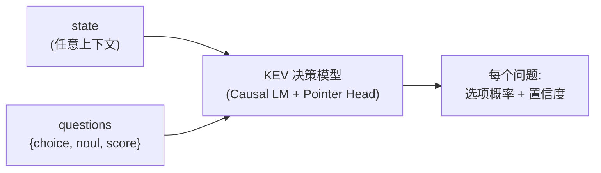
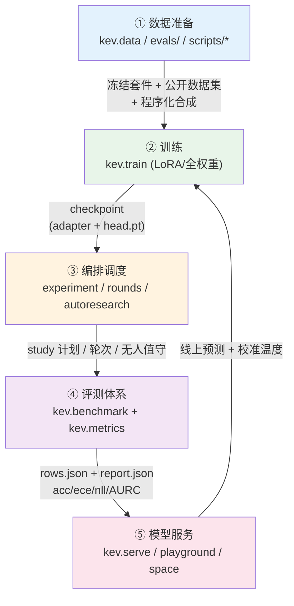
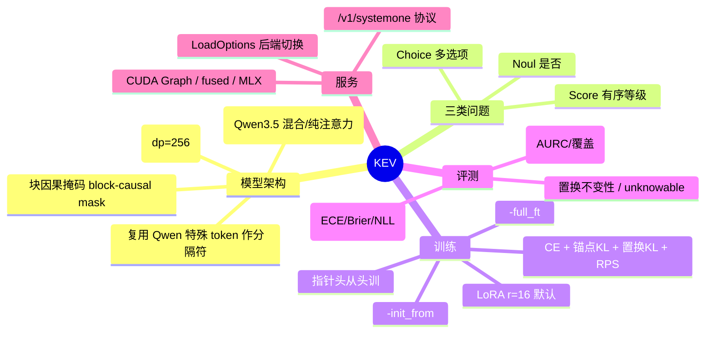

# KEV 学习地图与架构总览

> 一份面向「想快速、全面掌握 KEV，并具备自主训练垂直领域 KEV 模型能力」的学习文档。
> 全文以「图 + 文字」呈现，建议按 `01 → 06` 顺序阅读，每篇都自成一体，可单独查阅。

---

## 1. KEV 是什么

**KEV 不是「生成文本的 LLM」，而是一个「给选项打分的决策模型」。** 它基于因果语言模型（Causal LM）底座，用 **LoRA + 一个从零训练的指针读出头（Pointer Head）**，在**不做任何文本生成**的前提下，对给定的 `state`（上下文）与若干 `questions`（每个问题带一组候选选项）输出每个选项的概率。

- 输入：一段任意结构的状态文本 + 若干结构化问题（Noul / Choice / Score 三类）
- 输出：每个问题下各选项的概率分布 + 置信度
- 特点：推理是 **prefill-only（仅前向）**，无自回归解码；天然支持「不知道就选 none-of-the-above」「选项乱序不变」「可分离地回答同一状态下的多个问题」



---

## 2. 端到端完整链路（五大阶段）



| 阶段 | 核心模块 | 一句话 |
|---|---|---|
| ① 数据准备 | `kev.data`、`evals/`、`scripts/build_*.py` | 把公开数据集 + 程序化规则 + 你的数据，统一成 `state+questions` 的标注记录 |
| ② 训练流程 | `kev.train`、`kev.full_ft`、`kev.model`、`kev.checkpoint` | LoRA 微调或全权重训练，指针头从零训，多种防骗损失 |
| ③ 编排调度 | `kev.experiment`、`kev.rounds`、`kev.autoresearch`、`modal_app.py` | 用 JSON 计划驱动一批 trial；轮次引擎做对比选模；可无人值守 |
| ④ 评测体系 | `kev.benchmark`、`kev.predictors`、`kev.metrics`、`kev.calibrate` | 本地/远端/Jev 三种预测器打分，纯 numpy 指标 + 配对 bootstrap |
| ⑤ 模型服务 | `kev.serve`、`kev.api`、`playground/`、`space/`、`skills/` | FastAPI 暴露 `/v1/systemone`，前端演示 + HF Space + 自助部署技能 |

---

## 3. 关键技术概念速查



---

## 4. 推荐学习路径

| 顺序 | 文档 | 目标 |
|---|---|---|
| 0 | **README.md（本篇）** | 建立全局心智模型与术语 |
| 1 | [01-数据准备.md](./01-数据准备.md) | 理解 `state/questions` 数据格式，会造训练数据 |
| 2 | [02-训练流程.md](./02-训练流程.md) | 读懂训练入口、损失、checkpoint 结构、关键超参 |
| 3 | [03-编排调度.md](./03-编排调度.md) | 用计划文件跑 study / 轮次 / 无人值守 |
| 4 | [04-评测体系.md](./04-评测体系.md) | 看懂 `report.json`，会用指标判断模型好坏 |
| 5 | [05-模型服务.md](./05-模型服务.md) | 起服务、接前端、选后端、做校准 |
| 6 | [06-垂直领域实战.md](./06-垂直领域实战.md) | **落地**：从 0 训一个你自己的 KEV |

---

## 5. 环境与快速上手

### 5.1 通用步骤（Linux / macOS / WSL2）

```bash
# 1. 安装依赖（含 serve 后端）
uv sync --extra serve

# 2. 1 分钟冒烟训练（验证环境）；--device auto 会自动选 GPU，也可显式写 --device cuda
uv run python -m kev.train --n_per_source 40 --accum 4 --out runs/smoke

# 3. 用已发布模型做评测
uv run python -m kev.benchmark --run jaredpalmer/kev-4b \
    --suite evals/v7/decision-v7 --out runs/kev-4b-eval

# 4. 启动本地服务（FastAPI /v1/systemone）
uv run python -m kev.serve --run jaredpalmer/kev-4b --port 8008
```

> 在 **Linux 与 WSL2** 上，`uv sync` 从 PyPI 装到的 `torch` wheel **自带 CUDA 运行时**，
> 装完 `torch.cuda.is_available()` 即为 `True`，无需任何额外配置即可用 GPU。
> macOS 走 MLX 后端（Apple Silicon），无需 CUDA。

### 5.2 Windows 用户须知

本项目代码已对 `resource`、`fcntl` 这类 **POSIX 专有模块**做了跨平台兼容
（`kev/train.py` 的 `peak_rss_bytes()` 在 Windows 上改用 `ctypes` + `GetProcessMemoryInfo`，
`kev/suite.py` 的 `flock_ex()` 在 Windows 上改用 `msvcrt.locking`，Unix 上仍用 `resource` / `fcntl`），
因此 Windows 上可以直接 `uv sync` 并运行训练 / 评测 / 服务，无需改代码。

但有一个**关键环境坑**会让你觉得「怎么这么慢」：

- 在 **原生 Windows** 上，PyPI 默认提供的 `torch` wheel 是 **CPU-only**（形如 `torch 2.8.0+cpu`），
  `torch.cuda.is_available()` 恒为 `False`。这与 Linux/macOS 不同：Linux 的 PyPI wheel 自带 CUDA，
  而 Windows 的 PyPI wheel 不带。
- 脚本默认 `--device auto` 会先探测 CUDA、失败后退回到 `device=cpu`，于是冒烟训练每条记录要 ~5s，比 GPU 慢几十倍。

**澄清一个常见误解：PyTorch 官方是提供 Windows 的 CUDA wheel 的**，只是它**不在 PyPI 默认源**，
而在 PyTorch 自己的 CUDA 索引（`https://download.pytorch.org/whl/cuXXX`）。所以原生 Windows 上
**完全可以用 GPU**，只需把 `torch` 的来源从 PyPI 换成这个 CUDA 索引即可。下面给出四种方案。

#### 方案 A（推荐，最干净）：让 uv 从 PyTorch CUDA 索引装 torch

在 `pyproject.toml` 末尾加上索引与来源（这里用 CUDA 12.8，需驱动 ≥ 该版本，例如 572.84）：

```toml
[[tool.uv.index]]
name = "pytorch-cu128"
url = "https://download.pytorch.org/whl/cu128"
explicit = true

[tool.uv.sources]
torch = [{ index = "pytorch-cu128" }]
```

然后重新解析并安装：

```powershell
uv sync --extra serve
uv run python -c "import torch; print(torch.cuda.is_available(), torch.cuda.get_device_name(0))"  # 应为 True
uv run python -m kev.train --n_per_source 40 --accum 4 --out runs/smoke --device cuda
```

> 若 `cu128` 找不到对应 Python 3.13 的 Windows wheel，把 URL 换成 `cu126` 等即可，只要满足
> `pyproject` 的 `torch>=2.6,<2.9` 约束。`explicit=true` 表示只有显式声明来源的 `torch` 走该索引，
> 其余包仍从 PyPI 解析，不影响跨平台一致性。

#### 方案 B（不动配置，临时）：直接覆盖安装 CUDA torch

```powershell
uv pip install --reinstall torch --index-url https://download.pytorch.org/whl/cu128
```

> 之后若再执行 `uv sync` 会被还原成 CPU 版；仅在本机临时跑训练时可接受。

#### 方案 C（WSL2，Linux 子系统，零配置即可用 GPU）

WSL2 是 Linux 环境，PyTorch 有完整的 CUDA wheel（PyPI 默认即带 CUDA），`uv sync` 装完即可用 GPU，
且**不用动 `pyproject.toml`**。前提是 Windows 已装好 NVIDIA 驱动（如 572.84，已支持 WSL2 CUDA）。

```bash
# 在 WSL2（Ubuntu）终端，进入同一份代码目录
cd /path/to/kev
uv sync --extra serve
uv run python -c "import torch; print(torch.cuda.is_available(), torch.cuda.get_device_name(0))"  # 应为 True
uv run python -m kev.train --n_per_source 40 --accum 4 --out runs/smoke   # auto 认到 GPU
```

> **WSL2 实操坑**：不要把 Windows 原生创建的 `.venv` 与 WSL2 混用。`.venv` 若在 Windows 侧生成
> （含 `Lib\` 目录结构），WSL2 的 uv 想重建为 Linux 结构时会删不掉 `/mnt/d` 上的目录，
> 报 `Input/output error (os error 5)`。解决：先在 **Windows PowerShell** 删掉旧 `.venv`
> （`Remove-Item -Recurse -Force D:\work\kev\.venv`），再在 WSL2 里重建；或把项目复制到 WSL 本地磁盘
> （`cp -r /mnt/d/work/kev ~/kev`）以避开跨文件系统权限问题，并获得更快的 I/O。

#### 方案 D（原生 Windows + conda）

若不想动 `pyproject.toml`，也可用 **conda** 安装带 CUDA 的 PyTorch（conda 仍提供 Windows CUDA 包）：

```powershell
conda install pytorch torchvision pytorch-cuda=12.8 -c pytorch -c nvidia
```

> 但本项目以 `uv` 管理其余依赖，conda 只接管 `torch` 会与 `uv` 的环境产生两套解释器 / 包，
> 需自行协调，不如方案 A / C 干净。

### 选型小结

| 环境 | GPU 是否直用 | 配置成本 | 推荐度 |
|---|---|---|---|
| Linux（原生） | 是（PyPI 自带 CUDA） | 无 | ★★★★★ |
| WSL2 | 是（同 Linux） | 低（勿混用 `.venv`） | ★★★★★ |
| 原生 Windows（uv + pytorch 索引，方案 A） | 是 | 中（改 `pyproject` 一次） | ★★★★ |
| 原生 Windows（conda，方案 D） | 是 | 高（两套环境） | ★★ |
| 原生 Windows（PyPI 默认） | 否（CPU-only） | 无 | 仅验证用 |

> 完整命令清单见仓库根 `AGENTS.md` 与 `README.md`。本学习文档只聚焦「链路与原理」。

---

## 6. 文档约定

- 所有架构图用 **Mermaid** 渲染（GitHub / VitePress / 多数 Markdown 查看器原生支持）。
- 文件路径均为相对仓库根目录，例如 `kev/train.py`、`evals/v7/decision-v7`。
- 「旋钮/参数」指 `kev.train` 的命令行参数；所有默认值来自 `kev/experiment.py:DEFAULTS`。
