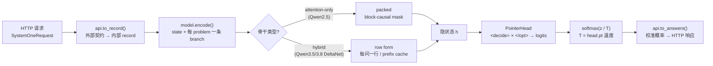

# 1. Kev 是什么：一句话模型与学习地图

> 《Kev 基础知识系统学习指南》· 第一部分 入门篇
>
> **本部分目标**：不依赖任何 Kev 特有知识，仅用 Transformer 基础，就能完整复述 "一条 record 如何变成一组校准概率"。读完即可读懂 `kev/model.py` 的 `encode()` 与 `PointerHead`。
>
> [⌂ 目录与架构图](../index.html) · [← 上一章](../README.md) · [下一章 →](02-transformer.md)

---


### 1.1 概念定义

> **Kev = 因果语言模型骨干（Qwen3.5/3.8，去 LM head）+ 自定义注意力掩码 + 一个指针读出头（PointerHead），
> prefill-only、不生成文本，把 `state + questions` 编码成一个序列，直接输出每个问题的校准概率分布。**

三种问题类型，一种读出方式：

| 题型 | 语义 | 输出 | 概率解释 |
|---|---|---|---|
| `noul` | 是 / 否 判断 | p(true) | 二点分布 |
| `choice` | K 选 1 | argmax + K 维分布 | 分类分布 |
| `score` | 等级评分 | 期望等级 `Σ i·p[i]` | 有序等级分布 |

### 1.2 原理讲解：这个定位决定了学什么、不学什么

Kev **不是对话模型**（`AGENTS.md` 第一行："No text generation"）。因此：

- **生成式 LLM 那一半知识可以跳过**：解码循环、beam search、采样温度（注意：Kev 的"温度"是校准用的，
  不是采样温度）、prompt 工程、RLHF/DPO。
- **判别式/校准/评测那一半是主干**：softmax 概率、交叉熵、温度缩放、ECE/Brier/NLL、选择性预测、
  bootstrap 置信区间、数据泄漏纪律。
- **再加一撮非典型系统工程知识**：hybrid 线性注意力（DeltaNet）、4D additive mask、prefix cache、
  bf16/fp32 混合精度——这些决定你能否读懂 `shared_prefix` / `fused_qwen35` / 训练计划。

### 1.3 全景数据流（动画）

下图是 Kev 一次请求的完整数据流。若你的阅读器支持 HTML（VS Code 预览、IDE 内置 Markdown 预览），
会看到数据包沿管道流动的动画；纯文本环境请对照下方 Mermaid 静态图。

<div style="font-family:monospace;background:#0d1117;color:#c9d1d9;padding:18px;border-radius:8px;overflow-x:auto">
<style>
@keyframes kevflow { 0%{left:0;opacity:0} 8%{opacity:1} 46%{opacity:1} 54%{left:100%;opacity:0} 100%{left:100%;opacity:0} }
.kev-pipe{position:relative;padding:14px 0}
.kev-dot{position:absolute;top:50%;margin-top:-6px;width:12px;height:12px;border-radius:50%;
  background:#58a6ff;box-shadow:0 0 8px #58a6ff;animation:kevflow 3.2s linear infinite}
.kev-dot.d2{animation-delay:1.05s;background:#3fb950;box-shadow:0 0 8px #3fb950}
.kev-dot.d3{animation-delay:2.1s;background:#f0883e;box-shadow:0 0 8px #f0883e}
.kev-lbl{display:inline-block;background:#161b22;border:1px solid #30363d;border-radius:6px;padding:4px 10px;margin:0 6px}
.kev-lbl b{color:#58a6ff}
</style>
<div class="kev-pipe">
  <span class="kev-dot"></span><span class="kev-dot d2"></span><span class="kev-dot d3"></span>
  <span class="kev-lbl">HTTP <b>SystemOneRequest</b></span>→
  <span class="kev-lbl">api.<b>to_record()</b></span>→
  <span class="kev-lbl">encode <b>state+branches</b></span>→
  <span class="kev-lbl">骨干 <b>block-causal/rows</b></span>→
  <span class="kev-lbl"><b>PointerHead</b> logits</span>→
  <span class="kev-lbl">softmax ÷ <b>T</b></span>→
  <span class="kev-lbl">api.<b>to_answers()</b></span>
</div>
<div style="color:#8b949e;font-size:12px;margin-top:6px">一次 prefill，零生成：state 只算一次，每个问题从缓存分支上读出 → 校准概率</div>
</div>



📖 `kev/model.py`（模块 docstring 第一行即是本节那句话）、`kev/api.py`、`kev/serve.py`。

### 1.4 示例代码：30 秒看到端到端输出

```powershell
# ▶ 起一个本地服务（首次先 uv sync --extra serve；smoke 训练 1 分钟得到可加载的 checkpoint）
uv run python -m kev.train --n_per_source 40 --accum 4 --out runs/smoke
uv run --extra serve python -m kev.serve --run runs/smoke/checkpoint --port 8009
```

```python
# ▶ 用 Python 直接走库路径（不需要起服务）：checkpoint → record → 概率
# 加载函数在 kev.checkpoint：Checkpoint(run).load(device) -> (tokenizer, model)
from kev.api import SystemOneRequest, to_record
from kev.checkpoint import Checkpoint

req = SystemOneRequest.model_validate({
    "state": "服务器 CPU 在 03:00 飙升到 98%，日志显示每秒 4000 次重试登录。",
    "questions": {"cause": {"type": "choice",
                            "instructions": "这更可能是安全事件还是性能故障？",
                            "criteria": {"security": "安全事件（暴力破解）",
                                         "performance": "性能故障（缓存雪崩）"}}},
})
tok, model = Checkpoint("runs/smoke/checkpoint").load("cpu")   # 注意顺序：tokenizer 在前
rec, meta = to_record(req)          # 外部契约 → 内部 record（见第 5 章）
probs = model.probs(model.encode(tok, rec))   # [[tensor([p_0, p_1])]]：每题一个 K 维分布
print(probs, meta[0]["keys"])
```

**关键结论**：Kev 的一切模块都围绕这一条 `state → questions → probabilities` 原语对齐；
读懂第 5–7 章（record、mask、pointer）就懂了模型本体，第 9–10 章补上"概率为什么可信"。

---

[⌂ 目录与架构图](../index.html) · [← 上一章](../README.md) · [下一章 →](02-transformer.md)
