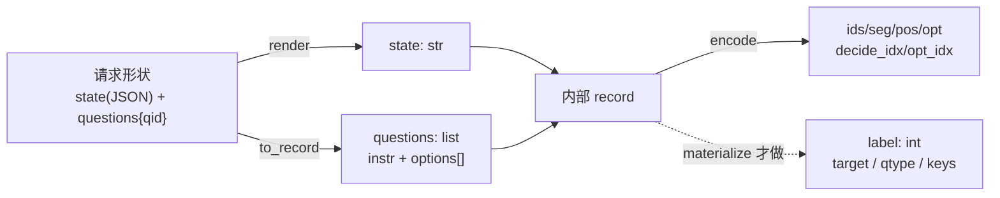

# 5. Kev 的数据单元：record（state + questions）

> 《Kev 基础知识系统学习指南》· 第一部分 入门篇
>
> [⌂ 目录与架构图](../index.html) · [← 上一章](04-probability.md) · [下一章 →](06-block-causal-mask.md)

---


### 5.1 概念定义

Kev 里有**两种**长得很像但不一样的"数据形状"，混用它们是新手第一大坑：

| 形状 | 谁生产 | state | questions | 标签 |
|---|---|---|---|---|
| **请求形状**（外部契约 / 标注行） | 调用方、`evals/*.jsonl`、`--data` 的 JSONL | `str \| dict \| list`（结构化 JSON） | **dict**：`{qid: {"type", "instructions", "criteria"}}` | `label`：choice 给选项名、noul 给 bool、score 给等级下标 |
| **内部 record** | `api.to_record()` / `data.materialize()` | `str`（已 `render` 拍平） | **list**：`[{"instr", "options": [str,...], "label": int}]` | int：命中的**选项下标** |

请求形状 → 内部 record 的唯一合法通道是
[`kev/api.py:to_record()`](../../../kev/api.py)（纯推理，无标签）与
[`kev/data.py:materialize()`](../../../kev/data.py)（带标签版本：走同一条 `to_record`，再把 `label`/`src`/`qtype`/`keys`/可选 `target` 附上）。

三种题型的候选项怎么来（`to_record` 的真实逻辑）：

| type | options | `question_keys()` 报告概率用的键 |
|---|---|---|
| `noul` | `["no", "yes"]` 的渲染文本（criteria 可给 false/true 描述） | `["false", "true"]` |
| `choice` | `criteria` 的每一项（1..`MAX_OPTIONS=255`） | criteria 的键名，按选项顺序 |
| `score` | `criteria` 列表的每一项（有序等级） | `"0".."L-1"` |

### 5.2 原理讲解：为什么"多问题共享 state"是数据模型的一部分

一条 record 天生是 **(1 个 state, Q 个问题)** 的扇出结构。这不是便利，而是**契约**：

- 计算上：state 只跑一遍（第 6/8 章），Q 个问题从它分支出去 → 一次 prefill 回答全部问题；
- 语义上：一次业务判断往往要同时问"是不是 / 归口哪 / 风险几分"，它们必须基于**同一份证据**；
- 统计上：**同一 record 的问题不独立**（共享 state 的隐状态），所以一切 bootstrap 都以 record 为重采样单位（第 11 章）。

行里那些 `_meta` 字段就是为这三件事服务的（`load_records` 会补齐）：

| 字段 | 用途 |
|---|---|
| `_meta.id` | record 唯一键；`group`（常等于 id）是聚类单位 |
| `_meta.source` | 数据集来源（如 `boolq`、`tasksource`）；分层 bootstrap 与 `--train_sources`/`--holdout` 按它切 |
| `_meta.variant` | `clean` 才计分；被筛出近重复孪生的行会挪到 `_meta.twin` |
| `_meta.control_id` | 与"完整证据版本"配对的对照行（不可知探针，见 §5.4） |
| `q.src` | 任务名（`grouped_metrics`、macro 聚合按它分组） |
| `q.target` | **soft target**（按选项键归一化的分布）；不可知记录用"对全部选项均匀"的 target |

<div style="font-family:monospace;background:#0d1117;color:#c9d1d9;padding:18px;border-radius:8px;overflow-x:auto">
<style>
@keyframes keprec { 0%{left:0;opacity:0} 10%{opacity:1} 88%{opacity:1} 100%{left:100%;opacity:0} }
.kr-pipe{position:relative;padding:16px 0}
.kr-dot{position:absolute;top:50%;margin-top:-6px;width:11px;height:11px;border-radius:50%;
  background:#58a6ff;box-shadow:0 0 8px #58a6ff;animation:keprec 3.6s linear infinite}
.kr-dot.b{animation-delay:1.2s;background:#3fb950;box-shadow:0 0 8px #3fb950}
.kr-dot.c{animation-delay:2.4s;background:#f0883e;box-shadow:0 0 8px #f0883e}
.kr-l{display:inline-block;background:#161b22;border:1px solid #30363d;border-radius:6px;padding:4px 8px;margin:0 4px;font-size:12px}
.kr-l b{color:#58a6ff}
</style>
<div class="kr-pipe">
  <span class="kr-dot"></span><span class="kr-dot b"></span><span class="kr-dot c"></span>
  <span class="kr-l">JSONL <b>请求形状</b></span>→
  <span class="kr-l">api.<b>render(state)</b></span>→
  <span class="kr-l">api.<b>to_record()</b></span>→
  <span class="kr-l">内部 <b>record</b></span>→
  <span class="kr-l">model.<b>encode()</b></span>→
  <span class="kr-l"><b>ids / seg / pos / opt</b></span>
</div>
<div style="color:#8b949e;font-size:12px;margin-top:6px">带标签的训练/评分路径再套一层 data.materialize()：它把 label 换成选项下标、补上 qtype/keys/src</div>
</div>



📖 `kev/api.py:to_record()`、`question_keys()`、`render()`；`kev/data.py:load_records()`、`api_request()`、`materialize()`。

### 5.3 示例代码

> 依赖：🟡 `uv sync` + 一次 tokenizer 下载（Qwen2.5-0.5B，很小）。不需要 checkpoint。

```python
# ▶ 一条标注行如何变成模型看到的 token 序列：完整可跑
from pathlib import Path
from kev.data import load_records, materialize
from kev.model import encode, load_tokenizer, SPECIAL

line = {"state": {"ticket": "账单被扣了两次，客户很生气", "team_hint": "billing / shipping / refund"},
        "questions": {
            "team": {"type": "choice", "instructions": "该归口哪个团队？",
                     "criteria": {"billing": "账务问题", "shipping": "物流问题", "refund": "退款问题"},
                     "label": "billing"},                       # choice：标签是选项名
            "angry": {"type": "noul", "instructions": "客户情绪是否负面？", "label": True},
            "p1":    {"type": "score", "instructions": "紧急度 0..2", "criteria": ["低", "中", "高"], "label": 2},
        },
        "_meta": {"id": "demo/1"}}
Path("/tmp/demo.jsonl").write_text(__import__("json").dumps(line, ensure_ascii=False), encoding="utf-8")

rec0 = load_records("/tmp/demo.jsonl")[0]      # 补齐 _meta.group_id / source / variant 与 q.src
rec = materialize(rec0)                         # -> 内部 record（questions 变 list，label 变 int）
print([(q["qtype"], q["keys"], q["label"]) for q in rec["questions"]])
# → [('choice', ['billing','shipping','refund'], 0), ('noul', ['false','true'], 1), ('score', ['0','1','2'], 2)]

tok = load_tokenizer("Qwen/Qwen2.5-0.5B")
enc = encode(tok, rec, max_state=64, max_branch=256, strict=True)   # 三题型共 3 条分支
print("总 token:", len(enc["ids"]), "| state token:", enc["state_tokens"])
print("分支数（= 问题数）:", max(enc["seg"]), "| <decide> 位置:", enc["decide_idx"])
print("每题的 </opt> 位置数:", [len(o) for o in enc["opt_idx"]])   # → [3, 2, 3]
print("前 6 个 token:", [tok.decode([i]) for i in enc["ids"][:6]])
```

### 5.4 进阶：不可知（unknowable）记录与 `target`

`evals/v9/transfer-v9` 一类面板会**删掉判断所需的证据**，正确答案按构造不可得。这类 record：
`target` 是均匀分布（soft target），`source == "unknowable"`。[`kev/metrics.py:scored_rows()`](../../../kev/metrics.py) 把它们**排除在常规指标之外**，
而 [`unknowable_report()`](../../../kev/metrics.py) 单独打它们的**置信度**——对的分数没意义，要看的是"它知道自己不知道"。

### 5.5 常见陷阱

- **对内部 record 再跑 `materialize`**：内部 record 的 questions 是 list，`api_request()` 只吃 dict 形状 → 直接报错。永远只在请求形状上做标注处理。
- **choice 标签写成下标**：`load_records` 用 `keys.index(label)` 换算，写错类型会在转换处炸；noul 必须是 `true/false`，score 必须是**从 0 起**的等级下标。
- **超过上下文预算**：`encode(strict=True)` 抛 `ContextOverflow`（`max_state` / `max_branch` / `max_packed` 三条），
  非 strict 会**静默截断**并在 `enc["state_truncated"]` 留痕。预算见第 18 章常量表：训练 384/1024/2048，服务 65,536。
- **把 `_meta.variant` 手工改成 clean** 绕过查重：评分侧只信干净行，但这是在污染统计，不是"加速实验"。

**关键结论**：record 是 Kev 的**唯一数据原语**；`state` 决定"共享什么"，`questions` 决定"扇出几个判断"，
`_meta` 决定"这些判断在统计上是同族的"。三者缺一，后面的掩码、损失和 bootstrap 都无从谈起。

---

[⌂ 目录与架构图](../index.html) · [← 上一章](04-probability.md) · [下一章 →](06-block-causal-mask.md)
