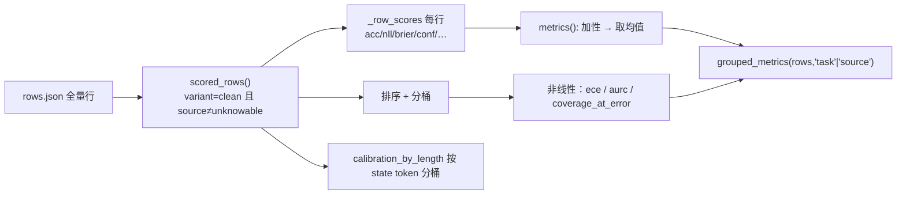

# 10. 指标族：accuracy / ECE / Brier / NLL / coverage / AURC

> 《Kev 基础知识系统学习指南》· 第二部分 进阶篇
>
> [⌂ 目录与架构图](../index.html) · [← 上一章](09-temperature.md) · [下一章 →](11-bootstrap.md)

---


### 10.1 概念定义

Kev 卖的不是"答得对"，而是**"知道自己什么时候答得对"**。所以一个 checkpoint 的成绩单必须同时报两族指标：
**判定质量**（accuracy）与**概率质量**（校准 + 选择性预测）。全部实现在 [`kev/metrics.py`](../../../kev/metrics.py)——
纯 numpy，只吃 `rows.json` 里的行字典，不需要 torch、不需要模型。

| 指标 | 公式（`p` = 概率向量，`y` = 金标下标，`c = max p`，`ô = argmax p`） | 越小/越大 | 随温度变吗 |
|---|---|---|---|
| `acc` | `1[ô == y]` 的均值 | ↑ 好 | **不变**（单调变换不改序） |
| `nll` | 有 logits：`logsumexp(z) - z[y]`；否则 `-log(max(p[y], ε))` | ↓ 好 | 变 |
| `brier` | `‖p - onehot(y)‖²` | ↓ 好 | 变 |
| `ece` | 10 个等宽置信桶：`Σ (n_b/n)·\|acc_b - conf_b\|` | ↓ 好 | 变 |
| `mean_conf` | `mean(max p)` | — | 变 |
| `confidence_bias` | `mean_conf - acc`（**带符号**） | 靠近 0 | 变 |
| `confident_error_rate` | `1[c ≥ 0.9 且 ô ≠ y]` 的均值（对**全部行**取均值） | ↓ 好 | 变 |
| `coverage_at_0_9` | `mean(c ≥ 0.9)` | ↑ 好 | 变 |
| `coverage_at_5pct_error` / `_1pct_error` | 按置信度降序接受，错误率 ≤ 预算时的**最大覆盖率** | ↑ 好 | 变 |
| `aurc` | risk-coverage 曲线下面积（风险 = 累计错误 / 已接受） | ↓ 好 | 变 |
| `score_mae` / `ranked_probability_score` | 仅 `type == "score"`：`\|Σ i·p[i] - y\|` / 累积分布差的均方 | ↓ 好 | 变 |

📖 `metrics()` 一次性返回上面全部字段，另加 `top_bins{0.9,0.95,0.99}`（各高置信桶的 `n / errors / error_rate`）与
`selective{0.5,0.8}`（保留 50% / 80% 最自信样本时的 `coverage / accuracy / confidence_cutoff`）。

两个"入口过滤器"必须先记住，它们决定分母是谁：

- `scored_rows(rows)`：只留 `variant == "clean"` **且** `source != "unknowable"` 的行。带噪变体与"不可知"题不进指标。
- `EPSILON = 1e-9`：概率下限。没有 logits 的行做 NLL 时 `-log(max(p, ε))`，防止 0 概率把 NLL 打成 `inf`。
  这是"有 logits 用精确值，没 logits 用被截断的概率"这一双轨的源头（`nll_at_temperature`）。

### 10.2 原理讲解：加性 vs 非线性，以及"整组阶梯"

**(1) 指标分两类，统计比较时待遇完全不同。** 这是第 11 章的全部前提：

- **加性（additive）**：`acc / nll / brier / mean_conf / confident_error_rate / coverage_at_0_9 / confidence_bias`。
  每条行有一个独立的数值（`_row_scores(row)`），总体指标 = 均值。重抽样只需对行取均值。
- **非线性（nonlinear）**：`{coverage_at_5pct_error, coverage_at_1pct_error, aurc, ece}`（`paired_bootstrap` 里写死的集合）。
  它们是**整条分布的泛函**——排序、分桶、取"最后一个满足预算的点"。对子集重算得到的值，绝不等于子集均值的组合，
  所以 bootstrap 必须在**每一次重抽样里把整个统计量重算一遍**。

**(2) risk-coverage 是阶梯函数，不是曲线。** `_risk_curve_arrays()` 把行按置信度**降序**排，累计错误 `cumsum(~correct)`，
然后只在"置信度发生变化"的位置取点（`ends`）。于是：

- `risk_coverage_curve()` 返回一系列台阶，每步 `{threshold, accepted, errors, coverage, risk}`；
- `coverage_at_error(conf, correct, budget)` = 满足 `errors ≤ budget × accepted` 的**最后一个**台阶的 `accepted / 最大 accepted`；
  一个都满足不了时返回 `0.0`（注意：不是返回负数，也不是返回首个台阶）；
- `area_under_risk_coverage()` = `Σ Δaccepted · (errors/accepted) / 最大 accepted`，即对台阶做矩形求和；
- `select_threshold(conf, correct, budget, min_accepted=1)` 给出可直接上线的**置信度门槛**（`None` = 全弃权）。

**(3) 为什么 Kev 特别看重 `coverage_at_error`。** 因为决策模型的真实卖点是"能自动化的比例"：
`AGENTS.md` 的说法是"一个概率诚实的模型覆盖率高；一个自信地犯错的模型覆盖率低，**无论它 accuracy 多高**"。
`confidence_bias` 的符号同理是诊断量：未训练（零样本）读出通常为正，结果训练过的接近 0 或为负。

**(4) 长上下文按长度分桶。** `calibration_by_length(rows, lengths, edges=LENGTH_EDGES)`，
`LENGTH_EDGES = (8192, 16384, 32768, 65536)`，产出互斥桶 `under_8k / 8k_16k / 16k_32k / 32k_64k / 64k_plus`
再加尾部 `8k_plus / 16k_plus / 32k_plus`，每桶报 `{n, acc, ece, brier, confident_error_rate}`（空桶 `n=0`，值为 `None`）。
token 数是**编码后的 state 段（含 `<state>`）**；行里自带 `state_tokens` 就用它，否则从 `lengths[row["id"]]` 取
（`kev.rounds.state_lengths` 算它）。rounds 面板里 `"by_length": true` 判据读的就是这里，例如 `long.ece_16k_plus.candidate <= 0.05`。

**(5) 一次真实 benchmark 的输出长什么样。** `kev.benchmark` 写两个文件：

- `rows.json`：每题一个对象的 JSON **数组**（`kev.suite.write_json`，`indent=2`；不是 JSONL，套件分区文件才是 JSONL）。实测 `runs/breadth-v1-kev-27b/rows.json` 的字段：
  `id, group, question, source, task, type, variant, keys, label, control_id, pair_id, sibling, parent, p, raw_probability_sum,
  zero_count, logits, inference_temperature`。`group` 是聚类单位（同一 record 的兄弟题共享），`control_id/pair_id/sibling`
  是 none-pair 的血缘，`raw_probability_sum/zero_count` 是"指针读出的和是否退化"的健康检查。
- `report.json`：`accuracy / ECE / Brier / NLL`、选择性覆盖与 AURC、`permutation`，以及 `environment`（这份 logits 依赖的
  kernel 集合，来自 `kev.predictors.kernel_environment`——包版本、GPU、backbone dtype、attention implementation、
  DeltaNet 层前向、绑定的 conv/delta rule transformer）。**两份 report 逐 bit 比较之前，先比 `environment`。**
  ⚠️ 隔离性（isolation）**不在** `report.json` 里，它由 `kev.experiment:mechanism_checks()` + `ISOLATION_PROBE` +
  `GATES["isolation_tolerance"] = 0.001` 把守（见第 6、15 章）。

<div style="font-family:monospace;background:#0d1117;color:#c9d1d9;padding:18px;border-radius:8px;overflow-x:auto">
<style>
@keyframes ecebar { 0%{height:4px;opacity:.35} 45%{height:var(--h);opacity:1} 62%{height:4px;opacity:.35} 100%{height:4px;opacity:.35} }
@keyframes rcwalk { 0%{left:8%;opacity:0} 12%{opacity:1} 88%{opacity:1} 100%{left:92%;opacity:0} }
.mx{display:flex;align-items:flex-end;gap:10px;height:110px;padding:0 6px;border-bottom:1px solid #30363d}
.mb{width:30px;background:#1f6feb;border-radius:3px 3px 0 0;animation:ecebar 4s ease-in-out infinite}
.mb.hi{background:#f85149}
.mlab{font-size:11px;color:#8b949e;margin:6px 0 14px}
.rc{position:relative;height:88px;margin-top:14px;border-left:1px solid #30363d;border-bottom:1px solid #30363d}
.rc-step{position:absolute;bottom:0;height:3px;background:#3fb950;opacity:.5}
.rc-dot{position:absolute;top:14px;width:12px;height:12px;border-radius:50%;background:#f0883e;
  box-shadow:0 0 9px #f0883e;animation:rcwalk 3.6s linear infinite}
.rc-cap{font-size:11px;color:#8b949e}
</style>
<div style="font-size:12px;color:#58a6ff;margin-bottom:6px">▍ECE：10 个置信桶上 |acc−conf| 的加权和（红柱 = 高置信却失准的桶）</div>
<div class="mx">
  <div class="mb" style="height:10px"></div><div class="mb" style="height:16px;animation-delay:.1s"></div>
  <div class="mb" style="height:9px;animation-delay:.2s"></div><div class="mb" style="height:14px;animation-delay:.3s"></div>
  <div class="mb" style="height:8px;animation-delay:.4s"></div><div class="mb" style="height:20px;animation-delay:.5s"></div>
  <div class="mb" style="height:26px;animation-delay:.6s"></div><div class="mb" style="height:34px;animation-delay:.7s"></div>
  <div class="mb hi" style="height:78px;animation-delay:.8s"></div><div class="mb hi" style="height:56px;animation-delay:.9s"></div>
</div>
<div class="mlab">0.05 → 1.00（横轴：预测置信度；纵轴：该桶 |acc − conf| × 占比）</div>
<div style="font-size:12px;color:#58a6ff;margin-bottom:6px">▍risk-coverage：按置信度降序接受，橙点走过台阶；绿横线 = 错误预算 5% 的截断点</div>
<div class="rc">
  <div class="rc-step" style="left:6%;width:12%;bottom:6px"></div><div class="rc-step" style="left:18%;width:14%;bottom:14px"></div>
  <div class="rc-step" style="left:32%;width:13%;bottom:24px"></div><div class="rc-step" style="left:45%;width:16%;bottom:38px"></div>
  <div class="rc-step" style="left:61%;width:15%;bottom:54px"></div><div class="rc-step" style="left:76%;width:18%;bottom:72px"></div>
  <div style="position:absolute;left:4%;width:88%;bottom:20px;border-top:1px dashed #3fb950"></div>
  <span class="rc-dot"></span>
</div>
<div class="rc-cap">← coverage 100%（全接受，risk 最高）　　coverage 0%（全弃权）→　｜　coverage_at_5pct_error = 虚线内最右可达台阶</div>
</div>



### 10.3 示例代码

> 依赖：🟢 只需 `numpy + kev.metrics`，直接对**仓库里已提交的真实 rows**跑，不需要 checkpoint、GPU、网络。

```python
# ▶ 读真实的 rows.json，把 metrics() 的全部字段打印出来
import json
from pathlib import Path
from kev.metrics import metrics, grouped_metrics, scored_rows

rows = json.loads(Path("runs/breadth-v1-kev-27b/rows.json").read_text(encoding="utf-8"))   # 也可以 kev.suite.read_json
clean = scored_rows(rows)                 # 这份已提交的 rows 全部是 clean 且无 unknowable，所以两个长度相等
print(f"总行数 {len(rows)} → 计分行数 {len(clean)}")

m = metrics(clean)
for k in ("n", "acc", "ece", "brier", "nll", "mean_conf", "confidence_bias",
          "confident_error_rate", "coverage_at_0_9", "coverage_at_5pct_error", "aurc"):
    print(f"  {k:24s} {m[k]}")
print("  top_bins:", m["top_bins"]["0.9"])
print("  selective 0.8:", m["selective"]["0.8"])

# 同一批行，按 task 打开：校准数字在不同任务上完全不同，只看总体会被平均掉
for name, mm in list(grouped_metrics(clean, "task").items())[:5]:
    print(f"  {name:28s} n={mm['n']:5d} acc={mm['acc']:.3f} ece={mm['ece']:.3f} ce0.9={mm['confident_error_rate']:.3f}")
```

```python
# ▶ 温度不改 acc / 改 ece；非线性指标必须整批重算（对比"逐行取均值"的错法）
import numpy as np
from kev.metrics import metrics, risk_coverage_curve, coverage_at_error, served_at, scored_rows

conf = np.array([max(r["p"]) for r in clean])
correct = np.array([np.argmax(r["p"]) == r["label"] for r in clean])

curve = risk_coverage_curve(conf, correct)
print(f"台阶数 {len(curve)} / 行数 {len(clean)}（置信度相同的行被压到同一台阶；全不重复时两者相等）")
print("  前三个台阶:", [(round(c["coverage"], 3), round(c["risk"], 4)) for c in curve[:3]])
print("  coverage_at_5pct_error =", round(coverage_at_error(conf, correct, 0.05), 4))

# 非线性泛函不能当加性量算：拿单行当 population，结果只能是 0 或 1
single = [coverage_at_error(np.array([c]), np.array([o]), 0.05) for c, o in zip(conf[:200], correct[:200])]
print(f"  伪·单行 coverage 均值 = {np.mean(single):.3f}，取值集 = {set(single)}（跟真实值 0.499 无关）")

# 同一批行换服务温度：acc 一 bit 不动，ece / brier / aurc 立刻变
# （served_at 先把行恢复到 raw logits 再重新加热，所以存的是 shipped 行还是 raw 行都能对齐）
for T in (1.0, 1.3819, 2.0):
    mm = metrics(served_at(clean, T))
    print(f"  T={T:<7} acc={mm['acc']:.4f} ece={mm['ece']:.4f} brier={mm['brier']:.4f} aurc={mm['aurc']:.4f}")
```

```python
# ▶ 长上下文分桶：length_buckets 的命名规则 + 空桶的形状
from kev.metrics import LENGTH_EDGES, length_buckets, calibration_by_length

print("edges:", LENGTH_EDGES)
print("buckets:", [name for name, _, _ in length_buckets()])
# breadth-v1 是短上下文面板，全部行落在 under_8k：尾部桶 n=0、指标为 None（判据读之前必须先看 n）
report = calibration_by_length(clean, lengths={r["id"]: r.get("state_tokens") or 0 for r in rows})
print({k: v["n"] for k, v in report.items()})
print("under_8k:", report["under_8k"])
print("8k_plus:", report["8k_plus"])        # 全是 None，不是一个很差的数字
```

### 10.4 常见陷阱

- **拿 `ece` 当唯一门槛**：ECE 是桶内平均，一个模型可以"整体 ECE 很低但 0.99 桶全是错"。永远同时看 `top_bins` 与 `confident_error_rate`。
- **混淆两个 coverage**：`coverage_at_0_9` 是**固定门槛**（conf ≥ 0.9 的比例）；`coverage_at_5pct_error` 是**固定错误预算**下能接受的最大比例。后者才是"可自动化比例"。
- **`confident_error_rate` 的分母**：它对**全部行**取均值，不是"高置信样本里的错误率"（后者是 `top_bins["0.9"]["error_rate"]`）。
- **对行取均值去重算非线性指标**：见示例第二条的"伪 coverage"。这正是 `paired_bootstrap` 每次重抽样整体重算的原因。
- **比较两份 report 前不比 `environment`**：kernel 集合（attention 实现、DeltaNet 前向、包版本）不同的 logits 不逐 bit 可比。
- **以为 `isolation` 在 report.json 里**：不在，见第 15 章。

**关键结论**：`acc` 是温度不变量，其余全是温度变量；`ece / aurc / coverage_at_*` 是整体泛函，
只能在"当前这批行"上整体重算。任何"两个 checkpoint 谁更好"的结论，都必须先把分母（`scored_rows`）、
温度（`served_at`）与 `environment` 对齐，才进入第 11 章的比较。

---

[⌂ 目录与架构图](../index.html) · [← 上一章](09-temperature.md) · [下一章 →](11-bootstrap.md)
