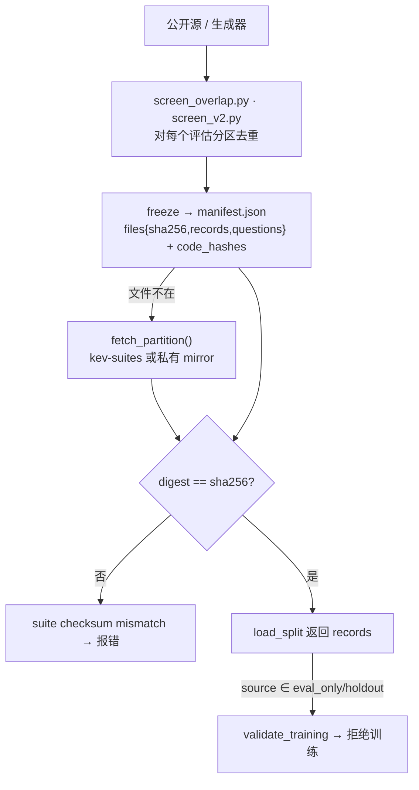

# 12. 冻结评测套件与数据纪律

> 《Kev 基础知识系统学习指南》· 第二部分 进阶篇
>
> [⌂ 目录与架构图](../index.html) · [← 上一章](11-bootstrap.md) · [下一章 →](13-training.md)

---


### 12.1 概念定义

> **冻结套件（frozen suite）= `evals/<version>/<suite>/{manifest.json, *.jsonl}`，四个分区 `train / calibration / development / test`，
> 每一个都被 manifest 里的 sha256 锁住。它不是一份数据，而是一份合同：数据 + 准入上下文 + 目标函数 + 代码哈希。**

| 概念 | 是什么 | 在哪 |
|---|---|---|
| `SPLITS` | `("train", "calibration", "development", "test")`：训练 / 拟合温度 / 开发读数 / 锁定考 | `kev/suite.py:22` |
| `manifest.json` | 套件合同：`version / seed / objective / context / files{sha256,records,questions} / admission / dataset_revisions / base_revisions / code_hashes` | 每个套件目录 |
| `suite_sha256` | **`digest(<suite>/manifest.json)`**，即 manifest 本身的 sha256（不是拼接分区） | `kev/benchmark.py:243`；用 `--data x.jsonl` 时它是那个文件的 digest |
| `CONTEXT` | 训练上下文 `{max_state 384, max_branch 1024, max_packed 2048, truncate False}` | `kev/suite.py:25` |
| `SERVING_CONTEXT` | 64k 服务上下文（`65536 / 73728 / 139264`）；旧套件记的是 `SERVING_CONTEXT_8K` | `kev/suite.py:27,31` |
| `ADMISSION_TOKENIZER` | 套件长度准入与计数用的固定 tokenizer：`("Qwen/Qwen3.5-4B-Base", "1001bb4d…")` | `kev/suite.py:46` |
| `ADMISSION_BRANCH_HEADROOM` | 64：clean record 额外留的 branch 余量，保证“加一个选项”的变体（none_of_these）仍然编得下 | `kev/suite.py:34` |
| `GIT_LIMIT` | 10 MB：超过它的分区不进 git（gitignore），但**仍被 manifest 的 sha256 钉住** | `kev/suite.py:44` |
| 镜像 | 公共 `jaredpalmer/kev-suites`（缺文件时自动拉）/ 私有 `jaredpalmer/kev-private-evals`（manifest 里 `mirror` 自己指名并钉 revision） | `kev/suite.py:40,227` |

三种可见性层级（实测本仓库）：

| 层级 | 例子 | git 里有什么 |
|---|---|---|
| 全量在 git | `evals/v9/transfer-v9`、`evals/smoke-v1` | manifest + 四个 jsonl |
| 大训练分区去镜像 | `evals/hard-v1`（train 23 MB）、`evals/documents-v1` | 其余 jsonl + manifest；`load_split` 首次使用时从 `kev-suites` 拉并校验 sha |
| 只公开 manifest | `evals/breadth-v1`、`evals/longdoc-v1`、`evals/documents-v2` | 只有 manifest.json（公布 hash，不公布文本；SATA-Bench NC / SGD share-alike / 无许可证文本不能公开） |

### 12.2 原理讲解：五道门 + 三条纪律

**(1) `load_split(directory, split, allow_test=False)` 就是一座门卫亭**，顺序固定：

1. `refuse_removed(directory)`：套件在 `REMOVED_SUITES` 里→ `RemovedSuite`，**附完整理由**，而不是一个“文件不存在”；
2. `split not in SPLITS` → `unknown split`；
3. `split == "test" and not allow_test` → `locked test requires explicit --allow-test; never use it for search`；
4. 文件不在 → `fetch_partition()` 从镜像拉（manifest 自己命名的 mirror 优先，否则 `SUITES_DATASET@SUITES_REVISION`；
   私有镜像对无权限账号回答“not found”，转成 `PermissionError` 并告诉你怎么拿）；
5. `digest(path) != manifest["files"][name]["sha256"]` → `suite checksum mismatch`；行数不对 → `suite record count mismatch`。

**(2) 纪律一：eval-only 永不进训练语料。** `validate_training(records, manifest)` 逐条检查 `_meta.source`：
命中 `EVAL_ONLY`（`mmlu / emotion / tweet_offensive / qnli / paws / sciq`）、manifest 的 `eval_only_sources` 或 `holdout_sources`
就报错；声明了 `trainable_sources` 时，“不在名单上”同样报错。`compositional` 还多一层：家族结构属于
`DEV_SHAPES / TEST_SHAPES` 或 `HELD_OUT_KEYS` 即“训练里出现保留结构”。breadth-v1 / longdoc-v1 的 `trainable_sources` 是 `[]`：
**按构造它们永远不可训**。反过来 documents-v2 / hard-v1 是“部分可训”（`cfpb`、七个 hard 家族），所以它的 train 分区能当增量数据。

**(3) 纪律二：温度拟合也算“用数据”**。第 9 章的 `kev.rounds.pool_conflicts()` 就长在这条纪律上：
一个 `temperature` 池不能是任何 arm 的训练套件 / 其 manifest 命名的组件 / plan 的 `data` 套件，不能池 arm 训过的 source，
也不能读任何可训语料的 `calibration` / `development` 分区（那两项是训练源的留出**条目**，同分布）。
round 19 就是踩了这一条（T 0.955、breadth-v1 ECE 0.059），round 20 换成留出**数据集**的池同一个 checkpoint 得到 0.0085。
从 `POOL_REQUIRED_FROM = 21` 起，受温度影响的判据不注册池就直接被 `validate`/`launch` 拒绝。

**(4) 纪律三：屏幕重叠（screening）而不是事后清洗。** 三个地方各管一段：
`scripts/screen_overlap.py`（hard-v1 vs JevBench 公开题，只计数）、`scripts/screen_longdoc_v1.py`、
以及 kev-sft 的 `assemble/screen_v2.py`（sft-v2 每条 record 对**每个冻结套件的每个评估分区** + 私有评估镜像 + JevBench 公开 +
eval-only 套件去重；不干净的 `_meta.variant` 移到 `_meta.twin`，`kev.benchmark` 只评 clean 行）。
私有名单（如 tasksource 家族列表、round 24 的排除列表）不进 git，靠 `scripts/private_rows.py` 恢复，
公开 spec 只携带路径与加盐文件的 sha256（`exclude_file`）。

**(5) `suite_sha256` 是“当时”的 hash。** `report.json` 记的是读数那一刻 manifest 的 digest；manifest 后来被补过字段（例如 breadth-v1 后来加了
`admission` 与 `note`），当前 digest 就会与已提交读数不同。这不是错误，而是**为什么 `kev.compare` 只允许同 hash 比较**：
它比较的是“同一次读数”，不是“同一个名字”。

**(6) 不可变不等于不能重建。** 每个套件都有能**逐字节重建**自己的 builder：`scripts/build_hard_v1.py`、
`scripts/build_devtools_v1.py --reproduce-v1`、`scripts/build_breadth_v1.py`、`scripts/build_documents_v{1,2}.py` + `label_*` + `freeze_*`、
`scripts/build_longdoc_v1.py` + `longdoc_v1_synthetic.py`。manifest 的 `code_hashes` 就是为此而存在——
重建后 hash 不同就说明数据真的变了，而不是“代码写法不同”。

<div style="font-family:monospace;background:#0d1117;color:#c9d1d9;padding:18px;border-radius:8px;overflow-x:auto">
<style>
@keyframes sflow { 0%{left:0;opacity:0} 8%{opacity:1} 44%{opacity:1} 52%{left:100%;opacity:0} 100%{left:100%;opacity:0} }
@keyframes gateflash { 0%,100%{border-color:#30363d;color:#8b949e} 50%{border-color:#f85149;color:#f85149;box-shadow:0 0 10px rgba(248,81,73,.5)} }
.sp{position:relative;padding:16px 0}
.sp-d{position:absolute;top:50%;margin-top:-6px;width:12px;height:12px;border-radius:50%;background:#58a6ff;
  box-shadow:0 0 8px #58a6ff;animation:sflow 4s linear infinite}
.sp-d.b{animation-delay:1.3s;background:#3fb950;box-shadow:0 0 8px #3fb950}
.sp-d.c{animation-delay:2.6s;background:#d2a8ff;box-shadow:0 0 8px #d2a8ff}
.sg{display:inline-block;background:#161b22;border:1px solid #30363d;border-radius:6px;padding:4px 9px;margin:0 4px;font-size:12px}
.sg b{color:#58a6ff}
.sg.no{animation:gateflash 2s ease-in-out infinite}
.sc{font-size:11px;color:#8b949e;margin-top:8px}
</style>
<div class="sp">
  <span class="sp-d"></span><span class="sp-d b"></span><span class="sp-d c"></span>
  <span class="sg">builder <b>--reproduce</b></span>→
  <span class="sg">screen <b>重叠</b></span>→
  <span class="sg">freeze → <b>manifest.json</b></span>→
  <span class="sg">分区 jsonl（<b>sha256 钉住</b>）</span>→
  <span class="sg no">门 1 refuse_removed</span>→
  <span class="sg no">门 2 split 名</span>→
  <span class="sg no">门 3 test 锁 (--allow-test)</span>→
  <span class="sg">门 4 mirror <b>fetch</b></span>→
  <span class="sg no">门 5 sha256 + 行数</span>→
  <span class="sg">records → <b>load_split()</b></span>
</div>
<div class="sc">红闪 = 三道“拒绝”门（移除的套件 / 未知分区 / 锁定考）；它们报错的方式都是“带理由的拒绝”，不是默默回空数据。</div>
</div>



### 12.3 示例代码

> 依赖：🟢 纯文件读取 + `kev.suite`，不下载、不训模型。全部命令已实测跑通。

```python
# ▶ 读一份套件合同，并验证 report.json 里的 suite_sha256 从哪里来
import json, pathlib
from kev.suite import SPLITS, CONTEXT, read_manifest, digest

m = read_manifest("evals/smoke-v1")
print("SPLITS:", SPLITS)
print("objective:", m["objective"])
print("context:", m["context"], "| 训练默认 CONTEXT:", CONTEXT)
print("seed:", m["seed"], "| holdout_sources:", m["holdout_sources"])
print("admission:", json.dumps(m["admission"], ensure_ascii=False)[:110], "…")
for name, blk in m["files"].items():
    print(f"  {name:22s} records={blk['records']:4d} questions={blk['questions']:4d} sha={blk['sha256'][:12]}")

# suite_sha256 就是 manifest 文件的 digest
print("smoke manifest digest:", digest("evals/smoke-v1/manifest.json")[:16])
rep = json.loads(pathlib.Path("runs/breadth-v1-kev-27b/report.json").read_text(encoding="utf-8"))
print("breadth report 当时记的:", rep["suite_sha256"][:16])
print("breadth manifest 现在的:", digest("evals/breadth-v1/manifest.json")[:16])
# → 两个可以不同：manifest 在那些读数之后被补过字段。同一次研究的两份读数之间必须相同。
```

```python
# ▶ 五道门：逐条碰出来
from kev.suite import load_split

dev = load_split("evals/smoke-v1", "development")
print(f"development: {len(dev)} records / {sum(len(r['questions']) for r in dev)} questions")

try:
    load_split("evals/smoke-v1", "dev")                # 门 2
except ValueError as e:
    print("门 2 →", e)

try:
    load_split("evals/smoke-v1", "test")               # 门 3：锁定考
except ValueError as e:
    print("门 3 →", e)

test = load_split("evals/smoke-v1", "test", allow_test=True)   # 唯一入口，显式且进日志
print(f"allow_test=True 才能读到：{len(test)} 条")

# 门 5：自己改一个字节，hash 就拒绝（在临时目录里做，不碰仓库）
import shutil, tempfile
from pathlib import Path
with tempfile.TemporaryDirectory() as tmp:
    d = Path(tmp, "tampered"); d.mkdir()
    shutil.copy("evals/smoke-v1/manifest.json", d)
    shutil.copy("evals/smoke-v1/development.jsonl", d)
    body = Path(d, "development.jsonl").read_text(encoding="utf-8").replace('"instructions"', '"instruction"', 1)
    Path(d, "development.jsonl").write_text(body, encoding="utf-8")
    try:
        load_split(d, "development")
    except ValueError as e:
        print("门 5 →", e)
```

```python
# ▶ 纪律一：eval-only source 进训练会被 validate_training 拒绝
import copy
from pathlib import Path
from kev.data import EVAL_ONLY
from kev.suite import load_split, read_manifest, validate_training

train = load_split("evals/smoke-v1", "train")
print("clean train 通过：", len(validate_training(train, read_manifest("evals/smoke-v1")) or train), "条")

bad = copy.deepcopy(train)
bad[0]["_meta"]["source"] = EVAL_ONLY[0]                 # "mmlu"
try:
    validate_training(bad, read_manifest("evals/smoke-v1"))
except ValueError as e:
    print("→", e)

# breadth-v1 / longdoc-v1 按构造不可训：trainable_sources 是空列表
for suite in ("evals/breadth-v1", "evals/longdoc-v1", "evals/hard-v1", "evals/documents-v2"):
    mm = read_manifest(suite)
    print(f"  {suite:22s} trainable={mm.get('trainable_sources')} "
          f"mirror={(mm.get('mirror') or {}).get('dataset')} git_files={[p.name for p in Path(suite).glob('*.jsonl')]}")
```

```python
# ▶ 纪律四：被移除的套件“带理由拒绝”，而不是报文件不存在
from pathlib import Path
from kev.suite import REMOVED_SUITES, load_split, removed_suite

print("已移除：", list(REMOVED_SUITES))
entry = REMOVED_SUITES["evals/external/wanli-v2"]
print("理由（节选）:", entry["reason"][:150], "…")
print("最后读过它的轮次:", entry["last_round"], "| 记录:", entry["record"])
print("目录在本 checkout 里存在吗：", Path("evals/external/wanli-v2").exists())   # False：套件已从仓库删除
# ⚠ Windows 上 suite_key() 用 Path 拼接，str(Path(...)) 返 'evals\external\wanli-v2'（反斜杠），
#    与字典的 POSIX 键不相等，removed_suite() 会返 None——这道门拦不住，变成 FileNotFoundError。
#    在 macOS/Linux（仓库的开发平台）上不发生。读之前先 print(removed_suite(dir)) 校一下。
print("removed_suite('evals/external/wanli-v2'):", removed_suite("evals/external/wanli-v2"))
```

### 12.4 常见陷阱

- **先读 test、后想指标**：`--allow-test` 是唯一入口，且它存在的目的就是一次性。拿锁定考调超参 = 把考卷变训练集。
- **以为文件不在就是“没数据”**：`load_split` 会自己拉镜像；拉不到时 `PermissionError` 会说清是哪个私有仓库，要 `hf auth login` / `HF_TOKEN`。
- **拿私有套件的“空目录”当“套件不存在”**：breadth-v1 / longdoc-v1 在 git 里只有 manifest，这是设计，不是没提交。
- **跨 `suite_sha256` 比较**：`kev.compare` 拒绝就对了；历史读数与当前 manifest 的 hash 不同也正常（第 12.2 节第 (5) 条）。
- **拿开发行拟合温度不算“用数据”**：第 9 / 12 两条纪律交叉处，round 19 就输在这里。
- **Windows 下 `REMOVED_SUITES` 不拦**（示例最后一条）：`suite_key()` 返回反斜杠形式。想真验拦劫，先比对 `list(REMOVED_SUITES)` 的键形。
- **devtools-v1 的重复 id**：CodeReviewer 的 id 来自数据集非唯一字段，`codereviewer/cls-test/13657` 与 `19245` 各指两条记录，
  另有 66 个 id 在 train 内部或 train/eval 之间重复——**train/eval 重叠要按 `text_sha256` 查，不是按 id**（冻结的已知缺陷）。

**关键结论**：Kev 的可信度不来自模型多小，而来自“数据不能作弊”这套机械护栏：分区被 sha256 钉住、锁定考被默认锁住、
eval-only 源被 `validate_training` 拒住、温度池被 `pool_conflicts` 拒住、重叠在装机前就被 screen 掉。
改任何一个评估数字之前，先保证自己没动这些门（`AGENTS.md`：“what may not be touched”）。

---

[⌂ 目录与架构图](../index.html) · [← 上一章](11-bootstrap.md) · [下一章 →](13-training.md)
