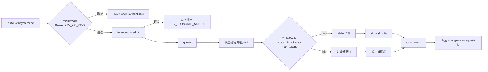

# 14. 推理服务实操

> 《Kev 基础知识系统学习指南》· 第三部分 应用篇
>
> [⌂ 目录与架构图](../index.html) · [← 上一章](13-training.md) · [下一章 →](15-evaluation.md)

---


### 14.1 概念定义

Kev 有四个“用它”的面，从库内到线上：

| 面 | 入口 | 返回什么 | 谁在用 |
|---|---|---|---|
| 库内直接 | `Checkpoint(run).load(device, opts)` → `(tok, model)`；`model.probs_batch(encs, cached, keep)` | 每题概率 | `kev.train` 的内循环、单测、脚本 |
| 本地 predictor | `kev.predictors.LocalPredictor(run, device, opts, context)` | `probabilities` + **`logits`** + `inference_temperature` + `latency_ms` | `kev.benchmark` 默认路径 |
| HTTP 服务 | `▶ uv run --extra serve python -m kev.serve --run <run\|Hub id> --port 8008` | TypeSafe 响应体 | playground、console、Space、SDK |
| 远程 predictor | `RemotePredictor(base_url)`（`--remote <url>`） | 只有概率（无 logits） | `kev.benchmark --remote` |

核心对象（全在 [`kev/serve.py`](../../../kev/serve.py)）：

- **`Server`**：一份已加载的 checkpoint + 一个 `PrefixCache` + **一条模型线程**。`submit(rec)` 把编码后的 record 排进队列并返回 `Future`；`answer(req)` / `answer_async(req)` 是完整的一次请求。
- **`PrefixCache`**：state 前缀的 LRU 缓存，键是 `(state 的 token id 元组, option_isolation)`。
- **`LoadOptions`**：把 checkpoint 变成模型的 8 个旋钮（`dtype / merge / attn / lora_scale / temperature / backend / cuda_graphs / fused`），`from_env()` 是 `KEV_*` 通道。
- **`SystemOneRequest` / `to_record()` / `to_answers()`**（[`kev/api.py`](../../../kev/api.py)）：HTTP 形状与内部 record 之间的唯一映射，整个对外合同只有 165 行。

### 14.2 原理讲解：请求的一生

**（1）八步。** 📖 `kev/serve.py: Server.answer / Server._run`、`kev/api.py: to_record / to_answers`。

| # | 步骤 | 代码 | 关键行为 |
|---|---|---|---|
| 1 | 形状校验 | `SystemOneRequest` + `Choice._check` | `criteria` 必须 1..`MAX_OPTIONS`=255；`questions` 至少 1 个 |
| 2 | 可选预处理 | `prepare()` → `api.with_date_facts` | `KEV_DATE_FACTS=1`：把两两日期差写成句子塞进 state（issue #8：模型不会做日期减法，但会用写出来的天数） |
| 3 | 形状 → record | `api.to_record(req)` | `render(state)` 把 dict/list 拉平成文本；每题 `{instr, options, label: 0}`；另留 `meta`（id/type/keys/legend）用于回填 |
| 4 | 服务准入 | `kev.model.admit(model, tok, rec, truncate)` | state > `SERVE_MAX_STATE` = 65,536 或某行 > `SERVE_MAX_BRANCH` = 73,728 → `ContextOverflow` → **422**；`KEV_TRUNCATE_STATES=1` 改成读前 65,536 并在**每个**响应里标 `truncated` |
| 5 | 排队 | `Server.submit` → `queue.put((enc, Future))` | 请求线程到此结束，绝不碰模型 |
| 6 | 模型线程 | `_run`：`plan → make_room → probs_batch → store` | 唯一碰模型的地方，全程持 `lock` |
| 7 | 概率 → 答案 | `api.to_answers(ps, meta)` | 三种题型各自的形状与置信度 |
| 8 | 响应体 | `Server._body` | `model / answers / usage{input_tokens, output_tokens} / latency_ms`（+ 截断标记） |

**（2）一条模型线程，有界批处理。**

- `MAX_BATCH = 64`：线程一空就把队列里现有的请求一次取走当一批。行与行互相独立（第 6 章的分支隔离），所以**批次不影响任何一条答案**——这是敢批处理的前提。
- 失败广播：一批抛异常 → 该批每个 Future 都拿到同一个异常，线程继续活。异常对象先 `traceback.clear_frames(e.__traceback__)`：批的 Future 会扣住异常与它的帧，而帧里是这一趟失败的张量（一条 3,578 token 的 state 在 Kev-0.8B 上是 142 MiB）。
- `sys.setswitchinterval(0.0005)`：模型线程每次 CUDA sync 让出 GIL、等回来时才继续，Python 默认 5 ms 的切换间隔会把一批的模型时间拉长近 2×；`close()` 负责复原。
- `latency_ms` 是**这一批的模型时间**，不含请求在队列里的等待；`wait_idle()` 给基准与预热用（队列 join + 等 CUDA graph 捕获完）。
- HTTP 侧走 `answer_async()` + `asyncio.wrap_future`：等待中的请求不占工作线程，所以一个容器能吃下的并发约等于批量能吸收的量（对比：同步端点会被 FastAPI 丢进 40 线程池）。

**（3）前缀缓存：省掉的是“state 再算一遍”。** 这是服务侧最大的一个杠杆，实测在下面。

- 三条边界：`size`（默认 `KEV_PREFIX_CACHE=4` 个 state）、`min_tokens`（短于此**不缓存**：注意力-only 的 torch 模型是 384，hybrid 与 MLX 是 0）、`max_tokens`（缓存里 state token 总量，默认 65,536）。Kev-27B 上一个 64k state 的前缀约 1.3 GB 的 K/V + DeltaNet 状态，所以“四个 16k”可以，“四个 64k”不行。
- `plan()` 只把“这批之后还留得住”的新 state 标 `keep`：从后往前按最近出现挑，超过 `size` 或 `max_tokens` 的就放弃——否则它会被自己这一批立刻挤掉。
- `make_room()` 在这一批**跑之前**就把 `store()` 反正会淘汰的条目删掉，不让旧 state 在新 state 的那几趟里还常驻（MLX 上 Kev-4B 的 64k 前缀是 2.2 GB，两份就顶不住）。
- OOM 兜底：带缓存跑时 OOM，就清缓存重跑一次并记 `oom_retries`——缓存只省时间，不该变成新的故障源（#75）。
- 命中与否在响应里没有字段，但在 `GET /v1/models` 的 `prefix_cache` 块里能看见 `hits / misses / cached_states / oom_retries`。

**（4）精确路径与服务路径是两件事。**

| | 评估（`LocalPredictor`） | 服务（`kev.serve` 的 `main()`） |
|---|---|---|
| dtype | fp32（`opts.dtype=None`） | 非 CPU 默认 **bf16**：L4 上 2–4.5×，概率差 ~0.01、argmax 不变 |
| CUDA 内核 | 关 TF32、关 flash 与 mem-efficient SDPA（TF32 会把概率挪 ~1e-3，而隔离门控容差正是 0.001） | hybrid + CUDA 默认开 `cuda_graphs`（一趟约 2,000 次 kernel launch）与 `fused`（`kev.fused_qwen35`，省 ~1/3 GPU 时间） |
| 后端 | torch | `auto`：Apple Silicon + hybrid + 装了 mlx-lm + 没点 fp32 → MLX；MPS 上 `attn=sdpa` |
| 温度 | checkpoint 自带的（`opts.temperature=None`），`1.0` = raw | 同左，可用 `--temperature` / `KEV_TEMPERATURE` 覆盖 |

两条路径的读数**不能 bit 对 bit 比**，所以 `report.json` 里写 `environment`（`kev.predictors.kernel_environment`：包版本、GPU、骨干 dtype、attention 实现、GatedDeltaNet 的 forward 与 conv/delta-rule 绑定），比较前先比这块（第 10 章）。唯一的例外通道：一条 record 最长的行 > `ROW_PASS_TOKENS` = 16,384 且是 CUDA + torch，就在 `long_row_kernels()`（flash / efficient / math）下跑，预测带 `"kernels": "efficient"`，benchmark 把它抄到该行并在 `report.json` 里数 `long_rows`——因为精确的 math kernel 要摆 L×L 分数矩阵，64k 时 Kev-4B 每层 ~275 GB。

**（5）三种题型的响应与两个置信度定义。** 📖 `kev/api.py: to_answers`

- `noul` → `{"type": "noul", "noul": p(true)}`
- `choice` → `{"choice": <名字>, "confidence": …, "probabilities": {名字: p}}`，`choice_confidence = (p_max − 1/K) / (1 − 1/K)`：均匀 0，确定 1
- `score` → `{"score": Σ i·p[i], "legend": {…}, "probabilities": {"0": …}, "confidence": …}`——**期望等级，不是 argmax**；`score_confidence = max(0, 1 − E|level − mode| / D)`，D 是均匀分布围绕均值的平均绝对偏差

两个置信度式子镜像 TypeSafe 参考适配器 `system-one-adapter 0.2.1`，改它们要同步那边。`round_prob` 保 4 位小数不是审美：255 选项时 `255 × 0.00005 < 0.02`，仍在 TypeSafe 的 `|Σp − 1| < 0.02` 容差里。

**（6）拒绝与重试。** `REFUSAL_STATUSES = (400, 413, 422)`：端点自己拒了的请求，`RemotePredictor` **立刻**抛 `ContextOverflow`（benchmark 在 `skip_overlong` 下把它记成 rejected 而不是中断整轮）；408 / 429 / 5xx / 连接错误 / 超时按 `retries` 指数退避；其它 4xx 是“每次都一样”的答复，立刻停。

<div style="font-family:monospace;background:#0d1117;color:#c9d1d9;padding:18px;border-radius:8px;overflow-x:auto">
<style>
@keyframes svflow { 0%{left:0;opacity:0} 6%{opacity:1} 94%{opacity:1} 100%{left:100%;opacity:0} }
.sv-pipe{position:relative;padding:13px 0}
.sv-dot{position:absolute;top:50%;margin-top:-6px;width:12px;height:12px;border-radius:50%;
  background:#58a6ff;box-shadow:0 0 8px #58a6ff;animation:svflow 4.2s linear infinite}
.sv-dot.q2{animation-delay:1.4s;background:#3fb950;box-shadow:0 0 8px #3fb950}
.sv-dot.q3{animation-delay:2.8s;background:#f0883e;box-shadow:0 0 8px #f0883e}
.sv-l{display:inline-block;background:#161b22;border:1px solid #30363d;border-radius:6px;padding:3px 8px;margin:0 4px;font-size:12px}
.sv-l b{color:#58a6ff}
.sv-note{color:#8b949e;font-size:12px;margin-top:8px}
.sv-hit{color:#3fb950}.sv-miss{color:#f0883e}
</style>
<div class="sv-pipe">
  <span class="sv-dot"></span><span class="sv-dot q2"></span><span class="sv-dot q3"></span>
  <span class="sv-l">HTTP <b>SystemOneRequest</b></span>→
  <span class="sv-l"><b>prepare</b> date_facts</span>→
  <span class="sv-l"><b>to_record</b> + meta</span>→
  <span class="sv-l"><b>admit</b> 65,536 / 73,728</span>→
  <span class="sv-l">queue → <b>Future</b></span>→
  <span class="sv-l">模型线程 <b>plan/make_room</b></span>→
  <span class="sv-l"><b>probs_batch</b></span>→
  <span class="sv-l"><b>store</b> → <b>to_answers</b></span>
</div>
<div class="sv-note">
  <span class="sv-miss">未命中</span>：state 与每个问题分支各算一遍 → 实测 1,725 token 的 state 在 CPU/fp32 上 <b>12,092 ms</b>；
  <span class="sv-hit">命中</span>：state 从缓存续上，只跑问题分支行 → 同一 state 换问题 <b>656 ms</b>（18.4×）。
</div>
</div>



### 14.3 示例代码

```python
# ▶ 🟢 A：对外合同——形状、选项文本、keys、置信度、日期预处理（不需要模型、不需要网络）
import json
from kev.api import (Choice, Noul, Score, SystemOneRequest, choice_confidence,
                     date_facts, round_prob, score_confidence, to_answers, to_record,
                     with_date_facts)

req = SystemOneRequest(
    state={"ticket": "T-1", "text": "Opened 2026-08-03, due July 22, 2026.", "tags": ["billing"]},
    questions={
        "refund": Noul(type="noul", instructions="应退款吗？", criteria={"false": "不退", "true": "退"}),
        "route": Choice(type="choice", instructions="交给谁", criteria={"billing": "计费组", "tech": "技术组", "ops": "运营组"}),
        "sev": Score(type="score", instructions="严重度", criteria=["无影响", "轻微", "中等", "严重"]),
    },
)
rec, meta = to_record(req)
print(rec["state"])                       # dict 被 render 拉平：
# ticket: T-1
# text: Opened 2026-08-03, due July 22, 2026.
# tags:
#   - billing
print([q["options"] for q in rec["questions"]])
# [['no: 不退', 'yes: 退'], ['billing: 计费组', 'tech: 技术组', 'ops: 运营组'], ['无影响', '轻微', '中等', '严重']]
print([(m["id"], m["type"], m["keys"]) for m in meta])
# [('refund', 'noul', ['false', 'true']), ('route', 'choice', ['billing', 'tech', 'ops']), ('sev', 'score', ['0', '1', '2', '3'])]

probs = [[0.05, 0.95], [0.15, 0.70, 0.15], [0.05, 0.10, 0.55, 0.30]]
print(json.dumps(to_answers(probs, meta), ensure_ascii=False))
# {"refund": {"type": "noul", "noul": 0.95},
#  "route": {"type": "choice", "choice": "tech", "confidence": 0.55, "probabilities": {"billing": 0.15, "tech": 0.7, "ops": 0.15}},
#  "sev": {"type": "score", "score": 2.1, "legend": {...}, "probabilities": {"0": 0.05, ...}, "confidence": 0.5}}
print(round_prob(choice_confidence([1/3, 1/3, 1/3])), round_prob(score_confidence([0, 0, 0, 1.0])))   # 0.0 1.0
print(date_facts("Opened 2026-08-03, due July 22, 2026. Also 2026-08-03 again."))
# July 22, 2026 is 12 days before 2026-08-03.          ← 重复的日期只留第一次出现
print(with_date_facts(req.state)["date_facts"])        # 对象 state 走新字段，字符串 state 走追加段落
```

```python
# ▶ 🟢 B：PrefixCache 的合同——三条边界、LRU、以及 Server._run 的调用顺序
from kev.serve import PrefixCache

def enc(state_ids):                      # 造一个假编码：seg 里 0 = state，1 = 一个分支
    return {"ids": list(state_ids) + [999, 998], "seg": [0] * len(state_ids) + [1, 1]}

pc = PrefixCache(size=2, min_tokens=3, max_tokens=10)

def fake_batch(encs, tag):
    """复刻 Server._run 里的一批：plan → make_room →（假）probs_batch → store"""
    keys, cached, keep = pc.plan(encs)
    pc.make_room(keys, cached, keep)
    fresh = [old if old is not None else (f"P{key[0][0]}" if key is not None and new else None)
             for key, old, new in zip(keys, cached, keep)]      # 命中沿用旧前缀，未命中且 keep 的算一个新的
    pc.store(keys, cached, fresh)
    print(f"{tag}: cached={cached} keep={keep} prefixes={fresh} | hits={pc.hits} misses={pc.misses} entries={list(pc.entries.values())}")

fake_batch([enc([1, 2]), enc([10, 11, 12, 13])], "batch0")     # 2 token 的 state < min_tokens → 键就是 None，不缓存
# batch0: cached=[None, None] keep=[False, True] prefixes=[None, 'P10'] | hits=0 misses=1 entries=['P10']
fake_batch([enc([10, 11, 12, 13]), enc([20, 21, 22])], "batch1")
# batch1: cached=['P10', None] keep=[True, True] prefixes=['P10', 'P20'] | hits=1 misses=2 entries=['P10', 'P20']
fake_batch([enc([30, 31, 32, 33, 34])], "batch2")              # 第三个 state 进来 → 最久未用的 P10 被淘汰
# batch2: cached=[None] keep=[True] prefixes=['P30'] | hits=1 misses=3 entries=['P20', 'P30']
print(pc.over([(tuple([0] * 2), False), (tuple([1] * 2), False), (tuple([2] * 2), False)]),   # 3 > size → True
      pc.over([(tuple([0] * 6), False), (tuple([1] * 6), False)]))                            # 12 > max_tokens → True
```

```python
# ▶ 🟢 C：test-time 序平均（RotationAveraged）能把位置偏置摊平多少——用一个假 predictor
import math
from kev.predictors import RotationAveraged

class PositionalStub:                     # 只给排在第一个的选项加分：纯粹的位置偏置
    temperature = 1.0
    def __call__(self, record):
        keys = list(record["questions"]["q"]["criteria"])
        z = {k: (2.0 if i == 0 else 0.0) for i, k in enumerate(keys)}
        top = max(z.values()); e = {k: math.exp(v - top) for k, v in z.items()}; s = sum(e.values())
        return {"probabilities": {"q": {k: v / s for k, v in e.items()}}, "logits": {"q": dict(z)},
                "inference_temperature": 1.0, "latency_ms": 1.0, "input_tokens": 7}

rec = {"state": "s", "questions": {"q": {"type": "choice", "instructions": "", "criteria": {"a": "", "b": "", "c": ""}}}}
print(PositionalStub()(rec)["probabilities"]["q"])                       # {'a': 0.787, 'b': 0.1065, 'c': 0.1065}
avg = RotationAveraged(PositionalStub(), rotations=3)
out = avg(rec)
print([list(p["criteria"]) for p in [avg.rotated(rec, r) for r in range(3)]])
# [['a', 'b', 'c'], ['b', 'c', 'a'], ['c', 'a', 'b']]      ← 循环轮转；noul / score 不参与（顺序是它们的语义）
print({k: round(v, 4) for k, v in out["probabilities"]["q"].items()}, out["rotations"], out["latency_ms"])
# {'a': 0.3333, 'b': 0.3333, 'c': 0.3333} 3 3.0            ← 平均的是 logits（按选项名对齐），3 趟的成本
print({k: round(v, 4) for k, v in RotationAveraged(PositionalStub(), 2)(rec)["probabilities"]["q"].items()})
# {'a': 0.4223, 'b': 0.4223, 'c': 0.1554}  ← 轮转数不够摊平
```

```python
# ▶ 🟡 D：真·端到端。一次基座下载后可离线；CPU 就能跑完（0.6B / fp32）。
#    没有 runs/smoke-mirror 就先造一个：第 13 章的 --device cpu smoke，把目录名换成它。
import json
from kev.api import Choice, Noul, SystemOneRequest
from kev.checkpoint import Checkpoint, LoadOptions
from kev.serve import PermuteSystemOne, Server, app, models, systemone_permute, systemone_separate

ck = Checkpoint("runs/smoke-mirror")      # 本地 run 目录或 "jaredpalmer/kev-4b@rev"
tok, model = ck.load("cpu", LoadOptions())        # 6.1s；backend=torch dtype=float32 hybrid=False
srv = Server(ck, tok, model, "cpu")               # main() 里最核心的就是这一步
app.state.server = srv                            # 让 models()/demo 端点找到它

state = ("The claim describes an invoice, a due date, and a partial credit offered by the agent. ") * 90
req = SystemOneRequest(state=state, questions={
    "refund": Noul(type="noul", instructions="Should it be refunded?"),
    "route": Choice(type="choice", instructions="Who owns it?", criteria={"billing": "billing", "tech": "engineering"})})

for i in range(2):                        # 同一 state，第一次未命中，第二次命中
    body = srv.answer(req.model_copy(update={"questions": dict(list(req.questions.items())[: i + 1])}))
    print(f"req{i}: q={len(body['answers'])} in={body['usage']['input_tokens']} "
          f"latency={body['latency_ms']}ms hits={srv.prefix_cache.hits} misses={srv.prefix_cache.misses}")
# req0: q=1 in=1725 latency=12092.4ms hits=0 misses=1      ← 1,725 token 的 state 全算一遍
# req1: q=2 in=1741 latency=656.8ms  hits=1 misses=1      ← 命中：只跑问题分支行，18.4× 

print(json.dumps(srv.answer(req)["answers"], ensure_ascii=False))
# {"refund": {"type": "noul", "noul": 0.6487},
#  "route": {"type": "choice", "choice": "tech", "confidence": 0.2331, "probabilities": {"billing": 0.3834, "tech": 0.6166}}}

perm = systemone_permute(PermuteSystemOne(request=req, question="route", n_perm=3, seed=0))
print(perm["argmax_stable"], {k: round(v, 4) for k, v in perm["spread"].items()})
# False {'billing': 0.4084, 'tech': 0.2866}   ← 一个没开 option_isolation 的 smoke checkpoint：换序会翻答案

packed = srv.answer(req); separate = systemone_separate(req)
print(packed["usage"]["input_tokens"], separate["usage"]["input_tokens"])
print(separate["answers"] == packed["answers"])      # True —— packed 与 separate 走的是同一条因果路径
print(json.dumps(models()["models"][0]["prefix_cache"], ensure_ascii=False))
# {"size": 4, "min_state_tokens": 384, "max_tokens": 65536, "hits": 3, "misses": 1, "cached_states": 1, "oom_retries": 0}
srv.close()
```

```python
# ▶ 🟡 E：HTTP 面（同进程起 uvicorn；生产入口是 `python -m kev.serve --run ... --port 8008`）
import os
os.environ["KEV_API_KEY"] = "demo-key"      # 必须在 import kev.serve 之前设：它是模块级全局
# ▶ 然后照 D 载入 checkpoint 并 app.state.server = Server(...)，再：
# import threading, uvicorn
# threading.Thread(target=lambda: uvicorn.run(app, host="127.0.0.1", port=8123, log_level="error"), daemon=True).start()

# 实测（urllib 直连）：
# 无 key  POST /v1/systemone -> 401（www-authenticate: Bearer）
# 带 key  POST /v1/systemone -> 200
#   x-typesafe-request-id: fea4e81a…   server-timing: app;dur=490.0
#   {"model": "kev-latest", "answers": {"refund": {"type": "noul", "noul": 0.4214},
#    "route": {"type": "choice", "choice": "tech", "confidence": 0.0353,
#              "probabilities": {"billing": 0.4823, "tech": 0.5177}}},
#    "usage": {"input_tokens": 55, "output_tokens": 74}, "latency_ms": 418.8}
# GET /v1/models -> "Kev pointer head on Qwen/Qwen3-0.6B-Base, serving runs/smoke-mirror at temperature 1.00"
# 注意：confidence 0.0353 是 (0.5177 − 0.5)/(1 − 0.5) —— 分布几乎是均匀的，所以“自信度”接近 0，
#      而 choice 字段照样给了一个 tech。答案与信心是两件事，这正是第 10 章要分开度量它们的原因。
```

### 14.4 常见陷阱

- **把 `output_tokens` 当成生成长度**：它是“把答案序列化后有多少 token”的**计费口径**（`api.output_tokens` 的 docstring 明写 “Not a measure of generation (there is none)”）。实测上面那条请求 `input_tokens` 55、`output_tokens` 74——Kev 一个 token 都没生成。
- **拿 `latency_ms` 算端到端 P99**：它只是这一批的模型时间，不含排队。看服务真实表现要同时看 `batches`（`count / requests / queued`）与客户端 wall time。
- **以为 `/v1/systemone` 会校验模型名**：不会。实测发 `"model": "kev-9000"` 照样返回 200，只是把它原样回显；`MODEL_NAMES`（`kev-latest` / `jev-latest`）只服务于 `/v1/models`。客户端要自己核对。
- **同进程里改了 `KEV_API_KEY`**：`API_KEY` 是 import 时读的模块级全局，子进程/容器里设才对；另外中间件只护 `/v1`，`/console/api` 不吃这个 key。
- **命中率是 0 就以为缓存坏了**：注意力-only 的 torch 模型 `min_state_tokens=384`，短 state 压根不进缓存（先比 `/v1/models` 里的 `min_state_tokens`）。hybrid 与 MLX 是 0，几乎什么都缓存。
- **拿服务读数与评估读数直接对**：一个 bf16 + graphs + fused，一个 fp32 + 禁 TF32。先比 `report.json` 的 `environment`，再谈“是否回归”（第 10 章）。
- **`option_isolation` 的 checkpoint 走 MLX**：`_load_mlx` 直接拒（隔离需要 packed mask，MLX 路径没有）；全权重 checkpoint 不能配 `lora_scale`（没有 adapter 可插值）。
- **8008 端口起了 `python -m kev.console`**：`KEV_CONSOLE_PORT=8008` 时 `/v1/*` 会全部消失。`main()` 在加载 checkpoint **之前**做 connect 探针并拒绝启动（注释里写明为什么不能用 bind 探针：Windows 的 `SO_REUSEADDR` 让第二次 bind 也能成功）。
- **`import kev.serve` 打印 “kev-console orchestration mounted”**：那是 console 挂进同一个 app（`/console/api`），不是错误；挂失败也只打印，绝不让推理服务倒下。
- **想用 `--temperature` 却把它放在 `LoadOptions.from_env()` 之前**：当前工作树里 `main()` 的这段顺序有缺陷（`--temperature` 会在 `opts` 赋值前被使用）。库通道 `KEV_TEMPERATURE` 或显式 `LoadOptions(temperature=…)` 永远可用；HEAD 的 `main()` 也是对的。

**关键结论**：服务侧的复杂度只集中在两处——**一条模型线程**（有界批处理、失败广播、GIL 切换间隔）与**一份前缀缓存**（三条边界 + LRU + OOM 兜底）。其余全是形状映射：`api.py` 用 165 行装下了整个对外合同。把 12,092 ms → 657 ms 这一条记住，你就知道“state 只算一次”到底值多少钱。

---

[⌂ 目录与架构图](../index.html) · [← 上一章](13-training.md) · [下一章 →](15-evaluation.md)
