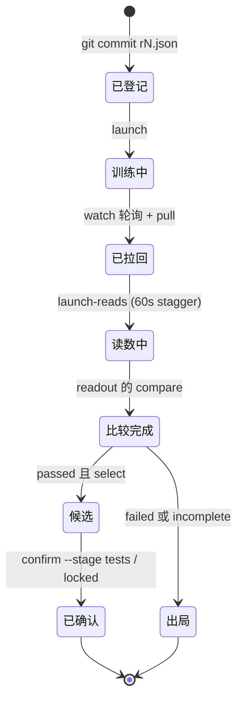

# 16. 科研流水线（rounds）概览

> 《Kev 基础知识系统学习指南》· 第三部分 应用篇
>
> [⌂ 目录与架构图](../index.html) · [← 上一章](15-evaluation.md) · [下一章 →](17-paths.md)

---


> **本章目标**：读懂一份 `experiments/rounds/r<N>.json`，说清一个 arm 从训练到“候选”要过哪几道门，
> 以及为什么 rounds 把一个研究问题压缩成六个子命令。本章的每一段输出与每一个数字都是本机实跑拿到的。

### 16.1 概念定义

**一轮（round）= 一份在任何训练与读数之前就提交了的 spec + 若干 config-only trial（或从它们做出来的 checkpoint）+ 一个 parent + 若干带标签的读数（reads）+ 一条规则 + 若干确认阶段。**
引擎只有一份：[`kev/rounds.py`](../../../kev/rounds.py)（1,365 行，六个子命令）。

| 子命令 | 做什么 | 需要什么 | 产出 |
|---|---|---|---|
| `validate` | 检查 spec 形式、parent 读数存在、plan 合法、温度池不共享训练数据 | 本地即可（可 `--partitions` 验分区） | 打印 problems（有则 exit 1）与 `round N: ok (X arms, Y studies)` |
| `launch` | 按 study 逐个 `modal_app.py::study`（可 `--dry-run` 只打印命令） | `modal deploy`，Modal 额度 | 远端 trial，日志 `runs/<study>.log` |
| `watch` | 轮询→ pull→ launch reads → 写 read-out | 同上 | `runs/<study>.watch.json`（可恢复）、`runs/r<N>-readout/round<N>.json` + 表格 |
| `launch-reads` | 单独重启读数（`--arms` / `--parents` / `--stage` / `--arm`） | 已拉回的 trial | 写读数意图 `runs/r<N>-reads-<arm>.json` |
| `readout` | 只重算规则（不碰远端） | `runs/` 里己有 rows.json | 同上（`--out` 可换位置） |
| `confirm` | 在候选上读一个确认阶段（test / locked） | `--stage` 必给 | `runs/r<N>-verdict/<size>-<stage>.json` |

spec 的字段（完整合同在 `kev/rounds.py` 的模块 docstring 里）：

| 字段 | 作何用 |
|---|---|
| `round` / `registered` | 轮号与它在 PLAN.md 里的登记位置 |
| `archive` | 记录轮： plans / runs / 数据都在那个 git tag 上；`validate` 只列“本 checkout 缺什么”，`launch` 直接拒 |
| `studies` | `{name: {plan, suite, transfer, gpu, timeout, budget}}`，一项就是一次 `modal_app.py::study` 调用 |
| `reads` | 读数标签 → 套件（带 `flags`，如 `--allow-test` / `--split calibration`），或者 `{entrypoint: "locked_test", decision: ...}` |
| `parents` / `arms` | arm 名是 `"<size>-<label>"`；每个 arm 指自己的 trial（或只指一个 checkpoint）与 parent |
| `temperature` | **本轮所有 ARM** 的服务温度改在池化读数上拟合（parent 仍用它 trial 的 development rows） |
| `drop_ids` | 两边同时丢掉有问题的记录 id |
| `rule` | `{panels, unknowable?, criteria, rank}`：开发阶段的完整比较规则 |
| `confirm` | `{stage: {candidate_reads, parent_reads?, panels, criteria}}`：test / locked 各只读一次 |

### 16.2 原理讲解

**（1）一轮的生命周期。** 📖 `kev/rounds.py: main / validate / study_commands / watch / write_readout / confirm`。

<div style="font-family:monospace;background:#0d1117;color:#c9d1d9;padding:18px;border-radius:8px;overflow-x:auto">
<style>
@keyframes rdflow { 0%{left:0;opacity:0} 5%{opacity:1} 92%{opacity:1} 100%{left:100%;opacity:0} }
.rd-pipe{position:relative;padding:13px 0}
.rd-dot{position:absolute;top:50%;margin-top:-6px;width:12px;height:12px;border-radius:50%;
  background:#58a6ff;box-shadow:0 0 8px #58a6ff;animation:rdflow 6.4s linear infinite}
.rd-dot.r2{animation-delay:2.1s;background:#3fb950;box-shadow:0 0 8px #3fb950}
.rd-dot.r3{animation-delay:4.2s;background:#f0883e;box-shadow:0 0 8px #f0883e}
.rd-l{display:inline-block;background:#161b22;border:1px solid #30363d;border-radius:6px;padding:3px 8px;margin:0 3px;font-size:12px}
.rd-l b{color:#58a6ff}
.rd-stop{border-color:#f85149;color:#f85149}
.rd-note{color:#8b949e;font-size:12px;margin-top:8px}
</style>
<div class="rd-pipe">
  <span class="rd-dot"></span><span class="rd-dot r2"></span><span class="rd-dot r3"></span>
  <span class="rd-l rd-stop"><b>git commit</b> r&lt;N&gt;.json</span>→
  <span class="rd-l"><b>validate</b></span>→
  <span class="rd-l"><b>launch</b> study</span>→
  <span class="rd-l"><b>watch</b> poll 120s</span>→
  <span class="rd-l"><b>pull</b> trial 结果</span>→
  <span class="rd-l"><b>launch-reads</b> 60s stagger</span>→
  <span class="rd-l"><b>readout</b> rule</span>→
  <span class="rd-l"><b>confirm</b> --stage</span>
</div>
<div class="rd-note">
  第一站是红色的：<b>spec 先提交，再训练、再读数</b>（规则不能读数后再找）；
  <b>validate</b> 把“不能启动”挡在门里：形式、缺失的 plan/读数、与被拒套件、以及温度池与训练数据重合（<span class="rd-stop">pool_conflicts</span>）。
</div>
</div>

三个必须记住的默认值：`SAMPLES = 2000`（登记重采样次数，round 5 以来不变）、`STAGGER = 60`（Modal 每分钟超过 ~3 次 app 创建就拒）、`IN_FLIGHT = 7200`（一个 arm 已启动的读数被认为还在跑多久，`ENTRYPOINTS = ("benchmarks", "locked_test")`）。

**（2）比较的原子：`compare()`。** 📖 `kev/rounds.py: arm_side / parent_side / compare / panel_filter`。每个 panel 给出：

- `n`（题数）与 `excluded`（面板的 `exclude_sources` / `exclude_tasks` / `exclude_file` 丢掉了多少题，**两边同时丢**）；
- `metrics` 里每一项：`{candidate, parent, delta, ci95}`——`delta` 与区间全部来自 `paired()`（`kev.metrics.paired_bootstrap`，**按 record 聚簇、micro、2,000 次、seed 0**）；
- `report` 里每一项：只给 `candidate` / `parent` 两个值，**不进判据**；`optional: true` 的面板是 report-only，任何判据或 `rank` 读它都是 validate 阶段的 problem，它缺读数也不会让 arm 变 incomplete（进 `missing_optional`）；
- `by_length`：每个 state-token 桶一套 `<metric>_<bucket>`（`ece_16k_plus` 这样），判据可以直接读一个桶；
- `versus`：拿另一份读数当参考（同一面板的过滤条件下再配对）。

判据是一套路径语言，不是 Python：`"<panel>.<metric>.<field>"`，`field ∈ {candidate, parent, delta, lower, upper}`（`FIELDS`），`lower/upper` 就是 `ci95` 的两端；`left` 可以是 `[a, b]` 表示 `a - b`；`right` 是数字或另一条路径，可加 `plus`；`op` 只认四个（`OPS`）。**任何一边取不到值，判据是 `None` 而不是 `False`**；而 `passed` 需要 `complete and all(criteria)`，没写判据时是 `None`（表格里报 `reported`）。

**（3）温度纪律：一切都是 served-vs-served。** 每一边的行先在自己那套行上拟合温度，再比。三个实测数字必须背下来：

| 事实 | 数值 |
|---|---|
| round 19 把 SFT arm 的服务温度拟在 `sft-v1` 的 development rows（同一训练 corpus 的 held-out **条目**）上 | T **0.955**，breadth-v1 ECE **0.059** |
| round 20 改用 held-out **数据集** 的池 | 同一个 checkpoint，breadth-v1 ECE **0.0085** |
| 从 round 21（`POOL_REQUIRED_FROM`）起 | 温度会动的判据没登记 `temperature` 池 = `validate` 与 `launch` 直接拒；rounds ≤ 20 只警告，所以上面那段警告字原样出现在旧 spec 上 |

`temperature` 池可带 `sources`（只用某些 source 的行）、`exclude_reads`（把某些读数里出现的记录整个剔除）与 `ci`（给每个 arm 的池拟温度再加一个 bootstrap 区间，`temperature_ci`，report-only）。三条禁令：**池里不能出现任何读温度相关判据的面板用的读数**（`pool_problems`）；**池不能与任何 arm 的训练数据共享数据**（`pool_conflicts` 三种情形：池化套件就是某 arm 的训练套件/其 manifest 里的组件/其 plan 的 `data` 套件；池用了 arm 训过的 source；读了训练 corpus 的 `calibration` 或 `development` 分区）；`sources` 白名单必须说出它套件里真列着的 source。
每个 read-out 都记录 `temperature_source`（池与它的题数，或 trial 的 development rows 与套件）与 `parent_temperature_source`（再加 `shipped`，即 head.pt 的温度）；当两边的 served T 与 shipped T 差超过 `SHIPPED_TOLERANCE = 0.05` 时 `validate`/`launch` 警告。

**（4）`rank` 与候选：没候选是常态。** 只有 `passed` 且 `select` 不为 false 的 arm（`select: false` 是归因 arm，只报告不当候选）参与排序；`rank` 每项 `by` 可给多条路径求和（按从左到右）、`order` 默认 desc；`candidates[size] = ranking[size][0] or None`。实测 round 5 在本 checkout 重跑：三个 size 的 ranking 都是空列表，`candidates {'9b': None, '4b': None, '08b': None}` —— **研究轮里“没有候选”是正常结果，不是流水线失败**。

**（5）`watch` 的可靠性设计。** 📖 `kev/rounds.py: watch_studies / poll_modal / pull / launch_arm_reads / transient`。它把“轮询”与“拉回”分开：轮询远端状态（进 `runs/<study>.watch.json`，可恢复），DNS / 连接类错误（`transient`）重试，而 trial 自己抛出的异常算 failure；超时与失败是分开的两种状态。一个全权重 trial 超时后由 `watch` 负责续跑（不是 Modal 自己重试，见 AGENTS.md 的租约与 `spawn.json` 账本那一节），并且一次只 pull 一个 study（`modal_app.pull_lock`）。读数的启动意图先写文件，所以在超时窗口内的读数不会被重开。

**（6）确认阶段。** 规则只读 development/calibration 行；test 与 locked 在 `confirm` 里各只读一次，进 `runs/r<N>-verdict/<size>-<stage>.json`，带自己的 panels 与 criteria。locked 读数走 `entrypoint: "locked_test"`，不是一条 `--allow-test` 命令。`kev.autoresearch session <specs> --spend-start X --spend-cap Y` 能把登记好的轮跑到 read-out，但**从不 confirm**。



### 16.3 示例代码

**▶ 示例 A｜`validate`：两种真实输出** 🟢

```powershell
uv run python -m kev.rounds validate experiments/rounds/r27.json
# round 27: ok (2 arms, 0 studies)          ← 0 studies：本轮的 arm 全是已有 trial，只新读数

uv run python -m kev.rounds validate experiments/rounds/r18.json
# !!! warning: arm 9b-joint-lr2e5 will be served at a temperature fitted on its trial's
#     evals\v7\decision-v7 development rows, a training corpus, and 4 (...) criteria depend on it:
#     round 19's failure mode: a temperature fitted on held-out items of a checkpoint's own training
#     corpus is in distribution (round 19 served its SFT arms at T 0.955 fitted on sft-v1 development
#     rows: breadth-v1 ECE 0.059); fit on a pool of held-out datasets instead (round 20: breadth-v1
#     ECE 0.0085); register a `temperature` pool
# archived (on research-archive-2026-09-24, not in this checkout):
#   read scienthoon: evals/external/scienthoon-v1 not in this checkout
#   study r18-9b: plan experiments/round18/joint.json not in this checkout
# round 18: ok (2 arms, 1 studies)
```

这两段输出里有三个课：(1) **警告不等于拒绝**——round 18 早于 `POOL_REQUIRED_FROM = 21`，所以旧 spec 仍继续 `ok`；(2) 记录轮（带 `archive`）的 plans / 数据不在 main 上，`validate` 只列缺什么；(3) 警告字里把失败模式的**数字**直接写进了代码，因而无需考古就能懂为什么必须有池。

**▶ 示例 B｜`readout`：一行一个 arm 的判决** 🟢（离线可跑，round 5 的行在 main 上）

```powershell
uv run python -m kev.rounds readout experiments/rounds/r5.json --out runs/learn-r5-readout
```

实测输出（节选）：

```text
9b-C9            long.acc +16.8 [+12.3, +20.9] | short.acc +0.5 [-0.5, +1.5] | short.brier -0.014 [-0.021, -0.006] | short.confident_error_rate -1.6 [-2.4, -0.7] | unk 0.0 -> fail: 3_wanli_accuracy_within_1pp
                 !!! 9b-C9 is served at T 1.149 fitted on runs/r5-combined/00-trial-0/development, held-out items of its training corpus evals\v7\decision-v7: in distribution, round 19's failure mode; not a temperature to ship (register a held-out-datasets `temperature` pool)
9b-C9-s2         ... | unk None -> incomplete (missing 5)
4b-C4            long.acc +20.0 [+15.5, +24.4] ... -> fail: 3_scienthoon_accuracy_within_1pp, 3_wanli_accuracy_within_1pp, 3_typesafe_accuracy_within_1pp
08b-C08          ... -> fail: 2_short_confident_errors_upper_at_most_1pp, 3_scienthoon_accuracy_within_1pp, 3_typesafe_accuracy_within_1pp
candidates {'9b': None, '4b': None, '08b': None}
```

读法：`RATES`（acc / confident_error_rate / coverage_*）以**百分点**打印，其余按原值；区间就是 `paired()` 的 `ci95`；`unk None` 是“这一轮的这条读数里没有 unknowable 记录”，不是 0；`incomplete (missing 5)` 是五个面板读数不在本 checkout（被删的套件与未拉回的读数）。

**▶ 示例 C｜一份真实 read-out 与 verdict 的结构** 🟢

```python
import json
r = json.load(open("runs/r27-readout/round27.json", encoding="utf-8"))
print(list(r))     # ['round', 'registered', 'drop_ids', 'arms', 'ranking', 'candidates']

arm = r["arms"]["9b-r18a"]
print(sorted(arm))
# ['complete', 'criteria', 'missing', 'panels', 'parent', 'parent_temperature', 'parent_temperature_source',
#  'passed', 'temperature', 'temperature_ci', 'temperature_fit', 'temperature_source', 'trial', 'unknowable']
print(arm["temperature"], arm["parent_temperature"])          # 2.193649959389252 2.2973967099940698
print(arm["panels"]["primary"]["n"], arm["panels"]["primary"]["excluded"])          # 1855 300
print({k: round(v, 6) for k, v in arm["panels"]["primary"]["acc"].items()})
# {'candidate': 0.821024, 'parent': 0.628032, 'delta': 0.192992, 'ci95': (0.171566, 0.216479)}  ← 区间下界 > 0
print(arm["temperature_source"])
# {'kind': 'pool', 'reads': ['runs/r27-9b-r18a-r3cal', 'runs/r18-9b-joint-lr2e5-v9'], 'questions': 648}
print(arm["parent_temperature_source"]["training_corpus"], arm["parent_temperature_source"]["shipped"])
# True 2.2973967099940698        ← parent 仍用它的 trial development rows，所以它被标为训练 corpus
print(arm["criteria"]); print(arm["passed"], r["candidates"])
# 7 条全 True → passed True； candidates {'9b': '9b-r18a'}

v = json.load(open("runs/r27-verdict/9b-locked.json", encoding="utf-8"))
print(v["stage"], v["criteria"], v["passed"])
# locked {'locked_acc_at_least_parent_minus_1pp': True, 'served_brier_at_most_parent_plus_0.005': True} True
print({k: round(v["panels"]["locked"]["acc"][k], 6) for k in ("candidate", "parent", "delta")})
# {'candidate': 0.852134, 'parent': 0.852134, 'delta': 0.0}   ← 656 题上一题没动，而判据要的是“不比 parent 差 1pp”
```

最后两行是 rounds 里最容易被误读的一件事：**确认阶段的判据是“不伤害”而不是“多拿分”**。locked 面板的 acc delta 恰好 0.0（区间 [-0.0168, +0.0183]）仍算 PASS，因为规则写的是 `left >= right + (-0.01)`；真正的提升在开发阶段已经被 `primary.acc.lower > 0` 这类“**下界大于 0**”的判据把守。

**▶ 示例 D｜`paired()`：登记过的配对读数自己算一遍** 🟢

```python
from kev.suite import read_json
from kev.metrics import scored_rows
from kev.rounds import paired

c = scored_rows(read_json("runs/r18-9b-joint-lr2e5-hard/rows.json"))   # arm 9b-r18a 的 hard 读数
p = scored_rows(read_json("runs/hv1-P9/rows.json"))                     # parent 的 hard 读数
print(len(c), len(p))                                                   # 1083 1083
for metric in ("acc", "brier"):
    x = paired(c, p, metric)
    print(metric, x["delta"], x["ci95"])
# acc   0.2382271468144045 [0.2057708240351714, 0.27123287671232876]
# brier -0.2815479256550053 [-0.3184111955665965, -0.24614572675175875]
# 与 read-out 里 hard 面板的 delta 一致（它就是这两个行集跑的）
```

**▶ 示例 E｜判据路径语言：手摊一个 report 字典也能求值** 🟢

```python
from kev.rounds import OPS, _criterion, value

report = {"panels": {"primary": {"n": 1855, "acc": {"candidate": 0.821, "parent": 0.628,
                                                    "delta": 0.193, "ci95": [0.1716, 0.2165]}},
                     "short": {"n": 1150, "acc": {"candidate": 0.855, "parent": 0.850, "delta": 0.005,
                                                  "ci95": [-0.005, 0.015]},
                                        "brier": {"candidate": 0.21, "parent": 0.236, "delta": -0.026,
                                                  "ci95": [-0.033, -0.019]}}},
          "unknowable": {"candidate": 0.0, "parent": None}}

for path in ("primary.acc.candidate", "primary.acc.lower", "short.brier.upper",
             "unknown.metric.candidate", "unknowable.parent"):
    print(f"{path:26}", value(report, path))
# primary.acc.candidate      0.821
# primary.acc.lower          0.1716
# short.brier.upper          -0.019
# unknown.metric.candidate   None      ← 面板没读到：None，不是 0，也不是报错
# unknowable.parent          None

for name, c in (("lower > 0", {"left": "primary.acc.lower", "op": ">", "right": 0}),
                ("upper <= 0.02", {"left": "short.brier.upper", "op": "<=", "right": 0.02}),
                ("cand <= parent + 0.01", {"left": "short.brier.candidate", "op": "<=",
                                            "right": "short.brier.parent", "plus": 0.01}),
                ("[a, b] 就是 a - b", {"left": ["primary.acc.candidate", "short.acc.candidate"],
                                        "op": ">", "right": -0.1}),
                ("右边是 None → 整条 None", {"left": "unknowable.candidate", "op": "<=",
                                              "right": "unknowable.parent"})):
    print(f"{name:30}", _criterion(report, c))
# lower > 0                        True
# upper <= 0.02                    True
# cand <= parent + 0.01            True
# [a, b] 就是 a - b             True
# 右边是 None → 整条 None       None
```

`primary.acc.lower > 0` 就是 rounds 里“主要判据”的全部形状：**要的不是平均值好看，是区间下界在 0 之上**。

### 16.4 常见陷阱

- **先改规则再读数**：spec 必须提交在任何训练与读数之前（`registered` 字就为这件事存在）。一个读数之后才加的判据只能叫发现，不能叫验证。
- **把 `None` 读成 `False` 或 0**：没读的 panel 的判据是 `None`；`unk None` 是没这类记录；`passed` 在无判据时是 `None`（打印 `reported`）。三者优先级都高于“看起来像一个小的负结果”。
- **拿 `report` 字段当门槛**：它只给值不给区间，也不能进判据或 `rank`（validate 报 problem）；要门槛就把它放进 `metrics`。
- **拟温度用了自家训练 corpus 的 held-out 条目**：这就是 round 19 的失败模式（T 0.955 / ECE 0.059）；held-out **条目**仍同分布，只有 held-out **数据集**的池才能给可迁移的温度。
- **忘了 `exclude_file` 是私有的**：它带 `sha256`，散列不对就拒；公开 spec 只拿路径与盐化后的散列，列表本体不在 git 里（丢了跑 `scripts/private_rows.py` 恢复）。丢掉的行两边同时丢，面板记下 `excluded` 数量。
- **在本地重跑一个记录轮**：`launch` / `watch` / `launch-reads` 直接拒带 `archive` 的 spec；`validate` 只列缺什么。想复现它们的 read-out，靠的是已提交的行与 `tests/test_rounds.py`，不是重跑流水线。
- **以为 `readout` 会去拉数据**：它只读 `runs/` 里已有的行。缺什么就在 `missing` 里列什么；想让一个不在本地的 checkout 能算，用 `--root <那个 checkout>`。
- **把 `select: false` 的归因 arm 当候选**：它可以出现在 read-out 里，但不进 `rank`；而 `optional: true` 的面板也不得被任何判据读。
- **同一轮里拿两个 size 的数字直接比**：`rank` 与 `candidates` 都是 **per-size** 的；不同 size 的判据不相互排序，比较它们要先看 `size_of(arm)` 与各自的 parent。
- **以为确认阶段会重新拟合温度**：不会。`confirm` 用的还是规则阶段定的那套（来处已在 `temperature_source` 里写清楚），否则 locked 就泄露了它自己的分布。

**关键结论**：rounds 把研究纪律写成了数据结构：**先提交规则，再读数；比较只能使用 `paired` 的区间；温度必须在另一批数据集上拟合；只有 `complete` 且全部判据为 True 的 arm 才能进候选；locked 只读一次且只问“有没有伤害”**。实测三个片段各自对应一条红线：`validate` 的警告字里带着 round 19 的数字（纪律来自事故），`readout` 表格的 `candidates {'9b': None, ...}`（没候选是正常输出），而 `r27-verdict` 的 `delta 0.0` 仍 PASS（确认阶段把的是安全门，不是分数门）。新轮只需写一份 spec：`experiments/rounds/r<N>.json` 加 PLAN.md 里的登记，引擎不改。

---

[⌂ 目录与架构图](../index.html) · [← 上一章](15-evaluation.md) · [下一章 →](17-paths.md)
