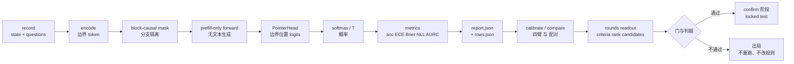

# 18. 关键结论总结（公式速查与红线）

> 《Kev 基础知识系统学习指南》· 第四部分 路径与总结
>
> [⌂ 目录与架构图](../index.html) · [← 上一章](17-paths.md) · [下一章 →](appendix-a-glossary.md)

---

### 18.1 概念定义

本章不引入任何新概念。它把前十章里**一旦记错就会得出错误结论**的东西压在四张表里：

- **18.2 公式速查**：每个指标的精确口径（含分母、求和范围、箱边界与“能不能当部署保证”），每一条都能对到 `kev/metrics.py` 的具体函数。
- **18.3 常量速查**：散在 9 个模块里的硬数字（长度上限、容差、预算、默认开关）及其文件锚点。
- **18.4 红线**：12 条“做了就作废”的规则。
- **18.5 一图总览**：record → mask → logits → 概率 → 指标 → 配对 → 轮次判定的全链条，每一步附一个本机实测数字。

使用约定：**表中每一个数字都是仓内代码或本机产物的实测值**，不是典型值。改代码里任何一个之前，先在这里找它；找不到就说明你在新增一个合同，得写测试与文档。

### 18.2 公式速查

📖 [`kev/metrics.py`](../../../kev/metrics.py)（`metrics` / `ece` / `nll_at_temperature` / `coverage_at_error` / `area_under_risk_coverage` / `scored_rows`）、[`kev/api.py`](../../../kev/api.py)（`to_answers`）、[`kev/benchmark.py`](../../../kev/benchmark.py)（`summarize`）、[`kev/compare.py`](../../../kev/compare.py)、[`kev/calibrate.py`](../../../kev/calibrate.py)。

| 量 | 公式 / 口径 | 实现 | 记住这一点 |
|---|---|---|---|
| softmax + 温度 | \(p_i = \mathrm{softmax}(z_i / T)\) | `metrics.served` / `served_at` | \(T>0\) **不改 argmax**，只改尖锐度；所以温度不重训练就能修 ECE |
| 温度反解 | \(z = \mathrm{logits} \times T_{inference}\) | `metrics.raw_row` | 存的是**服务温度下的 logits**，要回 raw 得乘回去 |
| NLL | 有 logits：\(\log \sum_j e^{z_j} - z_y\)；只有概率：\(-\log \max(p_y, \epsilon)\)，\(\epsilon = 10^{-9}\) | `nll_at_temperature` | 优先走 logits 分支（精确）；否则 floor 会吃掉尾部质量 |
| ECE | 10 个等宽置信箱的 \(\sum_b \frac{n_b}{N} \lvert acc_b - conf_b \rvert\)，**末箱闭区间** | `ece` | 它是均值差的加权，**可以正负抵消**；跟 `confidence_bias` 符号可以不同 |
| confidence_bias | \(\overline{conf} - acc\)（有号） | `metrics` | 正值 = 过度自信；它不反映“分布对不对”，只反映均值 |
| Brier | 每行 \(\sum_k (p_k - t_k)^2\)，**对选项求和、不除 \(K\)**；再对行取均值 | `metrics` | 二选项的 Brier 天生比 5 选项小；**跨题型比大小无意义** |
| accuracy | `argmax(p) == label` 的比例（只在 `scored_rows` 上） | `metrics` / `benchmark.summarize` | `scored_rows` = `variant == "clean"` 且 `source != "unknowable"`（**精确名字，不是前缀**） |
| confident_error_rate | \(mean(conf \ge 0.9 \land \neg correct)\) | `metrics` | 分母是**全部行**，不是高置信行 |
| coverage_at_0_9 | \(mean(conf \ge 0.9)\) | `metrics` | 与上一行同阈值，两者合起来才是“多敢 / 多错” |
| coverage_at_error | 误差率预算 \(e\) 下能接受的**最大占比**（经验曲线取上确界） | `coverage_at_error` | `metric_policy` 写得很明白：“in-sample maximum over confidence thresholds; **not a deployed error guarantee**” |
| AURC | \(\sum_i \frac{\Delta accepted_i \cdot errors_i}{accepted_i} / accepted_{last}\)，**右阶梯、整组进出** | `area_under_risk_coverage` | 同一批行算的，所以下降可以是拟合副产物，得配对比 |
| choice 置信度 | \((p_{max} - 1/K) / (1 - 1/K)\) | `api.to_answers` | 均匀分布 0，确定分布 1；镜像 TypeSafe 适配器 `0.2.1` |
| score 输出 | 期望等级 \(\sum_i i \cdot p[i]\)（**不是 argmax**） | `api.to_answers` | 所以“选了 2 档”不等于“预测 2 档” |
| score 置信度 | \(\max(0, 1 - \mathbb{E}\lvert level - mode \rvert / D)\) | `api.to_answers` | \(D\) = 均匀分布绕均值的平均绝对偏差；摊平时就是 **0** |
| objective | \(-\operatorname{mean}_{task}(nll_{task})\)，排除 `unknowable_*` 但保留 `unknowable_control` | `benchmark.summarize` | 实测：8 个 task 的 nll 均值 1.79009 → objective −1.79009，逐位对得上 |
| 分布合法性 | \(\lvert \sum p - 1 \rvert \le \max(10^{-5},\; 0.005K + 10^{-8})\) | `benchmark.validate_distribution` | 不是“约等于 1”，是这个公式（随 \(K\) 放宽）；通过后还会返回 **\(p / \sum p\)**，即重新归一化 |
| 概率舍入 | `round_prob` 保 4 位 | `api.round_prob` | \(255 \times 0.00005 < 0.02\)，仍在 TypeSafe 的 \(\lvert \sum p - 1 \rvert < 0.02\) 里 |
| 配对差异区间 | record 聚簇的 paired bootstrap，**2,000 次重抽样、seed 0、micro** | `rounds.paired` / `compare` | 聚簇单位是 `group`（record），**不是行**；同 record 的兄弟行必须同进同出 |
| 温度拟合 | 聚合 `micro`，**121 个点**的 log 网格 \([0.25, 4]\)，每题等权 | `metrics.TEMPERATURE_FIT` / `TEMPERATURE_FIT_METHOD` | 研究试验（`kev.experiment`）与 kev-finetune 仍用 **81 点**网格：它们是筛选报告，不是出厂值。`kev.calibrate` 四臂里 workload 的 T 是在这批行上拟合的，**报告不是部署** |
| 长度分桶 | 边界 `(8192, 16384, 32768, 65536)`，token = 编码后的 state 段（含 `<state>`） | `metrics.LENGTH_EDGES` | 计数口径与 `kev.model.encode` / `kev.serve` 一致，不是字符数 |
| 服务准入 | state \(\le\) **65,536**；单行 \(\le\) **73,728**（= `SERVE_MAX_STATE + 8192`） | `model.admit` | 超 → `ContextOverflow` → **422**，绝不静默截断（除非 `KEV_TRUNCATE_STATES=1`） |

### 18.3 常量速查

| 模块 | 常量 | 值 | 含义 / 后果 |
|---|---|---|---|
| [`kev/model.py`](../../../kev/model.py) | `MAX_STATE` / `MAX_BRANCH` / `MAX_PACKED` | 384 / 1,024 / 2,048 | `encode()` 的默认训练上限（可被 `--max_state` 等抬）；hard-v1 需 ≥ 5,120 |
| 同上 | `SERVE_MAX_STATE` / `SERVE_MAX_BRANCH` | 65,536 / 73,728 | 服务准入；超了就拒，不是截 |
| 同上 | `ROW_PASS_TOKENS` | 16,384 | 超一行就走长行规则（state 只跑一遍，flash/efficient kernel），预测带 `kernels: efficient` |
| [`kev/api.py`](../../../kev/api.py) | `MAX_OPTIONS` | 255 | 选项边界 token 的上限；超 → 422 |
| [`kev/metrics.py`](../../../kev/metrics.py) | `EPSILON` | 1e-9 | 无 logits 时的 NLL floor；`metric_policy.nll_floor` 就是它 |
| 同上 | `TEMPERATURE_FIT` | micro / 121 点 / 0.25–4 | 拟合网格；3 个数字都是合同，改它就是在改校准定义 |
| [`kev/suite.py`](../../../kev/suite.py) | `SPLITS` | train / calibration / development / test | 四个分区；test 只能 `--allow-test` 读 |
| 同上 | `GIT_LIMIT` | 10 MiB | 超此值的分区不进 git（hard-v1 / documents-v1 的 23 MB train 去镜像取） |
| 同上 | `ADMISSION_BRANCH_HEADROOM` | 64 | 准入计数给分支留余量；`ADMISSION_TOKENIZER` 是套件自带的分词器 |
| 同上 | `SERVING_CONTEXT` / `REMOVED_SUITES` | 长文档服务上下文 / **4** 个已移除套件 | longdoc 的 32k/64k 行走长行规则；scienthoon-v1、wanli-v1、wanli-v2、typesafe-v1 不可再当门控（`refuse_removed` 直接抛错） |
| [`kev/serve.py`](../../../kev/serve.py) | `PREFIX_CACHE_SIZE` / `PREFIX_MIN_TOKENS` / `PREFIX_MAX_TOKENS` | 4 / 默认取模型的 `prefix_min_tokens`（attention-only torch 为 384，hybrid 与 MLX 为 0）/ 65,536 | 前缀缓存三条边界；实测命中后同一 state 换问题 **18.4×** 快 |
| 同上 | `MAX_BATCH` | 64 | 一批最多 64 个请求；行与行相互独立，所以**批量不改任何一条答案** |
| 同上 | `DATE_FACTS` / `TRUNCATE_STATES` / `API_KEY` / `MODEL_NAMES` | `KEV_*` 环境变量 | 缺省全关；截断开关会在**每个**响应里标 `truncated` |
| [`kev/budget.py`](../../../kev/budget.py) | `MAX_SNAPSHOTS` | 8 | 一次训练最多 8 个快照（27B 一个 ~51 GB，写了不删） |
| 同上 | `FULL_FT_RETRIES` / `MAX_TIMEOUT` / `MAX_BUDGET` | 2 / `{非全权重: 28,800 s, 全权重: 86,400 s}` / `{非全权重: $250, 全权重: $1,000}` | 全权重试验的续跑次数与硬上限（每个 study）；Modal 对每个被杀超时的 attempt 都记账；`GPU_HOURLY` 是另一侧：H100 3.95 / H200 4.54 / B200 6.25 / T4 0.59 USD |
| [`kev/predictors.py`](../../../kev/predictors.py) | `REFUSAL_STATUSES` | (400, 413, 422) | 端点自己拒了 → **立刻**抛 `ContextOverflow`，不重试 |
| 同上 | `LONG_ROW_KERNELS` / `KERNEL_PACKAGES` / `DELTANET_KERNELS` | flash/efficient/math 等 | `kernel_environment()` 的字段来源；比较前先逐位对这块 |
| 同上 | `PRICE_PER_MILLION` / `JEV_CONTEXT_TOKENS` | $0.042 / 32,768 | 远程读数的成本折算与 Jev 上下文上限 |
| [`kev/experiment.py`](../../../kev/experiment.py) | `GATES` 八项 | 含 `isolation_tolerance` **0.001**、`transfer_brier_increase` **0.02** | 门不过就不是候选；容差 0.001 正是评估侧关 TF32 的理由 |
| [`kev/rounds.py`](../../../kev/rounds.py) | `SAMPLES` / `STAGGER` / `IN_FLIGHT` | 2,000 / 60 s / 7,200 s | 重抽样次数；读数发射间隔；一次在飞上限 |
| 同上 | `POOL_REQUIRED_FROM` / `SHIPPED_TOLERANCE` | 21 / 0.05 | 从 round 21 起，温度影响的判据没 `temperature` 池 → `validate`/`launch` 直接拒；服务 T 与出厂 T 差超 0.05 则警告 |
| 同上 | `LEASE_STALE` / `RESUME_MINUTES` | 900 s / 见模块 | 租约陈旧判定与全权重试验的续跑点间隔 |

### 18.4 十二条红线

1. **评测集永远不进训练 corpus**。`evals/breadth-v1`、`longdoc-v1`、`tasksource-heldout-v1` 等 eval-only 套件是红线上的数据；`rounds validate` 会用 `pool_conflicts` 拒掉共享数据的轮。
2. **test 分区只有一个入口**：`--allow-test`。没有“不当真地跑一下 test”这种模式；`report.json` 会记录你干过。
3. **读数目录不可覆写**。`benchmark` 用 `mkdir(exist_ok=False)`，重跑必须换目录名——这不是谨慎，是“结论可复现”的物理前提。
4. **不同 `environment` 的读数不得逐位对比**。包版本、GPU、骨干 dtype、attention 实现、DeltaNet forward 全在 `report.json.environment` 里；先比这块再比数字。
5. **评估路径关 TF32、关 flash/mem-efficient SDPA**。TF32 会搬动 ~1e-3 的概率，而隔离门控容差恰好是 0.001。
6. **温度只能在“留出数据”上拟合，且只能当报告**。round 19 用训练集自身的 development 行拟合（T 0.955，breadth-v1 ECE 0.059）；round 20 换成留出数据集的池，同一个 checkpoint 得到 0.0085。
7. **配对比较先查 `suite_sha256`**。`kev.compare` 不一致就直接报错 `comparison requires matching frozen-suite hashes`，跳过它等于比两个不同题目集。
8. **置信区间必须按 record 聚簇**。把同 record 的兄弟行当独立样本会显著低估方差，而“真改善”与“噪声”的区分全靠它。
9. **规则先提交，读数后发生**。`experiments/rounds/r<N>.json` 在训练或读数前就得 commit；先读数后写判据的轮不算证据。
10. **不要从 volume 删 checkpoint 与快照**。一个 27B 快照 ~51 GB 且写了不删；删除前必须问人。
11. **同一时间只跑一个训练进程**（尤其 MPS）。两个互相拖慢 ~10×，不是线性变慢。
12. **发现代码与工作树不一致，以代码为准并报告**。本文写作时真实踩到两处未提交的回归（`serve.main()` 的 `--temperature` 于 `opts` 赋值前使用 → `UnboundLocalError`；`benchmark.run()` 的 `opts` 未定义 → `NameError`）；本文的示例采用阅读代码后的正确顺序，并在注释里说明。

### 18.5 一图总览

下面这条链把全部 18 章串成一次前向，每个站点下面标的是**本机实测数字**（smoke checkpoint，CPU / fp32）。

  
  <b>record</b> state+questions→
  <b>encode</b> + 边界 token→
  <b>block-causal mask</b>→
  prefill <b>probs_batch</b>→
  <b>PointerHead</b> logits→
  <b>softmax</b> /T→
  <b>metrics</b> acc/ECE/Brier/NLL→
  <b>report.json</b> + rows.json→
  <b>paired</b> bootstrap→
  <b>rounds</b> criteria/rank

  结构：1 条 record 18 题 · 边界 token 不伪造 · 分支互不可见（实测 none-pair 与 clean 同 state） 
  读数：objective −1.79009（= −mean task nll）· clean n=18 acc 0.222 · ECE 0.293 · T 1.00 · latency median 662.6 ms / p95 4,142.4 ms 
  校准：同批行拟合 T 4.00 → ECE 0.264（−0.029）、Brier 0.689（−0.120）；<b>报告只说“拟合得动”，不说“可以部署”</b> 
  判定：round 27 primary n=1,855（excluded 300）acc +0.192992 CI [+0.171566, +0.216479]，7/7 判据 PASS；locked 阶段 acc 差 0.000 仍 PASS（判据是下界 ≥ −0.01） 
  红线：smoke checkpoint 只训过 3 条记录，上面的 acc 属预期；这一条链的价值在<b>结构与口径</b>，不在模型质量。

**关键结论**：Kev 的全部可验证性建在三条事实上——**读数不可覆写**（目录 `mkdir(exist_ok=False)`）、**比较必须配对同套件**（`suite_sha256`）、**规则先于读数提交**（spec 先 commit）。三者任一被绕过，后面的数字就只是装饰。

---

[⌂ 目录与架构图](../index.html) · [← 上一章](17-paths.md) · [下一章 →](appendix-a-glossary.md)
