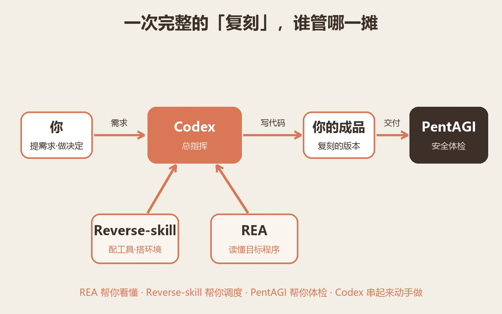
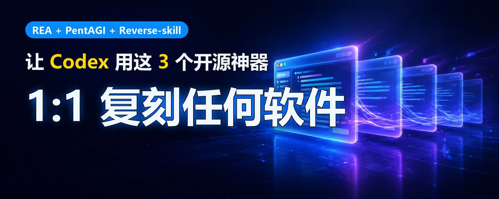
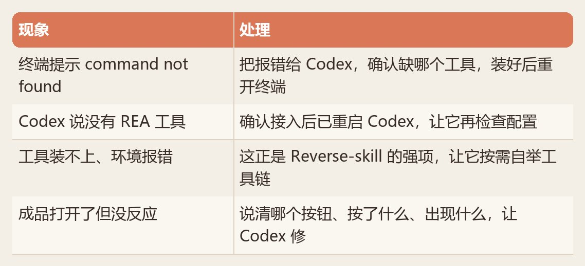

# Codex 软件开发完整工作流：1:1 复刻任何软件（REA + PentAGI + ReverseSkill）

> 原文转载自 X（Twitter），作者 **Researcher_王十三**（[@ResearchWang](https://x.com/ResearchWang)）。
> 原始帖子：<https://x.com/ResearchWang/status/2109812002076143824>
> 抓取时间：2026-10-16

**发布时间**：2026 年 10 月 13 日 9:02（X 平台显示时间）
**互动数据**：浏览 8.1 万 · 20 条回复 · 274 转发 · 1234 引用 · 2084 点赞

---

## 标题

Codex 软件开发完整工作流，1:1 复刻任何软件（REA + PentAGI + ReverseSkill）

最近 REA 在 X 刷屏了。很多人只盯着 REA，拿它去逆向软件，但是

> **逆向 ≠ 复刻**

但是（REA + Reverse-skill + PentAGI）能接成一条完整的流水线。把它们一起交给 Codex，可以实现：**看到一个喜欢的软件功能 → 搞懂它怎么实现 → 用自己的技术栈做出同样的版本 → 顺手确认它安全。**

## 目录

- 先认识这三个神器：看懂“它是怎么做的”
- 三者怎么配合
- 完整工作流：五步复刻一个软件（重点）
- 软件开发出问题解决方案

---

## 一、先认识这三个神器

1. **REA**：让 codex 看懂任何软件的某个功能是怎么实现的 · 拆解、理解 · <https://github.com/morluto/rea>
2. **Reverse-skill**：一个“技能路由包”，帮 codex 自动挑工具、搭环境、记经验 · 调度、提效 · <https://github.com/zhaoxuya520/reverse-skill>
3. **PentAGI**：一支自动干活的 AI 渗透测试团队 · 做完安全体检 · <https://github.com/vxcontrol/pentagi>

### 1. REA：看懂“它是怎么做的”

REA 全称 Reverse Engineer Anything。它是给 Codex、Claude Code 这类 AI 编程助手用的逆向分析工具。逆向分析是：从一个现成软件的程序和行为出发，查清某个功能是怎样实现的。它能研究网页、桌面应用和二进制程序。你看到一个喜欢的功能，让 AI 用 REA 去读取相关程序、追踪处理过程，它会给你一份有出处的解释，再帮你为自己的项目做一个类似版本。每条结论都会记录依据，方便核对。

### 2. Reverse-skill：帮 AI 自动挑工具、搭环境

Reverse-skill 是一个技能路由包，支持 Claude Code、Cursor、Cline、Kiro 等 AI 编程客户端。它解决的痛点是：逆向/分析要用一堆工具，新手根本不知道该用哪个、怎么装。Reverse-skill 做了三件事：

- **AI 自动路由**：你说要干嘛，它自动判断该走哪条技能线
- **按需自举工具链**：需要哪个工具，现用现装
- **自动进化经验库**：把踩过的坑记下来，下次更顺

### 3. PentAGI：复刻完还要确认它安全

PentAGI 是开源的“AI 红队”。多个 AI 智能体分工：一个搜信息、一个写测试代码、一个执行，彼此沟通，最后输出一份漏洞报告，全程在 Docker 沙箱里跑。你复刻出自己的版本后，用它测一遍，确保没留下明显的安全漏洞。

---

## 二、3 个神器怎么配合

一次完整的“复刻”，四个角色各管一摊：

---

## 三、完整工作流：五步复刻一个功能

下面以“复刻某个网页的一个小功能”为例。准备阶段会用到几条命令，后面基本就是跟 Codex 聊天。

### 第 1 步 · 装好三样东西

先装好 Codex（或 Claude Code）桌面端并登录。把下面这段话直接发给 Codex，让它带你装：

> 我想在你（Codex）里接入两个开源工具，用来逆向分析、复刻软件功能。我不懂编程，请一步步带我，每一步说清在哪个窗口操作、要粘贴什么、成功后会看到什么。
> 1. Reverse-skill（技能路由包）：仓库 <https://github.com/zhaoxuya520/reverse-skill>
> 2. REA（逆向分析工具）：仓库 <https://github.com/morluto/rea>
>
> 请你：
> - 先读这两个仓库的 README，告诉我各自要怎么接入到当前这个 AI 客户端；
> - 按我的操作系统给出具体命令（我的系统是：【Windows / macOS，二选一】）；
> - 需要我装 Node.js、Git 等前置工具时，先告诉我怎么装、怎么确认装好了；
> - 全部接入后，给我一句测试指令，用来确认 REA 和 Reverse-skill 都能正常调用。

### 第 2 步 · 让 REA 读懂目标功能

把下面这段发给 Codex，把【】里的内容换成你自己的：

> 我想搞懂【某个网页 / 软件，例如 Chrome 断网小恐龙】的【某个功能，例如障碍物为什么越来越快】是怎么实现的，之后要用我自己的技术栈做一个类似版本。请你：
> - 用 Reverse-skill 判断这次该走哪条分析线、要用哪些工具，缺工具就按需装好；
> - 用 REA 读取相关程序、追踪它的处理过程；
> - 给我一份【有出处】的解释：关键逻辑是什么，依据在哪个文件、哪一段；
> - 我不懂编程，请一步步来，并说明每一步在哪个窗口完成。

### 第 3 步 · 核对“有出处的解释”

REA 会把关键逻辑读出来，附上文件名、行号这类依据。你不用全看懂，重点确认一句话：它的结论能找到出处。想核对更细的，发这段：

> 请展示 REA 这次分析的 Evidence（证据）记录：你具体读了哪些文件、哪几段代码，每条结论分别基于什么。再用一段大白话，把这个功能的实现原理讲给完全不懂编程的人听。

### 第 4 步 · 让 Codex 做出你自己的版本

确认理解没问题后，发这段让它动手。注意这是理解思路后重写，不是复制原代码：

> 根据上面 REA 的分析，请用【我的技术栈，例如 HTML + JS】帮我实现一个功能类似的版本。要求：
> - 这是基于理解的全新实现，不要直接照搬原程序的代码；
> - 告诉我每个文件叫什么、放在哪、内容是什么；
> - 给我一条运行 / 预览的命令或步骤，让我能亲手打开试玩；
> - 跑不起来时，等我把现象和报错发给你，你再帮我改。

### 第 5 步 · 用 PentAGI 做安全体检

如果你复刻的是要上线的东西（尤其有后端、有表单），上线前做一次安全体检。发这段：

> 我用 PentAGI 给自己的这套系统做一次渗透测试（这是我自己有权测试的系统）。请你：
> - 带我用 PentAGI 对【我的站点地址 / 本地服务】发起一次测试任务；
> - 测试只针对这个我自己的目标，不要触碰其它任何系统；
> - 跑完把漏洞报告里的问题按严重程度讲给我听，并告诉我每个怎么修；
> - 我不懂安全，请用大白话解释。

---

## 四、卡住了怎么办

遇到报错，先把“出错前的操作 + 报错原文”发给 Codex，用这个模板：

> 我在跟练三件套复刻功能，刚才在【终端/客户端】做了【具体操作】，出现报错：【粘贴报错】。请先解释原因，再给我下一步具体操作，说明在哪个窗口做、成功后会看到什么。我不懂编程。

几种常见情况：

---

## 一句话总结

**REA 帮你看懂，Reverse-skill 帮你调度，PentAGI 帮你体检，Codex 把它们串起来动手做。**

## 相关链接

- 🔗 REA：<https://github.com/morluto/rea>
- 🔗 Reverse-skill：<https://github.com/zhaoxuya520/reverse-skill>
- 🔗 PentAGI：<https://github.com/vxcontrol/pentagi>
