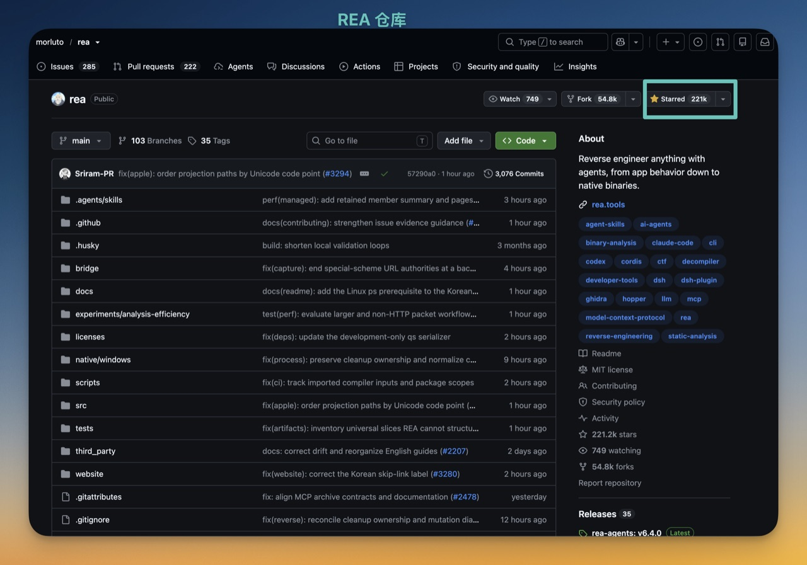
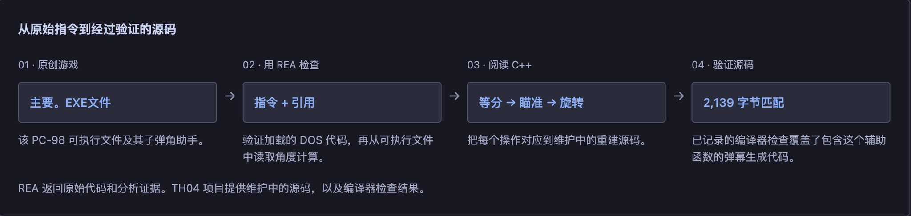
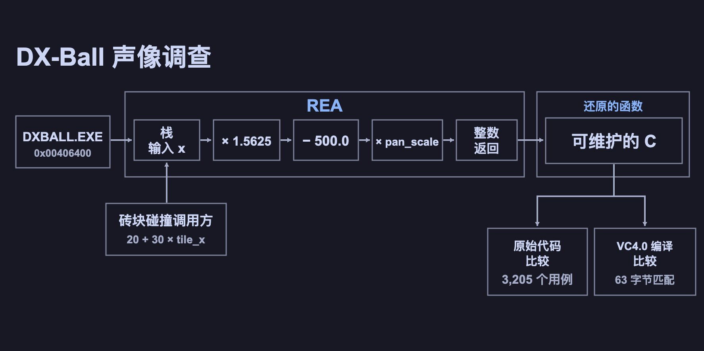
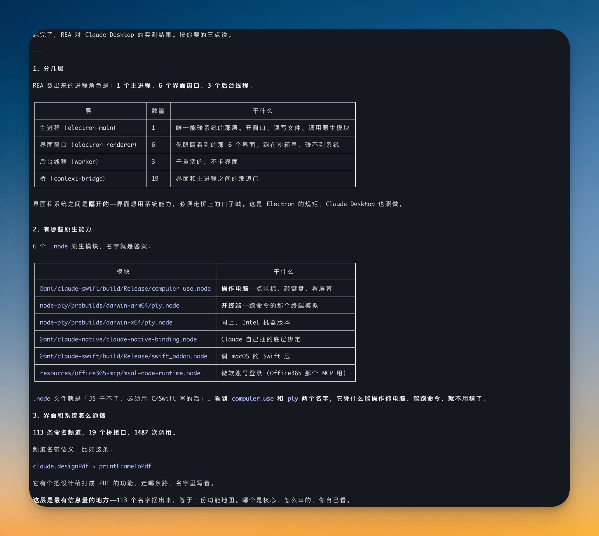

# 万字长文｜超简单 REA：逆向平权，从入门到精通

> 原文转载自 X（Twitter），作者 **想风**（[@xaiwind](https://x.com/xaiwind)）。
> 原始帖子：<https://x.com/xaiwind/status/2110529367793393945>
> 抓取时间：2026-10-16

**发布时间**：2026 年 10 月 15 日 8:33（X 平台显示时间）
**互动数据**：浏览 7.3 万 · 22 条回复 · 93 转发 · 462 点赞 · 874 书签

---

大家好，我是想风！

今天来看 REA **(Reverse Engineer Anything)**，本篇写给新手小白，新手也能学会！

先说结论：**它是一个装在 AI Agent 里的逆向工程工具箱。** 你给它一个软件。它把里面是怎么做的，一样样给你翻出来。每一条结论都带着证据。

它自己没发明任何新技术。真正拆软件的活儿，是 Hopper、Ghidra、IDA 这些老牌工具在干。REA 做的是中间那层翻译——把你家 AI 会说的话，翻成这些工具听得懂的指令。反过来，工具吐出来的天书，它再翻回你能看懂的人话。

这个仓库 4 月 14 日才建。到 10 月 14 日，star 数已经 22 万——刚好半年。README 里挂着 20 万 star 的致谢，这个月还冲上过 GitHub Trending 第一。



这篇不讲热闹，讲怎么装上、跑起来、看懂。整篇按「文科生也能跟着做」来写，**每个第一次出现的名词，都用大白话解释一遍。**

## 目录

- 一、REA 到底是个什么东西
- 二、能干什么·不能干什么
- 三、下载和装
- 四、三个分析引擎怎么挑
- 五、第一个任务
- 六、证据：REA 最值钱的地方
- 七、让 Agent 自己干
- 八、三个官方案例
- 九、坑集锦
- 十、常见问题
- 最后

---

## 一、REA 到底是个什么东西


先摊开两个词：逆向工程、MCP。这俩通了，REA 是干嘛的就自动清楚。

**逆向工程**
**把一个做好的东西拆开，看它是怎么做出来的。**
软件逆向是同一件事，只不过拆的不是塑料壳，是打包好的程序文件。拆别人的东西得有这个权利。学习、修自己的软件、做安全研究，是一回事。拿别人的东西去干别的，是另一回事。

**MCP**
**给 AI 装上的一双手。** AI 聊天框本质上有张嘴。能说，能写，能出主意，但碰不到你电脑上的任何东西。MCP 就是解决这个的：一套统一的标准接口，让 AI 能真伸手去用别的软件。

**REA 站在中间**
**左边是 AI Agent，右边是 Hopper、Ghidra、IDA，REA 是钉在中间的那根管子。** 它是一台 MCP 服务器。

- **干活的**：Hopper / Ghidra / IDA，把程序拆开
- **传话的**：REA，让 AI 指挥得动它们
- **动嘴的**：你家的 AI Agent（Claude Code、Codex、Cursor 都行），听懂你要什么

REA 官方对自己的定位说得很克制——它不是新的反编译器，是一层接口。

**它和别的不一样在哪**

| | 传统逆向工具 | 网页上的 AI 聊天 | REA |
|---|---|---|---|
| 谁动手 | 你自己操作，得看得懂汇编 | 只会说碰不到文件 | AI 自己动手 |
| 没源码时 | 能拆但结果要自己啃 | 完全没辙 | 能拆还能用大白话讲 |
| 结论可信度 | 自己判断 | 可能一本正经地瞎编 | 每条结论带证据 |

**为什么值得学**
想抄作业的时候最快；手里有拆不开的东西时（没源码的老软件等）；更长远：它教你 MCP 是怎么用的。

---

## 二、能干什么·不能干什么


**能干的**（分三档）：

- **最省事**：JavaScript / Electron 应用、网站、SQLite 数据库、网页存档、包和资源 → 不用装引擎
- **中等**：原生二进制（Mach-O、ELF、PE、Mac 的 .app）、Go 二进制、.NET 程序等 → 要配分析引擎
- **要折腾**：Android APK、固件、网络抓包等 → 还要装专属配套工具

新手看这句：第一档不用装任何引擎。

**不能干的**

1. 不给你原始源码（给的是伪代码，变量名可能是 `local_18`）。
2. 不把软件传到云上（REA 本机分析，但 Agent 用的模型有自己数据政策）。
3. 不帮你抄 App（给的是「看懂」不是「复制」）。

---

## 三、下载和装


REA 有两个用法：命令行工具或装进 AI Agent。顺序先把命令行跑通。

**第一步：装 Node.js** — 只认 22.x（22.19+）、24.x（24.11+）、26+；23 和 25 不行。
**第二步：一条命令装** — `npx rea-agents@latest setup`（新手走 npx）；或 `npm install --global rea-agents` 全局装。
**第三步：setup 会问你** — 给哪些 Agent 装（Claude Code、Codex、Cursor 等）；装不装 Hopper（建议不装）；看计划再批准（下载包和改配置是两次批准）。
**第四步：装完先做三件事** — 跑 `rea doctor --json` 体检；重启 Agent；跑一条免引擎命令 `npx -y rea-agents@latest analyze-javascript-application /路径 --json`（带原生模块加 `--integrity-policy=record-and-continue`）。

更新：`rea update` 或重跑 setup。卸载：`rea uninstall`（或 `--purge-data`）。

---

## 四、三个分析引擎怎么挑


不装行不行？行，新手第一次就该不装（第一档免引擎）。

三个引擎：Hopper（Mac 收费）、Ghidra（免费开源，需 JDK 21+）、IDA（最贵商业）。装一个就够。

- **Ghidra 路**：设 `GHIDRA_INSTALL_DIR` 和 `JAVA_HOME` 后 `rea doctor` / `rea setup`。
- **Hopper 路**：Mac 上 setup 问时同意，装到 `~/Applications`。
- **调超时**：设 `REA_HOPPER_STARTUP_TIMEOUT_MS=300000` 等环境变量。

---

## 五、第一个任务


挑 Electron 应用拆：

```bash
npx -y rea-agents@latest analyze-javascript-application /Applications/你的应用.app --json
```

看：模块、引用关系、Electron 边界（渲染层/预加载层/主进程）。

实测 Claude Desktop：388 文件、6 原生模块（如 `computer_use.node`）、113 通信频道。结果不落盘需自己 `> ~/Desktop/分析.md` 重定向。

---

## 六、证据：REA 最值钱的地方


每条结论带「凭什么这么说」（文件位置、摘要值、JSON 路径），并列出未能确定的事。堵住 AI 瞎编的口子，但证据本身也可核对不一定绝对对。

---

## 七、让 Agent 自己干

装好重启后用大白话问。例：「搞清楚 Notes 应用里的搜索是怎么做的，把证据给我看。然后照着这个思路帮我做类似功能。」

模板：拆 [目标] 的 [功能] → 1. 怎么实现 2. 带证据 3. 列不确定 4. 写自己版本。

大项目易上下文爆炸，存文件再分析或换小项目。

---

## 八、三个官方案例


- **DX-Ball**（1996 打砖块）：还原声音左右定位，3205 个 x86 用例全过。
- **Notion**：追剪贴板链路渲染层→主进程。
- **TH04**：16 位 PC-98 老游戏子弹环计算。

---

## 九、坑集锦



坑一：不重启 Agent；坑二：Node 版本差一点；坑三：`doctor healthy:false` 误判；坑四：只点一次同意；坑五：指望给源码；坑六：拿敏感东西拆；坑七：一上来装引擎；坑八：路径写相对；坑九：忘权利。

---

## 十、常见问题


不必装引擎（JS/Electron 免引擎）；Hopper 不用提前开；支持本地 MCP 的 Agent 都能用；返回伪代码非源码；REA 本机不上传但模型有自己政策；Windows 分情况；卸载只摘自己写的。

---

## 最后


- 它是什么：AI Agent 里的逆向工具箱
- 两词：逆向=拆看做法；MCP=给 AI 的手
- 装完三件事：doctor、重启、跑免引擎命令
- 引擎不用全装
- 最值钱是证据
- 最短路径：装 Node → npx setup → doctor → 重启 → 拆 Electron → 看证据 → 再决配引擎

新手秘诀：用提示词让 Agent 装 `https://github.com/morluto/rea` 及 skill/mcp，再大白话指挥。

推荐两篇优秀 REA 帖子（Chris @Chris62771610 的 Typeless 同款复刻；蓝哥AI @0xlangeai 的保姆级教程）。

资料来源：REA 官方仓库 github.com/morluto/rea、rea.tools、版本 6.4.0（2026-10-11），Star 22 万（2026-10-14）。

我是想风@xaiwind，一个关注出海与 AI、AIGC 的创作者。本文基于 AI 辅助与个人实践融合创作，如果文章对你有帮助，欢迎点赞、收藏、关注。


---

## 补充配图

以下为原帖中其余未单独标注的配图，按抓取顺序排列：





