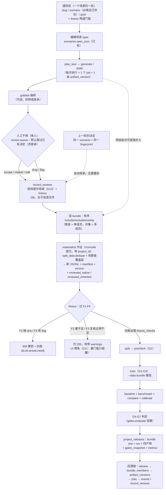
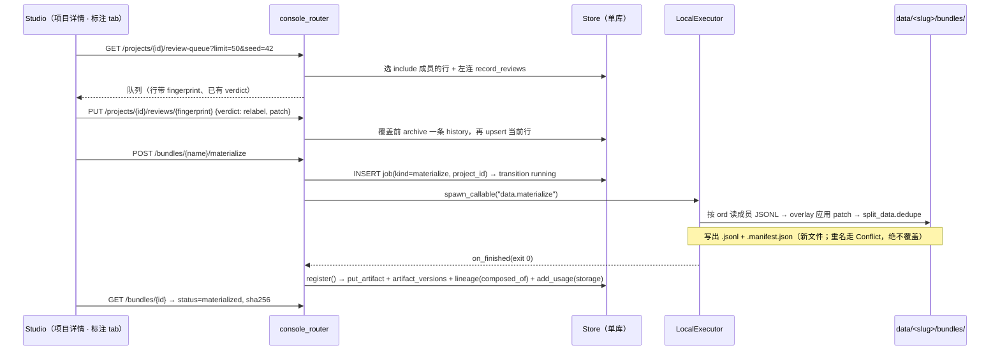
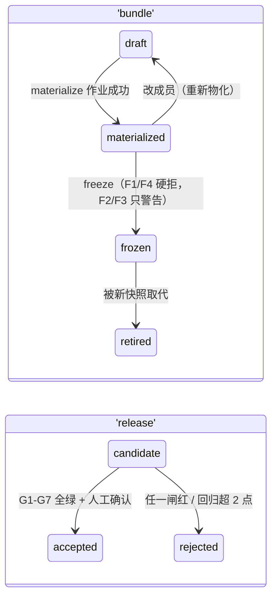

# Project 作为「完整训练过程项目」的中枢：架构与产品设计

- 日期：2026-10-16（v2：§9 的四条未决已由用户答复，答复改变要造什么，已就地并入）
- 状态：设计稿 v2，待用户批准后转实现计划
- 依据（全部为本 checkout 的实测代码，不是推测）：
  `kev/console/db.py`（表结构与状态机）、`artifacts.py`（id↔路径唯一归属、`register` 的事务）、
  `stages/{data,train,eval,deploy}.py`（argv 组装与产物契约）、`gates.py`（G1-G7）、
  `skills/kev-finetune/scripts/split_data.py`（`check_record` / `dedupe` / `state_key`）、
  `tools/review/`（已存在的键盘优先标注器与其 `reviews.jsonl` 导出格式）、
  `playground/src/app/console/layout.tsx`（11 项侧栏与 console/studio 互跳那段外壳）、
  `playground/src/app/console/goldset/review/page.tsx`（仓内已有的逐条改标页，它的 `exportHoldout` 只在浏览器里下载）、
  `playground/src/app/studio/*`（13 个页面接真 API、14 个仍是 mock）、
  `docs/superpowers/specs/2026-10-12-generic-scenario-engine-design.md`（D7 spec 单一真相源、D11 双通道）

---

## 1. 今天的事实，以及它为什么撑不起「训练过程项目」

1. **Project 与流水线是两条不相交的线。** `projects` 表只有 slug/name/description，加
   `project_members / project_quota / webhooks / invoices`（`db.py:285-342`）——它是「账单与工作区」的概念。
   `jobs` 表没有任何项目列；`artifacts` 与 `lineage` 也没有。于是「这个项目做过几轮数据、哪份数据训的、
   结果好不好」在库里一个查询都问不出来。
2. **产物是可变单例，重试会盖掉历史。** `artifacts` 以 `UNIQUE(kind, name)` 建索引，`put_artifact` 是
   `ON CONFLICT(id) DO UPDATE SET path/meta/bytes`（`db.py:722-733`）。同一个 `dataset:cv/train` 被第二次注册时
   只剩最后一次的痕迹，而 `jobs.attempt` 与 `parent_id` 明明记着「这是第几次」。版本语义在作业侧有、在产物侧没有。
3. **血缘存不下「多来源合并」。** `lineage` 的主键是 `(parent, child, relation)`，`add_lineage` 是
   INSERT OR IGNORE（`db.py:761-767`）——一对父子加一种关系只能有一行，`job_id` 因此只记第一个写入者。
   取并集需要 N 个来源各自的比例与去重统计，这张表装不下，硬塞会把 provenance 变成噪声。
4. **标注只有前端的一次性冲动。** `studio/datasets/label/page.tsx` 里是 4 条硬编码 `ITEMS`，
   `save()` 只改 React state（第 62-79 行），刷新即丢；而真正做过一遍的 `tools/review/` 是纯浏览器工具，
   决策落 localStorage，且它要求每行有 `id`——**生成的医疗记录只有 `{state, questions}` 两个顶层键**
   （实测 `data/critical-value/train.jsonl` 第一行），所以那个工具今天喂不进 Kev 自己的训练数据。
5. **训练结果回不到项目。** `run:` / `eval:` / `comparison:` / `calibration:` 都是产物 id，靠
   `run_name` 命名串起来；闸门（G1-G7）是纯函数、每次现算（`gates.py:235`），没有任何地方留下
   「哪份数据、哪个 checkpoint、哪次评测、过没过、当时数字是多少」这一份可审计的组合。

一句话：**缺的不是 UI，是「项目 → 作业 → 产物版本 → 数据快照 → 训练 → 结论」这条链上缺少可查询的脊柱。**

---

## 2. 目标、非目标、反目标

### 2.1 目标（可判定）

| # | 目标 | 判据 |
| --- | --- | --- |
| P1 | 每个作业都归属一个项目 | `POST /jobs` 带 `project_id`；`jobs.project_id` 非空率 = 项目内提交路径 100%（历史行为 NULL，不算回归） |
| P2 | 同一产物的多次执行都有版本 | `artifact_versions` 只增不改；`GET /artifacts/{id}/versions` 能列出每次重试的 sha256、记录数与作业 |
| P3 | 多批次数据可取舍、可取并集，且合并可复现 | 一个 bundle 冻结后，重跑 materialize 得到**同一个文件 sha256**（同库同文件状态下） |
| P4 | 人工修正与标注不破坏可审计性 | 原始 JSONL 永不被改写；标注决策在库里；物化产出一份 manifest 记录每条被谁改过 |
| P5 | 数据→训练→评测→结论形成闭环并可回溯 | 从 `GET /projects/{id}/releases/{rid}` 能一路反查到源记录的 fingerprint 与产生它的 job |
| P6 | 下游一行不改 | `kev.train`、`kev.benchmark`、`kev.compare`、`kev.calibrate`、`split_data.py` 的读取路径与契约零修改 |
| P7 | 前端不再是 mock | `/studio/projects/{id}` 下六个 tab 全部读真 API；被替换的 mock 页（含 `console/goldset/review`）在 `tests/test_conventions.py` 的扫描里不再含硬编码数据行 |
| P8 | freeze 有可判定的量门槛 | 把 `freeze_min_records` 调到 `records + 1` 后 freeze 必须被拒，且 `freeze_checks` 里 F2 的 `actual/need` 就是那两个数 |

### 2.2 非目标

- 不做多用户实时协作、不做权限强制：`project_members` 有 role 但 API 侧没有任何鉴权
  （`api_keys` 只服务代理推理，`app.py` 的路由全部无依赖注入的 auth）。这是已知缺陷，本设计**记录但不修**，
  修它是「给 `/console/api/*` 加认证层」这一件独立的事。
- 不做数据版本的全量文件副本（磁盘）。版本 = 登记时的 sha256 + 路径 + 完整性判定；漂移要看得见，但不靠复制来防止。
- 不改 `kev.suite` 的冻结 suite 契约，不把 bundle 变成 eval suite（bundle 是训练数据，不是评测集）。
- 不在标注界面里做富文本/表格编辑器：只编辑 `state` 的 JSON 值与 `questions.<qid>` 的字段。
- 不做 Modal 云端项目同步（`deploy/` 与 `modal_app.py` 是另一套 runs volume 语义）。

### 2.3 反目标（技术上做得到、但这个项目失败的样子）

- **Project 变成 UI-only 概念**：表建了、页面有了，但作业的 `project_id` 还是没人写、闸门还是每次现算。
  这条由 P1/P5 的判据守着。
- **bundle 偷偷改过去重语义**：自己写一套 dedupe，于是「控制台合出来的数据」与 `split_data` 认为的重复
  不一致，G3 与训练静默丢行同时存在。所以 materialize **必须 import `split_data.dedupe`**，不复制实现。
- **标注覆盖原始文件**：医疗可审计性要求「谁在什么时候把哪条的答案从 A 改成 B」是可查询的，而不是一个
  被就地改掉的字节。
- **把 `lineage` 当合并表用**：主键装不下 N 个来源，塞进去等于把 provenance 写成噪声。

---

## 3. 关键决策记录

> 标注 `[用户]` = 用户明确说的（v2 新增的 D1/D6/D11/D12 就是答复改变的那几条）；
> `[我的判断]` = 用户跳过访谈、由我定并在此公开，可一票否决。

### D1 Project 复用现有的 `projects` 表，且一个项目 = 一个场景的一轮训练 `[我的判断 + 用户]`

被否决的备选：另立 `training_projects` 表。理由：`ProjectSwitcher` + `useProjects()` 已经把
`projects` 当全局上下文用了（`components/studio/ProjectSwitcher.tsx`），billing/quota/members/webhooks 都挂在它上面；
再造一个「项目」会让同一个词在同一个产品里有两个含义，而且新表要么重复那五张管理面表，要么把它们变成孤儿。
所以本项目**把 `projects` 从账单根升级成流水线根**，只加列、不改语义、不动既有 5 张子表。

**粒度由用户定为「一个场景的一轮」**（例：`critical-value-2026-10`）。这条改变三处形状，都往简单方向：

1. `scenario` **必填且必须命中 `scenarios` 表里的既有场景**（不再是「可空 = 不限」）。建项目时选场景，
   不是先建项目再猜场景 —— 于是 `POST /projects` 在场景不存在时直接 400，而不是留下一个查不到 spec 的孤儿项目。
2. 同一场景的下一轮 = **新建立的一个项目**（slug 不同），而不是在原项目里再开一层。于是
   「这一轮的数据/快照/训练/结论」天然被 `project_id` 切干净，`bundles`/`releases` 的查询不需要再按场景过滤，
   版本历史也不会跨轮混在一张列表里。
3. 前端少一层：项目详情页内不再有「场景切换」下拉，tab 里的一切都已经属于那一个场景。

新增列：`status`（active/archived）、`scenario`（必填）、`goal`（一句话写清这轮要什么）、`archived_at`，
以及 D11 的两道 freeze 门槛。

### D2 项目的归属走 job，不走 artifact `[我的判断]`

`artifact_versions.job_id` 设为 NOT NULL（`artifacts.register` 永远有 job，见 `artifacts.py:135-160`），
项目通过 `jobs.project_id` join 得出，**不给 `artifacts` 加 `project_id` 列**。理由：产物 id 是按路径算的全局单例
（`dataset:cv/train` → `data/cv/train.jsonl`），把它绑到一个项目上会在「同一份数据被两个项目引用」时立刻变成谎话；
版本行的归属来自它由哪个作业写出，这是既成事实，不是新约定。

### D3 版本用「登记即算 sha256，读取时复核并报漂移」 `[我的判断]`

新表 `artifact_versions`（见 §4.2）。注册时算文件 sha256、行数、字节数；`GET` 时重新哈希，返回
`integrity: ok | drift | missing`。

为什么不复制文件：`paths.py` 的布局是仓库内 `data/` + `runs/`，一份 4B 训练集几百 MB，8 个快照的磁盘教训
在 `kev/budget.MAX_SNAPSHOTS` 那里已经写过了。为什么不假装「路径不可复用」就够：`_exists()` 只在
generate/split 的**目录**上拒（`stages/data.py:98-109`），而 `put_artifact` 是 upsert，
重试与重跑完全可能写下不同内容。所以诚实的做法是把漂移变成一个**可见状态**，而不是一个不存在的保证。
这与 `kev/rounds.py` 的面板过滤 `{path, sha256}` 同一口径：路径 + 哈希，哈希不匹配就是另一回事。

### D4 「数据快照」是一个新的不可变产物 kind：`bundle` `[我的判断]`

取舍/并集不能靠「给 UI 一个多选框然后当场拼给训练器」——那样合出来的东西没有 id、没有 sha、没有血缘，
下一次合是另一份。所以：

- bundle 是 `bundles` 表里的一行 + 一个**永不改写**的 JSONL + 一份 manifest；
- artifact kind 新增 `bundle`，`artifacts.resolve()` 里加一支：`bundle:<project-slug>/<name>`
  → `data/<project-slug>/bundles/<name>.jsonl`（路径前缀仍归 `paths.py`，`resolve` 是唯一归属）；
- `artifacts.RELATION` 加 `"materialize": "composed_of"`；
- bundle 名字过 `run_matrix.check_name`（禁点号，与运行名同一套规范，`stages/train.py:99` 已经在用它）。

下游什么都不用改：`split`/`precheck`/`train`/`benchmark` 收的都是 `--data <path>`，把 bundle 的路径传进去即可；
`artifacts_in` 用 `bundle:...` 就能让 G1-G3 的证据链长在新快照上。

### D5 合并语义 = 有序成员 + 三种 op，去重与标签冲突一律复用 `split_data` `[我的判断]`

```
ops:  include（并入，按 ord 先到先得） | exclude（整批排除） | overlay（应用标注覆盖层）
```

`include` 顺序即「取舍」：先出现的成员赢，后来的同 fingerprint 行不覆盖它。合并完成后统一过一次
`split_data.dedupe`——它已经做了两件事：完全重复（canonical `json.dumps({"state","questions"}, sort_keys=True,
ensure_ascii=False)`）丢弃；同一 `state_key` 下同一问句出现不同 label 的**整个状态组**丢弃。这两条正是「两个批次
生成了同一状态但答案不一致」该有的处理，而它已经是 G3 与训练器看到的同一份现实。再写一套就是反目标第 2 条。

统计逐成员落 `bundle_members.records_kept / records_dropped / drop_reasons`，
`drop_reasons` 的键固定为 `dup | state_conflict | review_drop | review_unresolved`（前两个由 `dedupe` 的返回值推，
后两个由覆盖层给）。

### D6 标注：不可变源 + DB 里的覆盖层 + 物化时应用 `[我的判断 + 用户]`

三个候选（就地改 JSONL / 独立 patch 文件 / 存库）里选存库，理由：

- 就地改：审计断掉，而且 `sha256` 一变，之前那次训练的配对证据（G4/G6 靠 `suite_sha256` 一致，
  `stages/eval.py:14-17`）就对不上了。
- 独立 patch 文件：`tools/review` 的 `reviews.jsonl` 就是这个形状，它适合单人本地；但项目要的是
  「过滤待复核队列、按标签批量处理、跨批次统计」，散文件做不到一次查询。
- 存库：与 `scenarios.spec_json + scenario_spec_history`、`stage_param_specs + stage_param_spec_history`
  完全同构（当前行 + 覆盖前归档 + `SPEC_HISTORY_LIMIT` 裁剪）。**用仓库已有的模式，不发明第四种。**

`tools/review` 不废弃，反而当接口：它的导出行
`{"id","verdict","label","proposed_label","note","reviewed_at"}` 就是 `record_reviews` 的字段集，
所以加一条 `POST /projects/{id}/reviews/import` 把它收进库，本地那套键盘肌肉记忆直接迁移过来。

**标注者是用户一个人（`[用户]`）**，于是这版明确不做：多人分派、同一记录的独立标注、一致性统计
（Krippendorff / Cohen's kappa）、裁决队列、标注员绩效。`reviewer` 列保留但只是署名用的文本。
一条记录只拥有一个决定，改主意就覆盖前归档（`tools/review` 本来就是 one-person 的设计，它的键位与
localStorage 语义可以整体搬到服务端）；**这个「一个决定」的作用域不是项目而是场景**，因为用户要求
上一轮的标注自动带给下一轮 —— 见 D13。
副作用要说在前面：单人标注下「复核比例」这道门槛（D11）衡量的是**我有没有看过**，不是「两个独立人同意见」，
所以它的含义是覆盖率而非一致性 —— 这也是为什么门槛用比例而不是用「争议率」。

**仓库里已经有两个标注面，本设计把它们收成一个**。`console/goldset/review/page.tsx` 是今天真正能用的
审校页：它把 goldset 导出的 JSONL 读进 React state、逐条改 `questions.<qid>.label`，然后**在浏览器里
下载一份 `<name>-reviewed.jsonl`**（它的 `exportHoldout`）。方向是对的（不改源文件），但决策只存在于
cursor 上：没有 id、没有 sha、没有血缘、刷新即丢，而且那个导出文件进不了任何版本表。PR6 把它替掉：
同样的逐条改标动作落 `record_reviews`，同样的「导出可喂 split 的文件」由 materialize 承担（多一个 sha）。

### D7 记录身份 = 内容指纹，因为生成的记录根本没有 id `[我的判断]`

`record_reviews.fingerprint = sha256(canonical {state, questions})`，与 `split_data` 的重复判定同一个规范化函数，
因此「标注了这条」与「去重丢的是这条」天然是同一个对象。`record_id` 列保留（评测记录、devtools、外部源确实带 id），
但**不作为键**。副作用要说清：修正后的记录指纹会变，所以覆盖层必须同时存
`fingerprint_before` 与 `fingerprint_after`，manifest 里两个都记；否则改过一次的答案就再也查不到它原本是谁。

### D8 结论落库为 `project_releases`，闸门结果快照进去 `[我的判断]`

`gates.evaluate()` 每次现算——文件还在才算得出，删了就问不出「当时过了没」。项目要留下组合：
bundle 版本 sha + 训练作业/run 产物 + 四个评测产物 + G1-G7 的当时判定 + 关键指标（acc/ECE/Brier/AURC/CI）。
存成一行 + 一份 `gates_snapshot` JSON。这与 `kev.benchmark` 的 `report.json`、快照的 `snapshot.json`（写完最后一份
才算提交完成）是同一个思路：**先落证据，再宣告完成**。

### D9 slug 一旦有数据就不可改 `[我的判断]`

`update_project` 今天允许改 slug（`db.py:1565-1584`），而 bundle 的路径里带 slug。改 slug = 把已登记的
`path` 指向一个不存在的目录，`integrity` 全体 `missing`。定案：项目下已有任何 job 或 bundle 时拒改 slug，返回 409
（与「目录不可复用，不自动改名」的既有脾气一致，`base.py` 的 `Conflict` docstring）。

### D10 日志不新造一套 `[我的判断]`

`db.py` 顶部三条约定之一：「日志文件是真相源，events 表只是给 UI 的可分页尾巴」。项目视图**不引入新日志表**，
只加一条聚合读：`GET /projects/{id}/events?after_id`。`events.id` 是全库自增，跨作业按 id 排序天然成立，
Last-Event-ID 续传的语义原样保留（SSE 那条 `stream` 路由不动）。

### D11 freeze 的两道量门槛是**提示而不是锁** `[用户]`

用户定了：要两道门槛（最低记录数、最低人工复核比例），但一轮只生成几十条时 300 会把 freeze 锁死，
所以**给出提示即可**。定案把四道检查分成两类，且这个分类不是拍脑袋：

| 检查 | 语义 | 不过时 |
| --- | --- | --- |
| `F1 materialized` | 已物化（sha 非空、records 非空）且至少一个 `include` 成员 | **409 硬拒** —— 未物化的东西没有 sha256 可记，freeze 它在事实上就是谎 |
| `F4 no_unresolved` | 产物里没有未处理的 `flag` | **409 硬拒** —— 「待议」的记录静默进训练集是数据质量事故，不是提示能兑的 |
| `F2 min_records` | `records >= freeze_min_records` | **警告**：freeze 成功，`freeze_checks` 里 `ok=false`，响应带 `warnings`，UI 黄条 |
| `F3 min_review_ratio` | `review_ratio >= freeze_min_review_ratio` | **警告**：同 F2 |

为什么 F2/F3 可以软、F1/F4 不行：F2/F3 是**我对自己定的充足度不够满意**（量小可能是故意的：先跑 30 条
验流程），而 F1/F4 是**事实上的未完成**。把前者做成 409 只会推翻门槛存在的意义 —— 而且
它会驱使用户去把阈值调低，得到的数字反而更不像真规矩。

其余保持原样：

- 门槛是**项目级策略**，存 `projects.freeze_min_records` / `projects.freeze_min_review_ratio`（§4.1），
  不是 bundle 上的自由参数 —— 否则可以挑一个宽松的 bundle 绕过自己定的规矩。既然是提示，
  默认值就给个真的有用的数：`300` / `0.10`（而非 0），新项目不填也会被提醒；但既然不拦路，
  一轮 30 条的项目也不会有任何损失，只是看到一条黄条。`0` / `0.0` 仍合法，含义是「我不想知道」。
- 逐条落 `bundles.freeze_checks`，**复用 `gates.Gate` 的字段形状** `{id, ok, detail, actual, need}`；
  四条全落（包括 ok 的），否则一年后没人知道当时卡在哪。
- **命名用 `F`，不用 `G8`**：console 的闸门是 G1-G7（`gates.py`），CI 侧另有 G1-G8（B2 设计的泄漏闸门），
  两个命名空间已经存在，再塞一个 `G8` 会让「G8 过了没」变成一句无法判断指谁的话。freeze 也不是训练闸门
  ——它发生在数据侧、train 之前，语义上是另一族。
- `review_ratio` 的分母必须机器可算，定义钉死为：**物化产出的记录中，其 `fingerprint`（或
  `fingerprint_before`）命中一条 verdict ∈ {accept, relabel, edit} 的决定的比例**。`drop` 掉的记录
  不进分母（它们已不在产物里），`flag` 的既不进分子也不该出现在分母（F4 会先拦住）。
  分子拆成**本轮定的**与**从上一轮继承的**两个数（D13），比例同时报两个：只报合计会把
  「本轮一条都没看、但上轮看过」绿过去，那是 F3 能给出的最坏的一种假绿。

### D12 `/console/*` 工作台保留，并成为「带项目的写入口」 `[用户]`

用户决定保留 stage 工作台并要求它与项目关联。定案是**分工而不是合并**：

- `/console/*` 仍是**唯一的提交面**（表单真相源在 `stage_param_specs`，`console/layout.tsx` 的 11 项侧栏不动）。
  在它的外壳头部（`playground/src/app/console/layout.tsx:36-53`，那里已有 console/studio 的互跳）挂
  `ProjectSwitcher`，选择持久化到 localStorage；每个 stage 页提交时从同一个 context 取 `project_id` 塞进
  `POST /jobs`。缺项目 → 后端 400，前端在提交按钮旁直接把这条错误显示出来，而不是让用户猜。
- `/studio/projects/{id}` 是**读与选**的面：版本、合并、标注、训练、结论、血缘六个 tab；它的「去提交下一步」
  一律是跳到 `/console/<stage>?project=<id>`，**不复制第二套提交表单** —— 两处表单必然漂移，
  而 `stage_param_specs` 的历史、回滚与校验只服务一份。
- URL 参数 `?project=` 让跳转能落回同一个项目；这同时是「从项目页一键带着刚冻结的 bundle 去 train」的入口，
  见 §6.1 的 J→K。

### D13 标注决定按**场景**作用域，于是上一轮的决定自动带给下一轮 `[用户]`

用户要求：上一轮的标注决定要自动带给下一轮。结合 D1（一个项目 = 一个场景的一轮），
最干净的做法不是「拷一份」，而是**把决定的作用域从项目抬到场景**：

- `record_reviews` 的键从 `UNIQUE (project_id, fingerprint)` 改为 **`UNIQUE (scenario, fingerprint)`**；
  行上不再记 `project_id`，而是记 `origin_project_id`（哪一轮做的这个决定）。
- materialize 取覆盖层时按**项目的场景**查，而不是按项目查。继承因此不是一个功能开关，
  而是同一张表的自然读法：第二轮重新生成了一模一样的记录（同一 fingerprint），它的 `accept/relabel/edit/drop`
  自动生效，不需要我重新标。这也避开了「拷进来」那条路的脏活：拷完就有了两份真相，谁也不知道哪份赢。
- **为什么这不丢审计**（这是必须说清的那一半）：决定行是可变的，但**物化产物是不可变的**（D4）。
  每一轮的 manifest 逐条记下当时应用了哪个 `review_id`、它的 `verdict`/`patch`/`origin_project_id`/`updated_at`。
  所以「第二轮推翻了第一轮的决定」不会重写第一轮的历史 —— 第一轮的文件与 manifest 就在那里，
  而 `record_review_history` 又多存一份被推翻的旧值。跟 D3 同一个口径：**可变的东西只存指针，
  不可变的证据落在产物里**。
- **代价要说在前面**：同一场景的两个项目（并行两轮）会抢同一行。单人串行的用法下这不是问题，
  但它是已知限制，不是没想过的漏洞；真要并行两轮，得先把键回到带轮次的作用域。
- **继承的决定不算本轮看过**（D11 的 F3 拆分子）：`reviewed_native` 只统计 `origin_project_id = 本项目` 的，
  `reviewed_inherited` 统计其他的。F3 的判定用合计（继承的决定确实被同一个人看过），但 UI 与
  `freeze_checks.detail` 必须两个数并列。一个只看合计的比例会鼓励我不干活就 freeze，那是 F3 能给出的
  最坏的一种假绿。

### D14 每个新作业必须有项目，而历史作业既不回填也不假装是项目 `[用户]`

用户两条一起看会撞：不允许「不属于任何项目的作业」存在（第 4 条），但现有 `data/critical-value/`
不回填成一个项目（第 3 条）。旧 `jobs` 行确实没有项目，两者只能这样调和：

- `jobs.project_id` 加列为 **`TEXT NOT NULL DEFAULT ''`**：库里永远没有 NULL，`''` 是一个**具名的哨兵**
  而不是项目，含义是「projects 概念之前出生的行」。sqlite 与 postgres 都能给已有表加
  `NOT NULL DEFAULT ''`，不需要重建 1,700 行数据的 jobs 表（重建才能加 CHECK，而历史行全是 `''`，
  CHECK 要么形同虚设要么一升级就拒自己的库）。跟 `projects.goal`/`scenario` 用 `NOT NULL DEFAULT ''` 同一写法。
- **真正的约束在唯一写入点**：`Store.create_job` 是 keyword-only 签名（`db.py:670-672`），把
  `project_id` 改成**无默认值的必填关键字**后，任何调用点漏了就 `TypeError`；方法内再 `ValueError` 拒 `''`。
  这比 DB 约束更强：新代码不可能默默写出无主作业，而历史行的 `''` 不会被当作合法值误用。
- `POST /jobs` 缺 `project_id` 或给了空串 → 400（无例外）；`/console/*` 无项目时提交按钮置灰。
  因此 P1 的 100% 从今日起成立，历史行单独算一类（「旧数据（未归属）」），不靠把它们归到一个
  编造的项目里凑分母 —— 那是用噪声做指标。
- 现有 `data/critical-value/` **不回填**：造历史 job 与历史版本行需要当时的 `spec_sha256` 与执行参数，
  库里没有，填进去只能靠猜。它们作为文件继续可读，作为行不存在。

---

## 4. 数据模型（`SCHEMA_VERSION` 6 → 7）

### 4.1 改列（幂等 `ALTER`，沿用 `_column_exists` 与 `version < N` 的迁移写法）

```sql
ALTER TABLE jobs ADD COLUMN project_id TEXT NOT NULL DEFAULT '';  -- '' = projects 之前出生的行（D14）
CREATE INDEX jobs_project_idx ON jobs(project_id, created_at DESC);
ALTER TABLE projects ADD COLUMN status     TEXT NOT NULL DEFAULT 'active';
ALTER TABLE projects ADD COLUMN scenario   TEXT NOT NULL DEFAULT '';
ALTER TABLE projects ADD COLUMN goal       TEXT NOT NULL DEFAULT '';
ALTER TABLE projects ADD COLUMN archived_at TEXT;
-- D11：项目级 freeze 策略（默认 300 / 0.10，只提醒不拦路）
ALTER TABLE projects ADD COLUMN freeze_min_records     INTEGER NOT NULL DEFAULT 300;
ALTER TABLE projects ADD COLUMN freeze_min_review_ratio {real}  NOT NULL DEFAULT 0.10;
```

`freeze_min_review_ratio` 走 `_ddl(backend)` 的 `real` 占位（sqlite `REAL` / postgres `DOUBLE PRECISION`），
与既有表的浮点列同一写法。`jobs.project_id` 用 `NOT NULL DEFAULT ''` 而不是可空：库里永远不出现 NULL，
而 `''` 是具名哨兵（D14）——真正的约束在 `Store.create_job` 的必填关键字参数上，不在库上。
历史行升级后全体变成 `''`，不变成任何项目。

**`scenario` 与 `freeze_*` 的迁移含义不同，不能揉成一谈**：`scenario` 的「必填」是**写入时校验**，
因为历史项目真的没声明过场景，猜一个会让 D1 的「项目 = 一个场景的一轮」从一开头就是假的；
迁移后既有项目的 `scenario` 是空串，`POST /projects` 与 `PUT /projects/{id}` 拒绝空值与不存在于
`scenarios` 的行。而 `freeze_*` 直接拿到有意的默认值（300 / 0.10）：它们只提醒，填错不会拦路。

### 4.2 `artifact_versions`：产物的不可变版本（D3）

```sql
CREATE TABLE artifact_versions (
  id          TEXT PRIMARY KEY,            -- uuid4().hex
  artifact_id TEXT NOT NULL,               -- 指向 artifacts.id（不加 FK：artifacts 是可变指针）
  seq         INTEGER NOT NULL,            -- 每个 artifact 从 1 递增，写在同一事务里
  job_id      TEXT NOT NULL REFERENCES jobs(id),
  path        TEXT NOT NULL,               -- 登记时的仓库相对路径
  sha256      TEXT NOT NULL,               -- 空串 = 当时读不到文件（integrity 直接判 missing）
  records     INTEGER,                     -- JSONL 行数；非 JSONL 产物为 NULL
  bytes       INTEGER,
  meta        TEXT NOT NULL,               -- artifacts.summarize() 的同形状
  spec_sha256 TEXT,                        -- 生成这批数据用的场景 spec 指纹（D7 of B2：spec 是真相源）
  created_at  TEXT NOT NULL,
  UNIQUE (artifact_id, seq)
);
CREATE INDEX artifact_versions_job_idx  ON artifact_versions(job_id);
CREATE INDEX artifact_versions_art_idx  ON artifact_versions(artifact_id, seq DESC);
```

写入点唯一：`artifacts.register()` 里紧跟 `put_artifact` 之后，`commit=False`，同一个事务
（现在的 `with store.tx():` 已经是原子的，半成品问题不会因为多一张表而回来）。
`seq` 由 `MAX(seq)+1` 在同一事务内取——这正是 `Store.tx()` 的 BEGIN IMMEDIATE 存在的理由。

### 4.3 `bundles` + `bundle_members`：取舍与并集（D4/D5）

```sql
CREATE TABLE bundles (
  id           TEXT PRIMARY KEY,
  project_id   TEXT NOT NULL REFERENCES projects(id),
  name         TEXT NOT NULL,              -- 过 run_matrix.check_name
  artifact_id  TEXT NOT NULL,              -- 'bundle:<slug>/<name>'
  status       TEXT NOT NULL,              -- draft | materialized | frozen | retired
  sha256       TEXT,                        -- 物化后的文件指纹（frozen 的必要条件）
  records      INTEGER,
  reviewed_records INTEGER,                 -- F3 的分子合计（native + inherited）
  reviewed_native  INTEGER,                 -- 本轮定的（origin_project_id = 本项目）
  reviewed_inherited INTEGER,               -- 从上一轮继承的（D13）
  review_ratio REAL,                        -- F3 的 actual（用合计）
  freeze_checks TEXT NOT NULL DEFAULT '[]', -- F1-F4 的 [{id,ok,detail,actual,need}]，同 gates 形状
  manifest_path TEXT,
  manifest_sha256 TEXT,
  frozen_at    TEXT,
  note         TEXT NOT NULL DEFAULT '',
  created_at   TEXT NOT NULL,
  updated_at   TEXT NOT NULL,
  UNIQUE (project_id, name)
);

CREATE TABLE bundle_members (
  bundle_id       TEXT NOT NULL REFERENCES bundles(id),
  version_id      TEXT NOT NULL REFERENCES artifact_versions(id),
  op              TEXT NOT NULL,           -- include | exclude | overlay
  ord             INTEGER NOT NULL,
  records_in      INTEGER,
  records_kept    INTEGER,
  records_dropped INTEGER,
  drop_reasons    TEXT NOT NULL DEFAULT '{}',   -- {dup,state_conflict,review_drop,review_unresolved}
  PRIMARY KEY (bundle_id, version_id)
);
CREATE INDEX bundle_members_ord_idx ON bundle_members(bundle_id, ord);
```

`bundle_members` 而不是 `lineage`，是 D3 之后剩下的那条真实约束：合并需要每成员的保留/丢弃计数，
而 `lineage` 的主键只能容纳一行、`job_id` 只能记住第一个写入者。`lineage` 仍然写
（`composed_of` 每条成员指向 bundle），但它是**给人看图的边**，provenance 的数字住在 `bundle_members`。

`reviewed_records` / `review_ratio` 由 **materialize 写、freeze 读**：覆盖层可以晚于物化发生（先合一批、
再标几条），所以 freeze 前重算一次比例并以重算值跑 F3；两者都写进 `freeze_checks`，免「freeze 时过了、
事后查不到当时多少」。`frozen` 的 bundle 拒绝改成员与重新物化（409），要变就另建一个名字——
与「目录不可复用、不自动改名」同一脾气（D9）。

### 4.4 `record_reviews` + `record_review_history`（D6/D7/D13）

```sql
CREATE TABLE record_reviews (
  id           TEXT PRIMARY KEY,
  scenario     TEXT NOT NULL,              -- 作用域（D13）：与 projects.scenario 同值，不建 FK
                                            -- （历史项目的 scenario 可以是 ''，而 '' 不是场景）
  origin_project_id TEXT NOT NULL REFERENCES projects(id),  -- 哪一轮做的这个决定
  fingerprint  TEXT NOT NULL,              -- sha256(canonical {state,questions})
  record_id    TEXT,                       -- 记录自带 id 时留一份，非键
  verdict      TEXT NOT NULL,              -- accept | relabel | edit | drop | flag
  patch        TEXT,                       -- JSON：仅被改字段的新值（state 整份 / questions.<qid>.<field>）
  fingerprint_after TEXT,                  -- patch 应用后的新指纹；无 patch 时 = fingerprint
  labels       TEXT NOT NULL DEFAULT '[]', -- 自由标签：来源、难度、脏法
  note         TEXT NOT NULL DEFAULT '',
  reviewer     TEXT NOT NULL DEFAULT '',
  source_version_id TEXT REFERENCES artifact_versions(id),   -- 可空：当时在哪批数据上做的决定
  created_at   TEXT NOT NULL,
  updated_at   TEXT NOT NULL,
  UNIQUE (scenario, fingerprint)
);
CREATE INDEX record_reviews_verdict_idx ON record_reviews(scenario, verdict);
CREATE INDEX record_reviews_origin_idx  ON record_reviews(origin_project_id);

CREATE TABLE record_review_history (      -- 与 scenario_spec_history 同构：覆盖前归档
  id           TEXT PRIMARY KEY,
  review_id    TEXT NOT NULL REFERENCES record_reviews(id),
  verdict      TEXT NOT NULL, patch TEXT, labels TEXT NOT NULL DEFAULT '[]',
  note         TEXT NOT NULL DEFAULT '', reviewer TEXT NOT NULL DEFAULT '',
  created_at   TEXT NOT NULL
);
CREATE INDEX record_review_history_idx ON record_review_history(review_id, created_at DESC);
```

`REVIEW_HISTORY_LIMIT = 20`（与 `Store.SPEC_HISTORY_LIMIT` 同值、同裁剪写法）。

**verdict 语义**：`accept` 明确「这条可以进训练集」（覆盖层的白名单作用），`drop` 排除，
`relabel` 只改 `questions.<qid>.label`，`edit` 改 state 或问句文本，`flag` 待议不入。
`frozen` 的 bundle 拒绝含未处理 `flag` 的成员行（拒因写进 `drop_reasons.review_unresolved`，即 F4）。

**单人标注的形状（D6）+ 场景作用域（D13）**：`reviewer` 只是署名，`UNIQUE (scenario, fingerprint)`
就是一条记录在一个场景里只有一个决定（跨轮一致，无需拷贝）；不建 `review_assignments`、不建多数投票表、
不算一致性。`record_review_history` 继续存在——它记的是「我今天改了主意」，与多少人无关。

**写入时的两条约束**（因为键不再包含项目）：`origin_project_id` 的项目的 `scenario` 必须等于行上的
`scenario`（否则一个项目能往另一个场景写决定）；历史项目的 `scenario` 是空串，因此**空场景不能写决定**
（409）——先给项目补上场景才能标数据，比默默造出一批 `scenario = ''` 的无主决定行好：那堆行
会彼此冲突，又永远查不到它们属于谁。

### 4.5 `project_releases`：结论（D8）

```sql
CREATE TABLE project_releases (
  id             TEXT PRIMARY KEY,
  project_id     TEXT NOT NULL REFERENCES projects(id),
  name           TEXT NOT NULL,
  bundle_id      TEXT REFERENCES bundles(id),
  bundle_sha256  TEXT,
  train_job_id   TEXT REFERENCES jobs(id),
  run_artifact   TEXT,      -- 'run:<run_name>'
  eval_artifact  TEXT, comparison_artifact TEXT, regression_artifact TEXT, calibration_artifact TEXT,
  metrics        TEXT NOT NULL DEFAULT '{}',   -- {acc,ece,brier,aurc,coverage,ci95:[lo,hi],delta}
  gates_snapshot TEXT NOT NULL DEFAULT '[]',   -- [{id,ok,detail,actual,need}]，gates.evaluate() 的原样形状
  verdict        TEXT NOT NULL DEFAULT 'candidate',  -- candidate | accepted | rejected
  note           TEXT NOT NULL DEFAULT '',
  created_at     TEXT NOT NULL,
  UNIQUE (project_id, name)
);
```

`delete_project` 的手工级联清单必须同步扩到这些表——那里有条明确的注释说明为什么不用
`ON DELETE CASCADE`（`db.py:1586-1594`：外键在部分环境不启用，靠库级联会留孤儿行）。

**两个例外的归属**（D13/D14 的直接后果，别看错）：

- `record_reviews` **不随 `delete_project` 删除**（也不因 origin 项目消失而变空）：它们的作用域是场景，
  删一个项目就把下一轮要继承的决定一起删掉，恰好推翻 D13。只有 `origin_project_id` 的 FK 需要处理：
  行上把它置为 `''`（「来源已删」）而不是删行 —— 否则删项目会静默改变下一个场景的行为。
  这是本设计对「级联清单」唯一的主动偏离，必须写在那段注释旁边。
- `bundles`/`releases` 仍随项目删除（它们本来就是项目内物）；但它们的 JSONL/manifest 文件**不删**
  （与仓库「旧产物永久保留」的既有做法一致）。

### 4.6 顺带记录的两个既有坑（本设计不修，但新代码必须绕开）

1. `put_artifact(..., commit=False)` 的 `commit` 形参**没有任何作用**——它总走 `_Conn.execute`，
   是否留在事务里由 `Store._local.in_tx` 决定。`Store.tx()` 的 docstring 却写着「不要调会自己 commit 的方法
   （put_artifact / add_lineage 的 commit=True）」（`db.py:485-492`）。文档与代码不一致，
   新增方法照 `_Conn` 的真实语义写，不要照 docstring 防。
2. `distill_usage` 的 `job_id` 有 FK，而 `record_webhook_delivery` 之类的写没有；quota 的
   `storage_gb_used / training_hours_used / api_calls_used` 三列**没有任何写入者**（全仓 grep 只有
   `set_quota_limits` 写 `*_limit`）。本设计在版本登记与 materialize 时把字节增量落到
   `storage_gb_used`、把 train 作业时长落到 `training_hours_used`（一个 `add_usage(project_id, **deltas)` 助手，
   单条 UPDATE，不与 `_exists`/`register` 的事务纠缠），否则 quota 页永远是一排 0。

---

## 5. API（全部挂在既有 `console_router` 的 `/console/api/*` 之下，错误体沿用 `_error`/`_job_error`）

| 方法 · 路径 | 作用 | 关键契约 |
| --- | --- | --- |
| `POST /projects` | 建项目 | `scenario` **必填且必须存在于 `scenarios`**（否则 400 `field="scenario"`）；`freeze_min_records`/`freeze_min_review_ratio` 缺省 **300 / 0.10**，只提醒不拦路（D11） |
| `PUT /projects/{id}/freeze-policy` | 改两道门槛 | 只改门槛，不改其余列；**对已 frozen 的 bundle 不追溯**；下次 freeze 用新值。因为是提示，调高/调低都不会锁死任何东西 | 
| `GET /projects/{id}` | 项目摘要（升级为中枢） | 返回既有列 + `jobs`/`versions`/`bundles`/`releases` 计数 + 最近 5 条事件 + 各 stage 的最后一个作业状态 + freeze 策略与最近一次 `freeze_checks`（含 native/inherited 两个数） |
| `POST /jobs` | 提交作业 | `project_id` **硬性必填**：缺失或空串一律 400（无例外，D14）。作业的场景必须等于项目的场景，不等则 409（D1）；项目的 `scenario` 为空串时 409（先补场景再提交） |
| `GET /jobs?project=` | 按项目过滤 | 与既有 `status/stage/scenario` 过滤并列；`project=legacy` 返回 `project_id = ''` 的历史行（D14） |
| `GET /artifacts/{id}/versions` | 版本列表 | 每项带 `integrity`（现算哈希复核，D3） |
| `GET /artifact-versions/{vid}/records?offset&limit&q&verdict` | 预览与检索 | 只读；`limit ≤ 500`（与 `read_events` 同上限）；行带 `fingerprint` |
| `GET /artifact-versions/{vid}/export` | 下载 | 沿用 `export_dataset` 的 StreamingResponse 与文件名策略 |
| `POST /projects/{id}/bundles` | 建快照（draft） | name 过 `check_name`；重名 409 |
| `PUT /projects/{id}/bundles/{name}/members` | 设成员（全量替换） | `[{version_id, op, ord}]`；draft 才可改，materialized/frozen 一律 409 |
| `POST /projects/{id}/bundles/{name}/materialize` | 起一个 `kind="materialize"` 作业 | 走既有 `_spawn`：有 preview、有 events、有产物注册；返回 job_id |
| `POST /projects/{id}/bundles/{name}/freeze` | 冻结 | 跑 F1-F4（D11）。**F1/F4 不过 → 409**；F2/F3 不过仍 **200**，响应体带 `warnings: [{id,actual,need}]`。两种情况都写全四条 `freeze_checks` + `frozen_at`，成功与否则看 `status` | 
| `GET /bundles/{id}/diff?other=` | 两个版本/快照的行级差异 | `{only_left, only_right, changed}`，按 fingerprint 集合运算（changed 需两侧都有同 state_key） |
| `PUT /projects/{id}/reviews/{fingerprint}` | upsert 一条决定 | 行的作用域是**项目的场景**（D13）：同一场景下一轮重建同样记录时自动生效。覆盖前自动归档一条 history；项目 `scenario` 为空串时 409 |
| `GET /projects/{id}/reviews?verdict&labels&origin&page` | 决定列表 | `origin=self\|inherited\|all`（默认 all）；每行带 `origin_project_id` 与那一轮的 slug，让「继承来的」看得见是从哪轮继承的 |
| `GET /projects/{id}/review-queue?limit=50&seed=42&include_decided=0` | 键盘优先队列 | 服务端抽样，seed 固定 → 换机器是同一批（抄 `tools/review` 的 spot-check 语义）。**默认跳过已有决定的指纹**（包括继承来的）—— 这就是 D13 在 UI 上的可感受效果：第二轮的队列只剩新记录 |
| `POST /projects/{id}/reviews/import` | 收 `reviews.jsonl` | 逐行按 `fingerprint`（无 id 时按 `record_id` 反查）落库，回报 `{imported, unmatched}`；导入的决定同样写进场景作用域（所以本地标完的那批也是跨轮的） |
| `GET /projects/{id}/events?after_id` | 跨作业时间线 | 只 JOIN，不新表（D10） |
| `GET /projects/{id}/lineage` | 图数据 | `{nodes:[{id,kind,version}], edges:[{parent,child,relation,job_id}]}` |
| `POST /projects/{id}/releases` · `GET .../releases/{rid}` | 冻结一次组合 / 回溯 | `gates_snapshot` 由服务端现算并落库，客户端不提交数字 |

**新 stage：`materialize`。** 它是唯一一个纯编排内的作业（不 exec 外部脚本）：
`StageSpec("materialize", "data", "合成训练快照", ..., service="data.materialize")`，
按 `base.py` 的注释走 `LocalExecutor.spawn_callable`（与 `eval.benchmark` 等同一条服务路径），
`artifacts_in` = 各成员 version 的 artifact id，`artifacts_out` = `bundle:<slug>/<name>`。
`stage_params.DEFAULT_SCHEMAS["materialize"]` 给出表单字段（成员选择是结构化控件，不是 text，
所以这个 kind 的 schema 只放 `note`/`overwrite` 这类标量，成员由 `PUT .../members` 管）。

---

## 6. 前后端交互的关键流程

### 6.1 端到端（Project 作为脊柱）



### 6.2 标注 → 物化（时序）



### 6.3 项目内状态机



`jobs` 的状态机（`ALLOWED`/`SOURCES`/`transition` 的单语句校验）**完全不动**——它已经能拒
`succeeded -> running`，新东西只是多带一个 `project_id`。F1-F4 也不入 `ALLOWED`：它们不是作业状态，
而是对一个已存物的准入判定，与 G1-G7 同一族（算得出、可拒、留证据）。

---

## 7. 前端（`playground/`：`/studio` 是读面，`/console` 是写面）

现状：`studio/datasets`、`projects`、`members`、`quota`、`webhooks`、`billing`、`usage`、`eval`、`deploy`、
`overview` 是真 API；`datasets/label`、`datasets/[id]`、`goldset`、`train/*`、`jobs/[id]`、`eval/compare`、
`deploy/{canary,health,metrics}`、`publish`、`domains`、`apikeys` 是 mock。项目中枢优先吃掉与训练闭环直接相邻的 mock。

| 路由 | 内容 | 替掉什么 |
| --- | --- | --- |
| `/studio/projects/{id}` | 中枢：goal、当前各 stage 的最后一个作业、版本/快照/发布计数、最近事件尾巴、六 tab 的入口；**freeze 两道门槛就地可编**（`PUT .../freeze-policy`，D11），旁边直接显示最近一次 `freeze_checks` 的红绿 | 新增 |
| `…/data` | 版本表（artifact × seq × 记录数 × sha × integrity × 来源作业），行展开预览 50 条、搜索框走 `q` 参数 | `datasets/[id]`（mock） |
| `…/merge` | 左列可勾版本（拖拽定 `ord`，op 三态），右列实时统计 `records_kept / drop_reasons / review_ratio`；freeze 按钮旁边就挂 F1-F4 清单；底部「预演」调 preview 显示 argv | 新增 |
| `…/review` | 键盘优先队列：`Enter/y` accept、`1-9` 重标、`x` drop、`f` flag、`e` 导出、`u` 撤销——**与 `tools/review` 同键位**，差别是决策落服务端；抽屉里能改 `state` JSON 与 `questions.<qid>`；顶部实时显示「已复核 N / 总 M = x%」与距 F3 门槛差多少 | `datasets/label`（mock）与 `console/goldset/review`（真功能但决策不落库） |
| `…/trainings` | 项目内 train 作业列表 + 每个 run 的 G1-G7 通过情况 + 快照/monitor | `train/records`、`train/monitor`、`train/[id]`（mock） |
| `…/results` | releases 表：metrics、gates_snapshot、verdict；点进去是回溯链（bundle → 成员版本 → 作业 → 源记录指纹） | `eval/compare`、`publish`（mock） |
| `…/lineage` | 血缘图（DAG，节点按 kind 上色，边标 relation） | 新增 |

**`/console/*` 的项目关联（D12）**：工作台不是影子面，它是**唯一的写入口**，所以要长项目感知：

| 位置 | 改动 |
| --- | --- |
| `console/layout.tsx` 外壳头部（现有的 console/studio 互跳那一段） | 挂 `ProjectSwitcher`，选择写 localStorage；无项目时侧栏仍可用，但各 stage 页的提交按钮置灰并说明「先选项目」 |
| 各 stage 页（datasets / train / eval / images / deploy / goldset） | 从同一 context 取 `project_id` 塞进 `POST /jobs`；作业的场景 ≠ 项目场景时把后端的 409 原文显示出来 |
| 列表页（jobs / datasets） | 默认只列当前项目（`GET /jobs?project=`），顶部一个「全部」开关回到今天的行为 —— 历史行 `project_id` 为 NULL，只归到「全部」不归到任何项目 |
| URL | 接受 `?project=<id>`，`/studio` 的「去提交下一步」就靠它落回同一个项目 |

贯穿改动：`ProjectSwitcher` 的选择写 `localStorage`（现在只有 `onChange`，没有持久化，
`ProjectSwitcher.tsx:30-61`），`/studio` 与 `/console` 共用同一个 project context（同一个 key），
于是「在项目页看到的那个项目」与「提交作业进的那个项目」不会是两个东西。

`lib/console.ts` 的 `api` 增加对应方法，类型与 §5 的返回形状一致。

---

## 8. 分期与合并顺序

| PR | 内容 | 退出判据 |
| --- | --- | --- |
| 1 | 本文档 | — |
| 2 | schema v7（全部新表与列）+ 迁移 + `Store` 方法 + `tests/test_console_db.py` | 旧库幂等升级（同一 DB 跑两次 `Store()` 无变化）；fresh 库与升级库的 `SCHEMA_VERSION` 一致；`delete_project` 级联覆盖新表；迁移期既有测试全绿 |
| 3 | `artifact_versions` 写入 + 版本/预览/导出 API + `integrity` | 同一 artifact 两次注册得到 seq 1/2，且 `sha256` 与 `sha256sum` 一致；文件被改动后 `integrity=drift`；历史 artifact（无版本行）读列表返回空而不是 500 |
| 4 | `jobs.project_id` + `POST /jobs` 带项目（且校验场景一致）+ `POST /projects` 必填 scenario + `GET /jobs?project=` + 项目摘要 + `/projects/{id}/events` | 项目内提交缺 `project_id` 是 400；建项目时场景不存在是 400；不带项目的老调用仍然 200（NULL）；SSE 不动 |
| 5 | `materialize` stage + `bundles`/`bundle_members` + manifest + **F1-F4 freeze 门槛**（含 `PUT .../freeze-policy`） | 两个批次取并集 → 第二次跑同一 bundle 得到**同 sha256**；`drop_reasons` 与 `split_data.dedupe` 的丢弃数逐条相等（property test）；重跑名冲突是 409 而不是覆盖；**门槛 0 时行为与不设门槛逐字节一致**；`records + 1` 的 `freeze_min_records` 一定拒，且四条 `freeze_checks` 的 `actual/need` 与库里数字对得上 |
| 6 | `record_reviews`/history + import/export + review-queue + **收掉 `console/goldset/review`** | 改一条答案后源文件的 sha256 **不变**；`reviews.jsonl`（`tools/review` 导出格式）导入后 `unmatched` 里的每条能在 UI 里看到原因；bundle 含未处理 flag 时 freeze 被拒（F4）；**仓内只剩一个逐条改标的标注入口** |
| 7 | `project_releases` + gates_snapshot 落库 + lineage API | 从 release 一路反查到源记录 fingerprint；删掉 eval 目录后 release 仍读得出当时的判定 |
| 8 | 前端项目中枢（§7 的 6 个 tab，按 results/review 先行）+ `/console` 外壳挂 ProjectSwitcher | 被替换的 mock 页不再含硬编码数据行；`/console` 与 `/studio` 的当前项目在 localStorage 里是同一个 key；`npm run lint && typegen` 绿 |
| 9 | quota 写入（`add_usage`）+ 顺带修 §4.6 的文档-代码不一致 | quota 页的 `storage_gb_used`/`training_hours_used` 有真实数字 |

PR 2-4 是纯后端且互不阻塞 UI；PR 5/6 是这一版设计的核心（合并 + 人工干预），各自独立可回滚；
PR 8 才动前端。任何一步都不需要改 `kev/{train,benchmark,compare,calibrate,suite}.py`。

---

## 9. 已答与新的未决

### 9.1 原四条未决，已由用户答复（v2 已并入 §3/§4/§5/§7/§8）

| # | 用户的答复 | 写进了哪里 |
| --- | --- | --- |
| 1 | 一个项目 = 一个场景的一轮训练 | D1（`scenario` 必填且必须已存在、下一轮 = 新建立项目、前端少一层）、§4.1 迁移说明、§5 的 `POST /jobs` 场景一致 409、§7 tab 表 |
| 2 | 标注只有我一个人 | D6（明确不建分派/裁决/一致性，`reviewer` 只是署名）、§4.4、以及 D11 里「门槛是覆盖率不是一致性」这句诚实声明 |
| 3 | freeze 要设最低记录数与最低人工复核比例 | D11（F1-F4，形状抄 `gates.Gate`，命名用 `F` 避开两套 `G8`）、§4.1/§4.3 列、§5 freeze 契约、§6.1、§6.3、P8、PR5 |
| 4 | `/console/*` 工作台保留，并与项目关联 | D12（写入口与读面的分工）、§7 新增的 console 关联四行、PR4/PR8 |

### 9.2 答复带出的四条新的未决

1. **上一轮的标注决定要不要自动带给下一轮？**这是「项目 = 一个场景的一轮」的直接后果：
   `record_reviews` 的键是 `UNIQUE (project_id, fingerprint)`，于是同一场景第二轮里内容完全相同的记录，
   在第一轮标过的 `accept/relabel` **不会**自动生效，得我重新标一遍。若这不能接受，有两条路：
   （a）跨项目按 fingerprint 查一份「场景级决定」并在新项目首次物化时拷进去；（b）键改成全局
   `UNIQUE (scenario, fingerprint)`，代价是第二轮无法推翻第一轮而不碰第一轮的历史。
   **默认我选现状（项内隔离）**：推翻上一轮的决定应该是显式动作，不是默认行为。
2. **两道门槛的数字到底是多少。**我定默认 `0`（= 不设限，升级零行为变化），推荐起点 300 / 0.10，
   但你一轮真实生成量只有几十条的话，300 会把 freeze 变成永远按不了的锁 —— 这个数只有你能定。
3. **现有的 `data/critical-value/` 这批要不要回填成一个项目？**回填要造历史 job、历史版本行，而它们没有
   `project_id`、也没有当时的 `spec_sha256`，填进去的字段只能靠猜。我默认**不回填**：历史行 `project_id`
   保持 NULL，只归到「全部」；新项目从零开始。想要一份「旧数据也能在项目页看到」的话，那是另一个 PR。
4. **要不要允许「不属于任何项目的作业」继续存在。**现在的设计里：老的不带 `project_id` 的调用仍然 200（NULL），
   但 `/console/*` 自己不产这种作业。如果你希望连 smoke / 探测也必须挂项目（为了 P1 的 100%），
   那把 `POST /jobs` 改成 `project_id` 硬性必填，PR4 的「老调用仍然 200」那条判据相应删掉。

---

## 10. 自查记录

`builder-check` 需要一个新的通用子代理，本环境只有 Browser / CodeReview / ComputerUse，因此按 skill 的指示
我自己当那个 builder 读了一遍。v1 里要问人的四条已得答（§9.1），答复又带出四条新的（§9.2）；
剩下能自己定的，我定了并标在 §3 的 `[我的判断]` 里。有两处我在写的时候改过主意，记在这里免得读起来像一开始就对：

- 一开始想把「未复核比例」做成第八道闸门 `G8`，读完 `tests/test_engine_matrix.py` 的 G8（泄漏闸门）才发现
  两套 G 编号在两个命名空间里会撞，于是改成 freeze 的前置条件（D11）。
- 一开始想给 `artifacts` 加 `project_id`，但产物 id 是按路径算的全局单例，一份数据被两个项目引用时那一列
  必然说谎，于是归属只走 `versions.job_id → jobs.project_id`（D2）。

### v2 自查（四条答复并入后重读）

- **答复 1 与答复 4 有一处相互作用：项目锁定了场景，而 `/console/*` 的 stage 页自带场景下拉。**
  两者可以不一致，所以 §5 把「作业场景 ≠ 项目场景」定为 409，§7 把它的原文渲染出来 ——
  而不是默默把作业归错项目（那是 P1 的 100% 里最差的一种假绿）。
- **答复 3 与答复 2 相互作用：门槛在单人下只测得出覆盖率。**这一点写进了 D6/D11，
  因为它决定了不建一致性表 —— 一个只会问「我看过多少」的数字，包装成「质量门槛」会给人虚假安全感。
- **新找到的一个事实（v1 漏的）**：仓内已有一个能用的逐条改标页 `console/goldset/review`，它的
  `exportHoldout` 在浏览器里下载改过的 JSONL。若 v2 不把它收掉，项目页 `…/review` 上线时仓里会同时
  存在两个逐条改标入口，而其中一个的决策不落库、刷新即丢 —— 正是 §2.3 第 1 条（UI-only 概念）的一种形。
  已写进 D6、§7 与 PR6。
- 仍未解的结构风险是 §9.2 的第 1 条（跨轮决定）：它是唯一一个**现在不定、PR6 合并后再改就要动唯一键**
  的问题，所以它是这一版里最值得先回答的一个。
